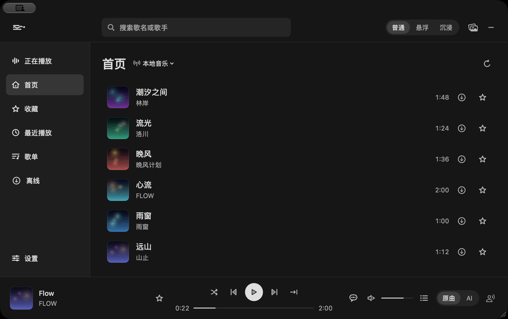
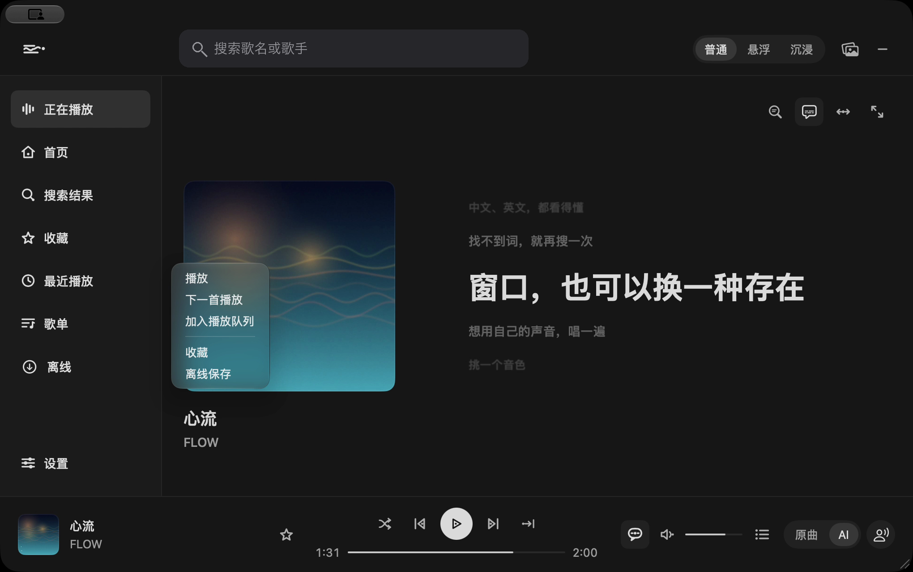
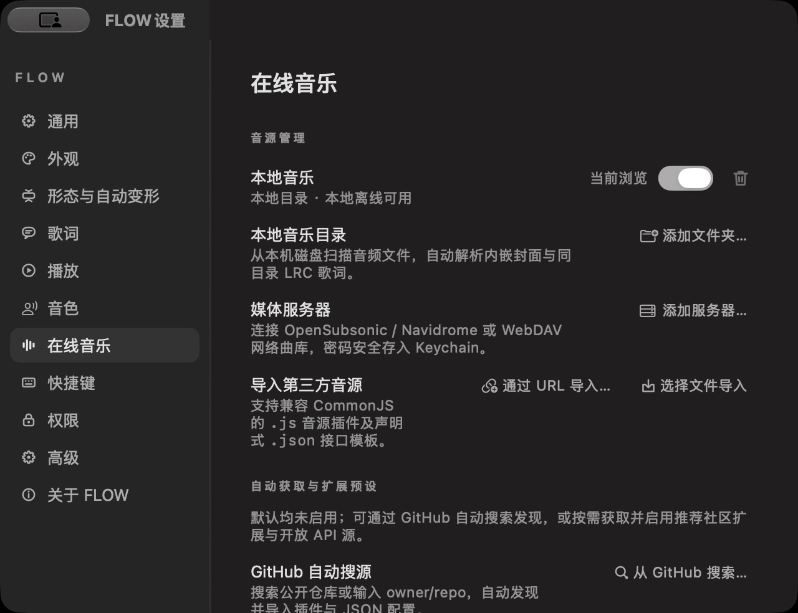

<div align="center">

# FLOW

**一个会自己找位置的 macOS 音乐播放器。**

播放时它待在桌面上；你切到别的应用，它缩成一条歌词；
桌面只剩一条缝，它贴到屏幕边缘；你在全屏工作，它悄悄让开。

同一份播放状态、同一条歌词时间轴，不是三个窗口。

<br>

[](../../releases/latest)
[](#安装)
[](LICENSE)
[](https://mekos2772.github.io/FLOW/play.html)

<br>

**[在浏览器里试玩 →](https://mekos2772.github.io/FLOW/play.html)**
真实播放、逐行歌词、五种形态切换与沉浸场景，不用安装。

<br>



</div>

---

## 它解决什么

大多数播放器只有两种状态：一个占着屏幕的大窗口，或者一个什么也做不了的小条。

FLOW 的窗口是**连续**的。它会读当前桌面还剩多少空间、你正在用什么应用，
然后决定自己该以什么形态存在——不是让你去点「迷你模式」，
也不是弹一个挡住你正在做的事的窗口。

<br>

<table>
<tr>
<td width="50%"><br><sub><b>完整</b> — 封面与歌词并排，逐行点亮</sub></td>
<td width="50%"><br><sub><b>设置</b> — 每个开关都绑定真实行为</sub></td>
</tr>
<tr>
<td><br><sub><b>迷你</b> — 失焦后留下的一条</sub></td>
<td><br><sub><b>胶囊</b> — 只剩当前一句歌词</sub></td>
</tr>
</table>

---

## 功能

**形态**

- 五种形态：完整、迷你、歌词胶囊、贴边、隐匿把手
- 按桌面剩余空间与前台应用自动变形，能不动就不动
- 同一窗口连续插值，不闪白、不抢焦点
- 普通 / 悬浮 / 沉浸三档一键切换
- 沉浸模式四个实时场景（流光、雨窗、远山、光影），颜色取自封面，每拍一道看得见的波

**播放**

- 本地文件夹、OpenSubsonic / Navidrome、WebDAV 三种音源
- 兼容 MusicFree / LX / 声明式 JSON 模板的第三方音源插件，跑在隔离沙盒里
- 从 GitHub 搜索并导入音源，自动识别可用格式
- 跨音源聚合搜索、混队列播放
- 收藏、歌单、最近播放、离线缓存

**歌词**

- 逐行 / 逐字高亮，中英双语同屏
- 本地 `.lrc` 侧车、内嵌标签、插件字幕、AMLL 逐字库、LRCLIB
- 找不到词可以手动搜词并绑定，绑定按曲目记住
- 中文歌词自动转简体，日文原样保留
- 可调偏移，按曲目保存

**FLOW Voice**

- 纯原生 ONNX 推理的 AI 翻唱，不依赖 Python
- 音色可在线检索与导入，转好的音色包放进下载目录会自动识别
- 只在你明确点击时生成，不会在切歌时偷偷跑

---

## 安装

需要 **macOS 14 或更新版本**、**Apple 芯片（arm64）**。

1. 到 [Releases](../../releases/latest) 下载 `FLOW-<版本>-arm64.dmg`
2. 打开 DMG，把 FLOW 拖进「应用程序」
3. **第一次打开要右键 FLOW →「打开」→ 再点「打开」**

第 3 步不是 bug。这个包用 ad-hoc 签名、没有苹果开发者签名与公证，
所以 Gatekeeper 会拦一次。之后正常双击即可。
也可以在「系统设置 → 隐私与安全性」底部点「仍要打开」。

<details>
<summary>为什么不做签名与公证</summary>

<br>

FLOW 是个人维护的开源项目，不做付费的 Apple Developer Program 分发。
ad-hoc 签名能保证应用完整性、也能带上沙盒权限，但没法和公证一起用。

附带影响：没有 Team ID 时 App Group 无法正式授权，
桌面小组件可能读不到播放状态（应用已按「不可用」兜底，诊断里会如实显示）。
</details>

---

## 音源

FLOW **不内置任何商业曲库**，也不收录抓取商业平台的脚本。
干净安装后是空的，需要你自己配置：

| 方式 | 说明 |
|---|---|
| 本地文件夹 | 选一个目录，自动解析内嵌封面与同目录 `.lrc` |
| 媒体服务器 | OpenSubsonic / Navidrome / WebDAV，密码存 Keychain |
| 第三方插件 | 兼容 CommonJS 的 `.js` 音源，跑在隔离沙盒 |
| JSON 模板 | 声明式接口模板，无需执行脚本 |
| GitHub 搜索 | 在应用里搜索公开仓库，自动识别可导入的音源 |

内置三个开放接口模板可直接用：Audius、Radio Browser、Internet Archive。

通过插件播放的内容版权归各自权利人所有，请只使用你有权访问的来源。

---

## 权限与隐私

- **沙盒开启**，不录屏、不读键盘输入
- **辅助功能权限只用来读前台窗口的位置和大小**（为了避让），不读窗口内容
- 未授权时悬浮形态照常工作，只是不做「基于他人窗口」的避让
- 所有网络请求受「允许联网」开关门控
- 隐私模式：歌名、艺术家、歌词全部隐藏或替换为「正在播放」

---

## 已知限制

写在这里是因为它们真实存在，不是免责声明：

- **没有苹果签名与公证**，首次打开需要右键
- **第三方 JS 没有可强制中断的执行时限**，同步死循环可能阻塞导入
- **音色转换需要本地执行一次**：社区只发布 `.pth` 训练权重，
  而 `.pth` 是 Python pickle，读取即执行代码，所以应用不解析它。
  转成 `.voicepack` 只需一次，之后一直可用
- 首次安装、VoiceOver、多显示器热插拔等尚未在真机完整验收

完整清单见 [docs/KNOWN_LIMITATIONS.md](docs/KNOWN_LIMITATIONS.md)。

---

## 自己编译

```bash
# 取回 ONNX Runtime（约 17 MB，来自微软官方 PyPI 包，脚本会校验 SHA-256）
./Scripts/fetch-onnxruntime.sh

# 编译
xcodebuild build -workspace SpatialLyricsPlayer.xcworkspace \
  -scheme SpatialLyricsPlayer -configuration Debug \
  -destination 'platform=macOS,arch=arm64' \
  -derivedDataPath /tmp/slp-dd CODE_SIGNING_ALLOWED=NO

open -n /tmp/slp-dd/Build/Products/Debug/SpatialLyricsPlayer.app
```

没有开发者账号也能编译运行，加 `CODE_SIGNING_ALLOWED=NO` 即可。
这样编出来的应用没有沙盒和 App Group，小组件读不到播放状态，其余功能正常。

```bash
# 单元测试 + 分层检查 + 死代码 + Release 构建
./Scripts/verify.sh

# 打一个 ad-hoc 签名的 DMG
./Scripts/package-release.sh
```

要带签名运行，在 Xcode 里把两个 target 的 Team 改成你自己的，
并把 `com.yg.spatiallyrics` / `group.com.yg.spatiallyrics` 换成你的标识。

---

## 技术

想了解实现的话：

| 文档 | 内容 |
|---|---|
| [docs/ARCHITECTURE.md](docs/ARCHITECTURE.md) | 分层、依赖方向、形态系统与窗口层设计 |
| [docs/ADAPTIVE_ENGINE.md](docs/ADAPTIVE_ENGINE.md) | 自适应引擎：前台判定 → 空间快照 → 求解 → 决策 → 执行 |
| [docs/IMMERSIVE_MODE.md](docs/IMMERSIVE_MODE.md) | 沉浸模式：四个场景、取色、随音乐变化、节拍联动 |
| [docs/FLOW_VOICE.md](docs/FLOW_VOICE.md) | AI 翻唱管线、`.voicepack` 格式与转换 |
| [docs/SOURCE_SPEC.md](docs/SOURCE_SPEC.md) | 第三方音源兼容标准 |
| [docs/DESIGN_SYSTEM.md](docs/DESIGN_SYSTEM.md) | 令牌、曲线、取色算法、组件清单 |
| [docs/HANDOVER.md](docs/HANDOVER.md) | 接手入口：现状、代码地图、工程陷阱、验收手段 |
| [docs/RELEASE_CHECKLIST.md](docs/RELEASE_CHECKLIST.md) | 上线前验证清单与最新测试基线 |

几个关键决策：

1. **播放状态是九态机 + 纯 reducer**，没有可以自由组合的 `isPlaying/isLoading/isBuffering`
2. **进度靠 `PositionAnchor(position, hostTime, rate)`**，不起定时器；所有形态读同一个锚点
3. **空间布局是坐标压缩的极大空矩形 + 多项评分 + 滞回**，目标不是「总取最大矩形」，而是「能不挪就不挪」
4. **五种形态是同一个窗口**：不做「关掉一个窗口、打开另一个」，那必然有重影和抢焦点

工程代号 `FLOW`，包名与 target 仍沿用历史名 `SpatialLyricsPlayer`。

---

## 许可

代码以 [MIT](LICENSE) 许可开源。第三方组件与致谢见 [THIRD_PARTY_NOTICES.md](THIRD_PARTY_NOTICES.md)。

「精选」里的音色卡片只是指向第三方公开发布的模型，部分模仿真实人物或动漫角色（及其声优）的声音。
下载与使用的合法性由你自行负责，请勿用于冒充他人、商业用途或任何侵权场景。
