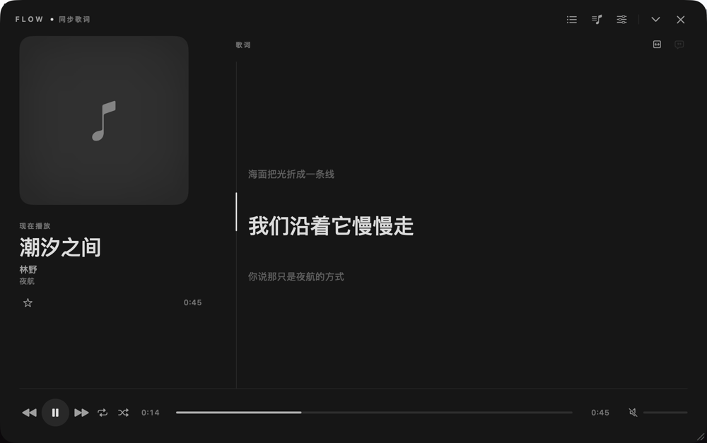
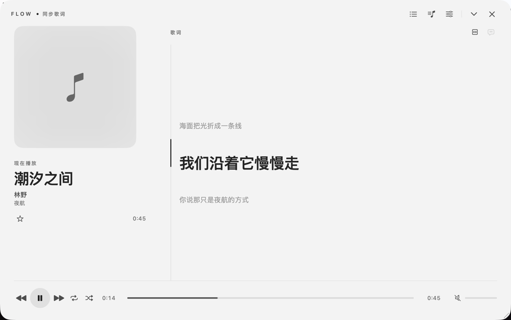
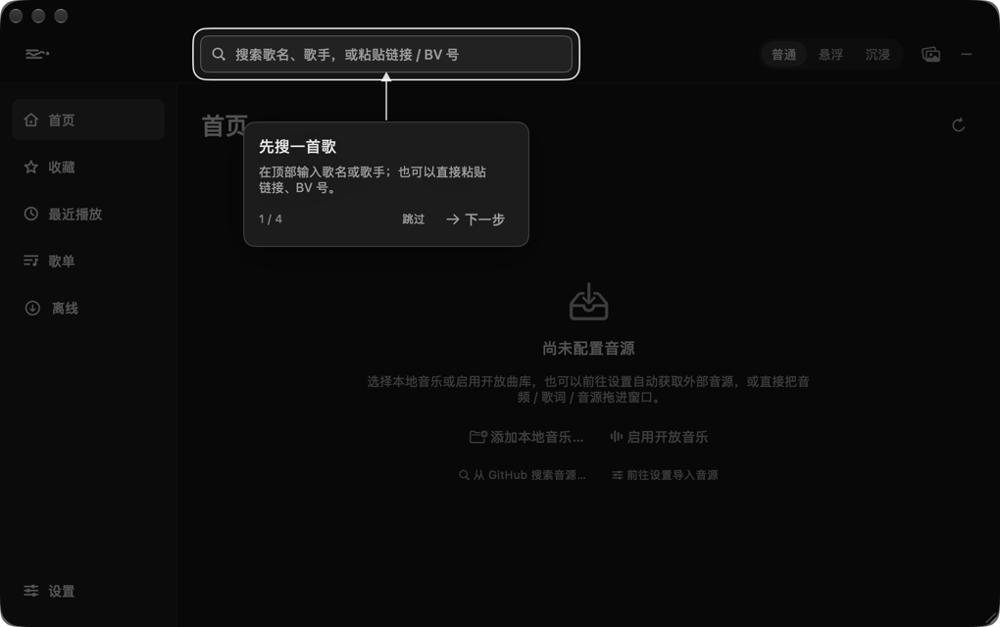
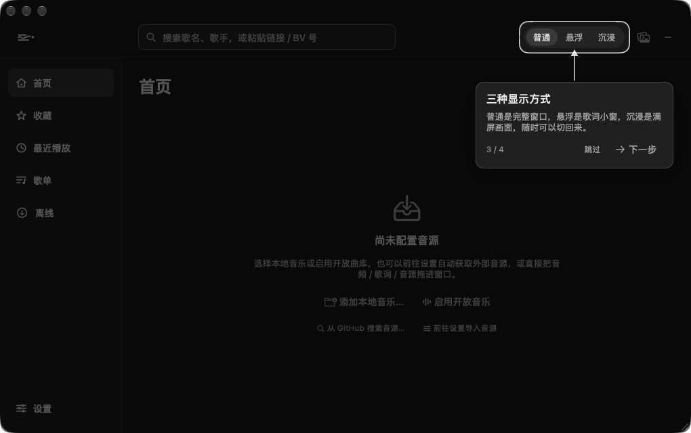

# FLOW — macOS 自适应空间音乐播放器

**整个播放器是一件能在桌面上舒展、收缩、折叠、隐匿的音乐界面。**

用户打开它、选歌、播放；随后它根据用户在做什么、桌面还剩多少空间、
以及用户此前的偏好，自己决定以什么形态存在。所有形态属于同一个窗口、同一份播放状态、
同一条歌词时间轴——不是"主窗口 + 迷你窗口 + 悬浮字幕"三个界面。

工程代号 `FLOW`，包名与 target 仍沿用历史名 `SpatialLyricsPlayer`（避免一次性重命名 e2e 风险）。

## 安装

- 需要 **macOS 14+、Apple 芯片（arm64）**。
- 到 Releases 下载 `FLOW-<版本>-arm64.dmg`，把 FLOW 拖进「应用程序」。
- 安装包**没有**苹果开发者签名与公证：第一次打开时在「应用程序」里**右键 FLOW →「打开」→ 再点「打开」**；
  或打开后到「系统设置 → 隐私与安全性」底部点「仍要打开」。之后正常双击即可。
- 想自己编译，见下面第 4 节。

FLOW 以 [MIT 许可](LICENSE) 开源，第三方组件见 [THIRD_PARTY_NOTICES.md](THIRD_PARTY_NOTICES.md)。
不内置任何商业曲库，也不收录抓取商业平台的脚本；音源由你自己配置（本地文件夹、自建 Navidrome / WebDAV、自行导入的插件）。

> [!IMPORTANT]
> **本次更新重点（2026-11-22 晚）**：
> 1. **AI 翻唱可用性闭环**：拦截原版 HuBERT 误装并校验 ContentVec、`ONNXSineGenSanitizer` 根除静音后锁频杂音、等待流式音频完整落盘后再入队。
> 2. **点击「播放 AI 版」无响应根治**：[`AppContainer.voiceDriver`](DI/AppContainer.swift) 强持有 `VoicePlaybackDriver` 防止弱引用悬空释放，并消除与上下文自动重载的并发抢锁。
> 3. **切回原曲掉源与画面细节修复**：`JSPluginSource` 持久化 `_item` 并兜底恢复历史 `BV`/`aid` 字段，在线源失灵时自动回退本地 `MediaAudioCache` 缓存；`hdslb.com` 封面自动升 HTTPS（防 `-1022 ATS`）；底栏「原曲 / AI」切换胶囊禁止压成 `... | ...`。

> **2026-11-22 全部进展**：
> - **FLOW Voice 全链路闭环与切原曲保活修复**：见上方重点说明与 [FLOW Voice](docs/FLOW_VOICE.md) / [运行时证据第 11 节](docs/RUNTIME_EVIDENCE.md)。
> - **自动避让与冷启动检测加固**：修复冷启动首帧窗口扫描预热与恢复竞态、前台悬浮态定时巡检、切悬浮 6 秒保护期内受遮挡即时同形态让位、连续拖窗 `geometryOnly` 防评估饥饿与动画看门狗收尾（`AutoAvoidanceReliabilityTests` 6 项回归覆盖）。
> - **设置页自动获取音源、FLOW Voice 自动获取与全应用降门槛**：设置页整合「自动获取与扩展预设」（GitHub 自动搜源 + 社区扩展与开放 API 预设按需获取 + jsDelivr CDN 回退，首页空态保持纯净合规）；FLOW Voice 支持三底座模型（`rmvpe` / `hubert` / `MDX`）一键自动获取与在线 RVC 音色检索直连导入（默认国内镜像 `hf-mirror.com`）；主窗口支持全域文件拖放（音频/文件夹/歌词/音源插件/音色模型）与无歌词快捷搜词/多编码导入。
> - **新手引导**：完整播放器第一次打开时用文字卡片 + 箭头依次指出搜索、导航、三档切换、内容区与底栏，可跳过，设置 → 通用 → 上手 可随时重看。
> - **2026-11-21**：右上角新增「普通 / 悬浮 / 沉浸」三档与可换的播放页背景，沉浸播放模式带实时节拍联动（见 [沉浸播放模式](docs/IMMERSIVE_MODE.md)）；**FLOW Voice（AI 翻唱）** 重构为纯原生 Swift + ONNX Runtime（1.32.0）+ Accelerate，三级缓存复用分离/转换/混音结果（见 [FLOW Voice](docs/FLOW_VOICE.md)）。
> - **2026-11-19 / 20**：主窗口改为侧栏导航、顶部搜索、内容区与统一底部播放器，完成**多音源插件化重构**（内置本地音库 / OpenSubsonic / WebDAV，按 [`FLOW Source Spec v1`](docs/SOURCE_SPEC.md) 支持 MusicFree / LX / JSON 模板与订阅清单导入，内置 B 站源剥离至未随包分发的 B 站外部插件（开源前已移出仓库、不再分发））、代码审查 P0/P1/P2 修复与全链路简体中文歌词归一。详见 [多音源标准](docs/SOURCE_SPEC.md)、[主窗口改版与验收记录](docs/archive/UI_REFRESH_2026-11-19.md) 与 [交接文档](docs/HANDOVER.md)。

---

## 1. 五种形态

| 形态 | 尺寸 | 存在方式 | 触发 |
|---|---|---|---|
| **Expanded** 完整 | 1020×640（可缩放，最小 780×480） | 普通窗口，愿意为焦点负责 | 用户主动打开 / 点胶囊 / Dock / 深链 |
| **Compact** 迷你 | 420×80 | 悬浮层，不抢焦点 | 失焦后空间足够 |
| **Capsule** 歌词胶囊 | 392×56（随歌词排布 76/152） | 悬浮层，单击展开 | 失焦后空间一般 |
| **Edge** 贴边 | 300×34 | 悬浮层，贴最近屏边 | 只剩窄缝 |
| **Dormant** 隐匿 | 26×26 把手 或 完全下屏 | — | 全屏应用 / 空间不够 / 用户隐藏 |

以下为历史形态截图（示例曲目为虚构的「潮汐之间」），保留在 [`docs/screenshots/flow/`](docs/screenshots/flow)：

| 完整（深色） | 完整（浅色） |
|---|---|
|  |  |

| 迷你 | 胶囊 | 贴边 | 双行歌词 |
|---|---|---|---|
|  |  |  |  |

首次打开的新手引导（文字 + 箭头，可跳过，设置里可重看）：

| 第 1 步：搜索 | 第 3 步：三种显示方式 |
|---|---|
|  |  |

---

## 2. 主窗口：清楚导航，减少干扰

采用 Apple Music 的简洁感与 Spotify／QQ 音乐清楚的导航、统一播放栏，不复制广告、会员或社区区块：

- **固定侧栏**：首页、搜索结果、收藏、最近播放、歌单、离线、正在播放、设置；搜索结果在提交搜索后出现，正在播放在有当前歌曲时出现。
- **紧凑顶部搜索**：按确认后的歌名匹配；切换页面保留搜索词和结果，不停止音乐、不重置进度或队列。
- **统一底部播放器**：歌曲信息、播放控制、进度、音量、歌词与队列入口；没有当前歌曲时不显示空播放条。
- **多音源可扩展架构与多配置兼容**：首发不内置任何商业或第三方版权曲库，干净启动后提供「尚未配置音源」引导，按需配置 **本地音库**（文件夹安全书签 / `.lrc` 侧车歌词 / Finder 打开音频）、**OpenSubsonic / Navidrome**、**WebDAV**，或依据 [`FLOW Source Spec v1`](docs/SOURCE_SPEC.md) 导入 **JS 插件**（隔离 `JavaScriptCore` 沙箱，兼容 CommonJS、MusicFree TypeScript 编译产物/`Parcel` 多导出/`cheerio`/`dayjs`/`he`/`qs`/`webdav`/`CryptoJS`/`userVariables` 及 LX `globalThis.lx`）、**声明式 JSON 模板**（含直链模式、JSONP 与多路径回退，如 [`external-plugins/examples/`](external-plugins/examples) 中的 Audius / Radio Browser / Internet Archive）或 **GitHub/社区订阅清单与服务器预设 JSON**；原 B 站实现已完全剥离为未随包分发的外部示例插件 B 站外部插件（开源前已移出仓库、不再分发）。
- **搜索与跨源混排**：搜索栏支持单源 / 全源聚合切换与来源角标；支持本地音频与远程音源同队列混播、统一缓存与手动 AMLL/LRCLIB 搜词绑定。
- **歌单直接嵌入内容区**：支持新建、选择、单首播放、播放全部、加入当前曲目、移除和排序；删除需确认。
- **主次分明**：页面标题 26pt、歌名 16pt、导航／控件 14pt、次要信息 13pt；删去重复说明、重复时长与“接下来”小字。
- **中性深浅色**：主窗口使用不透明底色，不加大面积光晕；悬浮形态保留原有材质。队列／设置／校准浮层不盖住底栏。
- **宽窄布局**：默认 1020×640，原生拖窗最小 780×480；矮窗口收紧导航与内容间距，保持歌单行和底栏可见。
- **普通 / 悬浮 / 沉浸**：播放器右上角三档一键切换。悬浮 = 桌面歌词胶囊（点一下回到普通）；沉浸默认全屏、Esc 退出，歌词区右上角 ⤢ 是快捷入口。
- **沉浸播放**：四个原创实时场景可选：流光、雨窗、远山、光影。颜色取自封面，背景随音乐的能量、低频与段落起伏变化，每拍一道看得见的波（节拍联动可调：关 / 克制 / 适中 / 明显）；歌词只显示焦点附近四行，间奏时显示倒计时点。
- **播放页背景**：右上角「背景」画廊里选纯色、封面取色或四个场景之一，和沉浸共用；封面与歌词并排居中，随窗口按比例放大。详见 [docs/IMMERSIVE_MODE.md](docs/IMMERSIVE_MODE.md)。

排版与组件样式集中在 [`DesignSystem/Tokens.swift`](DesignSystem/Tokens.swift) 和
[`DesignSystem/FlowComponents.swift`](DesignSystem/FlowComponents.swift)。歌曲确认是元数据匹配，不是音频指纹；
严格规则可能使推荐为空或漏掉可播放歌曲，不能宣称所有搜索结果都可用。

---

## 3. 架构

```
App ─┬─ Morph  ← 形态窗口（唯一窗口）
     ├─ MenuBar / Settings（SwiftUI 场景）
     ↓
UI(Expanded/Compact/Floating) ─ Metadata
     ↓
Morphology（纯逻辑）   Spatial（空间事实）   Lyrics   Playback
     ↓                     ↓                    ↓        ↓
DesignSystem          ScreenGeometry        Sources  Persistence
     ↓
    Core
```

| 目录 | 职责 |
|---|---|
| `Morph/` | **窗口层**：`MorphPanel`（唯一 NSPanel）、`MorphWindowController`（把状态机/几何/视图接起来）、`MorphRootView`（一个视图树按形态分发）、`MorphPresentationModel`（界面唯一投影） |
| `Morphology/` | **纯逻辑**：形态定义与几何规格、状态机、空间决策引擎、窗口几何解析、过渡计划。全部可在无窗口环境下单测 |
| `Spatial/` | 屏幕安全区、AX 窗口几何、极大空矩形、放置评分、空间事件状态机 |
| `Overlay/` | 只剩 `LyricsShape`（歌词排布）、`LyricsOpacity`、`FloatingLyricsControlling` 协议、文案 |
| `UI/Expanded` | 主窗口框架、侧栏／搜索、首页／收藏／最近播放、共享歌曲行、歌词区、统一底部播放器与次级抽屉 |
| `UI/Settings` | 设置窗：左侧分区 + 右侧"标题/说明/控件"行，全部走令牌 |
| `UI/Compact` `UI/Floating` | 迷你条、胶囊/双行/歌词板/贴边/隐匿把手 |
| `Playback/` `Lyrics/` `Sources/` `Persistence/` | 播放内核、歌词引擎、音源抽象、SwiftData |
| `DesignSystem/` | 令牌与基础组件，所有界面的唯一取值来源 |

单向依赖由 [`Scripts/architecture-lint.sh`](Scripts/architecture-lint.sh) 与
`ArchitectureBoundaryTests` 强制：表现层不得引用具体音源/播放器，生产目录禁止裸 `DispatchQueue`。

### 四条关键决策

1. **播放状态是九态机 + 纯 reducer**：`(state, event) → (newState, [Effect], accepted)`。
   没有可以自由组合的 `isPlaying/isLoading/isBuffering`。
2. **进度靠 `PositionAnchor(position, hostTime, rate)`**：不起定时器；`rate = 0` 冻结。
   主窗口、迷你条、胶囊、菜单栏、小组件读同一个锚点。
3. **空间布局是坐标压缩的极大空矩形 + 多项评分 + 滞回**
   （Debounce 100ms / Snap 12pt / MinimumImprovement 15% / MorphologyCooldown 350ms，
   数值以 `Spatial/PlacementSolver.swift` 与 `Morphology/MorphologyTuning.swift` 为准）。
   目标不是"总取最大矩形"，而是"能不挪就不挪"。
4. **五种形态是同一个窗口**：`MorphologyEngine` 只产出"该长成什么样"，
   `WindowGeometryResolver` 只产出"该是什么矩形"，`MorphologyStateMachine` 只管"允不允许变"。
   窗口层把三者接起来，用 AppKit 的帧动画做连续插值，内容同步交叉淡入淡出。
   **不做"关掉一个窗口、打开另一个窗口"**——那必然会有重影、闪白和抢焦点。

---

## 3.4 出错时会发生什么

规格 8.4 要求"不能静默吞掉异常"。任何播放失败都会在**完整形态传输带上方**出现一条错误条：

```
⚠ 音频解不开
  下载下来的音频读不出来。重试会重新下载，也可以换一首。   [↻ 重试] [⏭ 跳过]
```

- 文案由 `PlaybackError` 的 `title` / `detail` 提供（**同一句话**给完整播放器、胶囊、菜单栏用，
  不允许三处各写一份）；
- 「重试」只在真的值得重试时出现（格式不支持就不给重试按钮，只给跳过）；
- 胶囊与菜单栏会把错误标题放在歌词位置，点开完整播放器看详情；
- 播放恢复正常后错误条自动消失（`clearErrorIfRecovered`）。

## 3.5 设置（⌘,）

十一个分区：通用 / 外观 / 形态与自动变形 / 歌词 / 播放 / 音色 / 在线音乐 / 快捷键 / 权限 / 高级 / 关于。
**每个开关都绑定真实行为**，没有装饰性控件：

| 设置 | 真实效果 |
|---|---|
| 按空间自动变形 | 关闭后空间变化不再改形态（决策被 `autoMorphDisabled` 拒绝） |
| 形态过渡速度 0.5×–1.5× | 直接缩放变形时长 |
| 冷启动形态 | 没有位置记忆时落到该形态 |
| 悬浮歌词排布 / 隐匿策略 / 锁定形态 / 鼠标穿透 / 锁定位置 | 作用于同一个 `MorphControlling` |
| 悬浮不透明度 / 字号 / 行距 / 默认音量 / 到点淡出 | 写存储并立即作用于界面 |

`README` 里不重复设置清单，实现见 `UI/Settings/SettingsView.swift`。

## 3.6 全局快捷键

| 组合 | 作用 |
|---|---|
| `⌃⌥K` | 切换形态（宽松顺序循环） |
| `⌃⌥L` | 鼠标穿透开关 |
| `⌃⌥H` | 显示 / 隐藏 |

以上是默认组合，可以在设置的「快捷键」分区点击后按下新组合修改，也能逐项恢复默认（`Integration/HotkeyPreferences.swift`）。
该分区会显示 Carbon **实际注册成功**的数量（`3 / 3`）；少于 3 说明组合被系统或其它应用占用。走的是公开的 `RegisterEventHotKey`，
沙盒可用，不需要辅助功能权限。

## 3.7 连续二维布局

放置不再枚举四角：`ContinuousPlacementSolver` 对每个自由矩形生成连续候选
（当前位置投影、锚点投影、梯度位、贴边吸附），用统一评分挑选。
详见 [docs/CONTINUOUS_PLACEMENT.md](docs/CONTINUOUS_PLACEMENT.md)。

## 3.8 自适应引擎（空间避让）

前台判定（边沿触发）→ 空间快照 → 空白矩形求解 → 形态决策 → 窗口执行，整条闭环的
故障定位与验收记录见 [docs/ADAPTIVE_ENGINE.md](docs/ADAPTIVE_ENGINE.md)。

关键约定：

- **"我在前台"只认 `NSWorkspace.frontmostApplication`**，不认 `NSApplication` 的激活通知
  （面板 `orderFront` 也会触发后者）；
- 引擎判断"当前位置能不能留"时同时看**遮挡比例**，不是只看"形态放不放得下"；
- 移动与降级分开：先移动（要求遮挡改善 ≥15%），不行再降形态。

## 4. 构建、测试、运行

| 项 | 值（实测） |
|---|---|
| Xcode | 27.2 (27B52) |
| Swift | 6.4.2（`SWIFT_STRICT_CONCURRENCY=complete` + 警告即错误） |
| 部署目标 | macOS 14.0+ |
| 单元测试 | 最新条数见 [上线清单](docs/RELEASE_CHECKLIST.md)（`verify.sh` 会核对清单里的数字与实测一致） |
| 代码覆盖率 | 见 [`docs/evidence/coverage.txt`](docs/evidence/coverage.txt)（唯一权威来源） |
| 构建与检查 | Debug 单元测试通过、Release 构建通过（`0` 警告）、`architecture-lint` / `dead-code-scan` / `check-doc-numbers` / `git diff --check` 通过 |
| 运行时警告 | 测试运行日志仍含少量既有 Swift 6 `@MainActor` 测试隔离告警与持久化退出的 QoS 提示；Release 主产物 0 警告 |

历史改版记录与命令边界见 [2026-11-19 验收记录](docs/archive/UI_REFRESH_2026-11-19.md)（已归档）。

第一次编译前先取回 ONNX Runtime（约 17MB，来自微软官方 PyPI 包，脚本会校验 SHA-256；仓库里只放头文件）：

```bash
./Scripts/fetch-onnxruntime.sh
```

没有苹果开发者账号也能编译运行：命令行加 `CODE_SIGNING_ALLOWED=NO`。这样编出来的应用没有沙盒和 App Group（桌面小组件读不到播放状态），其余功能正常。
要带签名运行，在 Xcode 里把两个 target 的 Team 改成你自己的，并把 `com.yg.spatiallyrics` / `group.com.yg.spatiallyrics` 换成你的标识（`Config/*.entitlements`、`Shared/AppGroup.swift`）。

```bash
# 编译（本机无签名身份时必须加 CODE_SIGNING_ALLOWED=NO）
xcodebuild build -workspace SpatialLyricsPlayer.xcworkspace \
  -scheme SpatialLyricsPlayer -configuration Debug \
  -destination 'platform=macOS,arch=arm64' \
  -derivedDataPath /tmp/slp-dd CODE_SIGNING_ALLOWED=NO

# 单元测试
xcodebuild test -workspace SpatialLyricsPlayer.xcworkspace \
  -scheme SpatialLyricsPlayer -configuration Debug \
  -destination 'platform=macOS,arch=arm64' \
  -derivedDataPath /tmp/slp-dd \
  -only-testing:SpatialLyricsPlayerTests CODE_SIGNING_ALLOWED=NO

# 一键验证（单测 + 分层 + 死代码 + Release 构建；--quick 跳过构建）
./Scripts/verify.sh

# 打包给别人的 DMG（ad-hoc 签名，产物在 dist/）
./Scripts/package-release.sh

# 实网运行 GitHub 插件与开放 API 多配置端到端兼容测试（12 条全通）
TEST_RUNNER_SLP_LIVE_TEST=1 SLP_LIVE_TEST=1 xcodebuild test \
  -workspace SpatialLyricsPlayer.xcworkspace \
  -scheme SpatialLyricsPlayer -destination 'platform=macOS,arch=arm64' \
  -derivedDataPath /tmp/slp-dd \
  -only-testing:SpatialLyricsPlayerTests/MultiConfigCompatTests CODE_SIGNING_ALLOWED=NO

# 分层检查
./Scripts/architecture-lint.sh

# 死代码扫描（零引用的类型；输出非空需人工复核）
python3 Scripts/dead-code-scan.py

# 运行
open -n /tmp/slp-dd/Build/Products/Debug/SpatialLyricsPlayer.app
```

### 调试开关（只读环境变量，不影响任何业务判断）

| 变量 | 作用 |
|---|---|
| `SLP_SPATIAL_DEBUG=1` | 每次形态决策向 stderr 打印 `current/recommend/reason/rejected/note/zone/obstacles`；变形过程按 60ms 采样打印真实窗口帧 |
| `SLP_DEBUG_MORPH=<形态>` | 启动后切到指定形态（走真实的用户意图事件） |
| `SLP_DEBUG_PLAY=1` | 启动后播放库中第一首（走真实播放链路） |
| `SLP_DEBUG_DORMANT_HANDLE=1` | 隐匿时保留边缘把手 |
| `SLP_DEBUG_APPEARANCE=light\|dark` | 强制浅/深色，用于截图复核 |
| `SLP_DATA_DIR=<目录>` | 隔离运行：数据、缓存与偏好设置都落在这个目录，不碰真实数据 |

完整列表（含 Debug 验收驱动器 `SLP_QA_DIR`）见 [交接文档](docs/HANDOVER.md) 第 2 节。

### 深链

```
spatiallyrics://now                 # 展开完整播放器
spatiallyrics://toggle-floating     # 切换悬浮可见性
spatiallyrics://morph/capsule       # 指定形态：expanded|compact|capsule|edge|dormant
spatiallyrics://shape/doubleline    # 指定悬浮歌词排布：capsule|edge|doubleline|board
```

---

## 5. 权限与隐私

- 在线搜索、取流、封面和歌词仅在开启网络且用户配置远程音源或查询歌词（如用户自建服务器、自行导入的插件域、AMLL/LRCLIB）时发出网络请求；设置页「自动获取」会访问 `api.github.com`（失败回退 `cdn.jsdelivr.net`），FLOW Voice 会访问 `huggingface.co` / `hf-mirror.com` / `api.github.com` 检索和下载模型。全部受「允许联网」开关门控（正式版默认开启）。不内置商业曲库，不录屏、不读键盘输入；沙盒开启。
- 辅助功能权限**只**用于读取前台应用窗口几何（`AXWindow` 的 position/size）。
  未授权时：悬浮形态照常、安全区与多屏记忆照常，只是不做"基于他人窗口"的避让。
- 前台窗口过滤规则：只认 `role == AXWindow` 且 `subrole != AXDesktop`。
  桌面本身也是 Finder 的一个 AX 元素且铺满全屏，把它当障碍物会让播放器一切走就隐匿（实测踩过）。
- 隐私模式：标题/艺术家/歌词（含默认滚动歌词与编辑式歌词）全部隐藏或替换为本地化「正在播放」，封面不加氛围色；所有中文歌词（含插件字幕、本地 LRC 与 LRCLIB/AMLL）均自动转为简体（真实日文歌词原样保留）。

---

## 6. 已知限制（诚实清单）

详见 [docs/KNOWN_LIMITATIONS.md](docs/KNOWN_LIMITATIONS.md) 与
上线前检查清单 [docs/RELEASE_CHECKLIST.md](docs/RELEASE_CHECKLIST.md)、
审查报告 [docs/AUDIT_REPORT.md](docs/AUDIT_REPORT.md)、
全流程体验 [USER_WALKTHROUGH](docs/archive/USER_WALKTHROUGH.md)（2026-11-16，B 站时代，已归档）。当前最重要的空白：

- **正式 XCUITest 未执行**：2026-11-19 通过原生窗口交互验收，2026-11-20 补齐单元测试与构建验证，未运行 `SpatialLyricsPlayerUITests`。
- **真实取流已静音验证，听感未验收**：已观察到播放进度、歌词和 seek 响应；未验证音质、可听连续性或淡入淡出的听感。
- **严格过滤有覆盖率代价**：推荐可能筛空，元数据确认不能保证音频内容百分之百匹配；多曲歌单排序主要由单测覆盖，未完成实机拖拽演示。
- **2026-11-20 已闭环此前登记的四项独立审查问题与全套 P0/P1/P2 修复**：已修复默认滚动歌词隐私遮罩失效、「允许联网」开关双向失效、恢复重试强制自动播放与断点丢失、动画 watchdog 与 `CADisplayLink` 生命周期、队列多批保存等待、菜单栏/小组件未确认标题暴露、错误与兜底文案本地化，以及全链路歌词简体归一（由 `ReviewRegressionTests` 16 条单测覆盖；详见 [交接日志](docs/archive/HANDOVER_LOG.md) 第 205 节）。
- **多显示器热插拔**：只有一块屏，逻辑有测试，真机未插拔。
- **全屏应用隐匿**：判定链有测试，真实全屏未进入（AX `AXFullScreen` 两次读回 false）。
- **小组件**：App Group 需签名，未在真机添加过。
- **FLOW Voice 已重构为纯原生 Swift + ONNX Runtime（1.32.0）+ Accelerate**：彻底移除 Python 运行时与 `.pth` pickle 解析，社区模型需先由 `Tools/rvc-converter/` 转为安全 `.voicepack` / `.onnx`；实际含伴奏歌曲听感待真机人工试听。详见 [docs/FLOW_VOICE.md](docs/FLOW_VOICE.md)。
- **VoiceOver**：只做了标注与断言，未人工走查。
- **胶囊/贴边的二级降级**：实测到"完整 → 迷你"，更细的逐级降级在测试里覆盖。

---

## 7. 许可与使用须知

- 代码：[MIT](LICENSE)。第三方组件与致谢：[THIRD_PARTY_NOTICES.md](THIRD_PARTY_NOTICES.md)。
- 「精选」里的音色卡片只是指向第三方公开发布的模型，部分模仿真实人物或动漫角色（及其声优）的声音。下载与使用的合法性由你自行负责，请勿用于冒充他人、商业用途或任何侵权场景。
- 通过音源插件播放的内容版权归各自权利人所有，请只使用你有权访问的来源。

## 8. 文档地图

**先读**

| 文档 | 内容 |
|---|---|
| [docs/HANDOVER.md](docs/HANDOVER.md) | 接手者入口：现状、代码地图、工程陷阱、实机验收手段、现行规则出处 |
| [docs/RELEASE_CHECKLIST.md](docs/RELEASE_CHECKLIST.md) | 上线前验证清单与**最新测试基线**（测试条数只写在这里） |
| [docs/KNOWN_LIMITATIONS.md](docs/KNOWN_LIMITATIONS.md) | 全部已知限制与没验证的部分，逐条带原因 |
| [docs/NEXT_STEPS.md](docs/NEXT_STEPS.md) | 下一步优先级 |

**功能与设计**

| 文档 | 内容 |
|---|---|
| [docs/FEATURE_MATRIX.md](docs/FEATURE_MATRIX.md) | M / P1 / P2 功能对照表与落地状态 |
| [docs/ARCHITECTURE.md](docs/ARCHITECTURE.md) | 分层、依赖方向、形态系统与窗口层设计 |
| [docs/SOURCE_SPEC.md](docs/SOURCE_SPEC.md) | `FLOW Source Spec v1`：外部 JS（MusicFree / LX）与 JSON 模板 / 订阅导入兼容标准 |
| [external-plugins/README.md](external-plugins/README.md) | 未随包分发的外部插件与 Audius / Radio Browser / Internet Archive 示例模板 |
| [docs/IMMERSIVE_MODE.md](docs/IMMERSIVE_MODE.md) | 沉浸播放模式：画面原则、四个场景、取色、随音乐变化与节拍联动、歌词、三档切换、播放页背景与版面、性能与验证 |
| [docs/FLOW_VOICE.md](docs/FLOW_VOICE.md) | FLOW Voice：纯原生 ONNX + Accelerate 翻唱管线、`.voicepack` 转换与三级缓存 |
| [docs/DESIGN_SYSTEM.md](docs/DESIGN_SYSTEM.md) | 令牌表、曲线分档、取色算法、组件清单 |
| [docs/MONOCHROME.md](docs/MONOCHROME.md) | 黑白版面的配色与层级规则 |
| [docs/BACKGROUND_APPEARANCE.md](docs/BACKGROUND_APPEARANCE.md) | 悬浮形态按壁纸亮度自动切换深浅 |
| [docs/PERMISSIONS_AND_SANDBOX.md](docs/PERMISSIONS_AND_SANDBOX.md) | 权限、沙盒与 entitlements 说明 |

**空间避让与形态**

| 文档 | 内容 |
|---|---|
| [docs/ADAPTIVE_ENGINE.md](docs/ADAPTIVE_ENGINE.md) | 自适应引擎闭环：前台判定 → 空间快照 → 求解 → 形态决策 → 窗口执行 |
| [docs/CONTINUOUS_PLACEMENT.md](docs/CONTINUOUS_PLACEMENT.md) | 连续二维落点的设计 |
| [docs/SPATIAL_RESPONSIVENESS.md](docs/SPATIAL_RESPONSIVENESS.md) | 变形与遮挡响应的卡顿治理 |

**证据与审查**

| 文档 | 内容 |
|---|---|
| [docs/AUDIT_REPORT.md](docs/AUDIT_REPORT.md) | 审查发现的问题与修复状态、证据图索引 |
| [docs/CODE_AUDIT_2026-11-21.md](docs/CODE_AUDIT_2026-11-21.md) | 2026-11-21 全量代码审计：P1×10 / P2×38 / P3×9 逐项证据、触发路径与修复建议 |
| [docs/RUNTIME_EVIDENCE.md](docs/RUNTIME_EVIDENCE.md) | 实测证据（含失败实验与被推翻的假设） |
| [docs/evidence/coverage.txt](docs/evidence/coverage.txt) | 覆盖率测量（唯一权威来源） |

**历史**：[docs/archive/](docs/archive/README.md) 里是不再随代码更新的文档——交接日志（2026-11-14 – 11-20 的逐次改动，其他文档里的"第 N 节"都指它）、按日期的评审与验收报告、测试套件历史，以及 B 站时代的资料。
