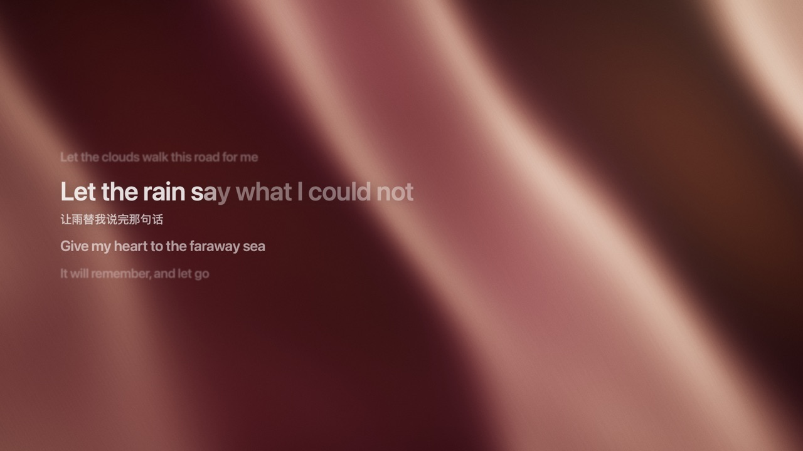
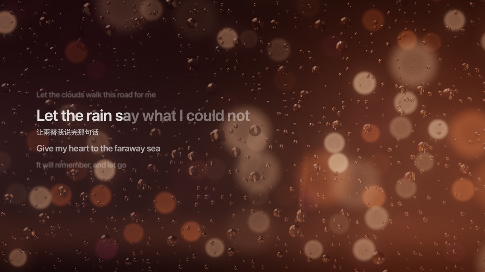
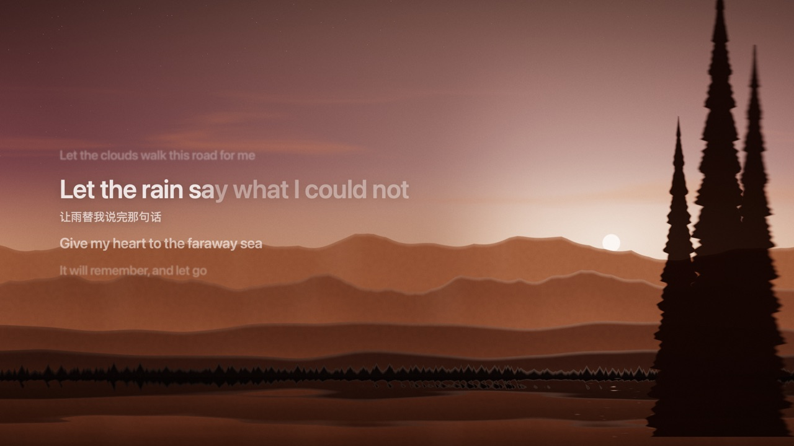
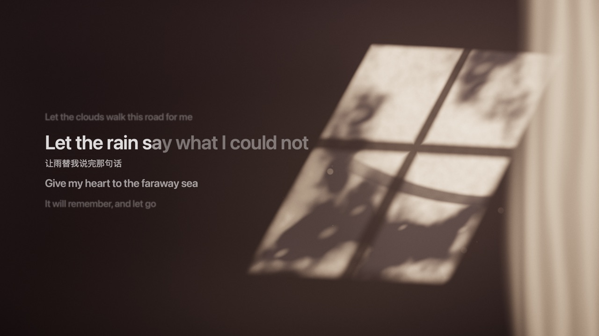
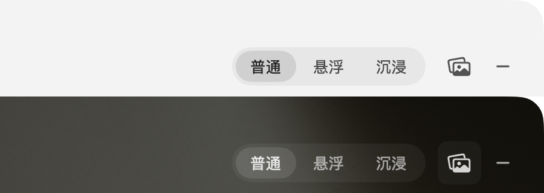

# 沉浸播放模式

完整播放器右上角的三档切换「普通 / 悬浮 / 沉浸」点「沉浸」进入（歌词区右上角的 ⤢ 是快捷入口）：整窗（默认全屏）只留一个会动的原创场景、几行歌词和一枚会自己隐去的播放胶囊。按 Esc、点「普通」或右上角的收拢按钮退出；点「悬浮」直接收成桌面歌词胶囊。四个场景同时也是普通播放页可选的背景（见第八节）。

目标是达到 Wallpaper Engine 成品级的完成度，但画面全部原创：所有画面都由着色器实时生成，不使用任何外部图片或视频素材；颜色取自当前封面；音乐改变光线、风和"每拍一道波"，不改变构图。

截图（2026-11-21，Apple M4、1920×1080 1× 外接屏、全屏）。用户看过这四张全屏截图后确认四个场景都达到了要的成品级：

| 流光 | 雨窗 |
|---|---|
|  |  |
| **远山** | **光影** |
|  |  |

间奏时的倒计时点：`screenshots/immersive/05-interlude.jpg`（全屏）；暂停时胶囊与右上角按钮（三档切换、背景、退出）常显：`screenshots/immersive/06-paused-chrome.jpg`（截图已从公开仓库移除）（窗口 1440×900，2× 屏）。

---

## 一、先看了什么：Wallpaper Engine 参考

调研了 20 个高订阅作品，覆盖 6 种风格，其中大部分带官方人工挑选的 Approved 标签。每个作品都看了 Steam 预览图与作者说明，只用来提炼原则，不复刻任何画面。

| 风格 | 代表作品 | 学到的东西 |
|---|---|---|
| 写实 / 电影感 | Rainy Day（348 万订阅）、Into The Woods、Mt. Fuji | 水滴是"透镜"而不是贴纸；主体不动，只让雾、水、雨这一两样东西动；近景压框拉开纵深 |
| 插画视差 | A Lonely Winter、Blue Sky、Kimi no Na wa、Windy | 一个色相家族；大面积负空间；唯一的高亮焦点；动势统一朝一个方向 |
| 抽象 / 生成 | Colorful Fluid、Angled Waves | 流体要有惯性；层叠 + 柔和投影就能做出纵深；彩虹色 + 快速运动是最容易显廉价的组合 |
| 克制的音频响应 | Lonely Cat、Bunk、sonic-topography | 音乐响应只占很小的面积，或者做成场景里的物体；低频驱动"地面"，高频只触发稀疏事件；无声时保持呼吸 |
| 像素 / Lo-fi | Aesthetic City、Lofi Cafe | 动的东西极少，靠零星的灯维持"活着"；冷暖对比两件事就够 |
| 极简 / 光与材质 | Foggy Forest、SandBlack、Still | 质感来自颗粒和光本身；配色低饱和 |

另外读了 AMLL（Apple Music-like Lyrics）的背景渲染器源码，以及 Apple Music 网页版歌词背景的公开逆向分析。由此得到两个技术取舍：取色用 OKLab 聚类，渐变必须加抖动去色带。

## 二、FLOW 的画面原则（都落到了代码里的具体数字）

1. **只让一两样东西动**。流光只有褶皱在动；雨窗只有水滴和灯；远山只有雾和水；光影只有树影和浮尘。
2. **运动低频、低幅**。最快的大尺度运动也要十几秒才走完一屏。视差漂移一圈 53 秒和 71 秒（两轴不同步），鼠标视差平滑 1.2 秒。
3. **每个场景至少三层纵深**，视差按层递增。远景几乎不动，近景动得最多。
4. **颜色全部来自封面**，按角色约束明暗和彩度（见第四节）。在线性空间混合，经柔和的胶片曲线、24 帧颗粒和三角抖动输出。
5. **音乐只改"光"、"风"和场景里本来就会动的东西，不改构图**（见第五节）。跟拍子的动作是形状的运动（波、涟漪、推），不是整幅明暗的一闪一闪。
6. **歌词放在负空间**。四个场景都把主光和主体放在右侧，左侧留给歌词，着色器在歌词区按背景亮度自适应压暗。
7. **换歌、换场景都是长而软的交叉淡化**：换场景 1.2 秒，换歌 2.4 秒，两端都缓。

## 三、四个场景

| 场景 | 画面 | 纵深层次 | 材质 | 跟音乐 |
|---|---|---|---|---|
| **流光**（默认） | 一匹缎子在暗房里被侧光照着缓慢起伏 | 褶皱主体 → 近处一层几乎看不见的薄纱 → 光源方向的淡体积光 | 三道低频褶皱 + 一层更低频扭曲；漫反射 + 两档柔高光 + 掠射角光泽 + 沿褶皱方向的纱线细纹；右上暖主光、左下冷补光 | 能量调流速；段落起伏调主光；低频与起音只让光轻轻呼吸 |
| **雨窗** | 夜里隔着带雨的玻璃看街口 | 远街散景（大小近乎一致，像镜头对焦在玻璃上）→ 玻璃内侧薄雾 → 静止水珠 → 走走停停的滑落水滴与水痕 | 水珠是短焦透镜：里面是倒置、更清楚的街景缩影，下沿全反射的暗边，上沿一点高光；散景亮度"少数很亮、多数很暗" | 街灯按低 / 中 / 高三个频段分组呼吸；能量越高雨越密；歌词背后的灯自动少一些、暗一些 |
| **远山** | 日落后的层峦、山谷雾、林线与静水 | 天空 → 五层山（空气透视：越远越接近天色）→ 每层山脚沉进山谷雾 → 尖顶针叶林线 → 右缘三株失焦的近景冷杉 → 倒影湖面 | 山脊迎光面一道细亮边；纸面肌理；冷杉枝层带斜缺口（全屏放大也没有水平硬切边） | 段落起伏改变余晖；能量调雾的流速；高频让星星和水面碎光闪；起音让波纹活一点 |
| **光影** | 午后的阳光穿过窗外的树，落在灰泥墙上 | 墙 → 斜切的四格窗光 → 叶团阴影与叶隙光斑 → 光柱里的两层浮尘 → 右缘被透亮的纱帘 | 叶隙光斑是顺光线拉长的椭圆"小太阳"；灰泥起伏只在被光扫到处显出；阴影里带叶绿和天光的冷色 | 能量越高风越大；起音像一阵轻风；段落起伏让日光时强时弱；中频调浮尘漂移 |

场景在沉浸页右上角的「背景」画廊里点选（缩略图用当前封面的颜色渲染），也可以在设置 → 外观 → 沉浸模式里选。普通页选了某个场景当背景，沉浸用的也是同一个场景。

> 曾尝试过第五个场景"火车驶过大桥"（云海、雪山、峡谷、大海依次循环）。成片偏扁平，按用户意见搁置，没有进入工程。

## 四、色彩：从封面取五个"角色色"

`UI/Immersive/ImmersivePalette.swift`

- 封面缩到 40×40，在 OKLab 里做确定性 k-means（6 簇，按明度分位数取初值，同一张图每次结果一致）。
- 按"面积 + 彩度 + 明暗"分配五个角色：底色（偏暗且有面积）、主体（面积最大）、辅色（与主体色相差最远）、点缀（彩度 × √面积最高）、光色（最亮）。
- **每个角色的明度固定、彩度设上限**：底色 L 0.16 / C ≤ 0.040，主体 L 0.29 / C ≤ 0.075，辅色 L 0.38 / C ≤ 0.090，点缀 L 0.64 / C ≤ 0.120，光色 L 0.90 / C ≤ 0.055。所以任何封面出来的画面都落在同一个可读的亮度结构里：颜色只决定"是什么色调"，不决定"有多亮多艳"。超出色域时保持明度、逐步收彩度。
- **单色调封面补冷暖对比**：主体、辅色、点缀几乎同一色相时（相差不到 40°），把点缀色相转 160°、彩度压到 0.05，作为辅色，只出现在暗部、补光和天顶里。这是电影调色"暖高光、冷阴影"的老办法。用真实封面复核时发现了这个问题：《魔杰座》几乎全是金棕色，四个场景跟着变成一片深浅金色。灰阶封面不补，保持中性。
- 用六张故意刺眼的合成封面验证过：红蓝撞色、霓虹粉青、纯黄、白底极简、照片感日落、森林。输出都收敛成可长期观看的色调，又各自保留了封面色相；灰阶封面保持中性。
- 没有封面或开了隐私模式时，用默认的暮色靛蓝配琥珀光。

## 五、随音乐变化

音频链路：播放抽头 → 分频段电平 → 共享电平表 → 驱动器 → 着色器参数。

- **抽头**（`Sources/Audio/AudioProcessingTap.swift` + `AudioBandSplitter.swift`）：在已有的均衡器 / 响度抽头里，取处理后的信号混成单声道，过三条双二阶滤波（低通 150 Hz、带通约 1 kHz、高通 4 kHz），按缓冲区算 RMS。只有打开沉浸模式时才计算，音频线程上不分配内存。
- **驱动器**（`UI/Immersive/ImmersiveDriver.swift`，纯值类型，单测直接喂时间序列）：
  - 每个频段**自适应归一化**：峰值快升慢降（约 6 秒），底噪慢升快降。安静的歌和响的歌落在同一个 0…1 区间。归一化后再过一条 1.4 次幂曲线，底噪和混响尾巴不会让画面一直抖。
  - 包络：低频 50 ms 起、280 ms 落；整体能量 0.8 / 1.6 秒；段落起伏 = 3.5 秒短期能量相对 30 秒长期能量，再平滑 2.5 秒。
  - 起音：低频正向突变超过自适应阈值，且距上次至少 250 ms，所以一秒最多四次；起音之后指数衰减 0.42 秒。
  - **两个时钟都单调递增**：`flow` 的速度随能量在 0.55–1.30 倍之间变，积分后从不倒退或跳变。直接把能量乘到时间上，画面会在每个鼓点处"抽一下"，这是廉价感的主要来源。
- **暂停、静音、播完**：全部按"没在放"处理，所有响应在一两秒内回落，流速降到三成，画面变成缓慢的呼吸。静音单独处理，是因为音量和静音在抽头之后才生效，抽头看到的仍是有声的信号。
- 设置里的「随音乐变化」：不跟随 / 轻柔（幅度减半）/ 标准。

### 节拍联动：每拍一道看得见的波

第一版节拍联动只让主光每拍轻轻鼓起、街灯呼吸，用户看了带原曲音轨的片段说"看不出来，应该是画面的变化，比如波动什么"。现在每拍是一道形状上的运动：

| 场景 | 每拍 | 每小节 |
|---|---|---|
| 流光 | 缎子被抖起两道长波，从一侧慢慢扫过去（波长长、走得慢，漫反射为主，高光只跟三成） | 褶皱幅度涌起一次 |
| 雨窗 | 玻璃后的街景被一道自下而上的波震得左右荡一下，滑落的水滴顺势滑一步 | — |
| 远山 | 每两拍，湖面荡开一圈同心涟漪；山谷雾涌一下；近景冷杉被推一下再荡回 | — |
| 光影 | 一阵风从右往左扫过，树影被推开再荡回；纱帘鼓一下 | — |

- **幅度**：设置 → 外观 → 沉浸模式 →「节拍联动」：关 / 克制 / 适中（默认）/ 明显。实际幅度 = 跟踪可信度 × 档位 × 「随音乐变化」。没有鼓、节奏自由、暂停或静音时可信度趋近 0，波自然淡出。
- **快歌按半速**：128 BPM 以上每两拍一动（回落到 122 以下才恢复），每拍一动在快歌里显得忙乱。
- **不闪**：单测逐帧量整幅平均亮度，适中档每帧变化 < 0.02、明显档 < 0.035；同时要求一道波在静止对比图上一眼看得出（适中档、非第一拍，有波和无波两帧的逐像素平均差 > 2/255），且歌词区照旧压在 0.46 以下。

### 节拍跟踪

`UI/Immersive/ImmersiveBeatTracker.swift`，纯值类型，单测直接喂合成鼓点。

- **起音格子**：抽头按 512 个采样（约 11.6 毫秒）切格，每格记三段能量和**歌曲时间**，放进电平表的环形缓冲（2048 格）。抽头给的缓冲起点时间是量化过的（每次 960 帧，起点跳 ±11.6 毫秒），直接用会让格长忽长忽短；现在按采样数连续推进，只在跳变超过 0.1 秒（拖动进度、换歌）时重新对齐。
- **速度**：低频和中高频两路起音包络各自做自相关（60–200 BPM），叠加二倍、四倍周期的相关值，乘上以 120 BPM 为中心的常见速度先验，两路按 0.4 / 0.6 投票；打分再做约 8 秒的长期平均。倍速、半速、三连音、附点这些"同一家族"的速度之间要连续 20 次、并且明显更好才换；家族外的速度连续 6 次胜出就换。
- **相位与小节**：按周期做梳状打分，网格钉在歌曲时间上，每次更新重新对齐并微调周期；低频起音按 4 拍取模累积找第一拍。
- **输出时钟**：拍数单调递增、只调速度不跳变，拖动进度时一秒内追上。

应用内实测速度（真实歌曲）：《七里香》142.5、《我落泪情绪零碎》132.9、《说好的幸福呢》117.7，与离线工具对同一文件的结果一致。修正抽头时间前，《七里香》在应用里被读成 85 或 114。

实机读数（合成测试曲：前奏无鼓 → 主歌 → 副歌更响 → 14 秒间奏只有和声）：副歌时 bass 0.5–0.8、起音约每秒 1.5–2 次（92 BPM 的鼓）；间奏时 bass 回到 0.00、mid 0.1–0.8（和声与琶音），段落起伏从 0.7 降到 0.35–0.4。

## 六、歌词

`UI/Immersive/ImmersiveLyricsView.swift`

- **只显示焦点附近四行**：上一句（淡、带模糊）、当前句、下一句、再下一句。沉浸模式是看画面的，歌词是画面里一块安静的字，不做整段滚动。
- **换行不跳字号**：所有行都按当前句的字号排版，再整体缩放。一句歌词从"下一句"变成"当前句"时，是从远处走近：变大、变实、变清楚。同宽折行，所以不会重新折行跳字。唱过的上一句按缩放后的宽度折行，不会留下孤零零的尾词。
- **长句在短语之间断**：中文按字就能断行，系统折行会把「随手撕下这一页 (这一页)」拆成「(这 / 一页)」。一句排不下时先在空格处断：括号前的空格优先，和声单独一行；没有括号就挑让上下两行最接近等长的空格。没有合适的空格时，才交回系统按字折行。
- **逐字点亮**：沿用已有的逐字时间。未唱的字不透明度 0.46（纯色底用 0.32，压在动态画面上需要更实一点）。
- **译文只跟着当前句**：上下文行缩小后，译文只剩八九号字，读不清，只会成为噪点。
- **间奏**：前奏或句间空白超过 10 秒时，当前句的位置换成三颗随进度亮起的点，告诉你下一句还有多久。实机发现 LRC 解析器把每句的结束时间填成"下一句开始"，照它算永远不会进入间奏。现在先按逐字时间或字数估一个"唱完"的时间，再和结束时间取较早的。同理修了最后一个字要拖到下一句才亮的问题：超过 6 秒的尾段按字数估。
- **可读性**：着色器在歌词区按背景亮度自适应压暗（亮的天空压得多，暗处只压一点，像渐变灰镜）；当前句再加一层很淡、带一点调色板光色的暗影。单测把四个场景的歌词区亮度都卡在 sRGB 灰度 0.46 以下，对应白字对比度 ≥ 4.5:1。
- **没有歌词或开了隐私模式**：这块位置写歌名与歌手。

## 七、交互

- **三档切换**：完整播放器顶栏右侧和沉浸页右上角都是同一个分段控件「普通 / 悬浮 / 沉浸」（`DesignSystem/FlowSegmentedSwitch.swift`，普通页跟随黑白版面，沉浸页用半透明深色玻璃样式），选中的底块切换时滑过去。
  - 普通 → 沉浸：进入沉浸（默认全屏）。从胶囊、菜单栏这类不激活应用的入口回来时，先把应用带到前台再全屏。
  - 沉浸 → 普通：退出沉浸，连同它打开的全屏。
  - 任何档 → 悬浮：收成桌面歌词胶囊，点胶囊回到普通。从全屏沉浸切过来时，等全屏退完（`windowDidExitFullScreen`）再收缩，不会在全屏桌面里变形、也不留下空的全屏空间。
  - 原来顶栏的「悬浮模式」开关（含义是"切走时自动收起"）拿掉了，同功能的「切到别的应用时收缩」仍在设置 → 形态与自动变形里。
- **背景画廊**：三档旁边的「背景」按钮弹出缩略图画廊。普通页列出纯色、封面取色和四个场景，沉浸页只列四个场景。缩略图用当前封面的调色板离屏渲染一张小静帧（240×150），换歌才重渲；不做四个实时小画面，省得画廊一开就是四份 GPU 开销。画廊开着时沉浸页的按钮不自动隐去。
- **快捷入口**：歌词区右上角的 ⤢ 仍然直接进沉浸。着色器在播放页出现时就在后台预编译，点进去不卡顿。
- **全屏**：默认进入时全屏，可在设置里关掉，改为在窗口里沉浸。全屏是沉浸模式自己打开的，退出沉浸时一并退出；用户本来就在全屏则不动。用绿灯退出全屏时，沉浸也一起结束。
- **退出**：Esc、「普通」，或右上角的收拢按钮。收缩到任何悬浮形态前会先退出沉浸。
- **胶囊与按钮自动隐去**：播放中鼠标 3 秒不动，胶囊和按钮淡出、光标隐藏，动一下就回来。暂停时常显。开启旁白时不隐藏：控件一旦淡出，会从无障碍树里消失。
- **沉浸期间不被自动收起**：实机发现，全屏沉浸时失去焦点，会被空间评估收成迷你条。现在沉浸期间不做避让评估，所有非用户发起的收缩都会被拒绝。
- **全屏窗口不被钳回桌面**：进全屏时系统会发一次屏幕参数变化，当时安全区还是按带菜单栏的桌面算的。原先会把 1920×1080 的沉浸页钳成四周各留 4pt 的 1912×1042。现在全屏窗口不钳，全屏期间也不保存窗口位置，否则下次启动会是一整屏大的普通窗口。
- **减少动态效果**：视差关闭；场景运动降到 15%；歌词换行只做淡入淡出、不做模糊；调色板直接切换。

## 八、普通播放页：背景与版面

| 远山背景 · 1020×640 | 三档切换特写 |
|---|---|
| *（截图已从公开仓库移除）* |  |

**背景**（`UI/Expanded/PlayerBackdropView.swift`）：纯色（默认，原来的黑白版面）/ 封面取色 / 流光 / 雨窗 / 远山 / 光影。在顶栏「背景」画廊或设置 → 外观 →「播放页背景」里选，两处同步；设置会进备份，旧备份里没有这一项时保留当前值，认不出的值回落到纯色。

- 场景背景复用沉浸的渲染器，但按省电档跑（24 帧、0.75 倍分辨率），不做歌词区压暗，改在整页上压一层从上到下 62% → 46% 的黑色，保证侧栏、顶栏、歌词都读得清。窗口被遮挡时照旧暂停。
- 封面取色是静态渐变：从右上到左下依次是辅色、主体、底色，右上角再加一团很淡的点缀色光，整体压 28% 黑。
- 选了非纯色背景时整页切成深色外观（白字）；纯色时照旧跟随系统浅色 / 深色。
- 电平分析改成引用计数：普通页背景和沉浸页前后脚出现、消失时，最后一个离开的才关掉分析。

**版面**（用户反馈"封面和歌词对齐放中间、歌词大一点"、"歌词跟着比例大"）：

- 封面和歌词并排、整组在内容区里水平垂直居中，歌名压在封面下方，不占歌词列的高度。
- 封面边长 = min(300 × 比例, 内容宽 × 0.3, 内容高 × 0.56)，歌词列宽 = min(640 × 比例, 剩余宽度)，两者间距 56 × 比例。
- 比例以默认窗口的内容区 790×480 为 1，取宽高两个比值中较小的一个，夹在 0.9–1.7 之间。封面、歌词列、歌词字号一起跟着放大。
- 歌词字号：普通行 max(18, 设置字号 + 5) × 比例，当前行 max(36 × 比例, 普通行 × 2)。
- 长句在短语之间折行（和沉浸页同一套 `ImmersiveLyricWrap`），只处理当前行上下各 3 行，当前行按粗体量宽度。滚动布局估行高时认换行符。

| 1020×640 | 1440×900 | 2000×1043 |
|---|---|---|
| *（截图已从公开仓库移除）* | *（截图已从公开仓库移除）* | *（截图已从公开仓库移除）* |

## 九、性能

- **内部分辨率按"每个点多少像素"计算**：流光 1.0 px/pt，雨窗、远山 1.5，光影 1.32，而且不超过屏幕的实际像素密度。歌词和按钮是另一层，始终按屏幕分辨率绘制。实机发现：原先直接乘屏幕倍率，1× 外接屏上流光只剩 0.5 px/pt，510×320 放大后整片糊掉。
- **帧率**：场景 30 帧，省电模式或系统低电量时 24 帧并降到 0.75 倍分辨率。背景里最快的东西（滑落的水滴）每秒也只走几十个像素，30 帧已经顺滑。歌词与按钮的动画由 SwiftUI 按屏幕刷新率绘制，不受影响。
- **窗口被遮挡、最小化或不在当前桌面时暂停渲染**，与 Wallpaper Engine 的"被遮挡即暂停"一致。

实测数据（Release 构建，Apple M4，1920×1080 全屏，播放中）：

| 项 | 数值 |
|---|---|
| GPU 每帧 | 流光 4.1–4.4 ms · 雨窗 3.4–3.5 ms · 远山 4.5–4.9 ms · 光影 3.8–4.6 ms（30 帧下 GPU 降频，单帧耗时比 60 帧时略长） |
| 窗口 1020×640 | 每帧 0.8–1.1 ms |
| 整个应用 CPU | 播放中约 9–12%（10 次采样）；播完、歌词不再变化时约 3% |
| 内存 | 约 124 MB |
| 普通播放页对照 | 播放中约 6% |

优化前（场景 60 帧），同样的全屏播放：Debug 实测 22–34%，Release 实测 20–30%。用 Time Profiler 逐项定位后做了下面几处改动：

- 场景从 60 帧降到 30 帧；
- 不再每次刷新都重写 MTKView 帧率（那会重置显示链接）；
- 歌词层不再随能量逐帧刷新；
- 间奏点不再每秒重画 30 次；
- 隐去的胶囊移出视图树；
- 上下文行不再加大半径阴影。

**普通播放页的场景背景**（2026-11-21，Release 构建，Apple M4，2× 屏，窗口 1020×640，播放《七里香》；每种背景冷启动一次，播放 8 秒后每 2 秒采样一次、共 10 次；另截两帧比对背景区域，确认采样时背景在实时渲染、没有因遮挡暂停）：

| 背景 | 整个应用 CPU | 内存 |
|---|---|---|
| 纯色 | 3.1–3.9% | 140 MB |
| 流光 | 5.4–6.5% | 142 MB |
| 雨窗 | 5.1–5.8% | 142 MB |
| 远山 | 5.0–5.8% | 142 MB |

GPU 每帧（同一窗口，24 帧省电档，Debug 构建读渲染统计）：流光 2.0 ms · 雨窗 2.0 ms · 远山 2.0 ms · 光影 3.3 ms。场景背景比纯色多 2 个百分点左右的 CPU，主要是 24 帧的渲染提交和打开的电平分析。

## 十、验证

**单元测试**（`Tests/SpatialLyricsPlayerTests/UI/ImmersiveModeTests.swift` 等）：

- **着色器参数布局**：Swift 结构体与 Metal 结构体逐字节一致（stride 176，节拍参数 `rhythm` 在偏移 160，关键字段偏移、字段顺序），渲染分辨率按像素密度计算。
- **四个场景在真实 GPU 上编译并离屏渲染**：画面不是一片黑或一片白、有层次；歌词区确实被压暗，且对比度达标；相邻两帧平均变化小于 3/255（不闪）。
- **节拍波**（`ImmersiveModeTests`）：四个场景的波在静止对比图上看得出、不让歌词区变亮；逐帧整幅亮度不一跳一跳（见第五节的门槛）。
- **节拍跟踪**（`ImmersiveBeatTrackerTests`，13 条）：干净鼓点锁定速度与相位；抖动、漏拍、摇摆节奏下仍稳；快歌不在倍速间翻；跟上变速；静音和无节拍时可信度回落；拖动进度后网格保持、时钟连续；暂停、静音、坏输入下时钟单调；从重音底鼓找第一拍；对齐率诊断；画面幅度跟档位并在不活动时淡出；快歌半速不跳；画面拍数收敛到小节位置。
- **起音格子**（`AudioBandSplitterTests`）：格子跨缓冲带歌曲时间；缓冲起点被量化时格长仍然均匀；拖动进度丢掉半满的格；没有歌曲时间就不出格；底鼓抬高所在格的低频；环形缓冲增量读取、重置、清洗坏值；抽头集成测试里格子带歌曲时间。
- **三档与背景**（`PlayerModeTests`、`PlayerBackgroundTests`）：档位推导；普通 ↔ 悬浮 ↔ 沉浸每条路径（含沉浸直接切悬浮）；背景设置的默认值、持久化、坏值回落、备份恢复；选场景背景同步沉浸场景；版面比例在 0.9–1.7 之间随窗口变化；四个场景的画廊缩略图都能渲染；电平分析引用计数；带换行的行高估算。
- **调色板**：角色明度单调、彩度不超上限；灰阶封面保持中性；结果确定；可回落到默认色；换色时平滑过渡。
- **驱动器**：120 BPM 能检出大部分拍子，起音限速；安静的歌归一化后仍有起伏；暂停后回落；流速单调，且响的歌更快；「不跟随」与「减少动态效果」生效。
- **歌词焦点**：前奏倒计时、上下文行、句间间奏；LRC 结束时间不会骗过间奏判断；尾字按时点亮；空文档；每首歌的种子稳定。
- **长句折行**：括号前优先断；没有括号时取最均衡的空格；排得下或没有空格时不动；超长句逐行排满；逐字点亮的进度不受折行影响；用真实字体按全屏尺寸量一遍。
- **窗口**：只能从完整形态进入、收缩时退出；完整形态参与全屏；沉浸期间拒绝自动收缩；屏幕参数变化不钳全屏窗口；Esc 退出。
- **音频分频**（子任务）：60 Hz、1 kHz、8 kHz 各落在对应频段，立体声 / 平面布局一致，NaN 不污染后续，电平表线程安全；还有一条测试把真实文件过一遍抽头。
- **设置**（子任务）：默认值、持久化往返、损坏值回落、备份恢复。

**真实交互验收**：隔离数据目录启动 Debug 与 Release 版，播放一首合成测试曲；曲子带双语、逐字时间的 LRC，同目录还放了封面图。

- **真实界面点击**（第一轮，当时的界面）：「沉浸播放」按钮、设置页「进入时全屏」开关、「换一个场景」循环四个场景（这个按钮在第二轮换成了「背景」画廊）、胶囊上的暂停 / 播放、「退出沉浸」按钮。
- **设置页**：沉浸模式四项控件在无障碍树中都在；「进入时全屏」开关用真实点击切换过，全屏和窗口两种进入方式都验证过。
- **用验收驱动器补发的操作**：回车、Esc、跳转进度、切换场景、读渲染状态，用于截图定位。

实机发现并修复的问题共 12 个：

1. 间奏永远不出现；
2. 最后一个字拖到下一句才亮；
3. 1× 屏画面糊；
4. 全屏请求被静默忽略（NSPanel 缺 `.fullScreenPrimary`）；
5. 全屏沉浸中被自动收成迷你条；
6. 歌词背后的亮天空让白字对比不足；
7. 浮尘出现在光柱外（光线方向写反）；
8. 非当前行译文太小；
9. CPU 偏高；
10. 单色调封面让四个场景都变成一片同色（真实封面复核发现）；
11. 长句把括号里的和声劈成两行（真实歌曲复核发现）；
12. 进全屏时偶发被钳成 1912×1042（真实歌曲复核发现）。

**第二轮：节拍联动、三档切换、背景与版面**（2026-11-21，2× 屏 2048×1152，隔离数据目录，真实歌曲《七里香》）：

- **真实界面点击**（Computer Use，点的是无障碍树里的按钮，不是驱动器注入）：
  - 普通 →「悬浮」→ 收成 392×56 的歌词胶囊；点胶囊回到普通；
  - 胶囊 → 普通 →「沉浸」→ 进入全屏（窗口 0,0 2048×1152，系统全屏工具栏窗口在）；
  - 全屏沉浸 →「悬浮」→ 先退全屏再收成胶囊，不留空的全屏空间；
  - 窗口沉浸 →「普通」→ 回到 1020×640 的普通页；
  - 画廊点「雨窗」：普通页背景和沉浸场景都变成雨窗；再点「封面取色」：普通页变成取色渐变，沉浸场景仍是雨窗；
  - 设置页「播放页背景」弹出菜单选「远山」：场景选项同步成远山，普通页背景实时换成远山（真实像素截图确认）。
- **用驱动器读的**：`state` / `windows` 核对形态与窗口；`immersive-beats` 读速度与对齐；`immersive-onsets` 读起音格子的时间连续性；`player-background` 读背景与场景。
- **全屏沉浸 →「普通」**没有在全屏下用真实点击走一遍：验收时机器正被人使用，全屏会接管整块屏幕。退出全屏走的是和「悬浮」同一段代码（上面已验证），窗口沉浸下的「普通」也验证过。

这一轮发现并修复的问题：

1. 第一版节拍联动只改明暗，用户看了说"看不出来"：改成每拍一道形状上的波（第五节）；
2. 应用里速度读错（《七里香》读成 85 / 114，离线是 142）：抽头的缓冲起点时间被量化，格长忽长忽短，改成按采样数连续推进；
3. 拍点比网格早一帧（约 33 毫秒）：输出时钟的误差改成和"这一帧推进之后"的拍数比；
4. 一首 R&B 被锁成 3:2 关系的 89 BPM（离线工具用真实歌曲发现）：两路投票、打分长期平均、同家族速度之间加迟滞；
5. 流光的节拍波让整幅亮度每帧变化 3–5%，看着像闪：改成慢速长波、漫反射为主，并加了逐帧亮度门槛的单测；
6. 歌词渲染改成短语折行后，一条检查"当前行与普通行共用一套行渲染"的源码测试没跟上新的调用写法：更新了它匹配的调用。

**真实歌曲 + 真实专辑封面复核**（2026-11-21）：
- 素材：本机 FLOW 缓存里的《说好的幸福呢》（周杰伦，4:17）及其逐句 LRC；专辑《魔杰座》封面取自 iTunes 公开检索接口，放在同目录作为 `cover.jpg`。
- 操作：真实点击「沉浸播放」，在全屏下切换四个场景。

| 段落 | 能量 | 段落起伏 | 中频（人声） | 低频 |
|---|---|---|---|---|
| 副歌 1:14「怎么了 妳累了 说好的幸福呢?」 | 0.50–0.57 | 0.68–1.00 | 0.67–0.98 | 0.05–0.38 |
| 主歌 0:30「妳的回话凌乱着 在这个时刻」 | 0.28 | 0.32 | 0.07 | 0.24 |

副歌和主歌在能量和段落起伏上拉得很开，画面在副歌时光更亮、流得更快。全屏 GPU 每帧 3.6–4.6 ms。

这组实曲截图（`screenshots/immersive/real/`）含商业歌曲歌词，已从公开仓库移除。

| 流光 · 魔杰座 | 远山 · 魔杰座 |
|---|---|
| *（截图已从公开仓库移除）* | *（截图已从公开仓库移除）* |

**再加两首色调完全不同的真实歌曲**（2026-11-21）：《七里香》（专辑封面是偏亮的草绿加卡其照片）和《我落泪情绪零碎》（专辑《跨时代》封面是暗青蓝雪夜，带一点红）。音频取自本机 FLOW 缓存，封面来自 iTunes 公开检索接口，逐句 LRC 来自 LRCLIB。

- **取色**：先用离线渲染按封面出四场景预览，再进应用实机截图。三张封面出来是三种色调：《魔杰座》金棕配冷灰，《七里香》草绿配卡其，《跨时代》青蓝配酒红。哪个场景都能认出是哪张封面，又都落在同一个可读的明暗结构里。
- **音频**：两首歌的段落起伏在副歌和主歌之间都拉得开。能量在《七里香》里差得明显；在《我落泪情绪零碎》里，副歌后半段只比主歌略高。

  | 段落 | 能量 | 段落起伏 |
  |---|---|---|
  | 《七里香》副歌（1:21–1:49） | 0.49–0.57 | 0.66–0.98 |
  | 《七里香》主歌 | 0.35 | 0.44 |
  | 《我落泪情绪零碎》副歌（1:41–2:03） | 0.35–0.54 | 0.53–0.80 |
  | 《我落泪情绪零碎》主歌 | 0.32 | 0.18 |

- **真实间奏**：《七里香》2:15 起有 26 秒间奏，当前句的位置换成三颗倒计时点，下一句在下方等着（`real/11`（截图已从公开仓库移除））；《我落泪情绪零碎》2:03 起的 11 秒间奏也正确出现。
- **由此修了两个问题**：长句把括号里的和声劈成两行（见第六节）；进全屏时偶发被钳成 1912×1042（见第七节）。两处都补了单测，并用同一句歌词、同样的进入方式实机复核。

《七里香》留了雨窗与间奏两张，《我落泪情绪零碎》留了流光和修好折行后的长句（`real/14`（截图已从公开仓库移除））两张。全屏 GPU 每帧 3.5–5.1 ms。

| 雨窗 · 七里香 | 流光 · 跨时代 |
|---|---|
| *（截图已从公开仓库移除）* | *（截图已从公开仓库移除）* |

**没有验证到的**：

- 视网膜屏下的全屏画质：第二轮已在 2× 屏上做了窗口截图（1020×640、1440×900、2000×1043）和全屏进入的实机验收，但四个场景的全屏画面没有在 2× 下重新截图评审；
- 更大范围的真实曲库（目前复核了三首真实歌曲、三张真实封面，都是华语流行；纯音乐、古典、电子乐和极简白底封面还没用真实素材试过）；
- 系统「减少动态效果」开关的实机表现（只有单测）；
- 签名沙盒环境；
- 多显示器。

## 十一、文件

| 文件 | 内容 |
|---|---|
| `UI/Immersive/ImmersivePlayerView.swift` | 沉浸页：场景、歌词、胶囊、自动隐去、取色与种子、右上角三档 / 背景 / 退出 |
| `UI/Immersive/ImmersiveBeatTracker.swift` | 节拍跟踪（速度、相位、第一拍）与画面节拍幅度 |
| `UI/Immersive/BackgroundGalleryView.swift` | 背景画廊、缩略图离屏渲染与缓存、封面取色渐变 |
| `UI/Immersive/ImmersivePalette+UI.swift` | 按封面取调色板、调色板到 SwiftUI 颜色 |
| `UI/Expanded/PlayerBackdropView.swift` | 普通播放页的背景层 |
| `DesignSystem/FlowSegmentedSwitch.swift` | 胶囊形分段切换（三档） |
| `Morph/PlayerMode.swift` | 普通 / 悬浮 / 沉浸 三档与当前档位推导 |
| `UI/Immersive/ImmersiveLyricsView.swift` | 歌词焦点逻辑、缩放式排版、间奏点 |
| `UI/Immersive/ImmersiveRenderer.swift` | 着色器库（运行时编译）、渲染器、Metal 视图、交叉淡化、统计 |
| `UI/Immersive/ImmersiveDriver.swift` | 音频 → 场景参数、调色板过渡 |
| `UI/Immersive/ImmersivePalette.swift` | 封面 → 五个角色色（OKLab） |
| `UI/Immersive/ImmersiveUniforms.swift` | 着色器参数布局 |
| `UI/Immersive/ImmersiveShaderSource.swift` | 公共着色器：噪声、歌词区压暗、胶片曲线、颗粒、抖动 |
| `UI/Immersive/ImmersiveScene{Silk,Rain,Ridge,Light}.swift` | 四个场景 |
| `Core/Models/ImmersiveSceneKind.swift` | 场景、响应幅度、节拍联动档位、播放页背景枚举 |
| `Core/Utilities/AudioFeatureMeter.swift`、`Sources/Audio/AudioBandSplitter.swift` | 实时分频段电平 |

着色器写成 Swift 字符串、运行时编译，原因是 Xcode 27 把 Metal 离线编译器拆成了可选组件，没装组件的机器上 `.metal` 文件会让整个工程编译失败。单测会把每个场景都编一遍，语法错误在测试阶段就会暴露。
