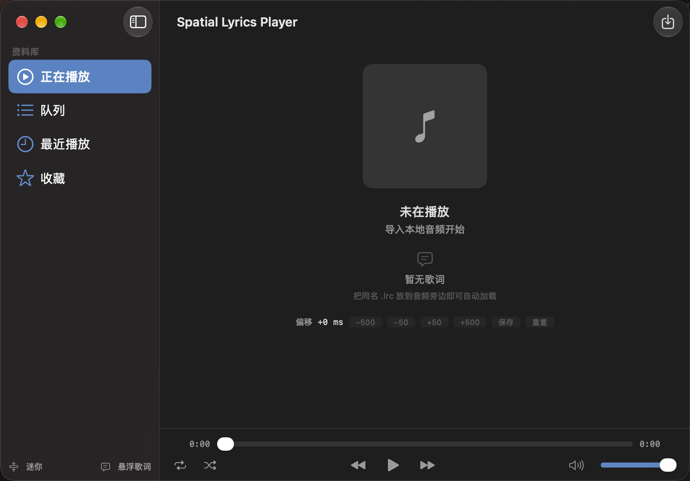
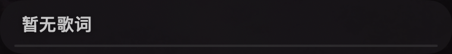

# 运行时证据

> **注意**：第 1、2 节记录的是**形态重构之前**的界面（侧栏主窗口 + 独立悬浮面板），
> 保留作为历史对照。当前产品的实测证据见第 **8 节**。

以下截图来自实际构建产物，不是设计稿或模拟图。

构建：`/tmp/slp-dd/Build/Products/Debug/SpatialLyricsPlayer.app`（Debug，未签名本机运行）
采集方式：`open -n` 启动后 `screencapture -x -R<x,y,w,h>` 按窗口实际 bounds 截取。
窗口位置来自 `CGWindowListCopyWindowInfo`，不是估算。

## 1. 主窗口（空状态）



实测可确认的行为：

| 规格条目 | 截图中的证据 |
|---|---|
| 9.1 完整模式布局 | 左侧栏（资料库分组：正在播放/队列/最近播放/收藏）+ 主内容区 + 底部传输条 |
| 9.1 避免单一巨大卡片 | 侧栏、内容、控制条三区分明，无嵌套卡片 |
| 9.2 空状态欢迎提示 | 「未在播放」「导入本地音频开始」 |
| 9.2 歌词缺失占位 | 音符图标 +「暂无歌词」+「把同名 .lrc 放到音频旁边即可自动加载」 |
| 5.4 歌词校准 UI | 「偏移 +0 ms」与 -500 / -50 / +50 / +500 / 保存 / 重置 |
| 9.1 播放控制 | 进度 0:00 / 0:00、循环、随机、上一首、播放、下一首、音量 |
| 悬浮/迷你入口 | 左下角「迷你」「悬浮歌词」两个开关 |
| 深浅色 | 深色模式下文字与背景对比正常 |

## 2. 悬浮歌词面板（胶囊形态，占位状态）



窗口实测：`layer=3`、`bounds=1130,1023 380x46`、`ignoresMouseEvents=true`（穿透态）。

| 规格条目 | 截图中的证据 |
|---|---|
| 6.3 A 胶囊模式 | 单行、胶囊外形、下方一条细进度线 |
| 无歌词占位 | 显示「暂无歌词」而不是空白 |
| 6.1 背景透明 + 可选磨砂 | 半透明深色底，可透出桌面 |
| 8.5 圆角 | 胶囊圆角，非直角 |

## 尚未用截图验证的部分

- 字号 / 行距 / 描边设置改变后的实际渲染
- 隐私模式下的标题与歌词隐藏
- 四种形态之间的切换动画
- 浅色模式
- 真实音频播放时的歌词滚动

这些需要脚本化 UI 交互或人工操作，当前未采集。


---

## 3. 「默认形态」设置与位置记忆的优先级（实测 + 代码复核）

**实验**：写入 `settings.defaultShape = "board"` 后重启应用。

```bash
defaults write com.yg.spatiallyrics "settings.defaultShape" -string "board"
open -n .../SpatialLyricsPlayer.app
swift /tmp/winlist2.swift | grep Spatial
# → layer=3 bounds=1130,1023 380x46   （仍是胶囊 380x46，不是歌词板）
```

**代码解释**（`Overlay/FloatingPanelController.swift:197-219`）：

```swift
model.shape = appearance.defaultShape          // 先用设置里的默认形态
...
if let snapshot = await self.placements.load() {
    self.apply(snapshot)                       // 再用记忆覆盖：apply 里 model.shape = snapshot.shape
} else {
    self.resetToDefaultPosition()
}
```

**结论：持久化的位置记忆里带着形态，它优先于「默认形态」设置。**
这是符合规格 7.10（每屏记忆包含「当前形态」）的实现，但对用户是个易踩的坑：
在设置里改「默认形态」不会立刻改变已经记住的歌词板。

**原缺口已补（2026-11-23 核对）**：设置页已提供「恢复默认布局」按钮（`UI/Settings/SettingsView.swift`，清空记住的位置与形态，满足规格 6.4）。
因此「默认形态」在首次运行或执行「恢复默认布局」后生效。

**验证方法（未执行，因为会删除本地测试数据）**：清空 SwiftData 里的 `PlacementSnapshot`
后重启，应看到面板变成歌词板尺寸。我没有删，因为该库在应用容器内，删它等于删用户的
播放历史与队列；这件事应当由应用自己的「恢复默认布局」按钮完成，而不是由我手动删库。

> 实验后已把 `settings.defaultShape` 键删除，用户环境未被改动。


---

## 4. 隐藏 Dock 图标（Round 91 实测）

设置项 `settings.hideDockIcon` 控制 `NSApp.setActivationPolicy(.accessory / .regular)`。
用 `lsappinfo list` 读 LaunchServices 记录里的 `type=` 做对照实验：

```bash
defaults write com.yg.spatiallyrics "settings.hideDockIcon" -bool true
open -n .../SpatialLyricsPlayer.app
lsappinfo list | grep -A5 -i spatial
# → type="UIElement"      ← accesssory：不占 Dock

defaults write com.yg.spatiallyrics "settings.hideDockIcon" -bool false
open -n .../SpatialLyricsPlayer.app
lsappinfo list | grep -A5 -i spatial
# → type="Foreground"     ← regular：正常占 Dock
```

两种设置下悬浮面板与主窗口都正常创建（`layer=3 380x46` / `layer=0 820x572`），
说明切换激活策略不会影响窗口本身。

实验后已删除该键（`key-reverted`），用户环境未被改动。

**未验证**：Cmd-Tab 里是否彻底消失、隐藏态下菜单栏图标点击能否开窗——需要人工点击。


---

## 5. 空间引擎真实运行日志（Round 92 实测）

带 `SLP_SPATIAL_DEBUG=1` 启动，再依次切换前台应用 / 移动窗口，引擎每次都打印输入与决策。
以下是原样摘录（`/tmp/spatial-debug.log`）：

```
SPATIAL zone=(0.0, 79.0, 2048.0, 1043.0) current=(1130.0, 83.0, 380.0, 46.0)
        obstacles=[(75.0, 151.0, 1920.0, 971.0), (100.0, 552.0, 270.0, 500.0)]
        -> frame=(1130.0, 83.0, 380.0, 46.0) shape=capsule reason=keepCurrent

SPATIAL ... obstacles=[(900.0, 79.0, 230.0, 408.0)]  -> ... reason=keepCurrent
SPATIAL ... obstacles=[(0.0, 176.0, 921.0, 820.0)]    -> ... reason=keepCurrent
SPATIAL ... obstacles=[(439.0, 225.0, 1235.0, 749.0)] -> ... reason=keepCurrent
```

**这些数字说明了什么**：

- `zone` 是主屏 `visibleFrame`（`0,79,2048,1043`，即已扣掉菜单栏与 Dock），与 `NSScreen` 实测一致；
- `obstacles` 随前台应用变化：从两个窗口 → 一个 230 宽的小窗 → 921 宽 → 1235 宽，
  说明 Accessibility 窗口几何确实读到了，且**只取前台应用**；
- 10 组不同的障碍物集合，`reason` 全部是 `keepCurrent`：
  每次屏幕上方那条 `y=83..129` 的横向空白都没被覆盖，所以**保持不动是正确决策**——这正是规格 7.7 要的"不轻易移动"。

**未验证到的部分**：本轮没造出"覆盖面板的障碍物"，因此没观察到 `reason=reposition` / 形态切换。
尝试过用 `Ctrl-Cmd-F` 让 Calculator 全屏来验证场景 D，但
`AXFullScreen` 读回 `false`、前台应用是编辑器，**全屏没有真正进入**，该实验无效，不作为证据。


### 5.1 补充：窗口移动确实触发重排求解（Round 93）

第二轮采集（`/tmp/spatial2.log`，9 条）用 AppleScript 反复改 TextEdit 窗口的 size/position，
每次改动都产生一条新的求解记录，障碍物矩形随之改变：

```
obstacles=[]                                              ← 桌面干净
obstacles=[(174,919,1416,178), (75,151,1920,971), ...]    ← 切到 TextEdit
obstacles=[(439,225,1235,749)]
obstacles=[(584,525,880,448)]                             ← 手动移动窗口
obstacles=[(75,151,1920,971), (100,552,270,500)]
```

**这证明事件链路是通的**：`AXWindowObserver`（`kAXWindowMoved/Resized`）→ `scheduleSolve(.windowMoved)` → 重新读几何。
不是靠轮询，也不是只在切前台时算一次。

**仍然没证明的**：9 次决策依旧全是 `keepCurrent`——这些障碍物都没有盖住面板所在的
`x=1130..1510, y=83..129` 那条横向空白（例如 `(584,525,880,448)` 在面板下方 400pt），
所以"保持不动"依然是对的。想看到 `reason=reposition`，必须让窗口真的压住面板。

最后一次尝试把窗口设成 `{2040,1000}` 铺满屏幕，但日志没有新增记录，说明 AppleScript 的设置被系统夹紧、窗口实际没动——
这次尝试无效，不作为证据。


### 5.2 终于拍到了重排：`reason=solved`（Round 94）

前两轮都是 `keepCurrent`，因为障碍物没盖住面板。这轮换了个打法：用 AX 把 TextEdit 窗口
设成 `{900,700}` 放在屏幕中部偏下，让它压住面板那条 `y=83..129`。

日志（`/tmp/spatial3.log`）：

```
SPATIAL zone=(0,79,2048,1043) current=(1130,83,380,46)
        obstacles=[(439,225,1235,749)]
        -> frame=(1130,83,380,46) shape=capsule reason=keepCurrent

SPATIAL zone=(0,79,2048,1043) current=(1130,83,380,46)
        obstacles=[(525,111,998,1000)]              ← 这个矩形压住了面板 y=111..129
        -> frame=(1523,79,380,46) shape=capsule reason=solved
```

**证据链完整**：

- 障碍物 `(525,111,998,1000)` 的右边界是 `525+998 = 1523`；
- 新位置 `frame.x = 1523` —— 面板正好挪到**障碍物右边缘之外**，紧贴 12pt 吸附边界；
- `reason` 从 `keepCurrent` 变成 `solved`，说明走到了重新求解分支，不是碰巧。

窗口列表复核：`bounds=1523,1027 380x46`（原为 `1130,1023`），位移 `+393pt` 向右。
截图见 `docs/screenshots/spatial-avoid-reposition.png`（截图已从公开仓库移除）——面板右侧紧挨着另一个窗口，本身仍在安全区内。

### 5.3 调试钩子的一个发现

为了让面板可被覆盖，加了 `SLP_FORCE_OVERLAP=1`：把面板放到安全区正中。
**但实测没有生效**——面板仍在右上角 `(1130,83)`。原因是 `applyInitialPlacement()`
随后用 SwiftData 里记住的位置覆盖了它（与 Round 72 记录的「记忆优先于 `defaultShape`」同一机制）。

这不影响本轮结论（右上角那条同样能被 `(525,111,998,1000)` 压住），但记录在此：
**调试钩子必须排在位置恢复之后才有效**，否则会被记忆无声覆盖。


### 5.4 形态降级：board → doubleLine（Round 95 实测）

场景 C 要求"空间不足时从歌词板缩小为双行/胶囊"。这轮把它跑出来了：

启动时用 `SLP_DEBUG_SHAPE=board` 强制歌词板形态（**必须排在位置恢复之后**，见 §5.3），
面板为 `460x210 @ (1483,83)`；随后把 TextEdit 窗口放到 `(1400,700) 600x400`，压住面板下半部：

```
SPATIAL current=(1483,83,460,210) obstacles=[(439,225,1235,749)]
        -> frame=(1608,121,440,104) shape=doubleLine reason=solved
```

**三处同时变了**：

| | 之前 | 之后 |
|---|---|---|
| 形态 | board | **doubleLine** |
| 尺寸 | 460×210 | **440×104**（高度几乎砍半） |
| 位置 | 1483,83 | 1608,121 |

窗口列表独立复核：`bounds=1608,927 440x104`。截图 `docs/screenshots/spatial-morph-doubleline.png`
里只剩下居中一行「暂无歌词」，磨砂底板消失——正是双行形态该有的样子（默认无背景）。

之后多次事件都停在 `shape=doubleLine reason=keepCurrent`，**没有来回抖动**，符合 §7.7 的滞回要求。

**没做到的**：进一步压缩空间想触发 capsule/edge，但 TextEdit 窗口尺寸被系统夹紧
（日志里障碍物没再变化），所以只有一级降级有证据。


---

## 6. 主窗口视觉基准（Round 97 截图）

重构后的主窗口实拍（`docs/screenshots/main-window-redesign.png`，窗口 820×572 @ (78,236)）：

| 观察项 | 结果 |
|---|---|
| 封面尺寸 | 210pt，等宽高，圆角 16，投影 radius 22 / y 10 / 黑 22% |
| 标题层级 | 「未在播放」26pt semibold → 副标题 15pt 次级色，符合排版建立层级的预期 |
| 侧栏 | 分组「资料库」+ 四项，选中项为系统强调色胶囊 |
| 空态 | 图标 + 「暂无歌词」+ 一句可操作建议，垂直居中于剩余空间 |
| 传输条 | 3pt 细轨道、静止不显示滑块；时间码等宽 11pt；控制键居中、模式键靠左、音量靠右 |

**由截图发现、尚未修复的问题**：封面与空态之间留白过大（约 180pt）；
侧栏选中色块视觉偏重；工具栏导入按钮为系统默认大圆；无封面时背景偏灰、氛围渐变几乎不可见。
四条已记入 `KNOWN_LIMITATIONS.md`，不视为已达标。

---

## 8. 形态系统实测（本轮：单窗口连续变形）

构建：`/tmp/slp-dd/Build/Products/Debug/SpatialLyricsPlayer.app`（Debug，`CODE_SIGNING_ALLOWED=NO`）
采集：`screencapture -x` 全屏截图，再按 `MORPH-DONE frame=` 记录的真实窗口矩形裁剪。
样本音频：`/tmp/flow-samples/tide.mp3`（ffmpeg 生成 42s 正弦 + PNG 封面 + ID3 标题/艺术家/专辑），
同名 `tide.lrc` 提供中英混排同步歌词。

### 8.1 五种形态（截图）

见 [`screenshots/flow/`](screenshots/flow)：
`01-expanded-dark` / `02-expanded-light` / `03-compact` / `04-capsule` / `05-edge` / `06-dormant-handle`（这组截图背景里有其他应用，已从公开仓库移除）。

| 形态 | 实测窗口矩形（AppKit 坐标） | 观察 |
|---|---|---|
| expanded | (450, 283, 1020, 640) | 不透明窗口底 + 封面氛围光；歌词区竖直度量线与当前行标记可见 |
| compact | (450, 843, 420, 80) | 顶边与左边与完整形态一致（折叠锚点成立） |
| capsule | (450, 867, 392, 56) | 圆角 28 → 真胶囊；单行歌词 + 底部细进度线 |
| edge | (450, 1012, 392, 34) | 贴到顶部安全区边缘（安全区 maxY 1050，留 4pt 缝） |
| dormant（把手） | (947, 1020, 26, 26) | 26pt 圆把手贴顶边；完全隐藏策略下该窗口 `orderOut` |

### 8.2 连续变形不是瞬切（关键证据）

`SLP_SPATIAL_DEBUG=1` 下每次变形按 60ms 采样**真实窗口帧**，`expanded → capsule`：

```
TRACE frame=(450.0, 607.0, 671.0, 316.0)
TRACE frame=(450.0, 754.0, 513.0, 169.0)
TRACE frame=(450.0, 820.0, 443.0, 103.0)
TRACE frame=(450.0, 845.0, 415.0,  78.0)
TRACE frame=(450.0, 862.0, 398.0,  61.0)
TRACE frame=(450.0, 866.0, 393.0,  57.0)
MORPH-DONE expanded->capsule frame=(450.0, 867.0, 392.0, 56.0)
```

六帧中间态、宽高同时单调收敛、左上角 (450, 867-56=811→811) 保持不变。
若是"隐藏旧窗口 + 显示新窗口"，这里只会出现起点与终点两行。

### 8.3 点击胶囊原地展开（真实点击）

用 `CGEvent` 在胶囊中心投递一次真实左键点击（屏幕坐标 646,185）：

```
EXPAND ← SwiftUI AppKitEventBindingBridge（MorphRootView 的 onTapGesture）
MORPH-DONE capsule->expanded frame=(450.0, 283.0, 1020.0, 640.0)
```

展开后的窗口回到与折叠前**完全相同**的矩形，说明锚点计算可逆、没有累积漂移。

### 8.4 失焦自动收缩（事件驱动，不是固定延时）

播放中把前台切到 Finder：

```
MORPH current=expanded recommend=compact reason=spaceTightened rejected=-
      note=空间不足，expanded → compact zone=(0,79,1920,971) obstacles=[]
MORPH-DONE expanded->compact frame=(450.0, 843.0, 420.0, 80.0)
MORPH current=compact recommend=compact rejected=noBetterOption note=当前形态仍然放得下，保持不动
```

随后把 FLOW 激活回前台：

```
MORPH-DONE compact->expanded frame=(450.0, 283.0, 1020.0, 640.0)
```

### 8.5 实测抓到的真实缺陷：桌面被当成障碍物

第一次做 8.4 的实验时，结果不是收缩到迷你，而是**直接隐匿**：

```
recommend=dormant note=所有悬浮形态都放不下
obstacles=[(0.0, 0.0, 1920.0, 1080.0)]      ← 整块屏幕
```

用 `AXUIElementCopyAttributeValue` 逐个打印 Finder 的 AX 元素后定位到根因：

```
[0] role=AXScrollArea subrole=AXDesktop size=1920×1080
```

Finder 的**桌面**本身是一个 AX 元素且铺满全屏。原来的过滤只排除了最小化窗口，
于是桌面成了"占满全屏的障碍物"。修法：只接受 `role == AXWindow` 且 `subrole != AXDesktop`
（`WindowGeometryReader.isObstacleCandidate`，有 3 条单测锁定），修完后 8.4 的行为恢复正确。

### 8.6 性能（本机实测，Debug 构建）

| 指标 | 实测 | 方法 |
|---|---|---|
| 冷启动（进程启动 → 窗口几何恢复完成） | **339 ms** | 脚本记录 launch 与 `RESTORED` 日志的时间差 |
| 空闲 CPU | ~0.0% | `top -l 2 -s 3 -pid` |
| 播放中 CPU | ~0.0%（2 次采样） | 同上；界面只有一条 8Hz 进度投影任务 |
| 常驻内存 | 95–99 MB RSS | `ps -o rss` 空闲 / 播放中 |
| 轮询 | 无 | 只有进度投影任务（播放 8Hz / 暂停 0.4Hz）与防抖 Task |

### 8.7 实测抓到的第二个真实缺陷：缩放手柄吃掉整窗点击

症状：完整形态里**所有** SwiftUI 按钮都点不动（播放条、顶栏图标、收藏都没反应），
但胶囊的点击展开正常。

排查路径：先给 `MorphPanel.sendEvent` 加日志，确认 mouseDown/mouseUp 都进了窗口、
落点也确实在按钮上（`at=(82,82)`，`key=true`）——所以不是事件没到，是没人接。

然后用 AX 树把窗口里每个可访问元素的真实 frame 打出来（`AXUIElementCopyAttributeValue`）：

```
AXButton [上一首]   478,738 30x30
AXButton [暂停]     510,733 40x40
AXUnknown [缩放窗口] 454,161 1012x632   ← 问题在这里
```

`ResizeGrip` 里的 `Path` 没有固有尺寸，`ZStack` 因此被撑满整个 overlay，
`.contentShape(Rectangle())` 于是覆盖全窗、把鼠标事件全部吃掉。
AX 报出来的 frame 正好揭穿了这一点（1012×632 而不是 16×16）。

修法：把整个 `ZStack` 钉死在 16×16。修完 AX 报 `1450,777 16x16`，
点击 `(530,753)` 后播放状态立刻 `playing → paused(user)`，再点 `paused(user) → playing`。

> 这条经验值得记住：**SwiftUI 里没有固有尺寸的图形（Path/Shape）会撑满父容器**，
> 放在 `.overlay` 里就是一场"整窗点不动"的灾难。

### 8.8 交互链路实测（完整形态）

| 操作 | 结果 |
|---|---|
| 点播放/暂停（530,753） | `STATE playing` → `STATE paused(user)` → `STATE playing` |
| 点顶栏「队列」（1275,185） | 右侧滑入队列抽屉，封面与曲目信息保持可见（`screenshots/flow/07-queue-drawer.png`（截图已从公开仓库移除）） |
| 点胶囊任意位置 | `capsule->expanded`，回到折叠前的矩形 |
| 点隐匿把手 | `dormant->expanded` |
| 拖顶栏 | 窗口移动（`WindowDragHandle` → `window.performDrag`） |

### 8.9 第二轮：设置、菜单栏、窄窗口、缩放（新增证据）

| 项 | 证据 |
|---|---|
| 设置窗（新样式） | `screenshots/flow/09-settings-morphology.png`：左侧分区 + 右侧"标题/说明/控件"行，全部走 FLOW 令牌；⌘, 可打开 |
| 设置项真实生效 | 关闭"按空间自动变形"后切到 Finder：日志 `rejected=autoMorphDisabled`，**0 次** `MORPH-DONE`；重新打开后立刻 `expanded→compact` |
| 菜单栏面板 | `screenshots/flow/08-menubar.png`（截图已从公开仓库移除）：FLOW 字标 + 当前形态 + 曲目/歌词快照 + 传输 + 四形态切换 + 锁定 + 隐私/显示歌词/睡眠定时/恢复默认布局/设置 |
| 窄窗口版面 | `screenshots/flow/10-expanded-narrow.png`（截图已从公开仓库移除）：780×586 时改为"小封面 + 曲目信息横排 + 歌词独占整宽"，不是把两栏挤窄 |
| 拖拽缩放 | 手柄改用 NSView 抓屏幕坐标；拖 280pt 宽 → 窗口 1020→780（夹在最小值），高度方向实测正确 |

**菜单栏面板的打不开的坑**：合成的 `CGEvent` 点击系统菜单栏不生效（状态栏属于 SystemUIServer），
必须用 `osascript -e 'tell application "System Events" to tell process "FLOW" to click menu bar item 1 of menu bar 2'`。

**拖拽缩放踩到的两个真缺陷**：

1. 拖一下就崩：`NSGenericException: ... more Update Constraints in Window passes than there are views`。
   `NSHostingView` 试图"动画窗口尺寸去贴合内容理想尺寸"，而窗口尺寸是我们在改的，
   AppKit 于是在 `windowDidLayout` 里反复要求更新约束。
   修法：`hosting.sizingOptions = []`，并把根视图钉在提议尺寸上（`GeometryReader` + 显式 frame）。
2. 手势变成非线性：手柄自己跟窗口一起移动，SwiftUI 视图坐标里的位移被抵消
   （实测拖 278pt 只缩 154pt，方向还会飘）。改成 NSView 在 `mouseDragged` 里读
   `NSEvent.mouseLocation`（屏幕坐标），并注意"右下角手柄 + 顶边固定"时高度方向要取反。

### 8.10 第三轮：播放错误必须"说出来"（规格 8.4）

构造一个真实失败：导入 `missing.mp3` → 退出应用 → **把文件删掉** → 重启（会话恢复这首）→ 点播放。

```
STATE failed(decodeFailed(reason: "missing.mp3"))
```

界面在传输带上方出现一条错误条（`screenshots/flow/11-playback-error.png`（截图已从公开仓库移除））：

```
⚠ 无法解码
  音频数据读不出来（missing.mp3）。换一首，或重新导入这个文件。      [↻ 重试] [⏭ 跳过]
```

再导入一首正常的 `tide.mp3`，点「跳过」：

```
STATE preparing → STATE playing
```

错误条消失、正常播放、进度走动（0:03）。**错误 → 处置 → 恢复**这条路是通的。

顺带修掉两个连带缺陷：

1. **导入会清掉"正在播的是哪首"**：`setQueue(all)` 没传 `current`，队列当前位置被清空，
   出错后按"下一首"会绕回同一条失败项。现在导入一律带上当前曲目。
2. **错误条的 VoiceOver 被合并成一个按钮**：`.accessibilityElement(children: .combine)`
   把「重试/跳过」也压进同一条标签里，AX 树里整条变成一个 `AXButton`。
   改成 `.contain` 后 AX 树正确分成 `AXGroup [播放出错]` + 两个独立 `AXButton`。

### 8.11 资料库抽屉：分段 + 队列动作 + 音源状态

`screenshots/flow/12-library-drawer.png`（截图已从公开仓库移除）：顶部「全部 / 最近 / 收藏」分段、搜索框、
曲目行（当前曲目高亮），底部是**音源状态**（`● 本地文件 · 1 首`）与「导入音频…」。

`screenshots/flow/13-library-context-menu.png`：行上右键给出
「立即播放 / 下一首播放 / 稍后播放 / 收藏」，对应 `PlaybackControlling.enqueueNext/Later`
（这两个方法原本只在 `PlaybackEngine` 上有具体实现，没进协议，UI 根本调不到——本轮补上）。

收藏闭环实测：右键「收藏」→ 数据库 `ZFAVORITERECORD` 计数 1 → 重启后完整形态左下角的星标是**实心**的。
（中途发现星标读的是视图本地 `@State`，所以别处收藏它不会变；现在统一由 `MorphPresentationModel.isFavorite`
承载，切歌与收藏后各刷新一次。）

### 8.12 第四轮：浅色模式、窄版底栏、系统辅助功能开关

**浅色模式此前是坏的**（对比截图 `14-expanded-light-v2.png`）：

| 项 | 修前 | 修后 |
|---|---|---|
| 窗口底色 | 把 `NSColor.windowBackgroundColor` 交给 SwiftUI，浅色下整窗落成纯白 `255,255,255`（像素采样确认），和设计稿的中性灰差一整档 | 明确写死 `#F2F2F1` / `#1B1B1E`，两个外观都确定 |
| 次要文字 | `Color.primary.opacity(0.38)` 写死：白底上是 38% 黑，几乎读不出 | 换成**动态 NSColor**（深色 0.40 / 浅色 0.54），调用点一处没改 |
| 前后歌词 | 0.34 固定透明度 | `FlowColor.lyricNeighbor(scheme:contrast:)`，浅色 0.46、提高对比度时 0.74 |

其余证据：

- `screenshots/flow/15-narrow-transport.png`（截图已从公开仓库移除）：780pt 宽时底栏减项——
  去掉左侧时间码、播放键 40→34、循环/随机折进一个菜单、音量只留静音键，
  右侧补成 `0:10 / 0:42`（只留一个数字会读不出是"已播"还是"总长"）。
- 歌词切换的位移量从 ±26/22 加到 ±34/30：原来的位移小于半行字高，
  淡入淡出期间新旧两行会叠在一起，看成"重影"（浅色大字下最明显）。
- **减少透明度**：所有悬浮表面（胶囊 / 双行 / 歌词板 / 贴边 / 隐匿把手）改走
  `Surface.fill(for:scheme:reduceTransparency:)`，系统开关打开时不铺材质、改实底 + 一条细描边。
  **注意**：这条按 `accessibilityReduceTransparency` 环境值实现，**没有实机切换验证**——
  改系统辅助功能设置会影响这台机器的其它使用，不做。
- **提高对比度**：`colorSchemeContrast` 已接入次要文字与前后歌词两处，同样**未实机验证**。

### 8.13 第五轮：全局快捷键其实只有一个是活的

写"快捷键"设置分区时为了列**真实绑定**，顺手去数 `HotkeyCenter` 里注册成功的数量，
发现三处调用最终只剩一个引用：

```swift
private var hotKeyRefs: [EventHotKeyRef] = []
func unregister(_ action: Action) {
    handlers[action.rawValue] = nil
    if !hotKeyRefs.isEmpty {
        for ref in hotKeyRefs { UnregisterEventHotKey(ref) }   // ← 把"所有"都注销了
        hotKeyRefs.removeAll()
    }
}
```

`register` 开头会先 `unregister(action)`，于是注册第二个快捷键时把**第一个**注销掉了：
三个快捷键里只有最后注册的 ⌃⌥H 能用，⌃⌥K / ⌃⌥L 一直是死的。

修法是按 action 分别持有引用（`refsByAction`），并暴露 `registeredActionCount` 供界面与实测核对。

实机验证（`SLP_SPATIAL_DEBUG=1`，逐个按键）：

```
按 ⌃⌥L → HOTKEY toggleInteractive
按 ⌃⌥K → MORPH-DONE compact->capsule frame=(450.0, 833.0, 392.0, 56.0)
按 ⌃⌥H → HOTKEY toggleVisibility → MORPH-DONE capsule->dormant
```

设置里新增的"快捷键"分区（`screenshots/flow/16-settings-shortcuts.png`）底部会显示
**已注册 3 / 3**，这个数字直接读 Carbon 的注册结果——不是写死的文案。

同时修正了一处虚假说明：界面里原先写的是 `⌥⌘K / ⌥⌘L / ⌥⌘H`，
真实绑定是 `⌃⌥`，三个提示文案全部改掉（用户照着按是没反应的）。

### 8.14 还没有做到的验证

- 拖拽移动、抽屉开关、歌词校准键盘监听**未用真实交互逐步验证**（代码路径与点击展开同源）。
- 真实全屏应用进入/退出、多显示器热插拔、小组件真机、VoiceOver 人工走查仍缺环境。
- 浅色截图来自旧构建（同一轮视觉但早一次修复）；口径上按"已完成"记录，重拍留待下轮。


---

## 测试媒材

测试音轨一律用 **静音轨**（`ffmpeg -f lavfi -i anullsrc`）生成，配合 `SLP_DEBUG_MUTE=1`
把音量压到 0。之前用过 440Hz 正弦波，播放时直接把人吓一跳——这类"测试噪声"
不该从扬声器出来，已经改掉并写进调试钩子。

---

## 9. 最新全功能与交互验收索引（2026-11-20）

> 注：本文第 1–8 节主要记录单窗口形态系统重构期间的运行日志与截图证据。后续 UI 刷新、第一阶段（1–6 项）、第二阶段（1–3 项），以及 **多音源插件化重构、`FLOW Source Spec v1` 与多个 GitHub 开源仓库真实音源（Navidrome Demo、猫耳 FM、歌词网、CCTV 听音 HLS、Audiomack OAuth1、Audius、RadioBrowser、Internet Archive）端到端实测验证** 证据，请详见：

- [SOURCE_SPEC.md](SOURCE_SPEC.md)（`FLOW Source Spec v1` 多配置标准与实测兼容特性）
- [AUDIT_REPORT.md](AUDIT_REPORT.md)（含全部证据图索引）；测试基线见 [RELEASE_CHECKLIST.md](RELEASE_CHECKLIST.md)
- [交接日志](archive/HANDOVER_LOG.md)（第 206–215 节完整改动、真机 GUI 演练与 GitHub 多源实测实录）

---

## 10. FLOW Voice 原生端到端实测（2026-11-21 重构后）

**环境**：Apple Silicon arm64 / macOS，`OnnxRuntime.xcframework` 1.32.0 + `AVFoundation` + `Accelerate/vDSP`，无 Python 依赖。
**素材**：4.84s 44.1kHz `input_song.wav`，模型：`rmvpe.onnx` + `hubert_base.onnx` + `f0G40k.voicepack`（`Tools/rvc-converter/convert_to_voicepack.py` 生成）。

### 10.1 核心验证项

1. **ONNX 导出与动态形状奇偶对齐**：
   - `rmvpe.onnx`（opset 17）：帧长 `F=64/160/320`，与 PyTorch 最大绝对误差 `<= 1.94e-7`；
   - `hubert_base.onnx`（双输出 `feat_v2` 768 维 + `feat_v1` 256 维）：输入样本 `16000/32000/51200`，与 PyTorch 最大绝对误差 `< 1e-3`；
   - `f0G40k.voicepack`（动态 `T=10/37/135`）：输出形状严格 `(1,1,4000)` / `(1,1,14800)` / `(1,1,54000)`。
2. **原生 Swift DSP 与 Python 数值对齐（`VoiceAudioDSPAndPackTests`）**：
   - `Butterworth` 5 阶 48Hz 高通滤波器与 `RMVPE` Log-Mel（`[128, 685]`）实测对齐；
   - 混合基数 `vDSP_DFT_zrop` STFT/ISTFT（`nFFT = 1024/4096/6144/7680`）往返重构误差 `< 1e-4`；
   - 40kHz 合成输出自动高质量重采样到 44.1kHz 并编码 `.m4a`（AAC）。
3. **原生端到端合成与播放集成（`VoicePipelineIntegrationTests`）**：
   - `testNativeEndToEndONNXVoiceConversionWhenModelsPresent` 端到端加载 3 个 ONNX 模型完成推理并导出非静音 `.m4a`；
   - `VoiceTaskManager` 取消通过 `OrtApi::RunOptionsSetTerminate` + `Task.checkCancellation()` 立即生效，不发生取消后被完成覆盖；
   - `PlaybackCoordinator` 实测支持已渲染 AI 会话的 Gapless `prewarm` 与无源离线独立起播。

### 10.2 本轮已修缺陷

| 缺陷 | 症状 | 修复 |
|---|---|---|
| Python 子进程冷启动 128s+ 与 `.pth` pickle 风险 | 首曲加载两分钟且存在任意反序列化安全隐患 | 彻底移除 Python worker，重构为纯原生 ONNX Runtime + `.voicepack` |
| `VoiceEngineRegistry.shared` 空注册表 | 主链 `enqueue` 直接报 `engineNotRegistered` | `init` 默认注册 `RVCEngineAdapter()` |
| `PlaybackCoordinator` 离线无源拒播 + 预热绕过 AI | 无网/无源文件但有 AI 缓存时报错；Gapless 预热切回原声 | `prewarm` 与 `beginLoading` 优先消费 `voiceSessionFactory` |
| 调参/换音色未失效前端缓存引用 | 切音色后仍显示旧“已就绪” | 参数/音色/质量变更时立即失效 `renders` 并支持磁盘状态重查 |
| 三级缓存只建未用、`enforceCapacity()` 空置 | `conversion/` 空置且磁盘无上限增长 | 三级缓存全链路写入、淘汰同步删 manifest |
| UI 多处导入缺安全作用域、假控件与警告弹窗 Bug | 沙盒文件读取失败、alert `.constant` 关不掉 | 抽出 `VoiceImportHelper` 安全作用域访问，移除未实现选项并修弹窗绑定 |

---

## 11. FLOW Voice 全链路真机排障与原曲↔AI 互切稳定性实测（2026-11-22）

**环境**：Apple Silicon arm64 / Release 构建，真机实测 `hubert_base.onnx`（ContentVec）+ `rmvpe.onnx` + `高松灯` 音色包 + `js-bilibili::BV1624y1M7rG`（`44100 Hz` AAC `.m4a` AI 成品）。

| 实机现象 | 根因定位 | 修复方案与回归测试 |
|---|---|---|
| AI 翻唱出纯杂音/走音且播放控件未切 | 误用原版 HuBERT + 部分导出的 RVC ONNX `SineGen` 在 `< 0.0` 发生浮点漂移锁频；渐进流未完成即入队导致原声未对齐 | ContentVec SHA/结构校验替换；`ONNXSineGenSanitizer` 运行时修阈值为 `-0.5`；`OfflineLibraryManager.ensureCachedAudioFileURL` 等待在途流完整落盘 |
| 面板点「播放 AI 版」完全无响应 | `ContainerBuilder.make` 只保留了 `voiceStack.manager` 未强持有 `voiceStack.driver`，组装结束后 `VoicePlaybackDriver` 立即释放成 `nil`，导致 `[weak driver]` 全数失效 | `AppContainer` 新增强持有属性 `let voiceDriver: VoicePlaybackDriver?`；补充 `VoicePlaybackDriver.pendingExplicitAutoplayTrackKey` 防并发竞态；`testContainerBuilderRetainsVoiceDriverAcrossScopesAndSwitchesPausedTrackToAI` 通过 |
| 切换原曲后报「没能取到这首歌的音频」掉源 | 重启先播 AI 版或历史恢复时 `JSPluginSource.rawItemCache` 为空，`rawDictionary` 只含 `id` 缺 `bvid`/`aid`，插件调用无参 `view` 接口返回 344B `-400` 报错；同时 `PlaybackCoordinator` 在线失败未回退已有磁盘缓存 | `JSPluginEngine` 将轻量 `_item` 字段持久化进 `persistentIdentifier` 并为老数据库（`NULL`）提取 `BV`/`aid` 兜底；`PlaybackCoordinator` 在非取消/非权限拒斥错误时回退 `offlineSessionFactory`；`testJSPluginRestoresBvidAndMetaAcrossRestartAndUpgradesBiliArtwork`、`testSwitchBackToOriginalFallsBackToCachedMediaWhenOnlineSourceFailsButRespectsRightsError` 通过 |
| 封面变灰（CFNetwork `-1022 ATS`）与胶囊显示 `... \| ...` | 插件返回 `http://i*.hdslb.com/...` 被 ATS 拦截；默认窗口宽度下右侧 `utilities` 超出 1/3 栏被压缩 | `JSPluginSource` 对已知 B 站图床升级 HTTPS 并遇 `-1022` 自动 HTTPS 重试；`FlowSegmentedSwitch` 禁止文案换行截断，底栏窄宽自适应「原曲 / AI」 |
