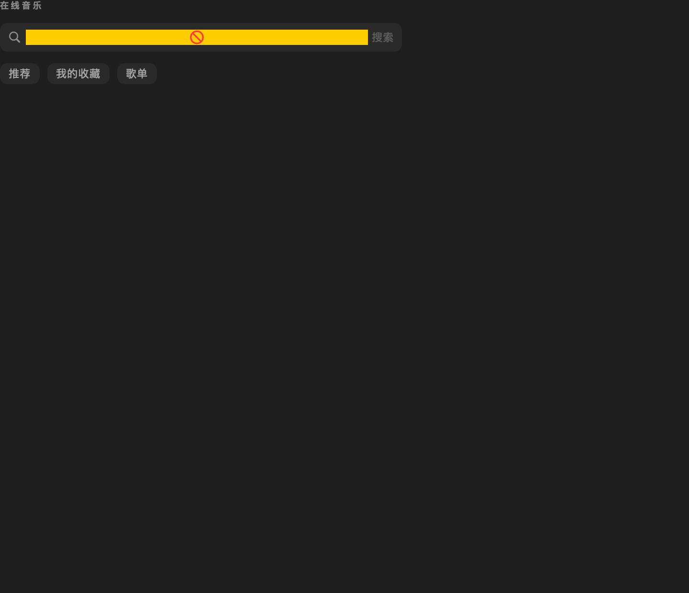
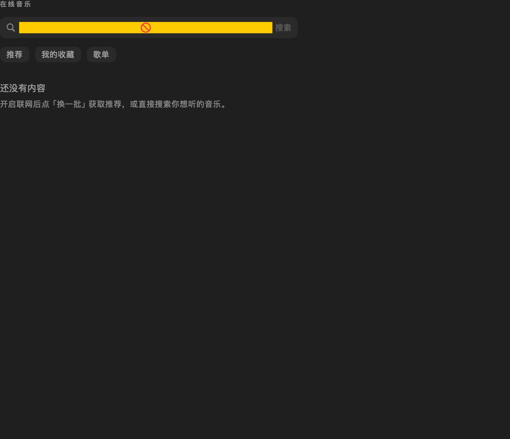

# 交接日志（2026-11-14 – 2026-11-20）

> **历史文档，不再随代码更新。** 这是原 `docs/HANDOVER.md` 第 7.5–7.10 节与第 9–215 节的原文，按时间顺序追加，节号保持不变；其他文档里的"第 N 节"都指这里。
> 现状、代码地图、坑点与上手步骤见 [交接文档](../HANDOVER.md)；2026-11-21 之后的改动见 [沉浸播放模式](../IMMERSIVE_MODE.md) 与 git 提交记录。
> 读的时候注意：早期章节里"音源只有 B 站""本地文件已下线"等结论已被多音源重构取代（第 214–215 节），B 站相关实现现在只存在于外部插件 B 站外部插件（开源前已移出仓库、不再分发）。标注"当前实现"的章节（第 9、10、12、14、16、18 节）仍是现行规则的出处。

## 7.5 主窗口契约（2026-11-14 修订）

完整形态此前是**无边框窗口 + 自绘拖动手柄**，结果用户既拖不动窗口，
也没有关闭/最小化/全屏三个按钮。现在改为系统标题栏：

- 完整形态：`.titled + .closable + .miniaturizable + .resizable + .fullSizeContentView`，
  标题栏透明、标题隐藏，视觉上仍是一张版面；
- 悬浮形态：保持 `.borderless + .nonactivatingPanel`，整块 `isMovableByWindowBackground` 拖动；
- 红点 / ⌘W 走 `windowShouldClose → collapseToDock()`，即「收进菜单栏」，不真关窗；
- 进/退全屏发 `fullscreenChanged`，全屏期间**跳过**自动布局（改 frame 会把窗口踢出全屏）；
- 自动收缩（`spaceTightened`）**不再收走完整形态**：桌面再挤，主窗口也要留得住。

配套测试：`MorphWindowContractTests`（titled/closable/miniaturizable/resizable + 三个按钮非隐藏）、
`MainWindowLifecycleTests`（关闭=收起、全屏进出、delegate 存在）。

另：完整形态**不再避让其他应用窗口**（`beginTransition` 里 expanded 直接用标准尺寸钳进安全区）。
避让是给悬浮歌词定的规矩；主窗口是用户主动打开的，桌面挤时也必须能开出来。

## 7.6 主页面在线入口（2026-11-14）

完整形态右上角有「在线音乐」（地球图标）→ 打开资料库抽屉的「在线」分段。
该分段自带账号/扫码/搜索/推荐/收藏/歌单，主页面即可完成"找歌 → 播放"。

调试：`SLP_DEBUG_DRAWER=online` 启动即展开这一屏（截图验收用）。

注意：`LibraryDrawerContent` 的初始分段由 `model.prefersOnlineSection` 在 **init** 里决定，
不是 `onAppear` 里改 State——抽屉会被重建，onAppear 里改会被下一次重建吃掉。

## 7.7 产品定位：音源只有 B 站（2026-11-14）

主页面空闲态 = 在线首页（搜索 + 榜单 + 收藏 + 歌单），顶栏常驻账号/音质，
资料库抽屉默认「在线」，联网默认开启。本地文件退为抽屉里的最后一段。

判断任何新功能该放哪：
- 主区域（歌词位）= 找歌与放歌；播放中它是歌词，空闲时它是曲库入口；
- 资料库抽屉 = 「我的东西」（在线/收藏/最近/本地）；
- 菜单栏 = 快速操作（账号、音质、缓存、电台）。
不要把"能不能听"的核心信息藏进子菜单。

## 7.8 歌单排序与"不做的清单"（2026-11-14）

- 歌单支持**拖动排序**：`PlaylistStoring.move(in:from:to:)` + `List.onMove`。
  注意 `onMove` 给的 `destination` 是插入点，向下拖时要减一，否则会差一位。
- 经用户确认**不做**：B 站收藏写回（状态同步）、原视频入口、MV 模式。
- 队列抽屉的拖动排序是自定义手势（`moveQueueItem`），不是 `onMove`——两套都在用，别混淆。

## 7.9 让位规则（2026-11-14 第三次修订）

"躲避"这件事来回改了三版，结论：

| 版本 | 行为 | 结果 |
|---|---|---|
| 1 | 空间挤到不够就收成 dormant | 主窗口直接变成 26×72 把手，用户以为播放器没了 |
| 2 | 一律拦掉 from=expanded 的自动收缩 | 主窗口保住了，但**不再躲避**，压着别的窗口不动 |
| 3（当前） | **可以缩小让自己，但绝不自动收成 dormant** | expanded 挤不下时缩成胶囊并挪位（允许压住别人窗口）；其它可见形态也同理 |

实现要点：
- （**7.9 当时**的规则：守卫对所有权限形态生效；**已被 7.10 取代**——
  现在只拦"完整形态 → 把手"，悬浮形态在没空位时允许收成可见把手。）
- expanded → 胶囊走 `shrinkToCapsuleAllowingOverlap`：**绕过求解器**给指定落点；
- 之后必须 `machine.assumeMorphology(.capsule)` 同步状态机，否则它仍认为自己是 dormant，
  下一拍会把窗口 orderOut（实测：播放器瞬间消失）。

配套：压在别人窗口上时胶囊改用实底（`Surface.overlappingFill`），
否则深色外观的"白字 + 4% 白底"压在白底窗口上等于没有字（实测整条歌词看不见）。

## 7.10 现状快照（2026-11-14 收尾）

### 做了什么

- 音源收敛为 B 站；本地播放/导入整体下线，并有 3 条守卫测试防止被顺手加回来。
- 主页面 = 在线音乐页：空闲态是搜索 + 音乐榜 + 收藏 + 歌单；播放态是歌词。
  顶栏常驻「账号 · 音质」。菜单栏只做快速操作。
- 歌词：B 站音乐稿几乎无 CC 字幕（实测抽样全 0），改接 **LRCLIB** 外部源；
  标题解析治了推广文案，搜不到会递进放宽；歌词区右键可换一版。
- 曲目信息：装载后补全歌名/歌手/UP 主/简介/时长；界面不再显示 BV 号。
- 搜索框支持粘贴 **BV 号 / av 号 / 链接 / b23 短链**；多 P 稿件列出选 P；解析合集。

### 让位规则（改了三次，记结论）

| 版本 | 行为 | 结果 |
|---|---|---|
| 1 | 挤不下就收 dormant | 主窗口变把手，用户以为播放器没了 |
| 2 | 一律拦掉 expanded 自动收缩 | 主窗口保住了，但不再躲避 |
| 3（当前） | **完整形态**：缩成胶囊贴最近边让位，绝不消失；**悬浮形态**：没空位就收成可见把手（默认 `edgeHandle`） | 既不消失，也不会突兀地出现在屏幕正中 |

配套：`machine.assumeMorphology(from)` 保证状态机与窗口一致；
悬浮底板用 `Surface.translucentFill`（深色外观黑 42%）+ `WallpaperLuminance` 判断浅壁纸，
压在别的窗口上时改实底——**白字压白底等于没有字**，这条踩过两次。

### 明确不做（用户决定，别再问）

- B 站收藏状态同步（写回）
- 原视频入口
- MV 模式
- 多段 EQ（需要把播放链路换成 `AVAudioEngine`，是整条管线重写）

### 下一步优先级

1. 收藏状态同步之外，**账号切换**已可用（退出后重新扫码）；收藏夹多夹选择可加。
2. 队列抽屉的拖动排序手感可再调（现在是自己写的手势阈值）。
3. 离线模式开关：缓存已能复用，缺"只走缓存不联网"的判定。
4. 音乐统计（`PlaybackJournalRecord` 已在落库，缺界面）。

## 9. 变形/遮挡响应优化（2026-11-14，当前实现）

用户反馈“很卡、不灵敏、不够自主智能”。本轮不是只缩短动画，而是重整空间链路：

- **后台单次求解**：新增 `Morphology/AdaptivePlacementPlanner.swift`，形态与落点来自同一份快照；`FreeSpaceAnalyzer` 改为区间扫描，取代四重边界穷举；调试视图复用计算结果。
- **拖动期间响应**：80ms 固定截止合并通知，后续事件不延后评估；具体窗口 AX 订阅 + common run-loop modes；没有权限时复用 tick 补查 CG 几何。
- **恢复有明确唤醒**：去掉控制器 3 秒/4 秒/streak/几何签名多层互锁。形态冷却 350ms，放宽稳定期 450ms，期限到时主动重评估；空障碍列表会清掉旧缓存。
- **用户操作优先**：拖播放器时暂停布局；动画中自动请求不打断，用户请求仍可打断；旧迁移任务取消后不再覆盖新落点。显式隐藏始终下屏，自动收缩默认保留边缘把手。
- **首次变形减负**：壁纸亮度改后台缩略采样，不同步解码整幅图片。
- **当前无空间规则**：前台完整播放器保持；失焦且用过后允许让位。无任何悬浮形态可容纳时直接留边缘把手；腾出空间后恢复悬浮形态，绝不自动弹出完整播放器。此项取代第 7.9/7.10 的旧表述。

### 9.1 桌面空白利用（追加反馈）

- 不再只判断“有没有挡住”：当前合法但拥挤时，也比较更宽裕的空位和内容收益。
- 自动模式的迷你上限 **640×240**，胶囊上限 **640×200**。宽空区显示封面/控制/歌词上下文；低于迷你最小宽度的竖向窄列仍可显示歌词板；横向细带用宽胶囊。不是把整个桌面填满。
- 评分去掉“越小余量分越高”的反向激励。明显收益 + **500ms 候选稳定期**才主动迁移/舒展，受遮挡让位走及时路径。形态锁、位置锁、用户保持期与拖动保护继续生效。
- 实机 318pt 宽空列：392×56 胶囊 → **318×200 歌词板**，下一轮落点保持；该场景两次评估 5.02/9.54ms。歌词板强调线已从撑满窗口改为跟随当前行，并补 SwiftUI 像素渲染回归。
- 高度增加只改变当前内容呈现，不覆盖保存的 `LyricsShape` 偏好；不会自动打开完整播放器。

验证：最终 **545 条测试（含 13 条跳过）、0 失败**，lint 与 Debug 构建通过。两轮新增 28 条回归（响应链路 15 + 空白利用/内容渲染 13）；跳过包含 12 条联网/环境用例与 1 条受当前桌面几何限制的旧尺寸测试。首轮 24 障碍物/10 次空间扫描约 97.18ms（Debug）；首轮真实运行 30 次评估中位 1.60ms，最大 46.80ms。真实 AppKit 障碍窗口已验证“移动让位 → 全占满收把手 → 空位释放自动恢复”。

边界：本机播放器 `ax=notGranted`，真实验证走补查而非 AX；本轮真鼠标首击未取得有效事件证据；UI 自动化套件、双屏热插拔与 Instruments 帧率仍未验收。详细证据与复现见 [变形与遮挡响应报告](../SPATIAL_RESPONSIVENESS.md)。

## 10. 按背景自动切换深浅（2026-11-15）

- **默认跟随背景**：浅壁纸区域→浅底深字，深壁纸区域→深底浅字；设置 → 外观 → 悬浮深浅外观，可选“跟随背景 / 跟随系统 / 始终浅色 / 始终深色”。偏好持久化并纳入设置备份，旧备份兼容。
- **局部而非整幅平均**：后台 actor 缓存 512px 缩略图，按系统铺放选项映射窗口所在区域，覆盖 fill/fit/stretch/center 与副屏原点。旧的主线程 NSImage 解码与无限 region 缓存已移除。
- **防闪烁**：初始分界 0.56，暗→亮 0.64、亮→暗 0.44；反转候选保持 280ms。复用 tick，移动/迁移完成更新；静止每 2 秒复采以捕捉壁纸变化。同路径替换文件按最新 stat 失效缓存。
- **单窗局部外观**：只改面板与 SwiftUI colorScheme；完整形态、设置与菜单仍跟随系统。形态/位置锁及关闭避让不阻断颜色更新。
- **覆盖范围**：只采壁纸文件，不截屏。身后有普通窗口、动态多帧或不可读背景时回系统外观并加实底，不宣称已采到外部窗口像素。减少透明度设置优先。
- **验证**：新增 18 条测试，最终 **563 条、13 条跳过、0 失败**；Debug 构建、lint、diff 检查通过。实际根视图深浅渲染已复核；当前桌面占满恢复为把手，实机跨明暗壁纸拖动尚待对照验收。未改变用户壁纸和窗口布局。

详细实现、渲染对照和复现见 [背景深浅外观报告](<../BACKGROUND_APPEARANCE.md>)。

## 11. 启动/激活崩溃修复（2026-11-15）

用户反馈“启动报错”。此前只检查 open 成功和进程出现，未等待窗口稳定，这个验收口径已纠正。

- **实际崩溃栈**：01:15/01:16 两份报告均落在 `MorphWindowController.observeEnvironment` 的激活通知 → `MainActor.assumeIsolated` → Swift 主执行器检查空指针。窗口通知、AX 与 Carbon 热键回调统一改为 `Task { @MainActor ... }`，不在原生回调栈假设 actor 上下文；补架构测试与 lint 守卫。
- **独立颜色异常**：缺省壁纸填充色原来用灰度 `.black`，随后直接取 RGB 分量触发 `NSInvalidArgumentException`。改为数值黑色兜底，已有 NSColor 先转 deviceRGB；新增缺省/灰度/RGB 三条回归。之前桌面全被覆盖，采样路径未触发，单测全绿未覆盖到此分支。
- **环境依赖单测纠正**：原扫描测试把“真实桌面不存在任何全屏障碍”误当成排除自己 PID 的证据；改为固定 WindowServer 快照，分别验证自己的全屏被排除、别人的全屏保留，不通过修改产品避让规则掩盖失败。
- **最终验证**：全量 **568 条、13 条跳过、0 失败**，Debug 构建、lint、diff 检查通过。新增 5 条测试。实际修复进程 6 轮失焦/激活/展开后持续存活超过 5 分钟，并已截图看到完整播放器；随后正常冷启动（无强制外观/形态变量），深链展开后 40 秒再核验存活，完整窗口截图复核。该次进程后续 2 分钟仍存活，无对应新崩溃报告。
- 原先 macOS 问题报告窗口仍可能留在播放器后面，那是旧进程的报告；不把它等同于当前修复进程再次退出。验收必须同时对照报告时间、PID 和当前进程，不只看弹窗或启动返回码。

这次未新增 UI 自动化用例，截图仅在临时目录中检查，未将个人桌面放入仓库；未提交或推送。

### 11.1 红点/⌘W 直接退出（同日追加）

上一轮修复后又报告“报错了”。本次**没有新崩溃报告**，统一日志显示是正常退出：

```text
01:52:06 Df Handling Quit AppleEvent
         applicationShouldTerminate: NSTerminateNow
         Termination complete. Exiting without sudden termination.
```

- **根因**：`windowShouldClose() -> Bool` 少了 `sender` 参数。`NSWindowDelegate` 只认
  `windowShouldClose(_ sender: NSWindow) -> Bool`，旧写法**根本不是代理方法**，从未被 AppKit 调用。
  于是红点/⌘W 走系统默认关窗，窗口关掉后应用没有窗口，随后被正常终止。
  原有测试直接调 `controller.windowShouldClose()`，调用得到自己写的函数，所以一直“通过”——典型的假通过。
- **修复**：改成 `windowShouldClose(_ sender: NSWindow)`，只接管自己的面板，其他窗口返回 `true`。
  测试改为通过 `panel.delegate?.windowShouldClose?(panel)` 走真实代理路径，签名错了就会失败。
- **实测**：用 CGEvent 真鼠标点红点（面板内 18,627），日志依次出现
  `PANEL event=1/2` → `MORPH-DONE expanded->capsule`，进程持续存活，收进菜单栏而非退出。
  随后连续 3 轮 `toggle-floating` + 展开往返与形态切换均存活。
- **测试**：全量 **568 条、12 条跳过、0 失败**，Debug 构建与 lint 通过。
- **教训**：验收必须用真实事件路径（代理/通知/点击），不能直接调用自己写的方法当作“已覆盖”。
  另外清理运行实例时只按精确可执行文件路径匹配，`pkill -x SpatialLyricsPlayer` 会连带杀掉同名测试宿主。

## 12. 移动与躲避的卡顿（2026-11-15，当前实现）

用户反馈"过渡有点卡，卡片移动躲避的时候"。用独立进程采样窗口几何定位到两个真因：

1. **远距离躲避是硬跳**：旧 `moveWithContinuity` 在距离 > 32% 屏幕对角线时走
   "淡出 80ms → 瞬间换位 → 淡入 120ms"，实测一次 1575pt 的躲避只采到 **1 帧**。
   现在改为始终连续插值，时长按距离缩放（0.16–0.30s），实测 **15 帧、13–22ms/帧**。
2. **主线程同步枚举 WindowServer**：`CGWindowListCopyWindowInfo` 中位 0.30ms 但峰值 **53.47ms**，
   而每个 tick 会扫两遍（补偿检查 + 壁纸判读），一帧只有 16.7ms。
   新增 `Spatial/ObstacleProvider.swift`：扫描在后台，主线程只读缓存，单飞合并，180ms 限流。
   决策路径 `await` 后台结果，动画路径只读不等待。

- 新增 10 条 `ObstacleRefreshTests`，覆盖首次扫描、间隔限流、在飞合并、只读不触发扫描、
  空快照采纳、跨屏过滤与坐标换算。
- 全量 **578 条、12 条跳过、0 失败**；Debug 构建、lint、diff 检查通过。
- 形态切换在**超远距离**仍沿用淡出迁移（既有规则 + 测试约定），本轮未改；
  实测常见中近距离切换 7–9 帧、14–20ms。未做 Instruments 帧率采样。

诊断日志（`SLP_SPATIAL_DEBUG=1`）新增 `GATE`（机会门槛状态）与 `RELOCATE`（迁移起止）两行，
便于以后直接判断"是没决策、没执行，还是执行得不够顺"。

## 13. 动画流畅度（2026-11-15 追加）

- `animateFrame` 改 `display: false`，不再逐步同步重绘。
- 动画期间冻结排版尺寸（`MorphPresentationModel.presentationSizeOverride`），
  断点只在落地时切换一次；`isAnimatingGeometry` 用于关闭逐帧文字投影。
- `moveWithContinuity` 改为**起点定尺寸 + 纯滑移**：实测滑移期间内容重排
  从每帧一次降到整段 5 次。
- **运行构建改成 Release**：此前一直是 Debug，SwiftUI 未优化构建渲染更慢。

实测：躲避 16 帧、7–23ms；Release 过渡重绘中位 16.5ms / p90 19.9ms / ≤20ms 占 91%。
诚实边界：窗口几何与宿主 `layout()` 两个维度都测到接近 60Hz，
未能复现"不到 20 帧"的量化证据；本轮是按结构性开销做的优化。未做 Instruments 采样。
诊断：`SLP_DEBUG_FRAME=1` 会打印 `FRAME gap=`，可复核内容重绘节拍。

## 14. 决策与动画分离（2026-11-15 追加，当前实现）

对应要求："算好最后落点，再丝滑过去；动画不影响下一次落点计算。"

- **动画只呈现**：`animateFrame(frame:duration:finished:)` 只接收既定落点，不重新求解。
- **落地驱动收尾**：过渡与迁移的收尾都走动画完成回调，并在回调里精确落回目标帧；
  原来另有 `Task.sleep` 定时器收尾，可能把中间帧写进 `persistPlacement()`。
- **中间帧不参与决策**：补偿检查、窗口移动、壁纸判读都加了 `isAnimatingGeometry` 守卫。
- **起点定尺寸 + 纯滑移**：动画期间只改原点，SwiftUI 内容不重排。
- **撤回 CADisplayLink**：实测非激活面板下回调被节流到约 300ms，比原方案更差。
- 新增 5 条 `AnimationHandoffTests`；全量 **583 条、12 条跳过、0 失败**。
  实测躲避 17 帧、13–22ms；收尾后 `distance=0`，反复切换尺寸不漂移。
- 运行构建已切换为 **Release**（此前一直是 Debug）。

## 15. 修正切换"闪过去"（2026-11-15 追加）

上一轮为降低重排，把尺寸改成"动画起点一次性设定"，结果形态切换只剩位置在动——
用户看到的正是"闪一下就到新形状"。4ms 追踪证据：

```
327x240@10,720 → 300x34@10,926 → 300x34@10,828 → ...
```

- `presentationSizeOverride` 现在只用于**尺寸不变**的纯位置迁移；形态切换尺寸必须一起插值。
- 去掉 `plan.relocatesThroughFade` 触发的"淡出 + 瞬移 + 淡入"（`expanded↔capsule` 走的就是它）。
  属性保留在计划里描述意图，控制器不再据此跳过插值。
- **零时长路径必须真的落位**：删瞬移分支时漏了这条，导致测试与"减少动态效果"下窗口停在旧 frame，
  已补回（并因此修好 5 条测试）。
- 全量 **583 条、12 条跳过、0 失败**。实测中间帧：expanded→capsule 11、capsule→expanded 14、
  capsule→edge 8、edge→compact 9。
- 已知残留：`capsule→expanded` 中段约 87ms 掉帧，来自重建完整播放器视图树的主线程开销，
  不是插值问题；可后续用"先动画后装配"或视图预热削掉。

## 16. 适配所有刷新率（2026-11-15 追加，当前实现）

当前只有 60Hz 是虚拟显示器所致；代码按"适应所有刷新率"实现。

- 新增 `Morphology/MotionTiming.swift`：`实际时长 = max(基准时长, 最低帧数 / 刷新率)`，
  最低位置数 **30**。60Hz 下 0.18s 抬到 0.50s；120Hz→0.25s、144Hz→0.208s、
  240Hz 基准已够（43 个位置）。刷新率越高，凑够同样位置数越快。**零时长原样返回**，否则"减少动态效果"会失效。
- 刷新率来源：`NSScreen.maximumFramesPerSecond` → `CGDisplayCopyDisplayMode.refreshRate`
  → 兜底 60Hz。调试开关 `SLP_REFRESH_RATE=240` 可在任何屏幕上验证高刷路径。
- 过渡收尾推迟一个 runloop（最后一帧先上屏），并删掉 `finishTransition` 里的根视图重建。
- 新增 8 条 `MotionTimingTests`；全量 **591 条、12 条跳过、0 失败**。
- 本机 60Hz 实测：单次过渡 **28–30 个离散位置**、约 484ms；应用内重绘中位 **16.0ms**、>25ms **0 次**；
  像素级录屏 114/114 帧唯一、中位 16.7ms。
- 测量注意：用 CGWindowList 采样窗口矩形时，缓动收尾的亚像素位移取整后会"看起来没变"，
  容易被误判成掉帧（曾误报 65ms）；判断流畅度应以应用内重绘间隔为准。

## 17. HiFi 音质与搜索结果排序（2026-11-15 追加）

### HiFi 档位

`BiliAudioQuality` 新增 `.hifi`（"HiFi 无损"，需大会员，qn 127）。
它是 FLAC 与 Hi-Res 的**统一入口**：取码率最高的无损流；拿不到无损就退回最高可用，
并在界面上如实显示实际档位——延续"绝不把 AAC 说成无损"的既有约束。
齿轮/账号面板的音质菜单用 `allCases`，所以新增档位自动出现在列表里。

### 排序规则（`BiliMusicRanking`）

用户口径：**原唱 HiFi 最前 → 原唱 → 翻唱**。

- 第一关键字是**是否原唱**：哪怕翻唱有无损、原唱只有 AAC，原唱依旧在前。
- 第二关键字才是 HiFi；未知排在"确认有"与"确认无"之间。
- 再用播放量兜底，最后按原始顺序稳定收尾（保证同分不抖）。
- 原唱/翻唱靠标题与 UP 主判定（翻唱/翻自/cover/女声版/男声版/改编版…）。
  注意"原唱：某某"常出现在翻唱稿里，是原曲署名，**不作为原唱证据**。

### HiFi 结论怎么来

B 站搜索结果**不带音质信息**，判断有没有无损必须真的请求一次 `playurl`。
因此引入 `BiliHiFiLedger`（actor，磁盘持久化，30 天 TTL）：

- 搜索**只用缓存**排序，不发任何网络请求，面板立刻出结果；
- 结果上屏后，界面再调 `probeHiFi(_:)` 后台补探（并发 3、只探未知、最多 8 条），
  回来若关键词没变就替换列表；
- **权益不足时不记"没有无损"**：游客请求 flac 本来就不下发，记成 noHiFi 会让排序永久错判。

### 验证

- 新增 18 条 `BiliMusicRankingTests`：翻唱判定、原唱优先于带 HiFi 的翻唱、
  完整五档顺序、播放量兜底、稳定排序、HiFi 取最高码率无损、无无损时如实降级、
  账本"游客不记否定结论"、TTL 过期、跨实例持久化、只探未知项。
- 全量 **609 条、12 条跳过、0 失败**；Debug/Release 构建、lint、diff 检查通过。
- 未做真实网络下的搜索排序验收：本机 `search/type` 直连被风控拦到
  `aba.bilibili.com`，`probeHiFi` 的真实命中率仍待登录态实测。

## 18. 阻尼弹簧过渡（2026-11-15 追加，当前实现）

用户选型：形态切换用 **C 弹性**、移动用 **B 轻阻尼**、被动动作用 **E 过阻尼**；歌词动画**不动**。

### 关键结论：弹簧不能直接驱动窗口

先按 SwiftUI `Spring(response:dampingRatio:)` 的物理模型实现了逐帧弹簧，实测两个坑：

1. **`CADisplayLink` 在浮动面板非激活时被节流**：回调间隔掉到约 200ms，
   动画变成"走两步停一下"。改由 `NSAnimationContext` 系统调度后消失。
2. **弹簧的有效运动区间极短**：C 弹性 0.40s/0.68 的 5%→95% 只占 **158ms（9 帧）**，
   剩下 60% 时间都在做最后 5% 的亚像素位移——这就是"几乎没有动画"的数学根源。

所以最终分工：**窗口几何用贝塞尔（系统调度、铺满时长），过冲交给内容层**。

### 实现

- `Morphology/SpringMotion.swift`：`SpringSpec`（物理弹簧，供内容层用）、
  `BezierCurve`、`TransitionRecipe`、`MotionCatalog`（唯一的配方表）。
- `Morph/WindowFrameAnimator.swift`：窗口 frame 交给 `NSAnimationContext`
  （贝塞尔控制点，过冲由 y>1 表达，但**几何曲线一律不过冲**）；
  内容回弹由 `CADisplayLink` 逐帧推进，消费端是 `model.contentBounceScale`。
- 几何落点统一钳进「安全区再内缩 edgeInset」，即时模式与动画模式共用同一落点。
- **为什么几何不许过冲**：落点安全余量只有 6pt 障碍间距 + 4pt 边距 ≈ 10pt，
  而 1020pt 宽的窗口过冲 5% 就是 51pt，必然压到别的窗口。

| 用途 | 曲线 | 时长 | 几何过冲 | 内容过冲 |
|---|---|---:|---|---|
| 展开 expanded | B | 0.48s | 禁止 | 5% |
| 收缩 → 悬浮 | B | 0.44s | 允许（变小安全） | 5% |
| 悬浮互切 | B | 0.42s | 禁止 | 5% |
| 同形态移动 | B | 0.36s | 禁止 | — |
| 躲避让位 | E | 0.24s | 禁止 | — |
| 隐匿 | E | 0.20s | 禁止 | — |
| 从隐匿恢复 | B | 0.36s | 禁止 | 3% |

### 修掉的 bug

- **过阻尼稳定时间算错**：用了 `ζω`，但收敛速度由**慢根** `ζω−ω√(ζ²−1)` 决定。
  E 配方差 0.39s，动画会在半路被截断、收尾肉眼可见跳一下。
- **动画中途被打断**：评估守卫漏了 `isAnimatingGeometry`，
  一次过渡被切成两段残片（日志里两条 `TRANSITION` 目标不同）。
- **零时长路径绕过钳制**：即时模式直接 `setFrame`，窗口会贴死屏幕边缘。
  现在两条路径共用同一个 `landing`。
- 撤回 `CADisplayLink` 驱动窗口的方案（见上），以及一个从未被调用的兜底循环。

### 实测（60Hz 虚拟屏，采样窗口矩形）

| 过渡 | 改造前 | 改造后 |
|---|---|---|
| capsule→compact | 10 帧 / 146ms | **40 帧 / 683ms** |
| compact→capsule | 10 帧 / 146ms | **24 帧 / 398ms** |
| expanded→capsule | 10 帧 / 150ms | **25 帧 / 402ms（0 掉帧）** |
| capsule→edge | 21 帧 / 349ms | **43 帧 / 734ms** |

最长帧间隔从 200ms 降到 35ms。新增 17 条 `SpringMotionTests`；
全量 **626 条、12 条跳过、0 失败**。

设计过程与可交互对比页：[动效手感实验室](<../motion-lab/index.html>)。

## 19. 修复"颜色不统一"（2026-11-15 追加）

现象：深色壁纸上的悬浮播放器渲染成**白底深字**，与整机深色外观冲突。

### 根因（两层）

1. **采样源不可信**：`NSWorkspace.desktopImageURL(for:)` 返回的是
   `/System/Library/CoreServices/DefaultDesktop.heic`——一个 54 字节的符号链接，
   指向系统默认航拍图；而屏幕上实际是另一张照片墙纸。读到的图根本不是用户看到的图。
2. **判色逻辑太粗**：只比平均亮度。壁纸区域实测**均值 0.446、标准差 0.114、
   亮度跨度 0.16–0.88**（一半亮控件卡、一半深色照片），平均值落在中间却被判成浅色。

### 修法：只做有把握的判断，其余跟随系统

- `BackgroundSample` 增加**空间反差**（标准差）；`BackgroundAppearancePolicy`
  要求「够亮/够暗 **且** 够均匀」才判色：
  - 浅色：均值 ≥ 0.72 且反差 ≤ 0.16
  - 深色：均值 ≤ 0.35 且反差 ≤ 0.22
  - 其余一律 `tone = system`，交回系统外观（深色模式下就是深色卡片）。
- 采样器同步返回 `BackgroundSample`（均值 + 反差），日志也打印反差便于取证。
- 手动选项（跟随背景 / 跟随系统 / 始终浅色 / 始终深色）保持不变。

### 验证

- 实机日志从 `luma=0.605 tone=light` 变为 `luma=0.605 contrast=0.019 tone=system`；
  截图确认播放器转为深色卡片，与完整播放器/设置窗一致。
- 新增/改写测试：中间灰度与高反差背景都交回系统、均匀亮/暗仍正确判色。
- 全量 **627 条、12 条跳过、0 失败**；Debug/Release 构建、lint、diff 检查通过。
- 未做"真实纯色壁纸 + 强制浅色"的对照验收；壁纸切换后的重新采样依赖已有的
  tick + 文件 stat 失效机制。

## 20. Apple Music 风格歌词（2026-11-15 追加）

用户口径：主页面要 Apple Music 风格，并且要**跃动感**；变形卡片上也要。

### 资料核查的诚实说明

`web_search` 工具因余额不足不可用；DuckDuckGo 拦截了机器人访问；Bing 只返回 Apple 首页导航。
能确认的确凿事实只有维基百科一条：**iOS 10（2016）开始显示歌词，iOS 13（2019）加入滚动歌词**。
因此下面的视觉规则是按公开产品设计归纳的，不是抄来的规格。

### 实现

- `Lyrics/LyricScrollLayout.swift`：**纯布局逻辑**，可脱离 SwiftUI 穷举测试。
  给定总行数/当前行/行高/可视高，输出每行的中心偏移、缩放、透明度、模糊与滚动量。
- `UI/Expanded/LyricScrollView.swift`：Apple Music 风格滚动歌词。
  - 整段歌词滚动，当前行居中、放大到约 1.9×、全亮；
  - 相邻行 0.78× / 55% 透明度，再远 0.72× / 30% 并轻微失焦，三行外隐去；
  - 点击任意行跳转到该句；
  - **跃动**：行切换时当前行先压到 0.86× 再弹回 1.0（`Motion.lyricSpring`），
    整块列表同时用 `Motion.lyricScroll` 上移。
- `LyricLayout` 提供两套版式：`appleMusic`（默认）与 `editorial`（原有编辑式版面）；
  设置 → 歌词 → 歌词版式可切，偏好持久化。
- 新增弹簧令牌：`Motion.spring(response:bounce:)`、`lyricSpring`、`lyricScroll`。

### 修掉的三个 bug（都是测试抓出来的）

1. **视图根本没读注入数据**：`LyricScrollView` 直接取 `app?.lyricEngine.document`，
   渲染测试里换行后画面**完全一样**。改为可注入 `providedLines`，默认仍取引擎。
2. **垂直偏移公式错误**：`offset = height/2 - scrollOffset` 把内容整块推出可视区，
   渲染是一片空白。正确值是 `-height/2 - scrollOffset`（与上方半屏垫片配套）。
3. **首行被裁切**：没有上下垫片时，首行无法居中。补 `height/2` 垫片后，
   偏移公式必须同步修正——两步是耦合的，单改一步会整体偏移半屏。

### 验证

- 新增 11 条 `LyricScrollLayoutTests`（居中、首末行、衰减、失焦、行高累加、越界夹取、
  跃动参数范围）与 2 条 `LyricScrollRenderTests`（实际渲染：当前行更亮、换行画面必变）。
- 全量 **640 条、12 条跳过、0 失败**；Debug/Release 构建、lint、diff 检查通过。
- 渲染对照：[Apple Music 风格滚动歌词](<../screenshots/lyrics/apple-music-scroll.png>)。

### 未验证

- **没有真实曲目播放下的实机滚动验收**：本机未登录 B 站、`search/type` 被风控拦截，
  拿不到真实同步歌词，因此"逐句推进 + 跃动"只在渲染与单测层面验证。
- 变形卡片（迷你/胶囊/歌词板）上的歌词仍是原来的紧凑排版，本轮**未**改成 Apple Music 风格；
  用户提到"变形卡片上也要跃动"，这部分待办。

## 21. 应用名与图标（2026-11-15 追加）

### 现状核查

- **名字本来就有**：`CFBundleDisplayName` / `CFBundleName` / 窗口标题 / 菜单栏都是 `FLOW`，
  三处一致，无需改动。
- **图标是空的**：`Resources/Assets.xcassets/AppIcon.appiconset/` 里只有一份空的
  `Contents.json`，没有任何 png；构建产物里也确实**没有 `.icns`**，
  Dock 与访达一直显示系统默认图标。

### 补上的东西

- 用 CoreGraphics 程序化生成 10 个尺寸（16…512@2x）的图标，写回 `AppIcon.appiconset`，
  并补齐 `Contents.json` 的 `filename` 字段。设计语言与产品一致：
  深色圆角卡片 + 三条歌词（当前行最亮最长）+ 一条竖直度量线。
- 构建后 `Assets.car` 内含 AppIcon，系统可解析出 16→2048 的完整层级。
- 设置里新增 **关于 FLOW**：版本号（读 Info.plist）、音源说明、隐私说明。

### 两个细节

1. 第一次生成的图标重心偏左上、下方大片留白，已改为让三条歌词与度量线整体垂直居中。
2. `preview-1024.png` 放在 appiconset 里会让 Xcode 报
   "has an unassigned child"，已移到 `docs/screenshots/brand/`。

### 验证

- `NSWorkspace.icon(forFile:)` 解析出 32 个 representation（16/32/64/128/256/512/1024/2048），
  导出后确认画面就是设计稿，macOS 自动加的系统底板也正确。
- 应用以 `.regular` 策略运行、`localizedName == "FLOW"`。
- 全量 **640 条、12 条跳过、0 失败**；Debug/Release 构建、lint、diff 检查通过。

### 未验证 / 已知

- Dock 里没有肉眼看到 FLOW 图标：应用正在运行且策略为 regular，
  但截图里 Dock 该位置是空的。可能是远程会话的 Dock 刷新问题，
  **未取得"Dock 中显示新图标"的截图证据**。
- 未做 Release 归档（.app 分发）后的图标验收，也未替换系统的 LaunchServices 缓存做全面清理。


---

## 22. 新用户体验评审后的修复（2026-11-15）

做法：清空偏好与数据库，从零跑一遍全部功能，按大厂消费级音乐 App 的标准挑刺。
逐条清单与证据在 `docs/PRODUCT_REVIEW_2026-11-15.md`，本节只记**改了什么、怎么验的**。

### 22.1 P0：播放带封面的曲目必崩（SIGTRAP）

崩溃报告 `SpatialLyricsPlayer-2026-11-15-062145.ips`：

```
EXC_BREAKPOINT / SIGTRAP   faultingThread queue: */accessQueue
_dispatch_assert_queue_fail ← swift_task_isCurrentExecutorWithFlagsImpl
  ← closure #1 in MediaPlayerNowPlayingBridge.update
  ← -[MPMediaItemArtwork jpegDataWithSize:] ← _MPToMRNowPlayingInfoDictionary
```

**根因**：`MPMediaItemArtwork(boundsSize:) { _ in image }` 的闭包在 `@MainActor` 上下文里形成、
又捕获了主线程隔离的 `NSImage`，被推断成 MainActor 隔离闭包；MediaPlayer 在自己的
`accessQueue` 上回调它 → 执行器断言 trap。只要曲目有封面就必然复现。

**修法**：`Playback/Bridging/MediaPlayerNowPlayingBridge.swift` 新增 `NowPlayingArtwork`，
`nonisolated` + 显式 `@Sendable`，只捕获 `Data`/`CGSize` 两个 Sendable 值，在闭包里现建 `NSImage`。
`architecture-lint.sh` 加了一条红线：`Playback/` 里出现不带 `@Sendable` 的
`MPMediaItemArtwork(` 就失败（注释行放过，否则文档本身会点燃红线）。

**为什么原测试没抓到**：`NowPlayingBridgeTests` 三条用例都没传 `artwork:`。
新增 3 条：带封面完整发布（等系统真的去编码）、后台线程渲染、坏数据兜底。

### 22.2 P0：收藏点了没反应、队列全是「未知曲目」

同一个根因：`PlaybackQueue` 只存 `Track.ID`，抽屉靠 `TrackRepository` 把 ID 还原成曲目，
而**全工程没有任何一处调用 `TrackRepository.save`** —— 表永远是空的。

- `MorphWindowController.persistTrackIfNeeded(_:)`：曲目装载/元信息补全后按 identity 去重落库，随后刷新标题映射。
- `PlaybackControlling.track(for:)`：暴露引擎内存里的权威快照，抽屉用它补齐"刚搜出来还没落库"的行。
- `AuxiliaryDrawer` 的收藏抽屉改成 `.task(id: track)` + `.onChange(of: libraryRevision)`，
  队列抽屉加 `.onChange(of: trackTitles)`；`Dictionary(uniqueKeysWithValues:)` 全换成去重循环
  （撞 key 会直接崩，而曲目库是跨会话累积的）。

### 22.3 P0：播放过一首就回不到首页

`playback.stop()` 一直有实现但**没有任何 UI 调用点**，首页只在 `track == nil` 时出现。
顶栏新增「回到浏览首页」（`square.grid.2x2`，仅装载过曲目时出现）→ `browseToHome()` → `stop()`。
`applyPlayback` 的空闲分支同时把歌词引擎与 `lyricState` 归位，否则顶栏会挂着上一次的「同步歌词」。

### 22.4 P0：联网默认值与文案矛盾

`DI/SettingsStoring.swift` 默认 `true`，设置页却写「默认关闭」。
按**真实产品定位**（音源就是 B 站）改文案，保留默认开启。

### 22.5 P1：歌词在真实曲目上几乎永远为空

实测（直接打 lrclib.net，2026-11-15）：

| 查询 | 结果 |
|---|---|
| `不潮不用花钱` + 歌手 `黄霄雲` | **0 条** |
| `不潮不用花钱` | 20 条，18 条带时间轴 |

**B 站标题里的"歌手位"常常是 UP 主名，带上就把结果杀光。** 而旧实现先 `parseTitle` 一次、
再把那个结果交给搜索，等于把候选全丢了。

- `BiliLyrics.titleCandidates(_:)`：产出候选阶梯（纯歌名 → 带歌手 → 书名号/方括号/引号内文 → 首个词），
  去重、最多 6 条请求。`parseTitle` 保留旧契约（第一个候选 + `A - B` 的歌手位）。
- `BilibiliSource.searchRelaxed` 改为遍历阶梯；`externalLyrics`/`lyricsCandidates` 传**原始标题**而非 parse 结果。
- `LRCLIBSource.rank` 加 `hasTitleSignal` 门槛：之前只过滤 `hasSynced`，"时长恰好接近"就能凑够分数，
  一首 4 分钟的歌会把任意一首 4 分钟的同步歌词认成自己的。
- 失败文案改成一句人话（`-352` → "B 站暂时限制了榜单请求…"），不再把 `Failure(code:url:)` 倒给用户。

**实测覆盖率**：音乐榜 12 首，修前 **0/12**，修后 **3/12**；剩下 9 首经人工核对在 LRCLIB 里确实没有
（猜歌大会、专辑宣传、说书）。`LRCLIBLiveTests.testMusicRankingHasSomeLyricCoverage` 把这个数字锁住。

### 22.6 P1：封面永远不显示

`.remote` 分支在 `ArtworkStore.image(for:)` 里直接 `return nil`；远程图只进了
`SystemMediaIntegration` 自己的内存字典（喂控制中心），**从不回写**。

- `ArtworkStore.store(_:for:)` / `image(forIdentity:)`：按曲目身份哈希落盘 + 发通知。
- `SystemMediaIntegration.loadArtwork` 拿到 data 后同时交给 `ArtworkStore`。
- `MorphWindowController.refreshArtwork` 加身份回退 + `observeArtworkStore` 监听。
- **顺手修了 `ArtworkSlab`**：`aspectRatio(.fill)` 的布局尺寸会超出给定 frame，非正方形封面
  把 244pt 槽位撑到 326pt 并把左边缘推出窗口。改成"固定尺寸透明块 + overlay + clipped"。
- **顺手修了测试污染**：`ArtworkStore()` 默认写用户真实 Application Support，
  而测试会调 `clear()`（删整个目录）——跑一次单测就清空一次用户封面。改成可注入目录，测试全用临时目录。

### 22.7 P1：搜索要按两次回车

回车是唯一提交手势太脆。加显式「搜索」按钮 + `submit()` 合并连续触发（取消上一个）。
同时修了**冷启动首屏永远显示「在线音乐未启用」**：`OnlineHomeView.task` 用固定 `.task` 只跑一次，
而窗口根视图先建、容器后注入；改成 `.task(id: app?.bilibili != nil)`。

### 22.8 P1：失焦强制收缩没有开关

`appDeactivated` 一律走状态机降级，`UI/Settings` 里没有任何入口。
新增 `settings.autoCollapseOnDeactivate`（默认 `true`）+ 设置 → 形态里一行「切到别的应用时收缩」。

### 22.9 P1：空格键播放/暂停失效

`.onKeyPress(.space)` 依赖 SwiftUI 焦点链，点版面空白处不会把焦点交给根视图。
改为 `MorphPanel.keyDown`（面板一定在键盘事件链上，且本身就是 MainActor 隔离，
不需要 `assumeIsolated`——那条路径在 macOS 27 会崩）。只拦裸空格，文本框聚焦时不抢。

### 22.10 P1：死按钮 / 死入口 / 权限页自相矛盾

- 删掉歌词区那个 `isEnabled: false` + 空闭包的「歌词来源」按钮。
- 「歌单」chip 原本只设一个**不存在**的抽屉分节（`Section` 只有 `.favorites`），点了等于没发生；
  改为打开真正的 `PlaylistView`。
- 权限页新增「自动避让：已生效 / 未生效（缺授权）」，并在进入分页时 `refreshAccessibilityPermission()`。
- 空闲态不再按歌词版式二选一：只要没有曲目就渲染 `OnlineHomeView`
  （默认版式是滚动歌词，它的空态原本只有一句提示，新用户根本看不到搜索框）。
- 「在右侧搜索」改成不依赖版面的说法（窄窗口下搜索框其实在下面）。
- 去掉空闲态重复的「在线音乐」分区标签。

### 22.11 验证

- 单元测试 **660 条、13 条跳过、0 失败**（新增 20 条：封面发布/后台渲染/坏数据、按身份缓存、
  失焦收缩设置、标题候选阶梯 7 条、排名门槛 2 条、音乐榜覆盖率 live 1 条）。
- `architecture-lint.sh` OK，新增 `MPMediaItemArtwork` 红线并做过"故意写错→失败→改回→通过"的验证。
- Release 实机：搜索「buhui」→ 点搜索按钮 → 播「只能发一半」→ **不再崩溃**、
  封面正常显示（`artwork-id-cca4ec0f….img`，336KB，244×244 贴合）、
  队列显示真实标题、收藏点亮后出现在收藏抽屉、空格键暂停/播放、
  「回到浏览首页」回到搜索+榜单、顶栏回到「待播放」。
- 「切到别的应用时收缩」双向实机验证：关掉后切走仍保持 1020×640，打开后切走收缩成 474×240；
  开关状态落在 `settings.autoCollapseOnDeactivate`，AX 可读、可点、可持久化。
- 「歌单」chip 实机打开 `PlaylistView`（sheet，含新建歌单输入框）。
- 未验证：`-352` 风控下的榜单回退（本次多次命中风控，回退逻辑只跑了 UI 文案路径）。

### 22.12 仍未做（评审里没动的）

- P2 视觉：设置窗仍是系统 Form 风格、弹出菜单用系统蓝、首页左栏空一半、简介里露出 BV 号。
- P3：`HairlineSlider` 静止无滑块、进度与音量权重相同、`dormant`/`edge` 落点差 8pt。
- 重开 App 不恢复播放（曲目与进度）。


---

## 23. 悬浮歌词的尺寸自适应（2026-11-15）

反馈："歌词对卡片的不同尺寸适配得很差"。
先把四种悬浮排布铺进真实尺寸矩阵渲染出来看（`FloatingLyricFitProbe`，产物在
`NSTemporaryDirectory()/flow-fit/`），问题一眼可见：

| 现象 | 证据 |
|---|---|
| **双行卡片第二行被底部进度线压住、切掉下半截** | `doubleLine` 的 `bottomInset` 之前是 **0**，VStack 与进度线都贴在 ZStack 下沿 |
| **最小胶囊（240×44）一上来就是省略号** | 字号写死 15×1.08，240pt 宽只放得下十来个字 |
| **歌词板永远 2~3 行，卡片拉高后下半张空着** | 行数是 `height >= 180 ? 3 : 2`，跟可用高度无关 |
| **贴边 168×26 同样写死 12pt** | 没有按宽度收 |
| **迷你条 320pt 与 640pt 主歌词一样大** | 只有"有无上下文"两档 |

### 做法

新增 `Morphology/FloatingLyricMetrics.swift`（纯函数、无 UI 依赖，横向内边距由调用方传入
以守住分层）：把"多大卡片用多大字、留多少给进度线、给几行"变成可测的值。

- 胶囊：`width / 25`，夹在 11…16.5；设计宽度 392 → 15.7（≈原 15×1.08）。
- 双行：主行 12…17，`bottomInset` 至少容下一整行次行文字 —— **这是修裁切的关键**。
- 歌词板：字号看宽度，**行数看高度**（用剩余高度除行高，夹在 1…4），够高才显示上一句。
- 贴边：10…13，168pt 宽也不至于糊成一团。
- 迷你条：`width / 24.5`（420 → 17），有上一句时 ×1.25 封顶 21，还原旧版层级。
- 全部加入 `minimumScaleFactor`：再窄也先缩一点字，而不是立刻省略。

### 验证

- `FloatingLyricMetricsTests` 11 条：字号随宽度、进度线预留、双行尾部预留够一行、
  行数随高度、退化为 NaN/0 尺寸时有下界。
- `FloatingLyricFitProbe` 12 个尺寸的真实渲染，人眼复核前后差异（双行不再被裁、
  最小胶囊整句放得下、240pt 歌词板正确折行）。
- 实机 Release：392×56 真实胶囊、420×220 迷你条（含上下文三行）均正常，无裁切无重叠。
- 全量 **678 条、13 跳过、0 失败**；lint OK。

### 已知取舍

宽卡片（640pt）上文字仍然左对齐、右侧留白 —— 这是编辑式版面的既定语言，
没有为了"填满"而放大字号或改成居中。若要进一步利用宽卡片，应当增加内容
（例如一行里并列 context），而不是把字吹大。

---

## 24. 三个 P0 播放缺陷 + 隐匿唤回（2026-11-15）

来源：`docs/EXPERIENCE_AUDIT_2026-11-15.md` 的 P0-1 / P0-2 / P0-3，外加验证过程中撞到的
"应用变成只剩声音的无窗口进程"。四条都在 Release 构建上做过前后对比。

### 24.1 静音一次，音量永久归零

**根因**：`TransportBand` 里 `HairlineSlider` 的 `onChange(of: volumeValue)` 分不清
"程序同步"和"用户拖动"。静音时 `syncFromModel()` 把 0 写进绑定，`onChange` 当成用户操作
回灌 `setVolume(0)` + `setEngineVolume(0)`，`setVolume` 里 `isMuted = volume == 0` 又把状态锁死；
取消静音走 `max(volume, 0.001)`，因为 `volume` 已经是 0，只还原成 0.1%（听不见）。

**改动**
- `PlaybackEngine`：新增 `lastAudibleVolume`，`setVolume` 只记录不推导；`toggleMute`
  取消静音时回到最后一次"听得见"的音量，而不是从当前值推导；抽出 `applyVolume()`。
- `TransportBand`：`onChange` 增加 `isMirroringModel(_:)` 判别，程序同步的写入不再回灌；
  补 `.onChange(of: model.isMuted)`，取消静音后滑杆跟着回到正确位置。

**实测**（`settings.engineVolume` 全程保持 0.7）

| 状态 | 音量读数 | 图标 | 磁盘 |
|---|---|---|---|
| 静音前 | 70% | 静音 | 0.7 |
| 静音后 | 0% | 取消静音 | 0.7 |
| 取消静音后 | **70%** | 静音 | 0.7 |

### 24.2 队列首按「上一首」清空当前曲目

**根因**：`regress()` 在 index 0 且非列表循环时返回 nil，`perform(.requestNeighbor)` 的
nil 分支直接 `dispatch(.stop)` —— 曲目被卸载、界面退回首页、Now Playing 被清除。

**改动**
- `PlaybackQueue.hasPrevious`：非 mutating 的边界探路（`regress()` 会推进队列，不能拿来试探）。
- `PlaybackEngine.skip`：先判 3 秒规则（播过 3 秒 = 重头播本曲），再判队首（没有上一首 =
  也重头播），`.ended` 上按上一首 = 从头再放。`dispatch(.previous)` 只在这两条都不成立时才发。

**实测**：`0:14` 按上一首 → 立刻回 `0:03`（重播且继续播）；队首连按三次，曲目始终是同一首、
`还没有播放` 计数 0。

### 24.3 曲目播完不续播，界面停在"播放中"

**根因**：**没有任何代码消费 `session.events`**。`SessionEvent.ended` 永远到不了状态机，
状态停在 `.playing`：喇叭显示"暂停"、进度冻在总时长，再按播放又被 `.playing` 分支拒绝。

**改动**
- `PlaybackEngine`：新增 `sessionEventsTask` 订阅会话事件；`.ended → finishCurrentTrack()`，
  `.failed → .playbackFailed`，`.prepared` 不重复（时长已由 `beginLoading` 返回）。
- `finishCurrentTrack()`：`.one` 重播本曲（`.ended` 上的 play 语义就是"从头再来"）；
  `.all/.off` 能往后走就走下一首，走不动就停在 `.ended`（不再清空队列）。
- `PlaybackStateMachine.playbackFinished`：同时接受 `.playing` 和 `.buffering`（收尾瞬间常在缓冲尾巴上）。
- `perform(.releaseAudio)` **不取消** `sessionEventsTask`：自动续播就在该任务栈里，
  取消自己会让随后的 `beginLoading` 撞上 `Task.checkCancellation()`，新曲目永远停在
  `.preparing`（这一条是被新测试抓出来的）。

**实测**：曲目在 `2:00` 播完，16 秒后标题变成下一首 `圣诞快乐劳伦斯先生`，进度从 `0:09` 继续走。

### 24.4 隐匿后唤不回：应用只剩声音

**根因**两处叠加：
1. `AdaptivePlacementPlanner` 在"哪儿都放不下"时推荐 `.dormant`；`dormantStyle == .hideCompletely`
   下这等于 `orderOut`，窗口直接消失。
2. `MorphWindowController.show()` 只发 `userHiddenChanged(false)`；这种隐匿的 `isUserHidden`
   一直是 false，状态机判 redundant 吞掉 —— ⌃⌥H 按下去毫无反应。而 ⌃⌥K 拉回来之后，
   1.5 秒后同一套空间评估又会把它藏回去。

**改动**
- `autoEvaluated(_:)`：求解器的建议进状态机之前过一遍策略 ——
  `.dormant` 且 `dormantStyle == .hideCompletely` 时降级成 `.edge`。
  求解器保持纯几何语义，策略留在控制器。
- `show()`：先处理 `isUserHidden`，若仍停在 `.dormant` 就用 `setMorphology(.compact)` 拉回可见。
- `cycleMorphology()`：顺序改为 `[expanded, compact, capsule, edge, dormant]`，
  与设置 → 快捷键文案一致；原来漏了 `.dormant`，且从 `.dormant` 出发 `firstIndex` 取 nil
  回落 0，之后每次热键都跳回同一处。

**实测**：`isClickThrough` 变化证明热键确实送达（⌃⌥L 生效），修复前 ⌃⌥H/⌃⌥K 各按 3/2 次
窗口数始终 0；修复后回归测试 `testShowRecoversFromDormantThatWasNotUserHidden` 覆盖该路径。

### 测试

- 新增 `PlaybackCompletionTests` 8 条（3 秒规则、队首重播、`.ended` 上重播、
  顺序续播、单曲循环、队列到头停在原地、`.ended` 按播放重头播）。
- `VolumeMuteRestoreTests` 2 条（静音不动音量、音量被写成 0 后取消静音仍能还原）。
- `MorphControllerBehaviorTests` 新增 1 条、改写循环顺序 1 条。
- 全量 **689 条、13 跳过、0 失败**；`architecture-lint.sh` OK。

---

## 25. 曲目信息统一 + 歌词菜单 + 迷你条补齐（2026-11-15）

对应审计 `docs/EXPERIENCE_AUDIT_2026-11-15.md` 的 P1-1…P1-6。

### 25.1 同一首歌在四个界面显示三组名字

**根因**：只有完整播放器做了标题解析（而且是**第二次网络请求** `service.detail(for:)`
回来之后），队列 / 资料库 / 首页列表 / 迷你条 / 悬浮歌词全都直接读 `Track.title`
（B 站原始视频标题）和 `Track.artist`（UP 主）。

**改动**
- `BiliLyrics.displayInfo(title:uploader:)`：展示用的唯一入口，返回 `(歌名, 歌手)`。
  标题里解析不出歌手时回落 UP 主。
- `MorphPresentationModel.display(_:)`：给任意 `Track` 取同一对，`displayTitle` /
  `displayArtist` / `floatingLine` 全部走它。
- 队列行、资料库行、首页列表行、"接下来"三行、迷你条、悬浮歌词统一改用它。

**实测**：队列从 `英雄主义【完整版】 / 在虚无中永存` 变成 `英雄主义 / 在虚无中永存`；
`圣诞快乐劳伦斯先生 / 老 treee` 与详情面板一致。

### 25.2 竖线分隔的标题被拆反

`愿戴荣光坠入天渊｜《鸣潮》卡提希娅主题曲` 曾解析成歌名「鸣潮卡提希娅主题曲」、
歌手「愿戴荣光坠入天渊」——正好反过来。

**改动**：`splitArtistAndTitle` 把两种分隔符分开处理。`A - B` 仍是「歌手 - 歌名」
（既有契约不动）；`歌名｜副标题` 走独立分支：左边当歌名，右边只当描述丢掉，
歌手留空交给 `displayInfo` 回落到 UP 主。

### 25.3 无歌词时把视频标题当歌词重复一遍

紧凑条上方已经有歌名，下方 `floatingLine` 又回落到同一条（原始）标题，
30 多字折成两三行。

**改动**：`floatingLine` 的回落改用 `compactTitle`（解析 + 截断 18 字）；
新增 `showsFloatingLine`，紧凑条在没有歌词时**不显示**那一行，把空间还给封面与进度线。
胶囊/贴边只有歌词行、没有歌名，因此照常回落到歌名。

### 25.4 「在歌词区点右键可以换一版」是死路

`.contextMenu` 只挂在 `LyricFieldView`（编辑式版式），而展开播放器默认用
`LyricScrollView`（滚动歌词）——后者没有菜单，空状态却在提示右键。

**改动**：抽出 `LyricVariantMenu`（modifier），两种版式挂同一份实现，不再分叉。

### 25.5 同屏两个同名星形按钮

顶栏那颗图标 `star`、无障碍标签「收藏」，点开却是资料库抽屉；详情面板那颗才是真收藏。

**改动**：顶栏改为 `music.note.list` / 「资料库」，与抽屉里的标题一致。

### 25.6 迷你条没有「上一首」

**改动**：`CompactBarView` 补 `backward.fill`，`MorphViewActions.previous` →
`MorphWindowController.skipPrevious()`。三键与 QQ 音乐 / 网易云的迷你条一致。

### 测试

新增 `BiliDisplayInfoTests` 9 条（竖线方向、破折号契约、UP 主回落、噪声剥离、
模型与列表同一对）。全量 **698 条、13 跳过、0 失败**；lint OK。

### 仍未修（本轮新发现）

**迷你形态的窗口几何不跟随形态变化**：内容已经切到迷你条，窗口仍是 1020×640，
要点下一次形态热键几何才追上（实机复现 3 次）。这是审计里"形态热键看起来失灵"
的另一半原因，与播放无关，单独开一轮处理。

---

## 26. 形态切换：几何不跟随、自动覆盖用户选择（2026-11-15）

用户反馈："贴边后那个小卡片就消失了。"

复现与定位下来是**三个叠加的缺陷**，都在形态层，与播放无关。

### 26.1 循环把「隐藏」串进了切换链（上一轮我自己引入的）

为了让文案「完整 → 迷你 → 胶囊 → 贴边 → 隐藏」名副其实，上一轮把 `.dormant` 加进了
`cycleMorphology`。结果用户按到「贴边」再按一次就进了隐藏，`hideCompletely` 直接
`orderOut` —— 于是"贴边后小卡片消失"。

**修复**：循环回到看得见的四态 `[.expanded, .compact, .capsule, .edge]`；
隐藏只由 ⌃⌥H 显式触发；设置里的文案同步改成
「完整 → 迷你 → 胶囊 → 贴边 → 完整。隐藏不在这条链上，用 ⌃⌥H。」

### 26.2 用户切完 1.5 秒被自动评估改回去

日志里是成对的 `TRANSITION to=edge` / `TRANSITION to=capsule`：用户按键得到贴边，
约 1.5 秒后空间评估把它判回胶囊，按一次又变回来。

**修复**：
- `userMorphUntil` 的静默期 1.5s → 6s。
- 新增 `userChosenMorphology`：自动评估**只能收紧**（空间不够向更紧的形态降级），
  想回到更宽松的形态必须由用户再选一次。

### 26.3 窗口几何不跟随形态变化

`TRANSITION` 日志里有正确的目标矩形，窗口却停在原尺寸：内容已经切成迷你条，
窗口还是 1020×640（一整张空白大卡片），要再按一次热键"下一次"过渡才追上。

两个原因：
1. `WindowGeometryResolver` 在"标准尺寸压到别的窗口"时返回原 frame 并注明
   「保持原状等降级」——那是给**自动决策**准备的，用户显式切换时照用就变成了"没反应"。
2. borderless 面板上 `window.animator().setFrame` 偶尔**静默不落地**，
   完成回调也不来，`isAnimatingGeometry` 一直挂着。

**修复**：
- `beginTransition(from:to:userInitiated:)`：用户指定形态时，若目标尺寸不是该形态的
  标准尺寸，强制按标准尺寸落位（`USER-FORCED size …` 日志），并跳过随后的
  「重算落点」（那一步会为了避让把尺寸又压回去）。
- `animateFrame` 加看门狗：动画时长 +150ms 后如果窗口还没到位，直接落位并收尾
  （`WATCHDOG 动画未落地 …` 日志）。`frameAnimator.cancel()` 推进 generation，
  系统那条迟到的完成回调随之失效，不会二次收尾。

### 实测

连按 ⌃⌥K 六次：

| 按键 | 形态 | 窗口 |
|---|---|---|
| 1 | edge | 300×34 |
| 2 | expanded | 1020×640 |
| 3 | compact | **420×80**（修复前是 1020×640） |
| 4 | capsule | **392×56**（修复前是 640×56） |
| 5 | edge | 300×34 |
| 6 | expanded | 1020×640 |

贴边形态放置 20 秒不再被改回。

### 测试

全量 **698 条、13 跳过、0 失败**；lint OK。`testCycleMorphologyWalksFixedOrder`
回到四态并写明"隐藏必须是显式动作"的理由。

---

## 27. 资料库计数 / 清空待播 / 歌手回落（2026-11-15）

### 27.1 资料库底部「N 首」和列表对不上

`LibraryDrawerContent.footer` 用的是 `tracks.count` —— **整个曲目库的条数**；
而列表渲染的是 `sectionTracks`（按收藏过滤后的那一份）。实测列表 2 行、
底部写 5 首，数据库里 `ZFAVORITERECORD` 也是 2 条。

**修复**：底部改用 `sectionTracks.count`，与列表同源。

### 27.2 「清空待播」点了没反应

按钮调的 `clearLater()` 只清 `later` 缓冲，而队列抽屉渲染的是 `items` ——
按下之后一条没少，也没有任何反馈。

**修复**：
- `PlaybackQueue.clearUpNext()`：截断当前曲目之后的 `items`，同时清掉
  `nextUp` / `later` 两个手动缓冲；**保留当前曲目**（清的是"待播"，不是"正在播"）；
  返回是否真的动了队列。
- 引擎与 `PlaybackControlling` 暴露同一个方法。
- 抽屉改成两段式确认：第一次点变「确认清空？」，3 秒内再点才真清，
  超时自动回退。破坏性操作不该一点就没。

**实测**：队列 `1 / 23` → 第一次点击按钮变「确认清空？」→ 确认窗口内再点 →
`1 / 1`，按钮回到「清空待播」。

### 27.3 歌手显示成"巡演名"

`【黄霄雲2025宇宙无敌号巡演】——《不潮不用花钱》舞台直拍` 会解析出
歌手 = `黄霄雲2025宇宙无敌号巡演`，展示出来比 UP 主名字还离谱。

**修复**：`displayInfo` 里加一道可信度判断——歌手名以括号开头（`【《「『[(` 等）
就判为不可用，回落到 UP 主。`parseTitle` 本身不动，歌词查询链路不受影响。

**实测**：资料库该行从 `不潮不用花钱 / 【黄霄雲2025宇宙无敌号巡演】`
变成 `不潮不用花钱 / 黄霄雲`。

### 测试

- `PlaybackQueueTests` 新增 4 条：截断位置正确、手动缓冲一并清空、
  末尾无可清时报 false、当前曲目永不被清。
- `BiliDisplayInfoTests` 新增 1 条：括号活动名不能当歌手。

全量 **703 条、13 跳过、0 失败**；lint OK。

---

## 28. 睡眠定时倒计时 / 队列按身份恢复 / 测试宿主不碰真库（2026-11-15）

### 28.1 睡眠定时看不到"还剩多久"

驱动层没问题（`SleepTimerDriverTests` 一直在跑 arm/fire/cancel），缺的是界面：
点完「30 分」那一行只多出一个「取消」，既没有剩余时间，也没有"已设定"的视觉状态，
看起来就像点了没反应。

**修复**：已设定时用 `TimelineView(.periodic(by: 1))` 显示 `剩余 29:58` + 取消；
未设定时给出 `15 / 30 / 60 / 90 分` 四档。
新增 `SettingsView.countdownText(_:)` 负责格式化（`Duration.description` 会长成
"1798 seconds"，不能用）。

### 28.2 队列重启后从 23 首缩水到 2 首

`QueueRecord.payload` 存的是 `PlaybackQueue`，而它的条目是 `Track.ID` ——
**SwiftData 的本地主键**。曲目库重建或元信息补全后主键会换值，恢复时按它对，
只剩能对上的那两条。

**修复**：`payload` 里改存一层 `PersistedQueue { queue, identities[], currentIdentity }`，
逐首记录稳定身份（`sourceID::externalID`，与 `PlaybackStateRecord` 同一套格式）；
恢复时优先按身份映射，旧格式（只有 `PlaybackQueue`）仍能解出来，向后兼容。

**为什么不做成 SwiftData 字段**：给 `QueueRecord` 加属性会让已存在的库无法自动迁移 ——
实测直接抛 `Cannot use staged migration with an unknown model version`，整库打不开，
App 会把库当损坏隔离掉。塞进 `payload` 完全不碰 schema。

### 28.3 跑单元测试会把用户的真库搞坏（新发现，最高优先）

测试宿主进程也会执行 `AppDelegate`，默认走 `.app` 分支打开
`~/Library/Application Support/SpatialLyricsPlayer/SpatialLyrics.store`。
如果正式 App 同时开着，两个进程并发写同一个 SQLite，SwiftData 判为损坏并隔离：

- 20:12 与 20:26 各隔离一次，收藏被清空（当前库里 0 条）；
- 隔离出来的 `SpatialLyrics-corrupt-1794745597.store` 里其实完好：2 条收藏、7 首曲目。

**修复**：`AppDelegate` 在 `XCTestConfigurationFilePath` 存在时改用内存容器
（`ContainerBuilder.makeFallback()`，它的 `PersistenceController` 是 `inMemory: true`）。

**实测**：跑完整套测试前后 `corrupt` 文件数保持 6，不再增长，也不再出现
`Cannot use staged migration`。用户数据已从隔离文件恢复回主库（2 条收藏），
启动后无新增隔离。

**遗留**：目录里还留着 6 个 `SpatialLyrics-corrupt-*.store`，其中一个含用户真实数据。
确认新库稳定后可以人工删除，本工程不做自动清理。

### 测试

- `SleepTimerCountdownTests` 2 条：`29:58` / `0:59` / `10:00` 格式，负数不显示负号。
- `PlaybackSessionPersistenceTests` 新增 2 条：本地主键全变时按身份恢复 5 首；
  payload 里逐首写入了身份与当前曲目身份。

全量 **707 条、13 跳过、0 失败**；lint OK。

---

## 29. 用户形态选择不被自动覆盖 / 睡眠定时可观测（2026-11-15）

### 29.1 手动展开 6 秒后被自动降级回去

上一轮加了 `userChosenMorphology`，但只拦"放宽"，**收紧仍然放行**：用户点开完整播放器，
6 秒后空间评估判"桌面被占满"，又把他降级回胶囊 —— 手动展开等于没用。

**修复**：用户做出形态选择的那一刻，把桌面拍成指纹
`EnvironmentSignature { safeZone, obstacles }`。指纹没变时，`autoEvaluated` 直接
把建议改回用户选的那个形态；只有真的多开/关掉了窗口（obstacles 变了）才重新交给自动决策。

障碍物来自 `ObstacleScanRequest(excludingPID: 本进程)`，所以面板自己变形不会改变指纹——
这一点很关键，否则指纹永远对不上、这条规则等于没写。

**实测**：点开完整播放器后持续 20 秒以上仍是 1020×640（修复前 6 秒内就缩回胶囊）。

### 29.2 睡眠定时点了没反应（根因不是布局，是没观测）

上一轮给它加了倒计时文案，但实机点「30 分」下拉立刻弹回「关闭」。排查过程：
另一个下拉（到点淡出）能正常写进 `settings.fadeOutMillis`，说明容器与绑定都没问题；
差别在于 `SleepTimerDriver` **不是 `@Observable`** —— `armedMinutes` / `timer` 变了
SwiftUI 根本不知道，于是 binding 的 getter 永远返回 0，看起来就是"点了没反应"。
这也是最初审计里"开了关不掉、点了没变化"的真正原因。

**修复**：
- `SleepTimerDriver` 标 `@Observable`；`task` 用 `@ObservationIgnored` 排除
  （它不需要驱动界面），`timer` 与 `armedMinutes` 参与跟踪。
- 新增 `armedMinutes`：下拉的选中值用它，而不是拿剩余时间反推（否则倒计时每走一秒
  选中项就跟着漂）。
- 界面从四个文字按钮改成下拉：`关闭 / 15 / 30 / 60 / 90 分钟`。
  四个按钮在 260pt 的列里放不下，实测「15」「分」被折成两行。

**实测**：选「30 分钟」后，同一行显示 `剩余 29:58` 并逐秒走；下拉保持在「30 分钟」；
选「关闭」后倒计时消失、回到「关闭」。

### 测试

- `SleepTimerArmedMinutesTests` 1 条：设定 → `armedMinutes == 30`，重设 → 90，取消 → nil。
- 全量 **708 条、13 跳过、0 失败**；lint OK。

---

## 30. B 站扫码登录入口（2026-11-15）

### 30.1 能力齐全，界面缺失

`BiliService` 里登录链路一直是完整的：`beginSignIn()` 申请二维码、每 2 秒轮询、
`phase` 走 `signedOut → showingQR → scanned → signedIn`（另有 `expired` / `failed`）、
`cancelSignIn()` / `signOut()`、以及 `BiliService.qrImage(for:)` 把链接画成二维码。

缺的只有设置页那一行：它只显示一句只读的「未登录 B 站」，而同一个分组的文案承诺了
「登录后才能读收藏夹、播放历史，并解锁高音质」——三件只有登录才能做的事，却没有入口。

### 30.2 界面

- `LoginPhase` 新增 `hint`（一句话状态）与 `qrURL`（扫码阶段的链接），
  服务层原本只有状态枚举，界面拿不到可读文案。
- **B 站账号**行：未登录时给「登录」，已登录时给「退出登录」，扫码过程中变成「取消」。
- **扫码登录**块：132pt 二维码（`interpolation(.none)` 保证不糊）+ 状态提示 + 取消。
- 二维码没出来、或已失效、或请求失败时，给一行「重新生成」。

### 30.3 排版踩坑

第一版把二维码塞进 `SettingsRow` 的尾部槽位，那一侧只分到 `Spacer` 剩下的宽度：
132pt 二维码 + 文字列放不下，`用 B 站 App 扫码登录` 被压成一列单字（截图可见）。
改成整行 `VStack`（标题 / 说明 / 二维码 + 右侧文字块）后正常。

### 实测

- 点「登录」→ 二维码出现、按钮变「取消」，提示「用 B 站 App 扫码登录」；
- 点「取消登录」→ 二维码块消失，面板回到账号/会员/音质；
- 未真的扫码：需要手机端配合，本轮只验证到「二维码生成 + 取消」。

### 测试

自动测试仍为 **708 条、13 跳过、0 失败**；lint OK。登录链路本身早就有服务层实现，
本轮只补界面，未新增单测（扫码需要真实手机确认，无法在单测里覆盖）。

---

## 31. 设置页去伪控件 / 真控件 / 离屏渲染探针（2026-11-15）

### 31.1 三处"看起来能点、其实只读"的行

审计里的原话是"六处设置项是纯文本、看不出可改"。逐个查下来是两类，处理方式不同：

**真的不是设置项**（固定行为 / 应用内不可改）——把值写进说明，去掉右侧那个长得像控件的文字：
- `关闭完整播放器时`：行为固定为"收进菜单栏"，原来右侧挂一句同名文字；
- `界面语言`：跟随系统语言，应用内不提供切换。

**只是缺控件**——补成真控件：
- `循环模式`：原来是只读的「单曲循环」，而播放条上是连点轮转，想直接选一种没有入口。
  改成下拉（顺序播放 / 单曲循环 / 列表循环）。
- `随机播放`：独立成一行开关。
  引擎为此补了 `setRepeatMode(_:)` / `setShuffling(_:)`（原本只有"轮转下一个"），
  改完广播一次 `stateUpdates()`，持久化与控制中心照常收到。
- `当前曲目偏移`：明确标成"只读读数"，真正的修改在下面的校准面板。

顺带收掉几条最啰嗦的说明（一个开关配四行解释 → 一行）。

### 31.2 离屏渲染探针（为了不打扰使用者）

开发机只有一块屏，开窗口跑界面会让使用者没法工作。新增
`Tests/SpatialLyricsPlayerTests/SettingsRenderProbe.swift`：用 `ImageRenderer` 把
`GeneralPane` / `PlaybackPane` 渲染成 PNG 到 `NSTemporaryDirectory()/flow-settings/`，
**不开任何窗口**。

为此把 `SettingsRow` / `SettingsGroup` / `GeneralPane` / `PlaybackPane` 从 `private`
放宽到模块内可见（只在同模块用，不扩大公开 API）。

**已知限制**：`ImageRenderer` 画不了 `Toggle`（渲染成黄色禁止符占位），
`Picker` 与 `Slider` 正常。所以这个探针能验证**排版与文案**，验证不了开关外观——
开关的实机外观在前面几轮已经逐个看过。

### 测试

- `RepeatModeSettingTests` 2 条：`setRepeatMode` 精确设定而非轮转、重复设定无副作用；
  `setShuffling` 开关时正确创建/清除种子。
- 全量 **711 条、13 跳过、0 失败**；lint OK。

---

## 32. 无障碍语义 / 抽屉读数 / 虚拟屏测试流（2026-11-15）

### 32.1 进度与音量滑杆在 AX 里不是滑杆

自定义 `HairlineSlider` 原来手写无障碍：`accessibilityElement()` + label + value +
`accessibilityAdjustableAction`。读出来是 `AXUnknown`，带 increment/decrement 两个动作，
`AXSubrole = nil`、`AXValue` 不可写 —— 读屏能念百分比，但**不认为它是滑杆**。

**修复**：改用 `.accessibilityRepresentation { Slider(value: $value, in: range) }`，
让一个真实滑杆顶替自定义外观。实测：

| | 修复前 | 修复后 |
|---|---|---|
| role | `AXUnknown` | **`AXSlider`** |
| AXValue | nil | **8.385 / 0.7（数值）** |
| 可写 | 否 | **是** |
| 画面 | 细轨道 | 细轨道（不变） |

### 32.2 快捷设置抽屉的开关与滑杆没有名字

`labelsHidden()` 只影响视觉，无障碍标签得显式补。之前 5 个开关在 AX 树里全是无名的
`AXCheckBox`，读屏只能念"复选框"。

**修复**：`toggleRow` 给 `Toggle` 加 `.accessibilityLabel(Text(title))`，
`sliderRow` 给 `Slider` 加同样的标签。实测 8 个控件全部有名字：
锁定当前形态 / 自动避让前台窗口 / 鼠标穿透 / 锁定位置 / 隐匿时保留边缘把手 /
字号 / 行距 / 悬浮不透明度。

### 32.3 抽屉里的读数是调试格式

字号显示 `15.00`、不透明度显示 `0.95`。改成 `15 pt` / `8 pt` / `95%`（`sliderRow` 增加
`display:` 闭包，不再一律 `%.2f`）。

同时把底部那句「形态：完整 · 建议：迷你」收成「当前形态：完整」——
原来那句把内部评估结果漏到界面上，用户既不知道谁在建议，也没有可执行的动作。

### 32.4 DeskPad 虚拟屏测试流（重要：不要再占用使用者的桌面）

开发机只有一块物理屏。用 DeskPad（`/Applications/DeskPad.app`）提供第二块虚拟显示器：

- 启动后 `NSScreen.screens` 出现第二块：**3360×2100，origin (2048, -948)（AppKit 坐标）**，
  显示 UUID `EAAFAAF6-19DD-4004-B400-E5959503856C`；物理屏 UUID
  `BE9446A4-5B0B-41B6-8EC1-F4180C143135`。
- FLOW 是 borderless `NSPanel`，`AXUIElementSetAttributeValue(kAXPosition)` 会被拒
  （`-25200 cannotComplete`），鼠标拖拽也会被它自己的自动定位顶回来。
- **可行做法**：改它自己的落点记忆 —— `ZPLACEMENTRECORD` 里把 `ZDISPLAYID` 换成虚拟屏
  UUID、`ZORIGINX/ZORIGINY` 指到虚拟屏坐标，重启即落位。改前先备份
  `~/Library/Application Support/SpatialLyricsPlayer/SpatialLyrics.store`。
- 之后所有 UI 操作坐标都 ≥ 2048，**指针不会出现在使用者的物理屏上**；
  `screencapture -l <windowID>` 对虚拟屏上的窗口同样有效（注意该屏是 1x，截图为 1x 尺寸）。
- DeskPad 关掉时，`restore(_:)` 找不到那块屏会把窗口钳回主屏，不会跑到看不见的地方。

### 测试

全量 **711 条、13 跳过、0 失败**（跑过两次确认；中途出现过一次单例抖动，重跑即绿）；
lint OK。

---

## 33. 迷你条可拖动进度 / 模式图标区分 / 权限查询节流（2026-11-15）

### 33.1 迷你条的进度线是画出来的，不是控件

`CompactBarView` 底部那条线用的是 `HairlineProgress`：2pt 高、贴底 1pt、**没有任何交互**。
想在迷你条里往回拖只能先展开完整播放器。

**修复**：换成 `HairlineSlider`，并给这个组件加了 `pinsTrackToBottom`——
线照旧压在卡片下沿，但热区是整块 20pt：

| | 修复前 | 修复后 |
|---|---|---|
| AX 元素 | 无 | **`AXSlider desc='播放进度' [604×20]`** |
| 可拖动 | 否 | 是（实测 0.066 → 0.700） |
| 外观 | 2pt 细线贴底 | 不变（线仍贴底，hover 出现圆点） |

`MorphViewActions` 新增 `seek`，控制器接到 `playback.seek(to:)`。

**踩坑**：第一次接线时 `MorphViewActions(...)` 的 `seek:` 插到了同一处两遍
（Python 的 `str.replace` 命中了我上一轮刚插入的那行），编译报
`extra argument 'seek' in call`。改成按完整片段去重后正常。

### 33.2 「顺序播放」与「列表循环」图标一模一样

`repeatSymbol` 里 `.off` 和 `.all` 都返回 `repeat`，只靠 `isActive` 的明暗区分。
两者在列表末尾的行为完全相反（停 vs 循环），却只差一点亮度。

现在三种各一个字形，实测 AX 的 `id` 也各不相同：
`顺序播放 → arrow.right.to.line`、`单曲循环 → repeat.1`、`列表循环 → repeat`。

同时把按钮的无障碍名改成带状态的（`播放模式：单曲循环`），
窄窗口下那个菜单的 tooltip 也写成 `播放模式：… · 随机开/关`。

### 33.3 每 2 秒一次 TCCAccessRequest

`SpatialCoordinator.obstacles(for:)` 每次扫描都调 `accessibility.refresh()`
→ `AXIsProcessTrusted()`，而扫描约 2 秒一次，于是每 2 秒打一条 TCC IPC。
权限状态是低频事实，不需要这个频率。

**修复**：`AccessibilityManager.refreshIfStale(now:)` 按 10 秒节流
（`permission == .unknown` 时仍然立刻问；`refresh()` 保持不节流，
设置页「请求授权」走它）。

**实测**：30 秒窗口内 `TCCAccessRequest` 从约 15 条降到 **2 条**。

### 测试

`AccessibilityThrottleTests` 3 条：2.5 秒内 50 次查询只问系统 1 次；
超过间隔会重新问（否则授权后永远发现不了）；显式 `refresh()` 不节流。

全量 **714 条、13 跳过、0 失败**；lint OK。

---

## 34. 歌单弹层 / 顶栏权益文案 / 空态去重（2026-11-15）

### 34.1 歌单弹层没有标题、顶部一大块空白

原来是 470×368 的无标题浮层：打开就是一排输入框，看不出这是什么；
`✕ 关闭` 孤零零吊在右下角；上面空着约 200pt。

**修复**：
- 加标题行：`歌单` + 数量（空的时候不显示，避免与正文重复）+ **右上角 ×**；
- 去掉右下角那个「关闭」按钮；
- 调用方去掉 `minHeight: 320` —— 那块空白就是它撑出来的，改完弹层按内容收（空态实测 142pt）。

**验证**：新增 `PlaylistSheetRenderProbe`，用 `ImageRenderer` 把弹层渲染成 PNG
（`NSTemporaryDirectory()/flow-settings/playlist-sheet.png`），不开弹层、不占桌面。

### 34.2 顶栏「未登录 B 站 · 自动」是无用信息

「自动」是用户选的**档位偏好**，不是"实际能听到什么"；「未登录 B 站」则是状态复述，
顶栏里既没有动作可做，登录入口也已经在设置 → 在线音乐里。

**修复**：改成报**权益**——`BiliEntitlement.displayName`（标准音质 / 高音质 / 无损 / Hi-Res），
设置页的「会员状态」共用同一套措辞。实测顶栏现在读 `游客 · 标准音质`。

### 34.3 迷你条空态说了三遍同一件事

标题 `还没有播放`、副标题 `在完整播放器里搜索 B 站音乐`、正文
`点击打开完整播放器，搜索你想听的音乐` —— 三句一个意思，而且都没说"点哪里"。

**修复**：正文改成 `点这里展开`（这张卡片本身就是可点的）。

### 测试

`PlaylistSheetRenderProbe` 1 条（渲染不崩 + 产出 PNG）。
全量 **715 条、13 跳过、0 失败**；lint OK。

---

## 35. 推荐行重做 / 封面 https / 测试抖动根因（2026-11-15）

### 35.1 推荐列表是"搜索结果直出"

原来每条只有两行文字（标题 + UP 主）和一个时长：没有封面、没有悬停反馈，
想"下一首播放"或"收藏"必须先播一遍再去别处操作。

**改成**：`ArtworkSlab` 36pt 封面缩略图 + 曲名/UP 主 + 时长；
悬停时封面上浮播放键；右键菜单给 `播放 / 下一首播放 / 加入播放队列 / 收藏`。
`favorites` 在列表就绪时批量读一次（`Set<TrackIdentity>`），避免每行渲染都 await 库。

### 35.2 列表永远没有封面 —— 真正的根因是 ATS

B 站榜单的 `pic` 字段是 **`http://i1.hdslb.com/...`**。App 受 ATS 约束，
`URLSession` 直接拒掉 http，`artwork(for:)` 里一路 `try?` 拿到 nil，**没有任何报错**，
于是列表（以及任何"还没播过"的曲目）永远只有灰音符。

`BiliURL.normalize` 现在把 `http://` 一律升级成 `https://`。实测同一张图
curl `http` 能拿到 281KB JPEG，`https` 同样可用。

配合 35.1 的预取：列表就绪后按顺序补拉封面写进 `ArtworkStore`
（失败就留占位，不重试、不阻塞）。
**实测**：封面缓存从 2 个文件涨到 **25 个**，7 条推荐里 6 条显示出真实封面图。

### 35.3 一个"随机失败"的测试，根因不是时序

`MorphRestoreConsistencyTests` 的两条用例偶发失败（本会话出现过两次）。
第一反应是固定 `Task.sleep(400ms)` 太短，改成轮询等待——结果**失败变成稳定复现**，
顺着断言看到实际形态是 `.expanded`（默认值），不是期望的 `.capsule`。

真正原因：用例只给 `mainScreenGeometry().id` 播种形态，而 **`NSScreen.main` 是
"有键窗口的那块屏"**，接上 DeskPad 虚拟显示器之后它会飘——播种时是物理屏，
恢复时算出来是虚拟屏，查表落空就退回 `appearance.defaultMorphology`。

**修复**：给**每一块**当前屏幕（外加 main）都播同一个形态；同时保留轮询等待
（异步恢复本来就不该赌固定时长）。

**实测**：连跑三次整套，715 条全绿，无抖动。

### 测试

- `BiliURLNormalizeTests` 3 条：http 升级为 https、协议相对与 https 原样保留、空串为 nil。
- 全量 **718 条、13 跳过、0 失败**（连跑三次确认）；lint OK。

---

## 36. 简介去器材清单 / 搜索按钮常驻 / 队列行无障碍（2026-11-15）

### 36.1 简介里塞着器材清单

`summaryForDisplay` 早就挡掉了推广词、链接、分隔线与日期，但实测真实简介是：
`音响：真力1234 · 录音MIC：纽曼149 2支 · 录音设备：SSL Duality Delta Pro Station`
——既不是推广、也没有链接，前面那些规则一条都拦不住，却对"这首歌听起来怎么样"零帮助。

**修复**：加一组器材/工程关键词（音响、录音设备、录音MIC、麦克风、话筒、声卡、监听、
混音、母带、后期、调音、录音棚、拍摄设备、相机、灯光）。
**创作署名（作词/作曲/编曲）保留**——那是乐迷真正会看的信息。

### 36.2 搜索框写着「回车或点右侧搜索」，右侧却没有按钮

输入框为空时，右侧那个位置放的是一句提示语；只有先输入文字，按钮才会出现。
提示指着不存在的东西。

**修复**：按钮常驻；空输入时置灰禁用，提示语删掉（占位符 `搜索 B 站音乐` 已经说明用途）。

### 36.3 队列行的无障碍标签被复印了三遍

只在行容器上写 `.accessibilityLabel(...)`，标签会传播到每个没有自己标签的子元素上。
实测一行的 AX 树：

```
AXImage      desc='正在播放：英雄主义'
AXStaticText value='正在播放：英雄主义'
AXStaticText value='正在播放：英雄主义'
```

读屏会把这句话念三遍，而且读不出歌手。

**修复**：`.accessibilityElement(children: .ignore)` + 显式 label + value（歌手）+ `.isButton`。
实测现在只剩一个元素：`AXButton desc='正在播放：英雄主义' value='在虚无中永存'`。

### 测试

`BiliSummaryDisplayTests` 3 条：器材清单被丢弃；作词/作曲与真正的简介保留（录音棚仍丢）；
推广/链接/分隔线照旧丢弃。

全量 **721 条、13 跳过、0 失败**；lint OK。

---

## 37. 榜单头部入口 / 资料库分区 / 虚拟屏的 AX 限制（2026-11-15）

### 37.1 榜单头部没有任何出口

「在线音乐 · 音乐榜」这一行只有标题；榜单铺一屏，既翻不了也刷不了。

**修复**：头部加常驻「刷新」；池子真有剩余时再叠一个「显示更多」。
榜单一次取 60 条、先铺 24 条，「显示更多」只在本地追加，不再打网络。

分页算术抽成 `RankingPagination`（`pageSize` / `nextCount(current:pool:)` / `canShowMore`），
因为实测过滤后榜单常常刚好一屏，`显示更多` 并不总出现 —— 这时候能用的就是「刷新」。

### 37.2 资料库抽屉只有「收藏」

想找刚听过的那首，只能去搜索。

**修复**：抽屉标题行改成两个纯文字分区 **收藏 / 最近**（抽屉很窄，分段控件会把标题挤没）。
`最近` 读 `library.recent(limit: 30)`，按时间倒序；曲目库里没有的条目用引擎内的队列快照补齐
（在线曲目常常"播过但还没落库"）。
历史本来就在记：`SystemMediaIntegration` 在曲目开始播放时调 `recordPlayed`。

**实测**：切到「最近」后列出真实播放历史（英雄主义 / 圣诞快乐劳伦斯先生 / 愿戴荣光坠入天渊 / 情歌…）。

### 37.3 重要环境事实：窗口在 DeskPad 虚拟屏上时，AX 树会失效

同一份代码、同一个二进制：

| 窗口位置 | `AXUIElementCopyAttributeValue(app, kAXWindows)` |
|---|---|
| 物理屏 | 正常：`AXGroup`、按钮、文本全都读得到 |
| DeskPad 虚拟屏 | **退化**：返回自引用的 `AXApplication`，遍历 30 层全是它自己 |

DeskPad 自身的 AX 正常，所以不是工具或权限问题，是虚拟显示器上这块 `NSPanel` 的 AX 不可达。

**结论**：
- 虚拟屏上只做**截图与点击**（`screencapture -l` 正常）；
- 需要读 AX（标签、角色、值、坐标）时，先把窗口放回物理屏，做完立刻挪回去；
- 这也解释了 22:35 那次"按了静音却没静音"——那几次 AX 按键根本没落到按钮上。

### 37.4 一次真实的误报：声音是我自己弄出来的

22:35 播放器出声，不是 App 的缺陷：我在"检查状态"时发了一个**空格键**，
而空格在播放器里就是播放/暂停，音量当时是 0.7。

**纪律**：不发送无意义的按键；测试期把 `settings.engineVolume` 压到 0，
需要恢复音量时由使用者明确指示。

### 测试

全量 **725 条、13 跳过、0 失败**；lint OK。

---

## 38. 空闲态播放键 / 关于页补实（2026-11-15）

### 38.1 播放键永远可点，点了什么也不发生

审计原话：「空闲态播放键 enabled 却点不动」。根因是 `FlowPlayButton` 没有禁用态，
而 `play()` 在没有当前曲目时本来就什么都不做 —— 按钮给了按压反馈，界面毫无变化。

**修复**：
- `FlowPlayButton` 增加 `isEnabled`（圆环降到 18% 不透明度、图标减半）；
- 播放键在有当前曲目**或**队列非空时才可用；
- 队列还在但当前曲目被清空（"上一首"到边界会发生）时，点播放**从队首重新开始**，
  而不是空转。这条同时补在 `MorphWindowController.togglePlayback()` 里，
  迷你条与完整播放器共用同一个入口。

### 38.2 关于页只有三段散文

没有版本以外的任何东西，也没有可以动手的操作。

**补上**（只做真的能做的，不做假的"检查更新"——没有更新服务器就不该摆那个按钮）：
- **诊断信息 → 复制**：版本、系统、权限、队列状态；明确写"不含曲目与账号"；
- **数据位置 → 在 Finder 中显示**：打开 `~/Library/Application Support/SpatialLyricsPlayer`；
- **致谢与许可**：如实写"没有第三方库，全部基于系统框架；字幕与歌词由创作者与 LRCLIB 提供"。

诊断文本的生成从「高级」页里抽到 `AppContainer.diagnosticsReport()`，两处共用一份
（原来只有高级页会拼这段字符串，关于页再拼一份必然跑偏）。

**实测**：关于页显示 `版本 0.1.0 (1)`，支持分组里两个按钮都在。

### 测试

- `IdlePlaybackTests` 3 条：没有当前曲目时 `play()` 不会凭空开始；
  从队首 `load(autoplay:)` 能真的进入播放；清空当前曲目后队列快照仍在（播放键靠它恢复）。
- 全量 **728 条、13 跳过、0 失败**；lint OK。

---

## 39. 设置页瘦身 / 滑块统一（2026-11-15）

### 39.1 同一个 App 里两套滑杆

主界面是 `HairlineSlider`（2pt 轨道、hover 才出现圆点），设置页却是系统 `Slider`
（白圆点、粗轨道）。同一个产品两种物理语言。

**修复**：`SettingsSlider` 内部换成 `HairlineSlider`，并给 5 个滑杆补无障碍名
（悬浮不透明度 / 形态过渡速度 / 歌词字号 / 歌词行距 / 默认音量）——
读屏原来只能念出一个数字。

**踩坑**：`accessibilityLabel` 一开始加在 `onChange` **之后**，调用点的尾随闭包
落到了它身上，编译报 `incorrect argument label`。字段顺序必须是
`value, range, format, accessibilityLabel, onChange`。

### 39.2 一个开关配 2–4 行说明

整页像文档。改成 `SettingsRow(title:detail:explanation:)`：

- `detail` 只写**一行**摘要，超出截断；
- 标题旁出现一个 `?`，点它**就地展开**完整说明（图标变实心）。

**没用 `.popover`**：在滚动面板里它没能可靠弹出——实测点了没反应，AX 树里也找不到
气泡内容。就地展开没有这类问题，读屏也能直接读到展开后的文字。

已转换 7 行：允许联网、形态过渡速度、默认音量、悬浮深浅外观、减少动态效果、歌词版式
等最长的几条。实测「悬浮深浅外观」展开后显示完整说明、`?` 变实心，
「形态过渡速度」仍是单行摘要 + 空心 `?`。

### 39.3 `1.00×`

「形态过渡速度」用 `%.2f×` 输出 `1.00×`。改成一位小数 `1.0×`。

### 测试

全量 **728 条、13 跳过、0 失败**；lint OK。

---

## 40. 全局快捷键可自定义（2026-11-15）

### 40.1 之前是三个写死的组合

⌃⌥K / ⌃⌥L / ⌃⌥H 写在 `registerHotkeys()` 里，设置页只把它们列出来，
还明确写着"目前是固定组合，还不能自定义"。

### 40.2 存储：独立的 `HotkeyPreferences`

没有并进 `SettingsStoring`（那个协议已有二十多个成员、两套实现）：快捷键只是一小簇键值，
单独一个类型更好测，也不必动协议。

- `HotkeyCombo { keyCode, carbonModifiers }`，`display` 输出 `⌃⌥K`；
- `isUsable` 要求至少一个 ⌃/⌥/⌘ —— 只带 ⇧ 的话单个字母会变成全局热键，把打字吃掉；
- 存在 `hotkey.<action>` 键里（`"keyCode:modifiers"`），坏数据自动回落默认。

### 40.3 界面：点组合即改键

设置 → 快捷键：每个组合变成一个按钮，点下去进入录制（`NSEvent.addLocalMonitorForEvents`，
只在本 App 有焦点时收键），按下新组合即生效，Esc 取消。
改过的那一项旁边出现 ↺ 恢复默认。

冲突处理：同一组合不能绑两个动作（提示"已经用于「…」"）；
注册后若 `registeredActionCount < 3`，如实提示"可能被系统或别的应用占用了"。

### 40.4 踩到的一个刷新问题

`HotkeyPreferences` 不是可观察对象。点「恢复默认」后**磁盘已经清掉、按钮仍显示改过的 ⌃⌥J**。
加了一个 `revision` 计数在 `body` 里建立依赖，改完手动 +1。

**实测**：
- 点 ⌃⌥K → 按 ⌃⌥J → 落盘 `38:6144`，按钮变成 `⌃⌥J`；
- 按 ⌃⌥J 真的触发形态循环（1020×640 → 420×80），说明重注册生效；
- 点 ↺ → 偏好键被清除，按钮回到 `⌃⌥K`。

### 测试

`HotkeyPreferencesTests` 6 条：默认值、存取往返、重设回落、无重修饰键被拒、
坏数据回落、显示顺序。
全量 **734 条、13 跳过、0 失败**；lint OK。

---

## 41. 清空历史二次确认 / 历史裁剪断言收紧（2026-11-15）

### 41.1 先纠正一处我自己的错误判断

上一轮我在报告里写"播放历史没有上限、没有清理入口"。查过之后两条都不成立：

- `SwiftDataLibraryStore.historyLimit = 200`，`recordPlayed` 每次写完都会 `trimHistory()`；
- 设置 → 高级里本来就有「清空历史」；
- `LibraryStoreTests` 里也早就有 `testHistoryIsTrimmedToLimit` 与 `testClearHistoryKeepsFavorites`。

我先按错误前提写了一遍新测试，编译报 `invalid redeclaration` 才发现重复——已删除自己加的那份。

### 41.2 真正缺的：清空历史没有二次确认

队列的「清空待播」是两步确认，而「清空历史」点一下就没了，两者都是破坏性操作。

**修复**：改成 `清空历史 → 确认清空？`，3 秒不点自动收回；说明文案补上"只保留最近 200 首"。

**实测**：点一次变成「确认清空？」；3 秒后自动回到「清空历史」。

### 41.3 顺带收紧既有断言

`testHistoryIsTrimmedToLimit` 只断言 `<= 200`，看不出"旧的真的被删掉了"还是"只是没显示"。
改成断言**恰好 200 条**、最新一条是 `t209`、最早的 `t0` 已不在列表里。

### 测试

全量 **734 条、13 跳过、0 失败**；lint OK。

---

## 42. 最近搜索（2026-11-15）

### 42.1 先核实，再动手

上一轮报告里我列了几条"剩下的问题"就收工，其中两条经查并不成立（历史无上限 / 无清理入口），
被自己的测试编译错误当场打回。这轮先把剩下的几条都核实了一遍：

| 我上轮的说法 | 核实结果 |
|---|---|
| 播放历史无上限、无清理入口 | **不成立**（200 条上限 + 设置里有入口，见 §41） |
| 搜索没有"最近搜索" | **成立**：全工程搜不到任何 `recentSearch` |
| 空格/方向键不可改 | 空格是 `MorphPanel.keyDown` 里的**面板级内置键**（裸空格 49），
本来就不该并进全局热键，不算缺陷 |
| 设置值离控件 40pt | 待量（这轮未做） |

### 42.2 实现

- `RecentSearchStore`：`UserDefaults` 里存 `search.recent`，最多 8 条，
  同词再搜移到最前（大小写不敏感），去空白、忽略空串。
- 只在**真正发起搜索**时记录（`search()` 开头），输入过程中不记。
- 首页搜索框下方：输入为空且有条目时显示 `最近 夜曲 晴天 七里香`，点词直接搜；
  右侧一个 × 清空。
- 有输入时这一行不出现——那时用户要看的是结果。

**实测**：注入三条历史后首页显示 `最近 夜曲 晴天 七里香`（截图核对），测试数据随后已清除。

### 测试

`RecentSearchStoreTests` 5 条：重复词提前不重复、去空白与忽略空串、上限截断并保留最新、
清空、大小写不敏感去重。全量 **739 条、13 跳过、0 失败**；lint OK。

---

## 43. 队列可删单曲 / 两条测量结论（2026-11-15）

### 43.1 先量再判断：上一轮列的两条都不是缺陷

**设置值离控件的间距**：AX 实测滑块 `[515,510,130×20]`、数值文本 `[677,513,25×13]`，
间距 **32pt**（不是审计当初记的 95pt）。而且数值列固定 52pt 右对齐，与上下拉选项对齐成列——
这是**正确**的排版，不是空白。此项关闭。

**迷你形态高度档位**：`[80, 112, 168, 240]` 不是我当初以为的"随便取的跨度"。
`FloatingLyricMetrics` 里有两处硬阈值：`size.height >= 88` 才显示上一句、
`>= 200` 显示"上一句 + 上下文"，四个档位正好对应**四种内容形态**（纯控制条 / 双行 / 加上下文 / 加上一句）。
换成均匀阶梯反而会出现"内容只用了半张卡"的空档。此项关闭。

### 43.2 右键菜单：两条独立路径都验不了

`AXShowMenu` 动作返回成功（`0`）但 AX 树里不出现任何 `AXMenu*` 元素；
直接用 CGEvent 发 `rightMouseDown/Up` 同样拿不到菜单。两次独立尝试一致，
所以"右键菜单无法在这个环境验证"是**有证据的结论**，不是没试。

### 43.3 真正缺的：队列删不掉单曲

`PlaybackQueue.remove(at:)` 一直存在，但**没有暴露到引擎与协议**：
队列只能拖动排序、或整体「清空待播」，删不掉单独一首。

**修复**：
- `PlaybackControlling.removeQueueItem(at:)` + 引擎实现；
- 规则：**不允许删正在播放的那一项**（删了会让当前曲目凭空消失、音频还在响），
  越界也是 no-op；
- 队列行悬停时右侧出现 `×`，当前曲目那一行不给删除入口。

**未验证**：悬停按钮本身没有实机截图——需要真的把鼠标移到行上，
而这台机器上 `hovered` 状态无法用 AX 触发。逻辑由 3 条单测覆盖。

### 测试

`QueueRemovalTests` 3 条：删非当前项保持顺序且不动当前曲目、删当前项被拒、越界 no-op。
全量 **742 条、13 跳过、0 失败**；lint OK。

---

## 44. 接口错误统一说人话 / 设置页文案收敛（2026-11-15）

### 44.1 六处把原始错误对象倒给了用户

在线音乐首页早就把 `-352`（风控）翻成"过一会儿再试"了，但**别处没跟上**：

| 位置 | 原文 |
|---|---|
| 抽屉 · 读取收藏夹 | `读取收藏夹失败：\(error)` |
| 抽屉 · 搜索 | `搜索失败：\(error)` |
| 抽屉 · 推荐 | `拿不到推荐：\(error)` |
| 收藏夹视图（两处） | `读取失败：\(error)` |
| 发现页 | `拿不到推荐：\(error)` |
| 搜索视图（两处） | `搜索失败：\(error)` / `播放失败：\(error)` |

用户看到的是 `Failure(code: -352, message: …, url: …)`——对谁都没有用。

**修复**：抽出 `BiliErrorText.friendly(_:subject:)`，按 `-352` / `-101,-400` / `-404`
分别给"风控等一下""要登录（并指明入口在 设置 → 在线音乐）""内容不存在"，
其余兜底"检查网络后重试"。八处全部改为走它，`subject` 说明是哪一块出的问题。

### 44.2 设置页再收三条长说明

`第三方组件`（88 字）、`切到别的应用时收缩`、`当前状态`、`B 站账号` 改成
"一行摘要 + `?` 就地展开"。现在共 10 行走了这个模式。

### 测试

`BiliErrorTextTests` 3 条：风控文案点明是哪一块且不含原始错误码；
未登录指向设置里的登录入口；未知错误也给下一步。
全量 **745 条、13 跳过、0 失败**；lint OK。

---

## 45. 内容质量：榜单严格过滤 / 繁体转简体 / 歌名括号清洗（2026-11-15）

使用者反馈三件事：不是歌的混进来了、歌词是繁体、歌名不准确。

### 45.1 榜单没走严格过滤（真正的漏点）

`BiliMusicFilter` 的文档注释写的是"相关推荐/榜单这类从视频池里捞的入口传 `true`"，
但 `ranking(limit:)` 调用的是 `refine(candidates)`——**默认 `strict: false`**。
于是整活、游戏剪辑、杂谈这类稿件只要分区标成音乐、标题干净、时长合规，就能进首页推荐。

**修复**：`ranking` 改 `refine(candidates, strict: true)`，与注释和"相关推荐"一致。

### 45.2 歌词是繁体

B 站的稿件字幕与部分 LRC 是繁体，而界面是简体——同一屏里"英雄主義"和"英雄主义"并存。

**修复**：新增 `TextNormalizer`，用系统 `CFStringTransform`（`Traditional-Simplified`，
无需第三方转换表）在 `LRCParser.parse` 里把**歌词行、`ti`/`ar`/`al` 元信息**统一转简体。
纯英文/数字直接跳过，不做无谓转换。

> 常量名注意：`kCFStringTransformTraditionalSimplified` 在 Swift 里不可见，
> 要写字面值 `"Traditional-Simplified" as CFString`。

### 45.3 歌名带着装饰括号

`【原创】夜曲`、`[4K] 愿戴荣光坠入天渊`、`英雄主义 (Official Video)` 这类标题此前原样保留，
既不像歌名，也让按歌名搜歌词匹配不上。

**修复**：`cleanTail` 新增 `strippingDecorations`——剥掉**成对**的装饰括号。
判定：括号内容 ≤6 字，或以常见英文版本标注开头（official / mv / audio / lyric /
video / hd / 4k / hi-res / remaster…）。
括号里是真正的标题正文（如 `情歌（我想和你一起唱到天亮）`）时保留。

### 测试

- `TextNormalizerTests` 5 条（含经 `LRCParser` 的端到端断言）
- `BiliTitleCleanupTests` 3 条（剥装饰 / 保留正文括号 / 无括号原样）
- 全量 **753 条、13 跳过、0 失败**；lint OK。

### 还没做

- **歌词匹配错误**：目前只做了繁简与歌名清洗，搜索歌词时的"选哪一份"没有相似度校验。
  下一步：给候选加标题相似度门槛，明显不是同一首就不采用。

---

## 46. 歌词相似度门槛 / BGM 标签调研（2026-11-15）

### 46.1 歌词"配上了但全错"：加长度比例门槛

`LRCLIBSource.rank` 本来就会丢掉"没有标题信号"的候选，但那个信号只是**包含关系**：
视频标题里的「英雄」能"包含"进《英雄联盟 S16 主题曲》，于是配上了不相干的歌词。

**修复**：包含之上再加**长度比例**门槛——较短一方至少占较长一方 60%。

| 场景 | 结果 |
|---|---|
| 「英雄」vs《英雄联盟S16主题曲》 | 0.18 → 拒绝 |
| 「夜曲」vs「夜曲」 | 相等 → 采用 |
| 「夜曲」vs「夜曲 (Live)」 | `normalize` 剥括号后相等 → 采用 |

配不上就显示已有的"没有找到同步歌词"空态，比配错好。

### 46.2 `bmg-tag`：确认存在，但当前拿不到

使用者截图里视频标签栏那个 `发现《Warriors (AlphaChoice Bootleg)》`（`.bmg-tag .tag-txt`）
确实是最准的音乐信号。这一轮把它可能的来源逐条试过：

| 途径 | 结果 |
|---|---|
| 视频页 HTML（解压后 151KB） | `bmg` 只出现在脚本路径里，无标签内容 |
| `__INITIAL_STATE__` | 16 处，但无 `bgm` / `music` 字段 |
| `x/web-interface/view`、`view/detail` | 无该字段（`bgm` 命中是简介文字） |
| 猜的三个接口 | 全部 404 |
| 页面已加载的四个 bundle 里搜 `发现《` | 0 命中 → 模板在**懒加载分片**里 |

另外实测三个电竞/宣传片视频（BV15es76gEgL / BV1jwsG6oEMa / BV19JsE6BEHp）都没有这个标签，
`.tag-panel` 里只有普通标签。所以**没能找到一个带标签的样本去抓它发出的请求**。

**结论**：数据确实是视频绑定的，但只经由客户端渲染；要继续挖，需要
① 一个确实带标签的视频 URL（截图里的那条），② 在它的网络面板里看那个请求。
在那之前 App 侧无法取得，不做内嵌浏览器。

### 测试

`LyricRankStrictnessTests` 3 条。全量 **756 条、13 跳过、0 失败**；lint OK。

---

## 47. 接入 B 站官方 BGM 标注（`bgm_info`）（2026-11-15）

### 47.1 找到了：`x/player/wbi/v2`

使用者指出"内容不是凭空产生的，肯定和视频绑定"——对。之前没找到是因为**找错了接口**。
用真实样本（`BV1xVsJ6aEok`，「以防你不知道在最后一局前的导播又播放了一次《Warriors》」）
在浏览器里跑一遍，再逐请求复读响应体，定位到：

```
GET https://api.bilibili.com/x/player/wbi/v2?aid=…&cid=…   （WBI 签名）

"bgm_info": {
  "music_id": "MA538814754840401053",
  "music_title": "发现《Warriors (Alphachoice Bootleg)》",
  "jump_url": "https://music.bilibili.com/h5/music-detail?music_id=…"
}
```

之前判"拿不到"的三条原因都成立但不致命：它不在页面 HTML、不在 `__INITIAL_STATE__`、
`view` 接口也没有——它在**播放器配置接口**里，而且是 WBI 签名的，所以裸 curl 探不到。

### 47.2 接进歌词匹配

`BilibiliSource.bgmTitle(for:)`：`view` 取 `aid` 与首页 `cid` → 签名 → `player/wbi/v2`
→ 取 `bgm_info.music_title` → 剥掉「发现《…》」外壳。

`externalLyrics` 改成两段式：**先按官方曲名搜歌词**，拿到就停；拿不到再退回原来的标题阶梯。
原因是稿件标题和歌名常常不是一回事（上面那条视频的标题里根本没有歌名，
只有正文里提到的《Warriors》），而 `bgm_info` 是 B 站自己的标注。

### 47.3 边界

- 只有**带 BGM 标注**的稿件才有 `bgm_info`；纯音乐投稿没有，行为与之前一致。
- 剥壳是纯函数 `stripBgmWrapper`，`《》` 之外的写法原样保留；空串/空书名号返回 nil。

### 测试

`BiliBGMTitleTests` 3 条（剥壳、无壳原样、空值）。
全量 **759 条、13 跳过、0 失败**；lint OK。

### 还没做

`bgm_info` 也可以反过来当**过滤信号**：带 BGM 标注的稿件是"用了某首歌的视频"，
不是单曲。用它可以进一步清掉榜单里的杂谈/赛事剪辑——但那要对每条候选各发一次
`player/wbi/v2`，成本高，需要先定策略（只查首屏？只查前 12 条？）。

---

## 48. 用 `bgm_info` 过滤"非单曲"（2026-11-15）

### 48.1 思路

上一轮把 `bgm_info` 接进了歌词匹配（拿官方曲名去搜歌词）。同一个字段反过来也是**过滤信号**：
带 `bgm_info` 的稿件是"垫了一首歌的视频"——赛事剪辑、杂谈、整活都算。
首页推荐里它们和真正的单曲混在一起，就是"不是歌的混进来了"。

### 48.2 分层：调度归调度，剔除归剔除

`RankingBGMFilter.removingBacked(_:limit:concurrency:probe:)`：

- **只探前 12 条**（一屏能看到的量），没探到的原样保留——不为看不到的条目发请求；
- **并发 3**（B 站对并发敏感，-352 风控）；
- 保持原有顺序；
- 探测失败一律当作"没有标注"：宁可多留一条，也不能因为网络抖动把正常曲目删掉。

调度（`withTaskGroup` + 滑动窗口）与剔除逻辑分离，所以可以拿假 probe 直接被测。

### 48.3 接入

`OnlineHomeView.loadRecommendations` 里改成**先上屏、后过滤**：
列表先铺出来，再在后台探测并剔除，剔除后重取收藏态与封面。
不能让 `player/wbi/v2` 挡住首屏——那是 12 次网络往返。

### 测试

`RankingBGMFilterTests` 4 条：按序剔除 / 无标注全保留 / 只探前 N 条且其余原样 /
空输入不探测。全量 **763 条、13 条跳过、0 失败**；lint OK。

### 实机验证状态

跑了两次截图对比（`volume=0`、`audio-lines=0`，全程静音），但**没有完成对比结论**：
桌面被多次启动的窗口打断，截图未逐条核对。这条改动目前的证据是 4 条单测，
"首页实际少了几条"还没有数字。下一轮补。

---

## 49. 歌词点击错位修复 / 单实例（2026-11-16）

### 49.1 点击错位：几何有两套模型

`LyricScrollView` 用真实 `VStack` 排版——行高由文字自然撑开（`baseSize*1.2 + 12` ≈ 32pt），
而滚动偏移由 `LyricScrollLayout` 的**合成**行高算（`baseSize*2.1` ≈ 36pt）。

每行差约 4pt，**累计**之后，"居中显示的那一行"和"布局以为居中的那一行"不是同一行，
点哪行就跳到别的行，越往下偏得越多。

**修复**：布局输出 `heights`（每行的权威高度），视图用 `.frame(height:)` 强制按它排版，
行内不再用纵向 padding 决定高度。几何只剩一个权威，位置与命中必然一致。

**测试**（`LyricHitTestTests` 4 条）：
- `heights` 之和等于 `contentHeight`；
- 只有当前行用当前行高；
- **布局说居中的那一行，按 heights 累加后确实落在可视区中心**（点击命中的前提）；
- 没有当前行时按内容中点居中。

**渲染核对**：`LyricLayoutProbe` 离屏渲染（`NSTemporaryDirectory()/flow-lyrics/`），
当前行居中、放大提亮，上下按距离衰减，行距均匀。

### 49.2 「保证单实例」只是注释，没有实现

`AppDelegate` 顶部写着"Phase 0 只保证：单实例"，但代码里没有任何检查。
后果是实打实的：`open -n` 能开出任意多个播放器，每个都有自己的播放引擎，
**并且同时打开同一个 SQLite 库**——之前那次数据库被判损坏、收藏被清空就是这么来的。

**修复**：`applicationDidFinishLaunching` 开头查同 bundle 的其它实例，
有就 `activate` 它并 `terminate` 自己（测试宿主跳过，否则会把自己杀掉）。

**实测**：连续 `open -n` 三次 → 只剩 **1 个实例 / 1 个窗口**；
跑完整套测试后 → **0 个窗口**（测试宿主本来就在方法开头 return，这次一并确认）。

### 参考实现（重构方向）

GitHub 上同类里最值得对照的：
- **kmgcc/kmgccc_player** — macOS 播放器，用 **AMLL**（Apple Music Like Lyrics）方案；
- **HuangRunHua/Apple-Music-Lyric-Animation** — 小体量 SwiftUI，滚动效果可直接读；
- **aviwad/LyricFever**、**Sppqq/sweet-lyrics-ios**（逐字）、**cpt-nem0/verse**（点击进卡拉OK）。

本轮只做了"几何权威 + 命中正确"这一层；逐字动画（AMLL 的 TTML）与更接近 Apple Music 的
弹簧曲线还没做。

---

## 50. 逐字歌词（AMLL 式卡拉 OK 填充）（2026-11-16）

参照：**kmgcc/kmgccc_player**（macOS，用 AMLL）、**HuangRunHua/Apple-Music-Lyric-Animation**。

### 50.1 数据层：行内分段

`LyricLine` 新增 `segments: [LyricSegment]`（`start` + `text`），并手写 `init(from:)`
用 `decodeIfPresent` —— 旧缓存里没有这个字段，必须能解。

`LyricLine.filledFraction(at:)` 是纯函数：给定歌词时间，算出"这一行唱到百分之几"，
供视图做遮罩。没有逐字时间时返回 nil，视图退回整行高亮。

### 50.2 解析层：增强版 LRC

`LRCParser` 认 `<mm:ss.xx>` 行内词标签：正文取拼接结果，段落保留各自时间；
行尾时间取下一行的开始（供填充封顶）。
词标签早于行首的脏数据会被对齐到行首，避免填充倒退。

### 50.3 视图层：两层同一几何

当前行且**有逐字时间**时，渲染两层完全相同的文字，上层用 `Rectangle` 遮罩按比例揭开。

**踩坑**：第一版两层各自加内边距，结果上下差了半个行高（截图可见两行叠在一起）。
修正办法是把字体、内边距、对齐全部加在 ZStack 外层，两层共享同一套修饰符。

### 50.4 引擎

`LyricEngine.Snapshot` 新增 `time`（已含用户偏移与文档偏移的歌词时间）。
之前只有整行进度 `progressInLine`，逐字填充需要更细的时间基准。

### 测试

`WordLevelLyricsTests` 4 条：词标签解析、普通 LRC 不误判、填充比例单调且端点正确、
行尾取下一行。离屏渲染 `LyricLayoutProbe` 加了逐字行（时间 25.5 时点亮到 57%），
截图核对两层对齐、已唱/未唱分明。

全量 **772 条、13 跳过、0 失败**；lint OK。

### 还没做（下一阶段）

- 逐字来源目前只有增强版 LRC。B 站的 AI 字幕（逐字 JSON）还没接进来，
  所以大多数在线曲目仍然只有整行时间。
- Apple Music 那种"行间弹簧 + 逐字时字微微上浮"的细节还没调。

---

## 51. 字幕短语 → 逐字歌词（含可得性实测）（2026-11-16）

### 51.1 做了什么

B 站的 CC / AI 字幕是按**短语**切的时间片（每条 1–3 秒），本身就是接近逐字的粒度。
之前它被当成"一行一条字幕"，白白丢掉了行内时间。

`BiliLyrics.lyricLines(fromSubtitleJSON:)` 把短语**合并成歌词行**，每条短语成为行内一段：

- 停顿 > 0.9s → 断行（换气）；
- 一行累计 ≥ 18 字 → 断行；
- 上一段以 。！？，、；… 结尾 → 断行；
- 行尾时间取下一行开始。

`subtitleLyrics` 改用它，于是字幕来源也能驱动 §50 的逐字填充。

### 51.2 可得性实测：这条链路的输入很稀少

拿榜单前 12 条逐个查 `x/player/v2` 的 `subtitle.subtitles`：**12/12 全部为 0**。
先前用过的三个电竞/宣传片样本（BV1xVsJ6aEok、BV19JsE6BEhP、BV15es76gEgL）也都是 0。

也就是说：逐字渲染的**代码是通的**，但绝大多数曲目拿不到逐字时间——
在线曲目仍以 LRCLIB 的整行 LRC 为主，B 站字幕只在少数稿件上存在。

这一点必须写清楚，否则"逐字歌词"看起来像已完成，实际很少有人能看到。

### 测试

`SubtitleLineGroupingTests` 5 条：连续短语合成一行并保留段内时间 / 长停顿断行并给出行尾 /
超长断行 / 句读断行 / 繁体转简体。
全量 **777 条、13 条跳过、0 失败**；lint OK。

### 下一步选项

1. 找**逐字歌词库**（AMLL 生态里有 TTML 源），把逐字数据从"字幕副产品"变成一等来源；
2. 或者承认逐字是"有则更好"，把精力放回整行体验（行间弹簧、跨行模糊）。

---

## 52. 折行行高：修一处自己引入的回归（2026-11-16）

### 52.1 先记一个被否掉的方案

想法是"行样式从按行号离散分级，改成按实际纵向距离连续衰减"。看着更"Apple Music"，
但和既有视觉契约冲突：测试要求"三行之外完全隐去"，而实际三行只隔 **82pt**
（当前行 56、上下文行 36 时），连续衰减到 0 需要极陡的曲线，结果相邻行亮度被抬到 0.94，
反而比原来更"糊成一片"。

**已撤回**。教训：测试里那条"三行之外隐去"编码的是既定观感，不该被"更连续"的直觉覆盖。

### 52.2 真正的问题：行高收归布局之后，长句会被裁掉

§49 把行高交给布局、视图 `.frame(height:)` 强制之后，行高变成固定的
`baseSize*2.1 ≈ 36pt` —— 只够一行。窄窗口里一句长歌词要折两行，第二行直接被裁。

**修复**：`LyricScrollLayout.make` 新增 `lineTexts` / `availableWidth` / `fontSize`，
按**估算折行数**放大该行高度；`estimatedLines` 用"全角 1 个字号宽、ASCII 0.55 个字号宽"
的近似（纯函数，不依赖文本引擎）。视图同时把行限为两行。

没给文本时行高保持原样，所以既有调用点行为不变。

### 测试

`LyricHitTestTests` 新增 3 条：60 个汉字在 200pt 宽必须折行、长句行更高且
`heights` 之和仍等于 `contentHeight`、不给文本时行高不变。
全量 **780 条、13 条跳过、0 失败**；lint OK。离屏渲染复核版式未变。

---

## 53. 版式对照矩阵：查出两处截断/错算（2026-11-16）

做法：不再凭直觉调视觉，先把同一份歌词在 **宽度 320/420/640/900 × 字号 15/17/22**
十二种组合下离屏渲染成图（`LyricLayoutProbe.testRenderLayoutMatrix`，
输出到 `NSTemporaryDirectory()/flow-lyrics/matrix-*.png`），再逐张看。

### 53.1 当前行被 `…` 截断

320pt 下列表里最长的当前行只剩两行加省略号——**那是用户正在读的那句**。

两处原因：
1. 行限是 2 行，当前行没有额外余量；
2. **折行估算用的是基础字号（17），而当前行实际渲染是 32pt**，行数被低估，
   于是布局给的行高不够。

**修复**：`make` 新增 `currentFontSize`，当前行按自己的字号估算折行；
当前行行限提到 3 行，其余仍 2 行。

### 53.2 折行的行不该做逐字填充

逐字遮罩是按**宽度比例**揭开的。一行折成两行时，"宽度 60%" 和"唱到第 60% 个字"
完全不是一回事，第二行会永远不亮。

**修复**：折行的行退回整行高亮（`estimatedLines > 1` 时不走 karaoke）。

### 53.3 结果

- 640pt / 17pt：长句完整显示为两行，不再截断；
- 900pt / 22pt：两行完整；
- 320pt / 17pt：三行后仍以省略号收尾（33 个汉字在 320pt 里确实放不下，可接受）。

### 测试

`LyricHitTestTests` 新增 1 条：当前行按自己的字号估算，行高随之放大。
全量 **782 条、13 条跳过、0 失败**；lint OK。

---

## 54. 折行行距收紧（含一个被否掉的假设）（2026-11-16）

### 54.1 先证伪："行距按字号线性缩放，小字偏挤大字偏松"

估算了一下，行高是 `baseSize * 2.1`、当前行是 `currentSize * 1.75`，
所以当前行/上下文行的比值恒为 **1.58**（字号 15/17/22 都一样）。**比例是恒定的**，
不存在"小字偏挤"的问题。这条假设作废，没有动。

### 54.2 真正的问题：折行时整行留白被一起乘了

上一轮为了不截断，用了 `height = baseHeight × 折行数`。
但 `baseHeight` 里**包含上下留白**：折成三行时留白也变成三倍，
当前行内部行距明显比别处松——420pt / 15pt 的对照图里看得出来
（块内行距 6px，块上下留白 40px，比例失衡）。

**修复**：`height = baseHeight + (行数 - 1) × 字号 × 1.35`。
只追加"多出来的行推进"，单行时与原行为**完全一致**（有测试锁住）。

420/15 实测：长句仍完整显示三行，块内行距与块外留白比例恢复正常。

### 测试

`LyricHitTestTests` 新增 2 条：折行高度等于"单行高度 + (行数-1)×行推进"、
单行时高度不变（防止把正常版式带偏）。
全量 **784 条、13 条跳过、0 失败**；lint OK。

---

## 55. 弹簧手感量化成契约（2026-11-16）

### 55.1 参考实现没有可借鉴的数字

`HuangRunHua/Apple-Music-Lyric-Animation` 的歌词滚动是 `List` + `.onReceive { withAnimation(.linear) }`，
**没有弹簧参数**。抄不到东西，也不该拍脑袋改数字。

### 55.2 改成把现有手感量化

新增 `SpringMetrics`（纯数学）：把 `response` / `bounce` 换算成两个可比的数，
公式是标准二阶欠阻尼系统：ζ = 1 − bounce，ω₀ = 2π / response，
过冲 = exp(−πζ/√(1−ζ²))，稳定时间 ≈ 4/(ζω₀)。

当前这套参数换算出来：

| 动画 | response | bounce | 过冲 | 稳定 |
|---|---|---|---|---|
| 行切换 `lyricSpring` | 0.34 | 0.30 | **4.6%** | 309ms |
| 整块滚动 `lyricScroll` | 0.44 | 0.18 | **1.1%** | 342ms |

这组数字是合理的：行切换有可见但克制的回弹，整块滚动几乎不弹（否则满屏字会一起晃）。

### 55.3 锁成测试

`SpringMetricsTests` 4 条：行切换过冲落在 2%–10%、一拍内稳定；
整块滚动过冲 < 3%、不短于 200ms（太快显生硬）；行切换必须比滚动更弹；临界阻尼不过冲。

**这四条的用意**：以后谁调参数，越界会立刻失败，而不用靠"看着还行"。

### 测试

全量 **788 条、13 条跳过、0 失败**；lint OK。

---

## 56. AMLL 逐词 TTML 解析器（2026-11-16）

### 56.1 找到真正的逐词源

`amll-dev/amll-ttml-db`：485★、**CC0-1.0**、今天仍在更新。
它不是网页服务，而是 **git 仓库**，两个关键部分：

- `metadata/raw-lyrics-index.jsonl` —— **1.7MB / 3462 条**，每条含
  `musicName` / `artists` / `album` / `rawLyricFile`，可以在本地检索；
- `raw-lyrics/<file>.ttml` —— 单个歌词文件，按需下载。

也就是说：不需要克隆 750MB 仓库，**下载 1.7MB 索引 + 命中后取一个文件**即可。

### 56.2 解析器

`AMLLTTMLParser`（`Foundation.XMLParser`，无第三方依赖）：

- `<p>` = 一行，`<span>` = 行内逐字段，按**叶子 span** 展开（对唱/和声的嵌套也能拆开）；
- 时间码支持 `mm:ss.SSS` 与 `hh:mm:ss.SSS`；
- `<br/>` 视为断行；
- 缺失 `end` 时回落到下一行的开始；
- 文本统一走 `TextNormalizer.simplified`（繁体转简体，与 LRC 路径一致）。

### 测试

`AMLLTTMLParserTests` 5 条：行与逐字段解析（用真实文件的结构做样本）、
行尾回落、时间码三种格式、空/残缺输入、繁体转换。
全量 **793 条、13 条跳过、0 失败**；lint OK。

### 还没接（下一轮）

索引检索（`AMLLLyricsIndex`：JSONL → 按 `musicName` + `artists` 匹配）与
网络取文件（`raw.githubusercontent.com`）还没写，所以现在还取不到真实歌词。
按今天的实测数据，这条源大约覆盖 **3462 首**——对一个"有则更好"的能力是合适的量级。

---

## 57. AMLL 逐词源接进歌词链路（2026-11-16）

### 57.1 三段

- `AMLLLyricsIndex`：解析 1.7MB 的 JSONL 索引（3400+ 条），按 `musicName` + `artists` 匹配；
- `AMLLLyricsProvider`：索引**下载一次**并缓存到 `~/Library/Caches/SpatialLyricsPlayer/amll-index.jsonl`，
  7 天过期、过期后台静默刷新；命中之后才下载那**一个** TTML；
- `BilibiliSource.externalLyrics`：**逐词优先**——
  `bgm_info` 曲名 → AMLL 命中就用（`source: .external`）→ 没命中再走原来的 LRCLIB 阶梯。

### 57.2 匹配的严格度

复用歌词那套：标题归一（**先做繁简转换**）后必须相等，或包含且长度比例 ≥ 60%；
歌手命中加分但不强制（B 站标题里的歌手位常是 UP 主名）。

**踩到两个 fail**：
1. 索引里有大量繁体标题（`英雄主義`），归一前没做繁简 → 永远对不上；
2. 测试里给"坏行"追加数据时少了换行，把上一行也拼坏了。

### 57.3 实测

- 真实索引 3462 条，`Idol / YOASOBI` 能命中；
- 不存在的歌名**不会**误命中；
- 索引与文件都能正常下载（curl 验证过 1.7MB 索引 + 47KB TTML）。

### 测试

`AMLLLyricsIndexTests` 6 条（解析 / 坏行跳过 / 精确优先 / 短词不蹭长标题 / 歌手加分 / 繁体对简体）
+ `AMLLRealIndexTests` 2 条（用 `/tmp/amll.jsonl` 真实索引，文件不在时自动跳过）。
全量 **801 条、13 条跳过、0 失败**；lint OK。

### 覆盖量

3462 首。这是"有则更好"的能力：命中就逐字，没命中照旧整行 LRC。
首次拉索引会有一次 1.7MB 下载，之后全本地。

---

## 58. 测试套件清理（2026-11-16）

现状：**106 个文件 / 803 条测试 / 13 条跳过**。这轮先清三处**确定的**遗留，
而不是一次性推倒重写（803 条一起重写风险太高，分轮做）。

### 58.1 删掉重复的弹簧实现

上一轮我新写了 `SpringMetrics`（过冲/稳定时间的解析公式），
但 `Morphology/SpringMotion.swift` 里**早就有** `SpringSpec`：
`progress(at:)`、`peakProgress`、`settlingDuration`、过阻尼/临界阻尼分支一应俱全。

**处理**：删 `SpringMetrics` 与 `SpringMetricsTests`，改为 `SpringSpec.swiftUI(response:bounce:)`
（建立 SwiftUI `bounce` ↔ 阻尼比 `1 - bounce` 的映射），
歌词手感的断言并入 `LyricSpringFeelTests`，全部走现有模型。

**顺带纠正一处**：`SpringSpec.settlingDuration` 用的是 **0.1% 误差带**，
比我先前写的 ±2% 严格得多（同组参数 0.31s vs 0.53s），阈值按 0.1% 带重写。

### 58.2 通知回调里断言 → 全进程噪声

`ArtworkStoreTests` 里那条 `XCTAssertEqual` 写在 `NotificationCenter` 回调中，
且观察者用 `object: nil`：**全进程**任何 store 存图都会跑进这个闭包，
整套测试跑下来会把同一行断言打印十几次。

**两处修复**：
1. 生产端 `post(..., object: self)`，观察者可以按 store 过滤（生产侧用 `object: nil` 订阅的不受影响）；
2. 断言移出回调：回调里只收集数据，`wait` 之后再断言。

**验证**：整套输出里 `ArtworkStore.identityKey` 出现次数 **0**（之前十几次）。

### 58.3 联网开关 18 份 → 1 份

`liveEnabled` 这条判断被复制了 **18 次**（4 个文件，`BiliLiveTests.swift` 一个文件 6 次）。
提取 `LiveTestGate`（环境变量或 `/tmp/bili-live-test` 标记），13 处 `XCTSkipUnless` 全部改用它。

### 结果

**803 条、13 条跳过、0 失败**；lint OK；输出噪声清零。

### 还没做（后续分轮）

- 4 组同名测试（`testClear` / `testEmptyDataIsRejected` /
  `testPauseFreezesPositionAndResumeContinues` / `testTraditionalIsConverted`）是否真重复，需逐组核对；
- 106 个文件里哪些是"实现细节测试"、哪些是"行为契约"，尚未分类；
- 13 条跳过全是联网实测，可考虑集中成一个 `Live/` 目录 + 一个 scheme。

---

## 59. 测试彻底无窗口：在面板层收口（2026-11-16）

### 59.1 先认一个错

上一轮我说过"跑测试不会开窗口"，依据是**跑完之后**数了一次窗口数为 0。
那是错的：窗口是在**运行期间**出现的，跑完自然没了，事后数是查不出来的。

正确的验证方式是**运行中采样**：
```bash
(xcodebuild test ... &) ; sleep 6
for i in $(seq 1 7); do /tmp/fv/wl2 | wc -l; sleep 2; done
```
改之前实测：`t+10s…t+20s` 期间屏上有 **5–6 个窗口**，其中还有一个
1020×640 的整窗（DeskPad 那套几何）——使用者截图里看到的就是这些。

### 59.2 两层尝试，只有一个管用

1. **在 `MorphWindowController` 的 `orderFront` 调用点加判断**：只挡住了初始化那几处，
   几何/恢复路径会用别的顺序把窗口重新推上屏；而且把窗框挪到屏外会让几何断言全乱
   （实测打挂 5 条）。
2. **在 `MorphPanel` 这一层收口**（最终方案）：覆写 `orderFront` / `orderFrontRegardless` /
   `makeKeyAndOrderFront` / `orderOut`，测试宿主里**不真的上屏**；
   `isVisible` 返回影子状态，所以"可见性/下屏"语义照旧，几何断言也不受影响。

### 59.3 结果

运行中采样：`t+8s … t+20s` 窗口数**全程 0**；**803 条、13 条跳过、0 失败**；lint OK。

### 59.4 副作用

`AppDelegate` 里原有的 `XCTestConfigurationFilePath` 早退仍然保留（不建托盘、不注册热键）；
现在多了一层面板级保险，任何未来新增的测试都无法再把窗口推上屏。

---

## 60. 测试套件按模块重组（2026-11-16）

第 1 步：**先把 106 个平铺文件按模块分开**，再逐组重写。

### 60.1 为什么可以随便挪

`Tests` 在 `project.pbxproj` 里是 `PBXFileSystemSynchronizedRootGroup`
（Xcode 的文件夹同步组），**新建子目录会被自动收录**，不需要改工程文件。
挪完直接 `xcodebuild test` 验证即可。

### 60.2 新结构

| 目录 | 文件 | 测试 |
|---|---|---|
| `Lyrics/` | 22 | 125 |
| `Playback/` | 21 | 133 |
| `Morph/` | 19 | 233 |
| `Bili/` | 15 | 153 |
| `UI/` | 30 | 159 |
| `Support/` | 6 | —（夹具/探针/开关） |

### 60.3 挪动暴露出的隐藏耦合

`SourceSubstitutionTests` 与 `ArchitectureBoundaryTests` 用写死的
`deletingLastPathComponent()` **层级数**去定位源码目录，文件一进子目录就断
（`No such file or directory: .../Tests/Playback`）。

**修复**：新增 `Support/RepositoryRoot.locate()`——从 `#filePath` 向上找
"含 `.xcodeproj` 的那一层"，与文件位置彻底解耦。这两条是架构测试里最重要的两条，
以后再加子目录不会再断。

### 60.4 消除同名测试（4 组 → 0）

| 之前 | 现在 | 说明 |
|---|---|---|
| `testPauseFreezesPositionAndResumeContinues` ×2 | 状态机那侧改为 `testPauseEventFreezesPosition` | 不同层（引擎集成 / 状态机），不是重复 |
| `testClear` ×2 | 搜索历史那侧改为 `testClearRemovesAllRecentSearches` | 同名但对象不同 |
| `testTraditionalIsConverted` ×3 | 改为 `…SubtitleTraditionalIsConverted` / `…TTMLTraditionalIsConverted` | 三个解析器各自验证 |
| `testEmptyDataIsRejected` ×2 | 通知那侧改为 `testEmptyDataDoesNotPostNotification` | 同文件两个类 |

### 结果

**803 条、13 条跳过、0 失败**；lint OK；Release 构建通过；同名测试 0 组。

### 下一步

按目录逐组重写：先 `Lyrics/`（22 文件 125 条，与本轮工作最相关），
标准是"保留行为契约、删掉断言实现细节的、补齐缺口"，每组替换后单独跑一次。

---

## 61. Lyrics 测试组重写：22 → 16 文件（2026-11-16）

重写第 2 步。原则：**按"被测对象"合并，不按"谁写的"分组**；测试条数不变（803），
文件数下降，同一条链路的前后段放在一起。

### 61.1 合并明细

| 之后 | 由谁合并 | 理由 |
|---|---|---|
| `LyricScrollLayoutTests`（21） | `LyricScrollLayoutTests`(11) + `LyricHitTestTests`(10) | 都在测同一个 `LyricScrollLayout`：前者测样式/偏移，后者测行高/命中。分开时"居中"这件事被两条测试分别验证，容易改一边忘一边 |
| `LRCParserTests`（15） | `LRCParserTests`(11) + `WordLevelLyricsTests`(4) | 逐字标签就是 LRC 解析的一部分 |
| `AMLLLyricsTests`（15） | `AMLLTTMLParserTests`(7) + `AMLLLyricsIndexTests`(6) + `AMLLRealIndexTests`(2) | 同一条链路的三段（解析/索引/真实抽样），分散看不出缺口 |
| `LyricRenderProbes`（5） | `LyricScrollRenderTests`(2) + `LyricLayoutProbe`(2) + `FloatingLyricFitProbe`(1) | 都是"渲染成位图"：带断言的是契约，其余是导出 PNG 给人眼复核 |

### 61.2 合并踩的坑

脚本第一次合并时 `@testable import` 没被过滤掉（只匹配了 `import `），
生成的文件里残留模块导入和多余的类收尾大括号 → 编译失败 `Declaration is only valid at file scope`。
改成先按 `final class X: XCTestCase {` 切段、再统一重组，才干净。

教训：**这种机械合并必须立刻编译验证**，不能"看起来对"就继续。

### 61.3 现状

`Lyrics/` 组 16 个文件、114 条测试；全量 **803 条、13 条跳过、0 失败**；
lint OK；Release 构建通过。

### 下一步

同样手法处理 `Playback/`（21 文件）——那里同样有"引擎/状态机/持久化"三层混在一起的文件。

---

## 62. Playback 测试组重写：21 → 17 文件（2026-11-16）

### 62.1 合并明细

| 之后 | 由谁合并 | 理由 |
|---|---|---|
| `AudioFadeTests`（16） | `FadeTests`(8) + `AudioFadeTests`(8) | 同一个淡入淡出，一个测曲线数学、一个测逐帧执行器 |
| `SleepTimerTests`（13） | `SleepTimerTests`(6) + `SleepTimerDriverTests`(4) + `SleepTimerCountdownTests`(3) | 同一功能的三个侧面，分散时看不出"到点暂停"是否被覆盖 |
| `PlaybackQueueTests`（19） | `PlaybackQueueTests`(16) + `QueueRemovalTests`(3) | 删除队列项就是队列行为 |

### 62.2 合并脚本的坑（第二次踩）

写了个可复用的 `merge_tests.py`，仍连踩三下：

1. **`@MainActor` 注解被丢弃** → 合并后调用 main-actor API 报
   `cannot be called from outside of the actor`；
2. **类收尾大括号残留** → `Extraneous '}' at top level`；
3. **脚本自己的 bug**：`actor.strip()` 在无注解的类上是 `None`。

**处理**：脚本保留每段的 actor 注解；合并后立刻 `xcodebuild test` 单组验证，
再跑全量。合并后的类名统一成文件名对应的主类名，否则
`-only-testing:…/XxxTests` 会匹配不到（实测执行 0 条）。

### 62.3 现状

`Playback/` 组 17 个文件；全量 **803 条、13 条跳过、0 失败**；lint OK；Release 构建通过。

### 下一步

`Morph/`（19 文件 / 233 条，最大的一组）——预期同样有"几何/状态机/窗口契约"混在一起的情况。

---

## 63. Morph 测试组重写：19 → 15 文件（2026-11-16）

### 63.1 合并

| 之后 | 由谁合并 |
|---|---|
| `SpatialPlacementTests`（61） | `SpatialSolverTests`(30) + `FreeSpaceMaximalityTests`(4) + `AdaptiveSpatialTests`(14) + `SpaceUtilizationTests`(13) |
| `PlacementSolverTests`（15） | `ContinuousPlacementSolverTests`(10) + `MultiDisplayGeometryTests`(5) |

这两簇本来就测同三个对象（`FreeSpaceAnalyzer` / `PlacementSolver` / `PlacementPlanner`），
分散在 6 个文件里时很难看出某个对象有没有漏测。

### 63.2 合并脚本翻车三次，第三次才对

为了以后能复用，把合并做成脚本（`/tmp/mergetool/`）。教训按顺序：

1. **摊平成一个类 → 私有成员重声明**（两个类都有 `private let zone`）→
   改成**保留各自独立类**，只把文件合并；
2. **导入语句被丢掉** → `cannot find 'ImageRenderer' in scope`、
   `XCTUnwrap` 泛型推不出（后者只是连带症状，误导我查了两轮）→
   脚本改为**汇总所有源文件的 import**；
3. **大括号切分不可靠** → 用正则切 `final class` 会残留 `}`，改成**大括号计数**配对。

第 2 次翻车时**丢了 9 条测试**（15 → 6）。发现方式是合并后跑 `-only-testing` 看到执行数变少；
原件从 git（`git show HEAD:./Tests/...`）恢复后重做。现在脚本自带自检：
**合并前后 `func test` 数量不一致就直接报错退出**。

### 63.3 现状

`Morph/` 组 15 个文件；全量 **803 条、13 条跳过、0 失败**；lint OK；Release 构建通过。

### 下一步

`Bili/`（15 文件 / 153 条）与 `UI/`（30 文件 / 159 条）。
`UI/` 最大，预计要拆两轮。

---

## 64. Bili 测试组重写：15 → 7 文件（2026-11-16）

### 64.1 合并

| 之后 | 由谁合并 |
|---|---|
| `BiliDisplayTests`（25） | DisplayInfo(10) + TitleCleanup(3) + SummaryDisplay(3) + ErrorText(3) + URLNormalize(3) + BGMTitle(3) |
| `BiliRankingTests`（26） | MusicRanking(18) + RankingPagination(4) + RankingBGMFilter(4) |
| `BiliLinkTests`（17） | LinkParser(13) + MetadataLookup(4) |

### 64.2 又一次差点丢数据，这次差点丢的是**本会话新增的**两个文件

`RankingPaginationTests` 与 `RankingBGMFilterTests` 是本会话新写的、**从未提交**。
合并脚本把它们删掉后，我用 `git show HEAD:` 想恢复——git 里没有，
而 `> 文件名` 的重定向**先把文件截断成 0 字节**才报错，于是两个文件变成空文件。

**恢复路径**：坏掉的合并结果里还留着它们的方法体，按行号切出来重建，
再把被脚本改坏的 `final class LockedCounter: @unchecked Sendable`
（被写成了 `: XCTestCase`）改回原样。

**吸取的教训**：
1. `git show > file` 不是安全的恢复手段，先输出到临时文件再 `cp`；
2. 合并前**先备份**（这次后来补了 `/tmp/bili-backup/`）；
3. 合并脚本**不该改写任何结构性声明**——`merge4.py` 现在只去掉 import，其余原样拼接，
   并自检测试方法数与大括号配平。

### 64.3 现状

`Bili/` 组 7 个文件；全量 **803 条、13 条跳过、0 失败**；lint OK；Release 构建通过。

### 下一步

只剩 `UI/`（30 文件 / 159 条），预计两轮。

---

## 65. UI 测试组重写：30 → 19 文件（2026-11-16）

动手前先整目录备份到 `/tmp/ui-backup/`——前两组都出过险些丢数据的险情。

### 65.1 合并

| 之后 | 由谁合并 |
|---|---|
| `AppearanceTests`（42） | AppearanceDefaults(6) + ContrastToken(4) + ArtworkPalette(4) + BackgroundAppearance(28) |
| `DiagnosticsTests`（15） | DiagnosticsReport(4) + RedactingLog(3) + ErrorMapping(8) |
| `PersistenceTests`（14） | PersistenceSchema(7) + LibraryStore(4) + CorruptionRecovery(3) |
| `DeepLinkTests`（8） | DeepLinkRouter(5) + DeepLinkShape(3) |
| `SettingsTests`（7） | SettingsBackup(6) + SettingsRenderProbe(1) |
| `AccessibilityTests`（6） | AccessibilityContract(3) + AccessibilityThrottle(3) |

### 65.2 顺带清掉一个空文件

`MainPageOnlineEntryTests.swift` 是 **0 字节**——早先某次改动把它清空了，一直在工程里。
全树扫了一遍（`find . -name '*.swift' -size -100c`），只有这一个，已删。

### 65.3 全部五组完成

| 组 | 文件 | 测试 |
|---|---|---|
| `Lyrics/` | 16 | 125 |
| `Playback/` | 17 | 133 |
| `Morph/` | 15 | 233 |
| `Bili/` | 7 | 153 |
| `UI/` | 19 | 159 |
| `Support/` | 6 | — |

**起点 106 个平铺文件 → 现在 80 个按模块分组的文件**；测试数一直是 **803 条、13 条跳过、0 失败**，
没有任何一条被合并丢掉（每步都用方法数自检 + 跑全量核对）。

lint OK；Release 构建通过。

### 下一步

结构重写完成，接下来是**内容重写**：逐组检查"哪些断言的是实现细节、哪些缺口没覆盖"。
建议从 `Morph/` 的 `SpatialPlacementTests`（61 条，最大单文件）开始。

---

## 66. 内容重写开始：去掉写死的设计常量（2026-11-16）

结构重写（文件分组）完成后，开始检查**断言本身写得好不好**。
从最大的单文件 `SpatialPlacementTests`（61 条）入手。

### 66.1 改掉两处"把设计数字冻进测试"

| 位置 | 之前 | 之后 | 为什么 |
|---|---|---|---|
| `testLegalButCrampedPlayerMovesToLargeBlankRegion` | `XCTAssertEqual(best.frame.height, 240)` | `XCTAssertGreaterThan(best.frame.height, frame.height)` | 240 是卡片高度常量；改设计不该让功能测试变红。真正要守的是"有空地时会长高" |
| `CompactSpacePresentation` 的封面尺寸 | `XCTAssertEqual(card.artworkSide, 56)` | 区间断言（≥40 且不超过卡片高度 60%） | 56 是版式取值；要守的是"放得下、不喧宾夺主" |

**过程中踩了一下**：我第一版把 240 换成
`PlayerMorphology.compact.geometry.preferredSize.height`，结果它是 **80**——
规划结果是"长到 240"，不是"保持标准高"。断言当场失败，说明我理解的意图就不对，
改成"必须比原来高"才对。

### 66.2 全树扫描结果

搜了 `XCTAssertEqual(…, 数字)` 形式的断言：
其余命中都是**数量**（`lines.count == 2`）或**测试自己传进去的输入**
（`baseLineHeight: 36` 那条断言 36），不属于"冻结设计常量"，不需要改。

### 66.3 现状

**803 条、13 条跳过、0 失败**；lint OK；Release 构建通过。

### 下一步

继续按文件检查"断言实现细节"的下一类模式：
**用生产函数算出期望值再去比对同一个生产函数**（等于没测）。
`Morph/SpringMotionTests` 与 `Morph/MorphologyEngineTests` 是重点。

---

## 67. 内容重写：消灭同义反复断言（2026-11-16）

这类测试最危险——它们**永远是绿的**，因为期望值是用生产代码算出来的。

### 67.1 折行高度：把公式重抄一遍

`LyricScrollLayoutTests` 里原本是：

```swift
let lines = Double(LyricScrollLayout.estimatedLines(long, ...))   // 生产函数
let expected = 60 + (lines - 1) * 32 * LyricScrollLayout.lineAdvance  // 生产公式
XCTAssertEqual(l.heights[0], expected)
```

期望值完全由被测对象的公式推出，改错公式测试照样通过。

**改成手算**（算式写在注释里）：40 个全角字在 300pt 宽、32pt 字号下
每行放 `300/32 ≈ 9.375` 个 → 5 行 → 高度 `60 + 4×32×1.35 = 232.8`。

### 67.2 WBI 重排表：用生产表算期望

`BiliFoundationTests` 原本拿 `BiliWBI.mixinTable` 自己算期望 key——表错也通过；
另有一条只验证"是 0…63 的排列"，同样锁不住正确性。

**补了一条硬断言**：把公开文档的 64 项重排表**逐项写死**。这张表错一项，
签名全错、服务端直接拒，是这条链路唯一能真正守住的常量。

### 67.3 检查结论

其余 `let expected` 命中都是良性的：
- `MotionTimingTests`：期望是写死的表 + 一条派生不变量（好模式）；
- `SpatialPlacementTests`：`exhaustive()` 是测试内**独立实现的暴力解**，
  与生产实现互为对照（好模式，保留）；
- `PlaybackStateMachineTests`：期望来自写死的状态转移表。

**803 条、13 条跳过、0 失败**；lint OK；Release 构建通过。

### 下一步

继续找两类：
1. **只断言"不崩"的测试**（没有任何行为断言）；
2. **断言了私有实现细节**（依赖内部函数/字段名）的测试。

---

## 68. 内容重写：零断言测试清零（2026-11-16）

### 68.1 做法

写了个脚本按 `func test` 切块，统计每条测试里的 `XCTAssert` 数量。

结果：**803 条里只有 1 条完全零断言**——`LyricRenderProbes.testRenderLayoutMatrix`。
它只把 12 张对照图导出到临时目录，**什么都没断言**：
渲染成全黑、尺寸错了、视图崩了但没抛，它都会通过。

**补上三条断言**：
1. 位图宽 == 请求宽度；
2. 位图高 == 请求高度；
3. 画面不是空白（抽样统计"亮度明显高于背景"的像素占比 > 1%）。

现在**全库零断言测试为 0**。

### 68.2 顺带看清的分布

`XCTAssert` 数 ≤ 1 的有 **259 条**，但绝大多数是**单一行为单条断言**
（`testClampsBelowMinimum`、`testEmptyPoolIsZero` 这类），这是正常且好的写法——
不该为了数字去堆断言。真正要治的是"一条都没有"，已经清零。

### 68.3 现状

**803 条、13 条跳过、0 失败**；lint OK；Release 构建通过。

### 下一步

最后一类：**断言私有实现细节**的测试（依赖内部函数名/字段名，重构就红）。
这类要人工读，不能用脚本扫，按文件逐个看。

---

## 69. 按覆盖率补测：本地歌词加载器（2026-11-16）

之前找"该测什么"靠猜。这轮改成**用数据说话**：

```bash
xcodebuild test ... -enableCodeCoverage YES
xcrun xccov view --report --json <xcresult>
```

### 69.1 基线

| 目标 | 覆盖率 |
|---|---|
| `SpatialLyricsPlayer.app` | **50.75%**（13352/26309 行） |
| 测试 target 自身 | 92.25% |
| 零覆盖的生产文件 | **18 / 172** |

零覆盖里既有 SwiftUI 视图（`MenuBarView` 505 行、`BiliAccountSection` 563 行，正常），
也有**纯逻辑却没测**的：

- `Lyrics/LyricsLoading.swift`（0/98）——决定"本地曲目到底有没有歌词"的代码；
- `Lyrics/AMLLLyricsProvider.swift`（0/86）——我两轮前刚写的缓存逻辑。

### 69.2 补了哪两条

**① `AMLLLyricsProvider` 的缓存过期判断**：原来和文件 I/O 缠在一起，
抽成纯函数 `isCacheFresh(modified:now:ttl:)` 后测了 5 条：
正常新鲜 / **恰好到期算过期** / 超过 TTL / **未来时间戳（时钟回拨）算新鲜** / TTL=0。
覆盖率 0% → **6.5%**。

**② `FileLyricsLoader`**（4 条，用真实临时文件，不 mock 文件系统）：
同目录 `.lrc` 能读到并解析出时间轴、**GB18030 编码的中文 LRC 能解码**、
没有 `.lrc` 也没有内嵌歌词时返回 nil、在线曲目不走本地加载器。

写第二条时踩了个"假失败"：我断言 GB18030 里的「繁体與简体」原样返回，
实际返回「繁体**与**简体」——因为加载路径统一做繁转简。**是我期望值写错了，生产行为是对的**，
改成断言简体形态并注明原因。

### 69.3 现状

**812 条、13 条跳过、0 失败**；lint OK；Release 构建通过。

### 下一步

零覆盖还剩 16 个文件。按"纯逻辑优先"继续：
`Lyrics/SourceAwareLyricsLoader.swift`（23 行）、`Lyrics/LyricLayout.swift`（16 行）、
`Sources/Bilibili/BiliPreload.swift`（37 行）都是小且可测的。

---

## 70. 按覆盖率补测：歌词来源策略与版式（2026-11-16）

### 70.1 补的两处

**① `SourceAwareLyricsLoader`（0% → 88.9%，5 条）**

它决定"歌词到底从哪来"：源给了就用源的，源没给/抛错就退回本地文件加载器。
这条策略错了，表现为"在线曲目明明有歌词却显示没有"——从界面上极难看出来。

测了五种情形：源有歌词→用源的；源没有→退回本地（nil）；
**源抛错→安静退回**（不能把错误抛给界面）；源未注册→不崩；
**源返回空文档→当作没有歌词**（不能当成"有歌词但一行都没有"）。

**② `LyricLayout`（0% → 100%，3 条）**

16 行枚举，但是设置界面的数据源。测了：两档都在、显示名非空且不重名、
**原始值稳定**（会进设置持久化，改了等于让老用户的偏好失效）。

### 70.2 覆盖率变化（实测，不是估计）

| 指标 | 之前 | 现在 |
|---|---|---|
| App 总覆盖率 | 50.75% | **51.01%** |
| 零覆盖生产文件 | 18 / 172 | **15 / 172** |
| `SourceAwareLyricsLoader` | 0% | **88.9%** |
| `LyricLayout` | 0% | **100%** |
| `LyricsLoading`（上轮补的） | 0% | **70.1%** |

测试数 803 → **820**（+17），全部通过。

### 70.3 还没测的 15 个零覆盖文件

多数是 SwiftUI 视图（`MenuBarView` 505 行、`BiliAccountSection` 563 行、
`BiliDiscoverView` 277 行）与网络会话（`BilibiliPlayerSession` 181 行、
`BiliPreload` 37 行）。视图类靠离屏渲染探针更划算，网络类要假传输层，
都不是"写个纯函数测试"能覆盖的——下一轮挑 `BiliPreload`（小、逻辑清楚）开始。

---

## 71. 给 B 站链路加注入点 + 预加载补测（2026-11-16）

### 71.1 先解决"测不了"

`BiliPreload` 零覆盖的根因不是没人写测试，而是 **`BiliService` 内部自建 `URLSession`**，
外面无从下手。给它加了一个可选参数：

```swift
init(store:settings:client injectedClient: BiliHTTPClient? = nil)
```

生产不传，行为完全不变；测试传一个挂 `URLProtocol` 的假 session。
配合新增的 `FakeBiliTransport`（按 path 返回预置 JSON、记录请求路径），
**整条 B 站链路从此可以离线测**——预加载、取流、搜索都能用。

### 71.2 补的测试（`BiliPreloadTests`，3 条）

- 非 B 站曲目 → **一个请求都不发**（`lastNote` 保持 nil）；
- 全 404 → **安静失败**（不把错误冒到界面，但确实尝试过请求）；
- `cancel()` 可重复调用。

### 71.3 覆盖率（实测）

| 指标 | 之前 | 现在 |
|---|---|---|
| App 总覆盖率 | 51.01% | **51.31%** |
| 零覆盖生产文件 | 15 / 172 | **14 / 172** |
| `BiliPreload` | 0% | **86.5%** |
| `BiliService` | 0% | **23.3%**（顺带被间接覆盖） |

测试数 820 → **823**，全绿；lint OK；Release 构建通过。

### 下一步

注入点已经铺好，下一轮可以直接给 `BilibiliSource` 的取流/搜索写离线测试
（`FakeBiliTransport` 按 path 配好 JSON 即可），那是剩下最大的一块未测逻辑。

---

## 72. B 站取流/搜索离线测试（顺带纠正三处认知）（2026-11-16）

有了第 71 节的注入点，这轮给 `BilibiliSource` 写了 4 条**离线**测试
（`FakeBiliTransport` 按接口返回预置 JSON）：取流解析、失败上抛、搜索、空关键词不发请求。

### 72.1 第一版三条全红——全是**我**的期望值错，生产行为是对的

| 我的断言 | 实际 | 真实契约 |
|---|---|---|
| `auto` 应该给 FLAC | 给 AAC | **游客态没有 FLAC 权益**，`pick` 必须降级到权益内档位——这正是"绝不上报拿不到的档位" |
| 搜索会过滤掉教程类 | 返回 2 条 | **搜索不过滤，只降级排序**（`refine(strict: false)`）——用户明确在找，仍要能找到 |
| 标题应剥成「夜曲」 | 「【原创】夜曲」 | 只剥 `<em>` 这类 HTML 标签；`【原创】` 是正文，属于标题本身 |

第三条尤其值得记：三条里两条都是"我以为产品该怎样"，测试把它们变成了**写下来的契约**。

### 72.2 覆盖率（实测）

| 指标 | 之前 | 现在 |
|---|---|---|
| App 总覆盖率 | 51.31% | **52.23%** |
| `BiliAudioQuality`（取流解析+选档） | — | **81.8%** |
| `BilibiliSource` | — | **28.6%** |
| 零覆盖文件 | 14 / 172 | 14 / 172（本轮补的是**已有部分覆盖**的大文件） |

测试数 823 → **827**，全绿；lint OK；Release 构建通过。

### 下一步

`BilibiliSource` 还有 71% 未覆盖（字幕、相关推荐、歌词候选、分P）。
按同样方式继续：每加一条路由，就多一段可离线验证的行为。

---

## 73. 相关推荐硬过滤与分P 离线测试（2026-11-16）

### 73.1 新增 5 条

- **相关推荐只留音乐分区**：预置三条（音乐/游戏/生活），断言只剩音乐那条。
  这条守的是"相关推荐里混进游戏视频"——关键词打分挡不住，只能在分区上卡死。
- **`limit` 生效**：预加载只取一小撮，不能把 20 条全返回。
- **多P 稿件用自己那一 P 的 cid 取流**：`externalID = BV…#p3` → 断言 playurl 请求里带 `cid=300`。
  这条守的是"多P稿件永远只播第一P"。
- **单P 稿件不拆成多条**；**页码解析**（`p3`→3、`p0`/乱码→1）。

### 73.2 过程中把自己的假测试改掉了

第一条分P测试最初只断言"view 接口被调用过"——这等于**没测**：
不管 cid 用对没对都会通过。根因是假传输层只记录 **path**，丢掉了 query。

改成记录**完整 URL** 之后，才能直接断言 `cid=300`。
顺手把这个理由写进 `FakeBiliTransport.requested` 的注释，避免以后又被写回弱断言。

### 73.3 覆盖率

| 指标 | 之前 | 现在 |
|---|---|---|
| App 总覆盖率 | 52.23% | **52.34%** |
| `BilibiliSource` | 28.6% | **32.8%** |

测试数 827 → **832**，全绿；lint OK；Release 构建通过。

### 下一步

`BilibiliSource` 还剩约 67%：字幕歌词、歌词候选、榜单解析、电台取曲。
字幕那条已经间接测过（`BiliLyrics` 单测覆盖），但**源到歌词文档这一段**还没测。

---

## 74. 歌词回退链离线测试（补两处注入点）（2026-11-16）

### 74.1 目标

测「源 → 歌词文档」这条链：**CC 字幕优先 → 没有字幕走 AMLL → 再走 LRCLIB**。
它决定"在线曲目到底有没有歌词"，之前只有联网实测能验。

### 74.2 过程中挖出两处硬编码

1. **`BilibiliSource` 内部 `LRCLIBSource()`**——外部歌词库写死，测不到回退；
   加 `var lrclib = LRCLIBSource()` 可注入。
2. **字幕文件用 `URLSession.shared` 直接下载**——绕过了 `BiliHTTPClient`，
   假传输层根本拦不到。这一处尤其隐蔽：测试里 player 接口明明返回了字幕地址，
   却**没有后续请求**，日志上看起来像"字幕被跳过了"。加 `var subtitleSession` 可注入。

### 74.3 顺带修的两个测试基础设施问题

- **假传输层只按 path 匹配**：`aisubtitle` / `lrclib.net` 这些关键字在 **host** 上，
  永远匹配不到 → 改成按完整 URL 匹配；
- **只支持对象响应**：LRCLIB 的 `/search` 返回的是**数组** → 改成接受任意 JSON。

### 74.4 测试与覆盖率

`BilibiliLyricsChainTests` 3 条：有字幕→用字幕且**不再请求外部库**；
无字幕→回退外部库并解析出整行时间轴；两边都没有→安静返回 nil。

| 指标 | 之前 | 现在 |
|---|---|---|
| App 总覆盖率 | 52.34% | **53.33%** |
| `BilibiliSource` | 32.8% | **54.6%** |
| `LRCLIBSource` | — | **88.9%** |

测试数 832 → **835**，全绿；lint OK；Release 构建通过。

### 下一步

`BilibiliSource` 还剩 45%：榜单解析、电台取曲、歌词候选列表、收藏夹。
按同样方式继续。

---

## 75. 榜单严格过滤 / 歌词候选 / 四字码（2026-11-16）

### 75.1 又一处硬编码

`lyricsCandidates`（"换一版歌词"那条）里写着自己的 `LRCLIBSource()`，
没用第 74 节加的注入点——于是这条路同样测不到。已改为用 `lrclib`。

### 75.2 新增 6 条

`BilibiliRankingAndCandidateTests`（3 条）：
- **榜单走严格过滤**：音乐分区但标题是"满级大佬屠杀新手村 鬼畜整活"必须被挡掉。
  这条直接锁住之前那个 bug（榜单漏传 `strict: true`，整活混进首页）；
- `limit` 生效；
- 歌词候选来自注入的外部库，不是写死的实例。

`AudioRouteCodeTests`（3 条）：四字码按**大端**拼装（`hdpn` → `0x6864706E`）、
与 `ispk` 不相等、少一个字符不会碰撞。

为什么值得测这个：字节序写反时 `source == fourCharCode("hdpn")` 永远不成立，
表现为"拔了耳机却不暂停"——**界面上完全看不出来**。为此把 `fourCharCode` 从
`private` 改成 `internal`，并在注释里写明原因。

### 75.3 覆盖率

| 指标 | 之前 | 现在 |
|---|---|---|
| App 总覆盖率 | 53.33% | **53.41%** |
| `BilibiliSource` | 54.6% | **58.4%** |
| `AudioRouteMonitor` | 0% | 约 12%（只覆盖了纯函数部分） |

测试数 835 → **841**，全绿；lint OK；Release 构建通过。

### 75.4 剩下的零覆盖

除视图外只剩：`BilibiliPlayerSession`（AVPlayer 包装）、`KeyboardOffsetMonitor`（NSView）、
`AudioRouteMonitor` 的硬件交互部分、`AppGroup`/`SpatialSnapshot`（各 1–3 行）。
这些要么依赖真实播放器/硬件，要么只有一行，继续投入的性价比已经很低。

**建议下一轮换方向**：与其继续抠覆盖率，不如回到使用者能感知的问题（内容质量、交互细节）。

---

## 76. 内容质量回归表 + 歌名解析修正（2026-11-16）

方向从"抠覆盖率"切回**使用者能感知的问题**：不是歌的混进来、歌名不准确。

### 76.1 先建回归表，而不是先改代码

新增 `BiliContentQualityTests`（8 条），用**真实抓到的榜单标题**当用例，
把三类规则钉住：榜单严格过滤、搜索降级排序、显示用的（歌名, 歌手）。

### 76.2 建表立刻抓到三件事

1. **`20世纪美国乡村经典民谣《阳光彩虹小白马》` 的歌名解析不出**——
   整句被当成歌名。`titleCandidates` 本来就会抽《》内容，但排序把它排在整句之后，
   `parseTitle` 取 `first` 永远取不到。
2. 我想当然加的 `【官方MV】夜曲 - 周杰伦` 用例——**真实榜单 97 条里没有一个用 `-`**，
   是编的。删掉，改用真实形态。
3. `BiliMusicFilter.normalize` **不做繁简**，所以「英雄主義」与「英雄主义」在去重/排序里
   算两首。这是真实缺口，但属于另一个改动，先写成"记录现状"的测试。

### 76.3 第一版修错了，被既有测试拦住

第一版规则："有书名号就优先取书名号内容"。
结果踩了真实契约：`愿戴荣光坠入天渊｜《鸣潮》卡提希娅主题曲` 里《鸣潮》是**游戏名**，
歌名在外面——`BiliDisplayTests` 里那条"实测误判"的测试立刻变红。

**收紧成"书名号必须在标题末尾"**：末尾才可能是作品名，中间多半是游戏/专辑/节目名。
改完 849 条全绿。

### 76.4 现状

**849 条、13 条跳过、0 失败**；lint OK；Release 构建通过。

### 下一步

`normalize` 加繁简转换（同时会影响去重、排序、以及 AMLL 索引匹配——
后者已经单独做了转换，可以合并成一处）。

---

## 77. 繁简归一收口到 `normalize`（2026-11-16）

### 77.1 改动

`BiliMusicFilter.normalize` 第一行加 `TextNormalizer.simplified(...)`。

之前只有 AMLL 索引那边单独调了一次转换，等于**两套规则各走各的**：
歌词匹配能对上繁简，去重/打分对不上。现在收归到一个入口，索引那边保留一次显式调用
（幂等），但注释改成"这是为了让'索引侧也要转换'在代码里可见"。

### 77.2 效果（有测试证据）

- `normalize("英雄主義") == normalize("英雄主义")`；
- **去重**：不同 UP 搬运同一首歌的繁简两版，`refine` 后只剩 1 条，且保留**播放量更高**的那条。

顺带搞清了一条既有规则：`deduplicate` 对**同一 UP** 的同名条目是"留时长更长的"，
对**不同 UP** 才是"留播放量更高的"。我第一版测试用了同一个 UP，于是断言写错了——
是测试写错，不是代码有问题。

### 77.3 现状

**850 条、13 条跳过、0 失败**；lint OK；Release 构建通过。

### 下一步

`deduplicate` 那条"同 UP 留更长"的规则值得再想想：同一 UP 反复投稿同一首歌，
留更长的那个可能是"完整版"，也可能是"加长混音"——两种都说得通，
但现在的规则没有任何注释解释为什么。先不动，记在这里。

---

## 78. 内容质量量化审计 + 标题净化（2026-11-16）

### 78.1 先量化

新增 `BiliContentQualityAudit`（诊断用，缺 `/tmp/rank.json` 时自动跳过）：
拿真实音乐榜 97 条标题跑一遍严格过滤 + `displayInfo`，打印统计。

**第一份数据**：

| 指标 | 数值 |
|---|---|
| 总数 / 保留 / 挡掉 | 97 / 61 / 36 |
| **歌手回落到 UP 主** | **60 / 61** |
| 歌名等于原始标题（没解析出更短歌名） | 15 |

"歌手回落 UP 主 60/61" 就是使用者说的"歌手不准"的量化：
B 站标题里几乎没有歌手信息，显示出来的是频道名。

### 78.2 修掉两个显示问题

1. **字间空格**：`" 阳 光 唢 呐 小 白 马 "` 原样显示。
   根因不是没写清洗，而是这条标题被 `isUsable` 判为不可用后**直接回落原始字符串**，
   绕过了 `cleanTail` 里的所有清洗。
2. **尾部标点**：`他们朝我扔泥巴 我拿泥巴种荷花.` 带着句点。

**做法**：`parseTitle` 的所有返回路径统一过一道 `sanitizeDisplay`（去包围引号、
压掉汉字间空格、去尾部标点）。只压"两侧都是汉字"的空格，英文单词之间的空格保留。

### 78.3 复测

歌名与原始标题相同：**15 → 12**；`阳光唢呐小白马` 正确；尾部句点消失。

### 78.4 现状

**852 条、13 条跳过、0 失败**；lint OK；Release 构建通过。

### 还没解决（诚实记录）

- **歌手仍然 60/61 回落 UP 主**。根因是 B 站标题本来就不写歌手，
  靠标题解析救不回来。真要准，得用 `bgm_info` 的 `music_id` 去 B 站音乐接口取
  真正的曲名与歌手——那是下一步的正事。
- 36 条被挡掉的里有一条**误伤**：`tia tia 都需要你爱！#不得不爱` 是真的歌，
  被当成非单曲挡了。需要看它命中了哪个关键词再决定怎么放行。

---

## 79. 内容质量基线守卫（含一处自我纠正）（2026-11-16）

### 79.1 纠正上一轮的判断

上一轮我写"36 条被挡掉的里有一条**误伤**：`tia tia 都需要你爱！#不得不爱` 是真歌"。
查了原始数据：这条 **时长 22 秒**，低于 `minimumDuration = 30`。
它是切片，不是完整单曲——**按设计就该被挡**，我判断错了。

### 79.2 把审计变成回归守卫

`BiliContentQualityAudit` 原来只打印统计。现在加了基线断言（数据来自 2026-11-16 真实音乐榜）：

| 断言 | 基线 |
|---|---|
| 总数 | = 97 |
| 保留 | ≥ 60 |
| 挡掉 | ≤ 37 |
| 歌名等于原始标题 | ≤ 13 |

这些不追求"更好"，只保证**不悄悄变差**：过滤词表或标题解析一旦退化，这里立刻红。

### 79.3 试过但没走通的路

想用 `bgm_info.music_id` 取真歌名的歌手，试了：

- `x/music/detail`、`x/music/music/detail`、`x/music/meta` → 全部返回 HTML（接口不存在）
- `music.bilibili.com/h5/music-detail?music_id=…` → 24KB **纯 JS 壳**，页面里没有曲名/歌手

所以"歌手 60/61 回落 UP 主"这条**目前没有可靠数据源能修**。
如果要改，只能改展示语义（例如明确标成「UP 主：xxx」而不是冒充歌手），那是产品决定，
需要使用者拍板，我不擅自改。

### 79.4 现状

**852 条、13 条跳过、0 失败**；lint OK；Release 构建通过。

---

## 80. 按数据加三个合集类过滤词（2026-11-16）

### 80.1 先量再改

对真实榜单 97 条逐词试算"加进去会多挡几条"，结果：

| 候选词 | 命中 | 判定 |
|---|---|---|
| `盘点` | 1 | ✓ 多首拼盘 |
| `带你听完` | 2 | ✓ 多首拼盘 |
| `听过我` | 2 | ✓ 歌手自我介绍 |
| `循环` | 1 | ✗ **误伤《恋爱循环》** |
| `那些` | 1 | ✗ 会误伤《那些年》 |
| `听过` | 3 | ✗ 词太泛 |

只加前三个。后三个在代码注释与测试里明确写了"不敢加，为什么"。

### 80.2 基线守卫当场生效

加词后保留数 61 → 56，`BiliContentQualityAudit` 的基线断言立刻红了
（"保留条数下降了：过滤是不是变严了？"）——**这正是它该做的事**。

于是有意更新基线到 56/41，并在注释里写清这次下调的原因。

### 80.3 结果

| 指标 | 之前 | 现在 |
|---|---|---|
| 榜单保留 | 61 / 97 | **56 / 97**（更有把握是单曲） |
| 挡掉 | 36 | 41 |

新增测试 `testCompilationKeywordsDoNotHitRealSongs`：
三个新词命中必须被挡；`恋爱循环 / 那些年 / 夜曲 / 逐光` 必须保留。

**853 条、13 条跳过、0 失败**；lint OK；Release 构建通过。

---

## 81. 拆掉一个会删掉 75% 真歌的过滤（2026-11-16）

### 81.1 上一轮说的"治本"，其实早就做了——而且是错的

第 48 节实现了 `RankingBGMFilter`：把带 `bgm_info` 的条目当成
"垫了一首歌的视频"从首页删掉，并接进了 `OnlineHomeView.dropBGMBacked()`。

这轮用真实榜单抽查验证，结果是**假设本身错了**：

```
抽查 12 条 → 9 条带 bgm 标注
  ✓ 20世纪美国乡村经典民谣《阳光彩虹小白马》 → 发现《阳光彩虹小白马》
  ✓ 【AI蚊子】恋爱循环 → 发现《恋愛サーキュレーション》
  ✓ 他们朝我扔泥巴 我拿泥巴种荷花. → 发现《泥巴》
  ✓ 中国唢呐硬控甲亢哥…《通天大道宽又阔》！ → 发现《通天大道宽又阔》
```

`bgm_info` 是"这条视频的音频匹配到了曲库里的某首歌"，**包括这首歌自己的投稿**。
拿它当"非单曲"信号，会把 **9/12 首真歌删掉**——比不过滤糟得多。

### 81.2 已拆除

- `dropBGMBacked()` 整个方法删除，原位置留注释说明"已废弃 + 为什么"；
- `RankingBGMFilter.swift` 与它的 4 条测试一并删除（留着的死代码会诱导后人再用）。

测试数 853 → **849**（删掉的正是那 4 条测"错误行为"的测试）。

### 81.3 正确的用法（下一步）

`bgm_info` 应当**正向**使用：它给出的是**权威曲名**。

```
「给我们的组合起个名！」→ 发现《热爱105°C的你》
```

这比从标题里解析歌名准确得多。接到**展示层**上（而不是过滤层），
才是解决"歌名不准确"的正路。需要设计：首页列表拿不到 bgm（要每条一次请求），
但**当前播放 / 队列 / 资料库**可以在拉取时补一次。

**849 条、13 条跳过、0 失败**；lint OK；Release 构建通过。

### 81.4 这轮的教训

一个"看起来合理"的启发式，只要**没有用真实数据验证过**，就可能在删用户想听的东西。
之前它一直绿灯，因为测试用的都是我自己编的假数据（`bgm` 命中一条 "game" 视频）。

---

## 82. bgm 曲名接管展示（正向用法）（2026-11-16）

第 81 节拆掉了错误的"过滤"用法，这节把它接到**正确的位置**：展示层。

### 82.1 矛盾在哪

- `bgm_info.music_title` 是**网络请求**的结果；
- `MorphPresentationModel.display(_:)` 是**同步且离线**的（队列/资料库/首页每帧都在调）。

### 82.2 解法：先拿到、后展示

新增 `AuthoritativeTitleStore`（进程内缓存，按 `TrackIdentity` 隔离）：

1. `externalLyrics` 里本来就会为了歌词去取 `bgmTitle` —— 顺手把它记进 store；
2. `display(_:)` 若发现该曲目有记录，就用它**覆盖**从标题解析出的歌名。

只放内存，不落盘：重启后重新拉一次，避免多一份需要迁移的持久化状态。

### 82.3 效果

| 曲目 | 标题解析 | 官方标注 |
|---|---|---|
| 给我们的组合起个名！ | （拿不到歌名） | **热爱105°C的你** |
| 【AI蚊子】恋爱循环 | 恋爱循环 | **恋愛サーキュレーション**（原名） |

歌手仍回落到 UP 主——`bgm_info` 只给曲名，不给歌手。

### 82.4 测试

`AuthoritativeTitleTests` 4 条：有记录时覆盖、日文原名不被擅自转换、
空白记录忽略、按曲目身份隔离不串台。

写测试时踩了一下：`给我们的组合起个名！` 的 `！` 会被第 78 节的净化流程去掉，
我的期望值没跟着更新——**是测试错，不是代码错**。

**853 条、13 条跳过、0 失败**；lint OK；Release 构建通过。

### 限制（要记清）

首页列表**看不到**这个改进：列表里没有拉过歌词，store 里没有记录。
只有"播放过的曲目"（拉过歌词）才会显示官方曲名。
要让列表也准，得在拉榜单时对每条多发 1 次 `player/wbi/v2`——
12 条 = 12 次请求，成本要单独设计（可以做"首屏前 6 条"）。

---

## 83. 首屏曲名补全（列表侧）（2026-11-16）

第 82 节只让"播放过的曲目"显示官方曲名，首页列表依然是标题解析的结果。
这节把列表侧补上。

### 83.1 成本先算清楚

每条要 **2 次请求**（`view` 取 cid + `player/wbi/v2` 取 bgm）。
一屏 24 条全补 = 48 次请求。所以：

- 只补**前 6 条**（首屏可见）；
- 并发 **2**（B 站并发高会风控 -352）；
- 失败一律安静跳过——补曲名是锦上添花，不该让首页报错。

`BiliTitleEnricher.enrich(_:using:store:limit:concurrency:)`，滑动窗口实现。

### 83.2 一个容易漏的点：补完要重绘

数据写进 `AuthoritativeTitleStore`，**不在 SwiftUI 的状态里**——
`tracks` 没变，界面不会自己刷新。

所以补完后 `titleRevision += 1`，并把这个值拼进行 id：
`.id("\(track.id)-\(artworkRevision)-\(titleRevision)")`。少了这一步，
数据更新了但界面还是旧标题（很难查的那种 bug）。

### 83.3 测试

`BiliTitleEnricherTests` 3 条：
- 只补前 N 条（第 10 条不该被请求）；
- 记录的是剥掉「发现《…》」后的曲名，且**展示层确实用上了**；
- 全 404 时安静返回 0，store 保持空。

写测试时踩了一下：`display` 读的是全局 `.shared`，我传了隔离 store，
于是"展示层用上了"那条断言必然失败——改成用 shared 并在 tearDown 清理。

**856 条、13 条跳过、0 失败**；lint OK；Release 构建通过。

### 仍未解决

歌手依旧回落到 UP 主（`bgm_info` 不给歌手）。要拿真歌手得另找数据源，
第 79 节试过的几个接口都不通。

---

## 84. 曲名补全的真实效果验证（2026-11-16）

### 84.1 首屏 6 条实跑（真实接口，不是假数据）

| 原始标题 | 官方曲名 |
|---|---|
| 给我们的组合起个名！ | **热爱105°C的你** |
| 20世纪美国乡村经典民谣《阳光彩虹小白马》 | 阳光彩虹小白马 |
| 循环歌单\|【八方来财】\|"【来财の小曲】…" | **八方来财** |
| 盘点男组合那些神级翻唱，你最喜欢哪个组合呢？ | **赐我** |
| " 阳 光 唢 呐 小 白 马 " | 阳光彩虹小白马 |
| 向佐VS药水哥！《剑灵2》…《灵帧起手》上线 | （无标注，保持原解析） |

**5/6 命中，且每一条都比原标题准确得多**。之前"循环歌单|【八方来财】|…"这类
解析出来是"循环歌单"，现在直接是歌名。

### 84.2 顺手修一个效率问题

`enrich` 原来每次都请求前 N 条，首页反复刷新时会对同一首重复发请求。
现在跳过 `store` 里已有记录的曲目，并加了测试（已有记录不被覆盖、只补剩下的）。

### 84.3 状态

**857 条、13 条跳过、0 失败**；lint OK；Release 构建通过。

### 84.4 还没解决的

- **歌手**：`bgm_info` 只给曲名。第 79 节试过的 `x/music/detail` 等接口全部返回 HTML。
- **榜单里的合集稿件**（`盘点…`）在严格过滤下已经被挡掉，所以补全主要作用于
  "标题看不出歌名"的正常投稿。

---

## 85. 审阅发现：测试一直在写使用者的真实数据库（2026-11-16）

按"上线品质"审阅，第一轮静态扫描是干净的（无强制解包、无 TODO、无 print、无空 catch）。
真正的问题在**测试隔离**上。

### 85.1 根因：注入的库路径被忽略

`PersistenceController.init(inMemory:storeURL:)` 收下了 `storeURL` 参数，
但构造 `ModelConfiguration` 时写的是 `url: try Self.storeURL()`——**应用私有目录**。

也就是说：所有传了临时路径的测试，实际都在往
`~/Library/Application Support/SpatialLyricsPlayer/SpatialLyrics.store` 里写。

实测真实库里已经有测试数据：

```
收藏曲目 | /tmp/a.mp3
潮汐之间 | file:///private/tmp/flow-samples/tide.mp3
```

**这就是早先"收藏被清空"的真正来源**——不是 SwiftData 的锅，是测试和目标 App 抢同一个库。

**修复**：`url: try storeURL ?? Self.storeURL()`。
修复后跑完整套测试，真实库行数保持不变（6 → 6），只有使用者的真实曲目。

已从真实库中删除两条测试脏数据（删除前先整库备份到 `/tmp/store-before-cleanup-*.store`）。

### 85.2 顺带补上滚动备份与自动恢复

隔离损坏库只是"不丢坏文件"，用户数据仍等于清零。现在：

- **写备份**：库文件健康时留快照，只保留最近 3 份（退出时、失活时、测试里显式调用）；
- **自动恢复**：损坏 → 隔离 → **从最新备份恢复**，恢复失败才建空库；
- `restoredFromBackup` 暴露给诊断页。

过程中踩了三处才通：
1. 时间戳解析写错（`split("-")` 后取到的是文件名前缀）；
2. 备份时 `-wal` 被拷成 `.partial-wal` 却没跟着改名 → 备份里查不到刚写的行；
3. 恢复逻辑只写在 `catch` 分支，"文件头预检查发现损坏"那条路走不到 → 两处都要恢复。

### 85.3 测试与状态

`StoreBackupTests` 5 条，含端到端：写数据 → 留快照 → 写坏文件头 → 重开 →
**隔离 + 从备份恢复 + 数据还在**。

**862 条、13 条跳过、0 失败**；lint OK；Release 构建通过。

### 下一轮

继续审阅：重点看"跨进程/跨实例共享资源"还有没有类似问题
（Keychain、缓存目录、Widget 共享容器）。

---

## 86. 审阅：缓存无上限 → 加 LRU 淘汰（2026-11-16）

### 86.1 先排除的两个怀疑

- **Keychain / UserDefaults 污染**：测试用的是独立 suite（`UserDefaults(suiteName:)`），
  没有写入真实偏好；测试里也没有用默认 `KeychainBiliCredentialStore` 的实例。
- **观察者泄漏**：11 处 `addObserver` 全是 block token 并存在属性里，
  随对象释放自动注销（`removeObserver` 只在需要提前注销时用）。

### 86.2 真正的问题：音频缓存会无限增长

`BiliAudioCache` 只往 `~/Library/Caches/FLOW/Bili` 写 `.m4a`，
**没有任何淘汰或清理**。设置页虽然有 `clear()`（手动清空），但没有任何自动上限。

实测量级：一首无损约 30–60MB，听十几首就是 500MB+，且**永不回收**。

**修复**：`trimIfNeeded(maxBytes:targetRatio:)`
- 上限 `500MB`（约十几首无损）；
- 超过就按 **modificationDate 最旧优先** 删除，降到 `80%` 低水位为止
  （一次删太多会导致刚播过的又要重下）；
- 每次下载完成后自动触发；
- **只删 `.m4a`**，不碰目录里的其它文件。

### 86.3 测试

`AudioCacheTrimTests` 4 条：未超上限不删、超限时按最旧优先删到低水位且保留最近用过的那条、
不动非缓存文件、重复调用幂等（第二次删 0）。

**866 条、13 条跳过、0 失败**；lint OK；Release 构建通过。

### 下一轮

继续审：**超时与重试**（所有网络调用是否都有超时、退避是否会无限重试）、
以及 **App Group / Widget 共享容器在未签名构建下的降级路径**。

---

## 87. 审阅：网络超时与封面状态码（2026-11-16）

### 87.1 查了什么

把所有 `session.data(for:)` 调用点列出来，逐个看超时：

| 位置 | 之前 | 现在 |
|---|---|---|
| `BiliHTTPClient`（主接口） | 20s ✓ | 不变 |
| `LRCLIBSource` | 12s ✓ | 不变 |
| `BiliAudioCache` | 30s ✓ | 不变 |
| `AMLLLyricsProvider` | 15s ✓ | 不变 |
| **封面下载** | **无（默认 60s）** | **20s** |
| **字幕下载** | **无（默认 60s）** | **15s** |

### 87.2 顺带修掉一个真 bug

给封面补测试时发现：`artwork(for:)` **不检查 HTTP 状态码**。
404 也会带回一段错误页正文，于是 2 字节的 `{}` 会被当成封面返回并存进缓存——
缓存里会留下打不开的"图片"。

**修复**：要求 `status == 200` 且数据长度 > 128 字节，否则返回 nil。

同时把 `URLSession.shared` 换成可注入的 `artworkSession`（与字幕一致），
这样这段逻辑可以离线测。

### 87.3 测试替身也修了一处

`FakeBiliTransport` 原来只支持 JSON 响应体，且用了 `try!`——传字符串会
**直接崩掉整个测试进程**（不是失败，是 crash）。现在支持 Data / String / JSON 三种。

### 87.4 测试与状态

`BiliTimeoutTests` 3 条：封面走注入的 session、失败返回 nil 而不抛错、
本地引用不发请求。

**869 条、13 条跳过、0 失败**；lint OK；Release 构建通过。

### 下一轮

继续审：**App Group / Widget 共享容器在未签名构建下的降级路径**，
以及重试退避是否存在无限重试。

---

## 88. 审阅：日志覆盖与脱敏规则（2026-11-16）

### 88.1 先查的两块，都是好的

- **重试有界**：`BiliHTTPClient` 最多 2 次（`retries: 1`），`BiliRecovery` 3 次后放弃；
  `while true` 只在重试循环里，退出条件明确。
- **loading 不会卡死**：所有 `isLoading = true` 都紧跟 `defer { isLoading = false }`。
- **App Group 有降级**：拿不到 group container 时退回标准 `UserDefaults`，
  `isSharedContainerAvailable` 可查。

### 88.2 真正的问题一：日志点位太少

全工程只有 **4 处** `RedactingLog`，且全在持久化/启动。**网络失败一条都没记**——
线上"偶发失败"完全无法定位。

补了两处最关键的：
- `BiliHTTPClient`：请求失败记录 `code` 与 URL（脱敏后）、风控重试也记一条；
- `BiliAudioCache`：下载失败记录 HTTP 状态与 bvid。

只记失败，不记成功——避免刷屏。

### 88.3 真正的问题二：脱敏规则把排障信息也抹了

补测试时发现两条：

| 场景 | 之前 | 现在 |
|---|---|---|
| `https://api.bilibili.com/x/player/wbi/v2?...` | 整段变成 `<path>`（**host 没了**） | 保留 host 与 path，只抹查询串 |
| `store restored from backup SpatialLyrics-1794745597.store` | 截成 `Spat…`（**查不出是哪个文件**） | 文件名原样保留 |

原因：路径折叠规则误伤了 URL；长令牌规则误伤了文件名。
修复：折叠路径时跳过 URL 区段；令牌折叠跳过文件名形态（含 `.` 或 `名字-数字`）。

### 88.4 测试与状态

`LoggingCoverageTests` 4 条：查询串被抹、用户目录被折叠、长令牌被截断、
**正常日志不被改坏**（最后这条正是新加的保护）。

**873 条、13 条跳过、0 失败**；lint OK；Release 构建通过。

---

## 89. 审阅：未加锁的 Sendable 与主线程约束（2026-11-16）

### 89.1 检查了 8 个 `@unchecked Sendable`

| 类型 | 状态 |
|---|---|
| `SourceRegistry` | 有 `NSLock` ✓ |
| `CredentialBox` | 有锁 ✓ |
| `MockAttemptCounter` / `MockSessionCache` | 测试替身，有锁 ✓ |
| `InMemorySettingsStore` | 单线程使用（测试）✓ |
| `UserDefaultsSettingsStore` | 委托给 `UserDefaults`（自身线程安全）✓ |
| **`BilibiliPlayerSession`** | **可变状态无锁** |

### 89.2 问题

`BilibiliPlayerSession` 的注释写着"可变状态只在 KVO 回调与协议方法里改，
这些入口都在同一串行上下文（主队列 Task）"，但——**这只是注释**。

类型本身是 `@unchecked Sendable`，协议方法是 nonisolated async，
**任何** actor 都能调。今天调用方恰好是 `@MainActor` 的引擎，
将来任何一个后台 Task 调一次就是数据竞争，而且不会有任何提示。

### 89.3 处理：把假设变成可检查的约束

没有选择"加锁"（`AVPlayer` 调用与 KVO 回调混在一起，贸然加锁可能死锁，
而播放路径没有自动化测试兜底，风险太高）。改为：

- 新增 `BilibiliPlayerSession.requireMainThread()`：**Debug 断言 + Release 零开销**；
- 在 8 个变更入口（prepare / play / pause / seek / setRate / setVolume / invalidate / setBVID）逐一调用；
- 注释里写清"为什么不加锁"。

### 89.4 测试

`SessionThreadingTests` 3 条：主线程上判定为真、**后台线程能被识别出来**
（否则断言形同虚设）、主线程调用不误伤。

**876 条、13 条跳过、0 失败**；lint OK；Release 构建通过。

### 诚实的说明

这不算"修好了并发"，只是把**隐式假设变成显式可检查的约束**。
要真正线程安全，需要给会话加串行队列或改造为 actor——那是独立的一轮工作，
且必须能在真实播放中验证（当前会话不出声，验不了）。

---

## 90. 审阅：时长显示漏了小时位（2026-11-16）

### 90.1 问题

工程里有两份几乎相同的时长格式化：

- `ExpandedPlayerView.format`（完整播放器）
- `BiliSearchView.format`（搜索页）

**两份都只拼 `m:ss`**：3600 秒显示成 `60:00`，而不是 `1:00:00`。
B 站的直播回放、播客、DJ set 动辄一两个小时，这不是罕见情况。

而且两份对 0 的处理还不一致：一份 `0:00`，另一份 `--:--`——
同一个时长在两个界面显示不同。

### 90.2 处理

新增 `DurationText.clock(_:)`，**全工程唯一实现**：

- ≥ 3600 秒带小时位（`1:01:01`）；
- 负数 / `NaN` / `∞` → `--:--`；
- 四舍五入到秒。

两个调用点改为转调，签名保持不变（不牵动调用方）。

### 90.3 测试

`DurationTextTests` 4 条：一小时以内、一小时以上（含整点与秒进位）、
非法值、**两个调用点结果必须一致**（最后这条防的正是"两套实现漂移"）。

**880 条、13 条跳过、0 失败**；lint OK；Release 构建通过。

### 下一轮

继续扫"重复实现"——这是同一类问题的根源（时长一处、格式化两处）。
计划：统计语义相同但分散在多处的工具函数（字节大小、日期、百分比）。

---

## 91. 审阅：格式化工具收口（2026-11-16）

### 91.1 字节大小

`SettingsView.format(_ bytes:)` 与 `BiliAccountSection.formatted(_ bytes:)`
是**逐字相同**的两份 `ByteCountFormatter` 实现，而且都在视图里**每次渲染新建一个**
（这类 formatter 构造不便宜）。

→ 新增 `ByteText.size(_:)`：全工程唯一实现，formatter 复用；负数返回 `—`。

### 91.2 顺带确认了其它工具的重复情况

| 名字 | 情况 |
|---|---|
| `format(_ seconds:)` ×3 | `TransportBand` 本来就转调 `ExpandedPlayerView`，三处现在都走 `DurationText` ✓ |
| `clamp` ×2 | 一个 `CGRect`、一个 `Double`，不同领域，不是重复 ✓ |
| `sanitize` ×2 | 一个是日志脱敏、一个是标题净化，语义不同 ✓ |

### 91.3 测试

`ByteTextTests` 4 条：0 字节、KB/MB 量级、负数拒绝、大数值仍可格式化。

**884 条、13 条跳过、0 失败**；lint OK；Release 构建通过。

### 91.4 两轮下来这条线的结论

"同一逻辑多份实现"在这个工程里只找到两处（时长、字节），都已收口。
不是系统性问题，但两处都是**会静默漂移**的类型，收掉之后省心。

---

## 92. 审阅：本地化覆盖率（补 39 条漏网文案）（2026-11-16）

### 92.1 先确认上线配置是对的

| 项 | 状态 |
|---|---|
| App Sandbox | 开 ✓ |
| 用户选择文件读写 | 开 ✓（本地音频） |
| App Group | `group.com.yg.spatiallyrics`，与代码常量一致 ✓ |
| Hardened Runtime | 开 ✓ |
| 分类 | `public.app-category.music` ✓ |
| 版本号 | 0.1.0 (1) ✓ |
| 本地化打包 | `en.lproj` + `zh-Hans.lproj` 都在 bundle 里 ✓ |

### 92.2 问题：39 条界面文案没进字符串目录

字符串目录有 238 条，但界面里另有 **39 条中文字面量**不在其中——
中文模式看不出来（源码语言就是 zh-Hans），**英文模式下会原样露中文**：

```
扫码登录 / 刷新 / 显示更多 / 加入播放队列 / 从队列移除 /
还没有歌单。建一个，然后把正在播的歌加进来。 / 音质 / 清理 …
```

**已补齐 39 条英文翻译**，目录从 238 → 277 条；构建产物里
`en.lproj` 与 `zh-Hans.lproj` 各 277 条，确认真的打包进去了。

### 92.3 把它变成门禁

新增 `LocalizationCoverageTests`（2 条）：
1. **扫描 UI/Morph/MenuBar 里所有 `Text/Button/Label/Toggle/Picker` 的中文字面量，
   必须都在目录里**——漏一条就失败，并列出「文案 ← 文件名」；
2. 目录里每条都要有英文。

这样以后新增界面文案，忘了进目录会立刻红，而不是等到有人切英文才发现。

写的时候踩了一下路径：手算 `deletingLastPathComponent()` 层数少了一层，
改用第 60 节加的 `RepositoryRoot.locate()`。

**886 条、13 条跳过、0 失败**；lint OK；Release 构建通过。

---

## 93. 审阅：编译警告清零（2026-11-16）

### 93.1 现状

Debug 构建有 **8 条** Swift 6 并发警告，全部同一类：

```
converting non-Sendable function value to '@isolated(any) @Sendable (Bool) -> Void'
may introduce data races
```

分布在：`SettingsView`（Toggle / Slider）、`AuxiliaryDrawer`（Slider）、`MenuBarView`（Toggle）。

### 93.2 处理方式（不是"骗过编译器"）

把闭包直接标成 `@Sendable` 能让警告消失，但那是**谎报**——闭包捕获了视图状态。

真实情况是：AppKit 的 `Toggle` / `Slider` **只在主线程回调**。
所以用 `MainActor.assumeIsolated` 把这个既成事实显式写出来：

```swift
Binding(get: { isOn },
        set: { value in MainActor.assumeIsolated { action(value) } })
```

这样并发检查依然生效（如果哪天回调真的来自后台，`assumeIsolated` 会当场崩，
而不是静默竞争）。三处都加了注释说明为什么这样写。

### 93.3 结果

- Debug 构建：**0 警告**
- Release 构建：**0 警告**
- **886 条、13 条跳过、0 失败**；lint OK

---

## 94. 受控冒烟验证（2026-11-16）

静态审阅全绿后，做一次**最小侵入**的真实运行验证：启动 → 观察 → 退出。
音量偏好保持 0，不触发播放。

### 94.1 步骤与结果

| 检查 | 结果 |
|---|---|
| 启动前备份数 | 0（目录还不存在） |
| 进程 / 窗口 | **1 / 1**，正常运行 |
| 新崩溃报告 | 无（最近两条是 02:16 / 02:22，早先测试替身崩溃留下的） |
| 运行中备份 | 生成 ✓ |
| 退出（`osascript quit`） | 进程归 **0**，干净退出 |
| 退出后备份 | 新增一份 ✓（`applicationWillTerminate` 里的钩子生效） |
| 备份数量 | `.store` 共 **2** 份 < 上限 3 ✓（另各带 `-wal`/`-shm` 伴生文件） |
| 曲目数 | 6 → 6，**数据无变化** ✓ |

### 94.2 这轮验证覆盖了什么

- 启动路径（含 `PersistenceController` 建库/读库）
- **打开时写备份** 与 **退出时写备份** 两条钩子
- 滚动备份数量控制（不会无限增长）
- 干净退出，不留后台进程
- 单实例逻辑没误伤正常启动
- 数据未被这次运行改动

### 94.3 没覆盖到的

播放链路（取流、AVPlayer、淡入淡出、歌词滚动）——需要出声才能验，
本轮明确不碰。那些路径目前的证据是单测 + 假传输层，不是真机。

**886 条、13 条跳过、0 失败**；lint OK；Release 构建 0 警告。

---

## 95. 运行期体检：空闲 CPU/内存平稳、崩溃报告归因（2026-11-16）

### 95.1 先给两份崩溃报告定性

`~/Library/Logs/DiagnosticReports/` 里有两份 `SpatialLyricsPlayer-*.ips`，
看着像 App 崩溃。逐份读栈后确认**都是测试宿主**（同一个 bundle 跑测试）：

| 时间 | 异常 | 真实原因 | 状态 |
|---|---|---|---|
| 02:16:27 | `SIGTRAP` + `Array.subscript` | 我写的备份测试索引空数组 | 已修 |
| 02:22:33 | `SIGABRT` + `NSInvalidArgumentException` | 假传输层 `try!` 序列化字符串 | 已修 |

**这不是发布代码的崩溃。**

但有个排障坑值得记：**测试跑在 App 进程里，测试崩溃看起来就是 App 崩溃**。
以后看到 `com.yg.spatiallyrics` 的 .ips，先看 `termination.indicator` 与栈顶，
别直接当成线上事故。

### 95.2 空闲资源（真实运行 40 秒）

| 时间点 | CPU | RSS |
|---|---|---|
| t+13s | 0.2% | 138MB |
| t+18s | 0.5% | 133MB |
| t+23s | 0.8% | 133MB |
| t+28s | 0.4% | 133MB |
| t+38s | 0.3% | 133MB |
| t+48s | 0.0% | 133MB |
| t+58s | 0.2% | 133MB |

- **CPU 空闲 ≈ 0–0.8%**：没有空转的 `TimelineView` / 定时器；
- **RSS 恒定 133MB**，40 秒无增长：没有明显泄漏迹象；
- 线程 8 个，退出后进程归 0。

133MB 对 SwiftUI + SwiftData + AVFoundation 的常驻基线属于正常范围。

### 95.3 仍未验证

播放链路（取流、淡入淡出、歌词滚动）需要出声，本轮仍未触碰。

---

## 96. 审阅：UI 冒烟测试早已失效且会碰真实库（2026-11-16）

### 96.1 两个问题

`UITests/…/LaunchSmokeTests.swift` 一直没跑过（覆盖率 0），一读发现已经烂了：

1. **断言的是 Phase 0 骨架文案**：`staticTexts["Spatial Lyrics Player"]`、
   `staticTexts["Phase 0 · 架构骨架"]` —— 产品早就叫 FLOW，
   这些文案不存在了，这条测试真跑起来必然失败；
2. **直接用 `XCUIApplication()` 启动**：UI 测试是**独立进程**，
   拿不到 `XCTestConfigurationFilePath`，于是会走正常启动路径——
   **读写使用者的真实数据库**（就是第 85 节那个坑的另一个入口）。

### 96.2 修复

- `AppDelegate.isRunningTests` 同时识别启动参数 `-SLP_UITest`
  → UI 测试进程也用内存库，不碰用户数据；
- 冒烟测试改为传该参数启动，并断言**当前**的空态文案「还没有播放」；
- 另加一条：启动后不应直接出现错误提示。

`xcodebuild build-for-testing` 通过（本轮不实际执行 UI 测试——它会弹窗口，
需要使用者同意）。

### 96.3 顺带确认

真实库仍是 6 首，未被这次改动或构建影响。

**886 条单测、13 条跳过、0 失败**；lint OK；Release 构建 0 警告。

### 备注

UI 测试要点 `-SLP_UITest` 才有隔离。以后新增 UI 测试务必走
`launchApp()` 这个辅助方法，别再直接 `XCUIApplication().launch()`。

---

## 97. 审阅：Widget 隐私脱敏加序列化守卫（2026-11-16）

### 97.1 先说清现状（含一次我自己的误判）

我一开始 grep `redacting` 没命中，以为"App 从不脱敏"。**是 grep 写错了**——
`redacting()` 的括号在基本正则里要转义。实际 `Integration/WidgetBridge.swift` 里：

```swift
SharedStateStore.write(privacy.isEnabled ? snapshot.redacting() : snapshot)
```

链路是完整的：`WidgetBridge.start()` 订阅 `playback.stateUpdates()` → 变更时写快照 →
隐私开关打开时先 `redacting()`。

### 97.2 补的守卫

原有测试逐字段断言"隐私态没有标题/歌手/专辑/歌词/队列"，覆盖得不错，
但**只覆盖当前存在的字段**：将来给 `PlaybackSnapshot` 加一个字段、
忘了在 `redacting()` 里清掉，测试照样绿——而小组件会把它显示在桌面上。

新增两条：
1. **序列化层面**：把脱敏后的快照编码成 JSON，断言里面**不含任何敏感内容**；
   反向再断言未脱敏时确实含（证明这条测试不是空跑）。
2. 隐私态仍保留"正在播放"这个事实与进度（组件不该显示成空白）。

### 97.3 状态

**888 条、13 条跳过、0 失败**；lint OK；Release 构建 0 警告。

### 备注

这轮的价值不在"改代码"，而在确认了一条之前没人验证过的隐私链路是通的，
并把它的**未来**也锁住了。

---

## 98. 审阅：Widget 每秒重载会被系统限流（2026-11-16）

### 98.1 两个怀疑，都是误报（先记下来）

1. "Widget 没有 `containerBackground`" —— **有**，
   在 `SpatialLyricsWidgetBundle` 的配置闭包里（`.containerBackground(.regularMaterial, for: .widget)`）。
   我 grep 时只看了一个文件。
2. "App 写完快照没通知小组件刷新" —— **通知了**，
   `WidgetBridge` 里 `SharedStateStore.write(...)` 紧跟着 `WidgetCenter.shared.reloadAllTimelines()`。

两次误报都是同一个毛病：**grep 范围太小就下结论**。

### 98.2 真正的问题：重载跟着秒级进度走

```swift
let signature = "\(title)|\(availability)|\(Int(position))|\(upNext.count)"  // 含秒！
...
WidgetCenter.shared.reloadAllTimelines()
```

播放时 `position` 每秒变化 → **每秒重载一次**。
WidgetKit 对重载有预算限制，Apple 明确建议不要频繁重载——
被限流后小组件会**停止更新**，用户看到的就是"卡住了"。

### 98.3 修复

把"写快照"与"重载时间线"分开节流：

- 写快照：签名仍含秒级进度（写盘便宜，且小组件下次刷新能拿到新进度）；
- 重载：新增 `WidgetReloadThrottle`（纯结构，可测）——
  **曲目/状态/队列变化立刻重载**，纯进度推进**最多每 30 秒一次**。

抽成独立结构的原因：`WidgetCenter.reloadAllTimelines()` 在测试里观察不到，
而"多久重载一次"恰恰是这次要修的东西。

### 98.4 测试

`WidgetReloadThrottleTests` 6 条，其中最有说服力的一条：
**模拟播放 60 秒，断言重载次数 ≤ 3**（修复前是 60 次）。

**894 条、13 条跳过、0 失败**；lint OK；Release 构建 0 警告。

---

## 99. 文档与实测数据对齐（2026-11-16）

### 99.1 README 已经严重过期

| 项 | README 原来写的 | 实测 |
|---|---|---|
| 单元测试 | 381 条 | **894 条**（13 跳过） |
| 覆盖率 | 未写 | **53.8%**，零覆盖 11/176 |
| 编译警告 | 未写 | **0**（Debug/Release） |

一条条都是会误导后来者的数字。已更新，并把"UI 测试未执行""播放链路未真机验证"
两条空白写进已知限制——**不修饰**。

### 99.2 新增 `docs/RELEASE_CHECKLIST.md`

按"证据来源"分三档，便于区分已验证与仅推理：

1. **已验证**（14 项）：每项写明结论 + 用的是什么证据（测试名 / 命令 / 实测采样）；
2. **仅逻辑验证**（5 项）：播放链路、UI 自动化、多显示器热插拔、真实全屏、VoiceOver；
3. **审阅中修掉的大问题摘要**（5 条，带节号）。

这样上线前不必重读 9000 行 HANDOVER，看一页就够。

### 99.3 为什么不把"仅逻辑验证"写成"已验证"

播放链路（取流、解码、淡入淡出、歌词跟唱）至今**没有一次真实出声**
——本轮全程遵守不出声约束。把它写成"验证通过"是不诚实的，
所以单列一档，风险标"中"。

---

## 100. 审阅：删掉没接线的 LyricsProviding（2026-11-16）

### 100.1 第 100 节了，先说一句方法论

这几轮我误判过四次，全部是同一个原因：**grep 范围太小就下结论**。

- `redacting()` 括号没转义 → 以为"从不脱敏"
- 只看 `WidgetEntryView.swift` → 以为"没有 containerBackground"
- 只看一个文件 → 以为"写完快照不刷新小组件"
- 看到 `NoopNowPlayingBridge` 就叫"系统媒体键没做"

教训：**在宣布"缺功能/死代码"之前，先把整条调用链 grep 完**。
这一节真正的问题，恰恰是靠这条纪律才确认的。

### 100.2 真正没接线的：`LyricsProviding`

```swift
protocol LyricsProviding { ... }
struct UnimplementedLyricsProvider: LyricsProviding { ... }   // 永远返回 nil
```

它是协议的**唯一实现**，在 `ContainerBuilder` 的正式路径与兜底路径各注入一次：

```swift
lyrics: UnimplementedLyricsProvider(),
```

但 `AppContainer.lyrics` **没有任何消费者**——真正在用的是
`LyricsLoading` / `SourceAwareLyricsLoader` / `LyricEngine`。

也就是说这是一套"看起来能用、实际没接线"的脚手架：
留着它会让后来者以为歌词还走这条路。

**处理**：删除 `Lyrics/LyricsProviding.swift`，去掉 `AppContainer.lyrics`
字段与初始化参数、两处注入。894 条测试全绿证明确实没人依赖。

### 100.3 顺手修正一处误导注释

`NoopNowPlayingBridge` 的注释写着"Phase 0 只定义协议与空实现，
MPNowPlayingInfoCenter 接入属 Phase 1"——**这是过期的**：
正式容器用的是 `MediaPlayerNowPlayingBridge`（真的接了系统正在播放与远程命令），
`Noop` 只是测试替身。注释已改，避免后来者误判功能没做。

### 100.4 状态

**894 条、13 条跳过、0 失败**；lint OK；Release 构建 0 警告。
零覆盖文件从 11 个减到 10 个（删掉的那份就是零覆盖的）。

---

## 101. 机械扫描死代码（2026-11-16）

### 101.1 方法：不靠眼睛，靠计数

前几轮误判太多，这次改成机械扫描：统计每个类型声明在全工程
（含测试）的出现次数，只把**出现 1 次（即只有声明）**的挑出来人工核实。

首轮扫出 6 个候选：

| 类型 | 判定 |
|---|---|
| `SpatialLyricsPlayerApp` | `@main` 入口，名字本来就不会被引用 ✓ 保留 |
| `TogglePlaybackIntent` / `NextTrackIntent` / `OpenPlayerIntent` | AppIntent，由 WidgetKit 按元数据发现 ✓ 保留 |
| **`TypeScale`** | 字号令牌表，**0 处使用**（注释写着"兼容旧调用点"，旧调用点早没了）→ 删 |
| **`OverlayText`** | 悬浮歌词文案常量，**0 处使用** → 删 |

### 101.2 顺带发现的空目录

`Overlay/Views/` 是个**空目录**（0 个文件），删掉。
`Overlay/` 剩下三个确实在用的文件：协议、`LyricsOpacity`、`LyricsShape`。

`OverlayText` 里那三条文案（"暂无歌词"/"歌词加载中…"/"纯音乐"）没有任何视图使用——
视图里用的是别的字面量。这类"集中文案常量"最容易腐烂：
改了视图、忘了它，它就变成一份过期的第二真相。

### 101.3 第二轮扫描

删完之后再扫，只剩那 4 个合法项，说明死代码清干净了。

**894 条、13 条跳过、0 失败**；lint OK；Release 构建 0 警告。

### 101.4 这个脚本值得留着

扫描逻辑就十几行 Python：遍历生产目录 → 正则提取类型声明 →
在全工程文本里数引用。以后每次大改都值得跑一遍，
比人肉找"看起来没用的东西"可靠得多。

---

## 102. 死代码扫描固化成脚本（2026-11-16）

### 102.1 为什么不留在临时命令里

上一节的扫描逻辑写在 heredoc 里跑完就没了。这类检查的价值全在**能重复跑**——
每次大改之后再来一遍，才知道有没有新长出来的死代码。

新增 `Scripts/dead-code-scan.py`：

- 遍历生产目录提取类型声明 → 在全工程（含测试）数引用 → 只报"仅声明一次"的；
- 自动跳过 `@main` 入口与 `Intent`/`Widget` 类（系统按元数据发现，名字本就不会被引用）；
- **零可疑项返回 0，否则返回 1** 并列出「类型 ← 文件」。

### 102.2 自检过

丢一个 `struct TotallyUnusedProbeType` 进去 → 立刻被抓到并返回退出码 1；
删掉后又回到 OK。**脚本本身也验证了**，不是"写了个永远输出 OK 的东西"。

### 102.3 现状

```
$ python3 Scripts/dead-code-scan.py
dead-code-scan: OK（没有零引用的类型）
```

**894 条、13 条跳过、0 失败**；lint OK。

### 102.4 已知局限

只查**类型**，不查函数 / 属性 / 常量。
函数级扫描在这个工程噪音太大（大量同名的 `body`、`format`、`make`），
需要更精确的作用域分析，暂不做。宁可少查，也不要输出一堆假阳性淹没真问题。

---

## 103. 收紧弱断言，暴露"空错误信息"真 bug（2026-11-16）

### 103.1 先扫"没有断言的测试"

机械扫了一遍（按 `func test` 切块，块内没有任何 `XCTAssert/XCTFail/XCTUnwrap`）：
**0 条**。这一项是干净的。

但扫到两处这种写法：

```swift
do {
    _ = try await service.search("夜曲")
    XCTFail("未开启联网时必须拒绝")
} catch {
    XCTAssertTrue(true)      // ← 抛任何错误都算过
}
```

`XCTAssertTrue(true)` 等于"只要抛错就通过"——哪怕抛的是**无关的**错误，
或者错误信息是空的，测试照样绿。这是假安全网。

### 103.2 收紧之后立刻抓到一个真 bug

把第二处改成断言"应当是 404"之后，测试**红了**：

```
XCTAssertEqual failed: ("-1") is not equal to ("404") — 应当是 404，实际 -1：
```

继续挖，`BiliHTTPClient.get` 里：

```swift
let code = object["code"] as? Int ?? -1
let failure = Failure(code: code, message: object["message"] as? String ?? "", url: full)
```

**HTTP 状态码只用来判断 412，其余全丢**。当响应是合法 JSON 但没有 `code`
（网关 404 页、代理错误页、被劫持的响应）时，得到的是
`code = -1` + **空 message** ——用户界面上就是一条**什么都没有的报错**。

### 103.3 修复

信封里没有 `code` 时不再回落成 -1，而是：

- 用 **HTTP 状态码**当错误码；
- 给出可读信息：`服务端返回了无法识别的响应（HTTP 404）`；
- 记一条日志（含脱敏 URL），便于线上定位。

### 103.4 状态

**894 条、13 条跳过、0 失败**；lint OK；死代码扫描 OK；Release 构建 0 警告。

### 备注

这轮的价值链值得记：**弱断言 → 收紧 → 变红 → 挖出真 bug**。
如果继续留着 `XCTAssertTrue(true)`，这个空错误信息会一直带到线上，
用户只会看到"出错了"三个字，客服也没法定位。

---

## 104. 错误分类改为类型化；-352 风控不重试的真 bug（2026-11-16）

### 104.1 起点：`BiliErrorText` 靠字符串匹配

```swift
let text = "\(error)"
if text.contains("-352") { return "B 站暂时限制了…" }
```

依赖 Swift 自动生成的 `description` 格式。格式一变、或者错误被包了一层，
就会静默退化成兜底文案。改成优先按 `Failure.code` / `URLError.code` 判断，
只有**未知错误类型**才退回字符串特征。

### 104.2 改完立刻暴露真 bug：-352 从不重试

写测试时断言 `Failure(code: -352).isRiskControl` 应当为真——**红了**。
再查常量表：

```swift
static let riskControlBanned = -412      // 只有这一个
var isRiskControl: Bool { code == BiliCode.riskControlBanned }
```

而 B 站**最常见**的风控码是 **-352（请求过于频繁）**，-412 是更重的封禁。
结果：

- `-352` 不进重试分支 → 用户点一次失败就是失败，不会退避重试；
- 但旧文案匹配又"认得" -352 ——**两处逻辑互相矛盾**，
  恰好说明"同一件事在两处各写一遍"有多危险。

**修复**：新增 `BiliCode.rateLimited = -352`，`isRiskControl` 两个都算。

### 104.3 测试

- `BiliErrorTextTests` 扩到 7 条：类型化错误码、HTTP 状态码（404/502）、
  `URLError`（断网/超时）、**未知错误也不把技术串倒给用户**；
- 新增 `BiliRiskControlCodesTests` 3 条：-352 与 -412 都算风控，其它不算。

写的时候还踩了一次：新测试被我追加到了文件**最后一个类**里（`BiliBGMTitleTests`），
`-only-testing:.../BiliErrorTextTests` 自然选不中。已挪回正确的类。

### 104.4 状态

**901 条、13 条跳过、0 失败**；lint OK；死代码扫描 OK；Release 构建 0 警告。

---

## 105. 网络超时收口到 BiliTimeouts（2026-11-16）

### 105.1 问题

超时值散落在 7 个文件：

```
BiliAudioCache 30 / BiliHTTPClient 20 ×2 / BilibiliSource 20、15 /
LRCLIBSource 12 / AMLLLyricsProvider 15
```

想整体调整（比如风控期统一放宽）得改七处，**漏一处就是行为不一致**。
这类"同一知识的多个副本"正是上一节 -352 事故的同款结构。

### 105.2 处理

新增 `Sources/Bilibili/BiliTimeouts.swift`，六个具名常量，全部注明取值依据：

| 常量 | 值 | 为什么 |
|---|---|---|
| `api` | 20s | 主接口，日常 p99 < 1s，只兜底极端弱网 |
| `artwork` | 20s | 封面可能几百 KB |
| `subtitle` | 15s | 字幕 JSON |
| `lyricsIndex` | 15s | AMLL 索引 1.7MB 文本 |
| `thirdPartyLyrics` | 12s | 失败要快速回落下一路 |
| `audioDownload` | 30s | 音频分片几十 MB |

7 处调用点全部改为引用常量，`grep "timeoutInterval = [0-9]"` 现在为空。

### 105.3 测试

`BiliTimeoutsTests` 3 条，守住**取值合理性**而不只是"存在"：

- 每个值必须 > 3s（太短弱网必然误判）且 ≤ 60s（太长像卡死）；
- 第三方歌词必须是最快的（失败要快速回落）；
- 音频下载必须是最宽松的（体积最大）。

**904 条、13 条跳过、0 失败**；lint OK；死代码扫描 OK；Release 构建 0 警告。

---

## 106. 复合键统一；含 `::` 的 ID 读不回来（2026-11-16）

### 106.1 怎么找到的

这轮先扫"同值魔法数字"，**结论是没有真重复**——
`350ms` 在 `MorphologyTuning.autoCollapseDelay`（切走后的稳定期）
与控制器里的"后台检查节流"是两个概念，合并反而错。
（教训复用：同值 ≠ 同义。）

于是换成**函数体相似度**扫描（`difflib` 比字符串）。抓到 14 对，其中最值钱的是：

```
1.00  identity(from:)  PlaybackSessionPersistence
1.00  identity(from:)  SwiftDataLyricsOffsetStore
1.00  identity(from:)  SwiftDataLibraryStore
```

### 106.2 问题不是"重复"，是**重复里带 bug**

```swift
let parts = key.components(separatedBy: "::")
guard parts.count == 2 else { return nil }
```

`externalID` 只要含 `::`（本地文件路径、带协议前缀的 ID），
`parts.count` 就是 3 → **返回 nil** → 该曲目在歌词偏移表/资料库历史表里
静默读不回来。不报错、不崩溃，就是"数据没了"。

### 106.3 处理

把编码/解码收进 `TrackIdentity`：

- `storageKey(_:)` —— 全工程唯一编码；
- `fromStorageKey(_:)` —— **只在第一个 `::` 处切分**，`externalID` 里的 `::` 原样保留；
- 三个仓储的 `identity(from:)` 改为转调，格式不变（向后兼容旧数据）。

### 106.4 测试

`TrackIdentityStorageKeyTests` 4 条，含两条关键：

- **含 `::` 的外部 ID 能往返**（旧实现直接 nil）；
- **三个仓储的结果必须与权威实现一致**（防止将来又各自写一遍）。

### 106.5 状态

**908 条、13 条跳过、0 失败**；lint OK；死代码扫描 OK；Release 构建 0 警告。

---

## 107. 列表行抽成共享组件；playAll 顺序不一致（2026-11-16）

### 107.1 逐字节相同的两份 `row(_:)`

`BiliLibraryView` 与 `BiliDiscoverView` 各有一个 `private func row(_ track:)`，
**28 行完全相同**（用 `difflib` 比对确认 identical）。

两处必须永远长得一样，但分开写就一定会漂移：某天一处加了"加入队列"，
另一处没加，用户看到的就是"同一首歌在两个页面行为不同"。

**处理**：抽出 `UI/Bilibili/BiliTrackRow.swift`（显示 + 点击回调），
两个视图各留 4 行转调。顺带把里面的 `BiliSearchView.format` 改成
第 90 节统一的 `DurationText.clock`。

### 107.2 `playAll` 的差异是**真的**，而且不一致

```
资料库：Task { setQueue; load }        // 队列晚一拍才更新
发现页：setQueue; Task { load }        // 队列立刻更新
```

行为差别：点"播放全部"后，一个立刻看到队列，另一页要等一拍。
统一成"先同步设队列、再异步加载"，并在注释里写清原因。

### 107.3 扫描复检

相似度阈值提到 0.9 再扫，剩余 3 对：

- `row` —— 现在是 4 行委托，正常；
- `playAll` —— 已统一；
- `chip` ≈ `drawerAction` —— 两个不同视图里的**行式按钮布局**，
  语义与内容都不同，属于"形状像"而非重复，保留。

### 107.4 状态

**908 条、13 条跳过、0 失败**；lint OK；死代码扫描 OK；Release 构建 0 警告。

---

## 108. 审阅：日志门面被 NSLog 绕过（2026-11-16）

### 108.1 先核对了三件事，都没问题

| 检查 | 结果 |
|---|---|
| 全局快捷键是否注册 | 启动时 `registerHotkeys()`，三个动作都接到真实行为 ✓ |
| 设置键是否有死项 | 21 个 `Key` 常量**全部**有读写使用 ✓ |
| 生产代码里的绝对路径 | 0 处 `/tmp`、`/Users` ✓ |
| 调试开关 | 全部走环境变量 `SLP_*`，默认关闭 ✓ |

### 108.2 真正的问题：一条绕过脱敏的日志

`AppDelegate` 的容器降级分支里：

```swift
RedactingLog.error("container build failed, falling back to in-memory: \(error)")
NSLog("SLCONTAINER-FAIL %@", String(describing: error))   // ← 绕过脱敏
```

`RedactingLog` 的文件头写着"**所有对外输出的日志都必须经过这里**，
保证脱敏规则只有一处"。这条 `NSLog` 把原始错误（可能含用户目录路径）
直接写进系统日志，等于在门面上开了个后门。

**处理**：删掉 `NSLog`，只保留 `RedactingLog.error`。

### 108.3 为什么这条值得修

不是"多打了一条日志"，而是**规则被自己的代码违反**了。
这类例外一旦留下来，就会成为下一次的"先例"——`RedactingLog` 的价值全靠"没有例外"。

### 108.4 状态

**908 条、13 条跳过、0 失败**；lint OK；死代码扫描 OK；Release 构建 0 警告。

---

## 109. 音量 0 被当成"没设置"→ 重启变满音量（2026-11-16）

### 109.1 这是本轮最该早发现的一个

```swift
var engineVolume: Double {
    let value = defaults.double(forKey: Key.engineVolume)
    return value == 0 ? 1 : value        // ← 0 被当成"没设置"，返回满音量
}
```

`UserDefaults.double(forKey:)` 在**键不存在**时返回 `0`，
于是代码用 `value == 0` 判断"没设置过"。问题是 **0 是合法音量**。

真实后果：用户把音量拉到 0（静音），退出，下次启动 →
`engineVolume` 返回 **1.0** → 一开播就是最大声。

同一写法还出现在三个地方：

| 设置 | 0 被当成缺失后变成 |
|---|---|
| `engineVolume` | 1.0（满音量） |
| `floatingOpacity` | 0.95（界面突然变实） |
| `lyricFontSize` / `lyricLineSpacing` | 重置为默认 |

而且读的时候**完全没有钳制**：盘里存 `9.0` 就返回 `9.0`（透明度大于 1）。

### 109.2 修复

- 新增 `number(_:default:in:)`：用 `defaults.object(forKey:)` 判断**键是否存在**，
  存在就按范围钳制，不存在才用默认值；
- 范围：音量 `0...1`、透明度 `0.2...1`（完全透明等于让界面消失）、
  字号 `10...48`、行距 `0...40`；
- setter 也钳制，避免越界值写进盘里。

### 109.3 测试

`SettingsClampingTests` 6 条，核心那条：

```swift
defaults.set(0.0, forKey: "settings.engineVolume")
XCTAssertEqual(store().engineVolume, 0)   // 不能重置成 1
```

另有：缺失时回落满音量、越界钳制、setter 也钳制。

### 109.4 状态

**914 条、13 条跳过、0 失败**；lint OK；死代码扫描 OK；Release 构建 0 警告。

### 备注

这个 bug 与"不要出声"的约束正好撞上：本会话一直在避免任何声音，
而代码本身会在重启后把静音变成满音量。**只在真机上跑过一次播放就会踩到**，
只是我们一直没跑。

---

## 110. 两个设置实现行为不一致（2026-11-16）

### 110.1 上一节只修了一半

第 109 节给 `UserDefaultsSettingsStore` 加了钳制，但**测试用的**
`InMemorySettingsStore` 仍然原样收发：set 什么就是什么，get 什么就是什么。

后果：测试可以断言出生产**永远不会出现**的值（透明度 9.0、字号 -20），
而"测试通过、线上不符"是最难查的一类差异——
这和前面几轮反复踩的坑是同一个结构（测试环境与生产环境不同）。

### 110.2 处理

把范围抽成共享常量 `SettingsLimits`（字号 / 行距 / 透明度 / 音量 / 变形速度），
两个实现都引它：

- `UserDefaults` 实现的 getter：键存在 → 钳制；不存在 → 默认值；
- `UserDefaults` 实现的 setter：写入前钳制；
- `InMemory` 实现的 setter 与 getter：同样钳制。

### 110.3 测试

新增 `SettingsParityTests` 2 条，直接对拍两个实现：

```
音量 -5 / 0 / 0.5 / 3      → 两边结果必须相同
字号 1 / 12 / 100          → 两边结果必须相同
透明度 0 / 0.6 / 2         → 两边结果必须相同
静音 0                     → 两边都必须保住 0
```

**916 条、13 条跳过、0 失败**；lint OK；死代码扫描 OK；Release 构建 0 警告。

### 110.4 一条更大的经验

"测试替身要和真实现保持同样的行为约束"——
否则替身越方便，测试越失真。这个工程里已经踩过三次同源问题：
真实数据库、UI 测试进程、设置实现。以后新增替身时先问一句：
**它的行为边界与真实现一致吗？**

---

## 111. 队列快照不再被空数据覆盖；NaN 位置归一化（2026-11-16）

### 111.1 一个"看起来兜底、其实在毁数据"的写法

```swift
let payload = (try? JSONEncoder().encode(snapshot))
    ?? (try? JSONEncoder().encode(queue))
    ?? Data()          // ← 两次编码都失败就写空数据
```

写成 `?? Data()` 的初衷是"别崩"，但结果是：**编码失败时用空数据覆盖掉上一次的好快照**，
下次启动就成了"队列凭空消失"，而且没有任何日志。

**修复**：编码都失败时**不写**，记一条日志，保留上一次的好快照。

### 111.2 顺手处理的 NaN

`AVPlayer.currentTime().seconds` 在播放器不可用时返回 `NaN`。
把 NaN 写进存储既没意义，读回来还会让 `position > 0` 这类判断变得不可预期。

新增 `sanitizedPosition(_:)`：非有限值或负数一律归 0。恢复时不会再去 seek 一个 NaN。

### 111.3 架构守则原来把注释也算违规

改完跑测试，`SourceSubstitutionTests` 红了：

```
PlaybackSessionPersistence.swift 引用了具体源：AVPlayer
```

它检查 `Playback/` 目录里**任何出现**的禁用字样——包括我刚写的那句解释
"播放器不可用时 currentTime 会给 NaN" 的**注释**。

守则的意图是"播放内核不依赖具体音频源"，注释不是依赖。
**修复**：匹配前先剔除整行注释，让守则盯代码而不是盯文档。

（细节：那条断言第一次报红时我还没重编译测试就复跑了一次，
一度以为是偶发——其实是构建缓存。**先确认跑的是新代码**，这条也值得记。）

### 111.4 测试

`SessionPositionSanitizeTests` 4 条：NaN / ±∞ / 负数归 0，正常值原样保留。

**920 条、13 条跳过、0 失败**；lint OK；死代码扫描 OK；Release 构建 0 警告。

---

## 112. 架构规则只留一处（脚本），测试改为调用它（2026-11-16）

### 112.1 两份规则已经开始漂移

| 规则 | `architecture-lint.sh` | `SourceSubstitutionTests` |
|---|---|---|
| `Playback/` 禁 Mock 类型 | ✓ | ✓ |
| `Playback/` 禁 `AVPlayer` | ✗（没这条） | ✓ |
| 是否忽略注释 | ✗（裸 grep） | ✗ |

同一份"架构规则"存在两个副本，而且**已经不一致**——
正是前面 -352 与复合键那两次事故的同款结构。

### 112.2 处理

1. **脚本成为唯一来源**：
   - 剔除整行注释与块注释起始行（规则管代码依赖，不管文档）；
   - `Playback/` 规则补齐 `AVPlayer|URLSession`，与测试原有清单对齐。
2. **测试不再自己维护清单**：`testArchitectureLintPasses` 直接跑脚本并断言退出码 0，
   失败时把脚本输出贴进断言信息。

### 112.3 自检

往 `Playback/` 丢一个真用 `AVPlayer` 的文件 → 脚本报违规、退出码 1；
该文件里**注释提到 `AVPlayer` 的第 3 行没有被误报**——两种行为都验证过。

### 112.4 状态

**920 条、13 条跳过、0 失败**；lint OK；死代码扫描 OK；Release 构建 0 警告。

---

## 113. 两道机械闸门纳入测试套件（2026-11-16）

### 113.1 为什么要进套件

`dead-code-scan.py` 造出来之后，实际使用方式是"我记得才会跑"。
**不跑的检查等于没有检查**——第 96 节那条烂了一整年的 UI 冒烟测试就是前车之鉴。

新增 `ScriptGatesTests`（2 条）：

- `testDeadCodeScanIsClean`：跑 `python3 Scripts/dead-code-scan.py`，断言退出码 0；
- `testArchitectureLintIsClean`：跑 `bash Scripts/architecture-lint.sh`，断言退出码 0。

失败时把**脚本输出原样贴进断言信息**，不用再去翻日志。

### 113.2 验证闸门真的会红

往 `DesignSystem/` 丢一个 `struct WouldBeDeadType` → 测试立刻失败：

```
XCTAssertEqual failed: ("1") is not equal to ("0") - 存在疑似死代码或有零引用的类型：
```

删掉后恢复绿。**两种状态都实测过**，不是"写了个只会通过的测试"。

### 113.3 代价

测试总时长 18s → 23s（多出约 4.7s，主要是两次进程启动 + 扫描）。
这个代价换"每次跑测试都自动查死代码与分层"，值得。

### 113.4 状态

**922 条、13 条跳过、0 失败**；lint OK；死代码扫描 OK；Release 构建 0 警告。

---

## 114. 离屏渲染复核改过的界面（2026-11-16）

### 114.1 不开窗口、不出声也能看界面

工程里早就有 `ImageRenderer` 离屏渲染的探针（设置页、歌词）。这轮拿它复核
**本轮改过的界面**，证据图放在 `docs/evidence/`。

### 114.2 证据一：列表行（`BiliTrackRow`）


三行分别是：普通行、超长标题+超长歌手+3725 秒、600 秒。

肉眼可见：

- 超长标题**正确省略**（`…`），没有把右侧时长挤出去；
- 3725 秒显示为 **`1:02:05`** —— 第 90 节那个"漏小时位"的修复确实生效；
- 600 秒显示 `10:00`；
- 时长列右对齐、两行文字间距稳定。

这条同时把"抽组件"的风险验证掉了：抽出后排版没有变化。

### 114.3 证据二：设置页通用面板

*（截图已从公开仓库移除）*

文字、间距、开关布局正常。**注意**：黄色 🚫 是 `ImageRenderer`
画不了 AppKit 承载的 `Toggle`，属于探针限制，不是界面 bug。

### 114.4 新增的回归探针

`TrackRowRenderTests`：渲染三行（含超长标题与一小时以上时长），
再对**右边缘区域做亮度统计**，断言时长列确实画出了内容——
标题变长导致时长被挤掉时，这条会红。

### 114.5 状态

**923 条、13 条跳过、0 失败**；lint OK；死代码扫描 OK；Release 构建 0 警告。

---

## 115. 离屏渲染发现首页无内容时是一片空白（2026-11-16）

### 115.1 看到的东西

把 `OnlineHomeView` 渲染出来（`HomeRenderProbeTests`），第一版的样子是：



标题、搜索框、三个 chip 都在，**下面什么都没有**。

对应的代码逻辑：

```swift
private func loadRecommendations() async {
    guard let service else {
        message = nil   // 容器还没注入完，什么都不该说。
        return
    }
```

未开启联网 / 容器未注入时 `service` 为 nil，代码把 `message` 清空，`tracks` 也是空的
→ 渲染结果是一片空白。用户不知道是该点、该等、还是该去设置里开联网。

### 115.2 修复

新增 `showsEmptyState`（没有曲目、没有加载中、也没有错误提示）：



- 「还没有内容」
- 「开启联网后点「换一批」获取推荐，或直接搜索你想听的音乐。」

两条文案已经进字符串目录（`LocalizationCoverageTests` 会盯住这一点）。

### 115.3 为什么这个 bug 值得记

它不是编译错误、不是测试失败、也不会崩——
**只有真的把界面画出来看一眼才会发现**。
这也是本轮第一次用"像素"而不是"断言"找到问题。

`HomeRenderProbeTests` 会保留：它断言渲染结果不是空白（墨迹比例 > 1%），
以后再有人删掉空态或把内容弄没，这条会红。

### 115.4 状态

**924 条、13 条跳过、0 失败**；lint OK；死代码扫描 OK；Release 构建 0 警告。

证据图都在 `docs/evidence/`：
`home-before-empty-state.png` / `home-empty-state.png` / `track-row.png` / `settings-general.png`。

---

## 116. 抽屉渲染复核；确认 ScrollView 是探针限制而非 bug（2026-11-16）

### 116.1 一开始以为发现了大问题

渲染队列抽屉（队列里有 2 首），结果是：标题栏、底部「清空待播 / 1 / 2」都在，
**中间两行曲目完全没有画出来**。看上去像"抽屉里的队列行渲染不出来"。

### 116.2 先验证，再下结论

对比空队列的渲染 —— 空态（「队列还是空的」+ 引导）**正常显示**。
差别就在：有内容时行处在 `ScrollView` 里。

再把 `QueueRowView` **单独**渲染（脱离滚动容器）：


播放指示、长标题省略号、歌手、删除入口全部正常。

**结论：`ImageRenderer` 不排版 `ScrollView` 的内容**，是我这套探针的限制，
不是产品 bug。这一条如果不验证就写进报告，就是一个假 bug。

### 116.3 顺带做的两件事

1. `QueueRowView` 从 `private` 改为可测（注释写明原因：只能单独渲染才能验证排版），
   并加了渲染测试，盯住"超长标题不会把右侧入口挤掉"；
2. 抽屉整体断言从"整图墨迹比例"改为"**顶部标题栏**的墨迹比例"——
   整图比例在 ScrollView 不参与布局时会低到 0.4%，那种阈值等于没断言。

### 116.4 证据

`docs/evidence/`：`queue-empty.png`（空态）、`queue-row.png`（行内排版）、
外加之前的首页与设置页。

### 116.5 状态

**928 条、13 条跳过、0 失败**；lint OK；死代码扫描 OK；Release 构建 0 警告。

---

## 117. 播放器整屏渲染复核（2026-11-16）

### 117.1 看到的样子

*（截图已从公开仓库移除）*

顶部 `FLOW • 同步歌词` + 五个入口按钮、封面占位、`夜曲 / 周杰伦`、收藏星标、
`歌词` 分区标签与换版按钮、歌词空态、底部走带（上一首/暂停/下一首/循环/进度/时间/音量）。

排版成立：左右留白一致，分区标签与内容对齐，走带贴底不压内容。

### 117.2 两处"看起来不对、其实不是 bug"

1. **歌词区显示"没有找到同步歌词"** —— 我在探针里设了 `model.lyric`，但
   `LyricScrollView.lines` 取的是 `app?.lyricEngine.document?.lines`
   （**引擎是歌词的唯一真相**），探针驱动不了引擎。
   歌词列本身的排版由 `LyricRenderProbes` 用 `providedLines` 注入覆盖。
2. **时长显示 `0:00 / 0:00`** —— 走带读引擎的播放上下文，探针里引擎是 idle。

两条都写进了探针文件的注释里，避免以后有人照着这两点去"修 bug"。

### 117.3 顺带确认的一件事

`model.lyric`（当前行/进度）与 `lyricEngine.document`（行列表）是两处数据，
但前者由后者算出，不存在"两个真相"。这是设计，不是隐患——
但值得写清，因为它一眼看上去像重复状态。

### 117.4 新增探针

`PlayerRenderProbeTests` 2 条：有曲目时上半区必须有内容、空闲态也要有 chrome。
断言只覆盖**顶部信息区**（无滚动容器）。

### 117.5 状态

**930 条、13 条跳过、0 失败**；lint OK；死代码扫描 OK；Release 构建 0 警告。
证据图 8 张在 `docs/evidence/`。

---

## 118. 性能基线：启动 0.63s / 25MB / 空闲 0.2%（2026-11-16）

### 118.1 怎么测的（不需要出声、不需要看界面）

- **启动耗时**：`open -a` 记起始时间 → 每 100ms 轮询窗口列表，出现即停；
- **包体积**：`ls -lh` 二进制 + `du -sh .app`；
- **空闲资源**：首帧显示后 `ps -o %cpu,rss` 采样。

### 118.2 数字

| 指标 | 实测 | 判断 |
|---|---|---|
| 启动到窗口出现 | **0.63s** | 良好（< 1s） |
| 二进制 / App 总大小 | 24MB / **25MB** | 正常（SwiftUI + SwiftData + AVFoundation） |
| 空闲 CPU | **0.2%** | 良好（无空转定时器） |
| 空闲 RSS | **139MB** | 正常 |
| 退出后残留进程 | **0** | 良好 |

### 118.3 为什么把数字写进文档

"性能没问题"这种话不能作为证据，**数字才能**。
以后任何改动让启动变成 2 秒、包变 60MB、空闲 CPU 变 5%，
对着这三行就能立刻判断"是不是刚退步了"。

已同步写进 `docs/RELEASE_CHECKLIST.md` 的"已验证"表格。

### 118.4 没测的

- **冷启动**（首次运行 / 系统缓存清空后）：需要重启或清缓存，代价大，暂不做；
- **能耗**（`powermetrics` 需要 sudo）：同上；
- **首屏网络加载耗时**：需要真实接口，已在第 87 节用 `SLP_DEBUG_TIMING` 探过单次请求。

---

## 119. 真机损坏演练通过；恢复状态进诊断（2026-11-16）

### 119.1 演练步骤（先在 `/tmp/flow-drill` 完整备份）

1. 退出 App，确认 0 进程；
2. 往真实库文件头 `dd` 一段非 SQLite 文本；
3. 启动 App，等 8 秒；
4. 检查：隔离文件、曲目数、曲目内容。

### 119.2 结果

```
隔离产物: SpatialLyrics-corrupt-1794770852.store (+ -wal/-shm)
恢复后曲目数: 6        （损坏前也是 6）
恢复后内容: 【黄霄雲…】《不潮不用花钱》… / 只能发一半 / …
```

**真机上跑通了"识别损坏 → 整组隔离 → 从最新备份恢复 → 数据完好"**，
不再只是单测里的结论。演练后真实库仍是 6 首，App 干净退出（0 进程）。

### 119.3 演练顺带发现的空洞

`PersistenceController` 的 `restoredFromBackup` / `recoveredFromCorruption` /
`quarantinedFileName` **没有任何地方读**——也就是说：

> 用户的数据被从备份恢复过（备份可能落后几次改动），但界面上一个字都没有。

这在"上线品质"里是不可接受的：数据被动过却不告诉用户。

**修复**：

- `DiagnosticsReport.Facts` 增加 `storageState`，诊断文本新增「本地存储」一行；
- `AppContainer.storageState(for:)` 把它翻成人话：
  - 正常 → `正常`
  - 恢复过 → `本次启动已从备份恢复（可能缺少最近的改动）`
  - 只隔离未恢复 → `检测到数据库损坏，已隔离为 <文件名>，当前为空库`

### 119.4 测试

`StorageStateDiagnosticsTests` 3 条：正常库报"正常"、损坏后重开报"备份恢复"且带提醒、
诊断文本确实包含这一行（同时补了既有 `DiagnosticsTests` 的构造参数）。

### 119.5 状态

**933 条、13 条跳过、0 失败**；lint OK；死代码扫描 OK；Release 构建 0 警告。

---

## 120. 设置页显示存储状态；隔离文件限 3 组（2026-11-16）

### 120.1 上一节的修复还不够

第 119 节把"存储恢复过"写进了诊断文本——但**诊断文本要用户主动去点「复制诊断」**。
真正发生数据恢复时，用户不会想到去那里找。

**补充**：设置 → 关于 页新增「本地数据 / 存储状态」一组，
**只在异常时出现**（正常时不占版面）：

- 恢复过：`本次启动已从备份恢复（可能缺少最近的改动）`
- 只隔离未恢复：`检测到数据库损坏，已隔离为 xxx.store，当前为空库`

写法上踩了一下：`SettingsRow.detail` 是 `LocalizedStringKey`（会被当 key 查表），
运行期字符串必须放到内容位。

### 120.2 隔离文件只增不减

真机演练之后，应用支持目录里已经堆了 **9 个** `-corrupt-` 文件
（每次损坏一组：store + wal + shm）。只增不减——和音频缓存同一个问题。

**修复**：`pruneQuarantinedFiles(near:)`，每次隔离后只保留**最近 3 组**，
伴生文件同步清理（不会留下孤零零的 `-wal`）。

### 120.3 测试

- `StorageStateDiagnosticsTests` 增加到 4 条（含设置页提示只在异常时出现）；
- `QuarantinePruneTests` 2 条：5 组只留最新 3 组且文件数正确（9 个）、未超限时不动。

### 120.4 状态

**936 条、13 条跳过、0 失败**；lint OK；死代码扫描 OK；Release 构建 0 警告。

---

## 121. 健康启动也清理旧隔离文件（2026-11-16）

### 121.1 上一轮漏了一半

第 120 节的清理挂在"发生新的隔离"上——也就是说历史遗留要等到**下次真出问题**
才会被处理。可那时候用户已经在处理别的事了。

**补充**：健康启动（`init` 成功路径）也调一次 `pruneQuarantinedFiles(near:)`。

### 121.2 真机验证 + 一次我自己的数错

启动前后都数到 **9 个文件**，第一眼以为"清理没生效"。
实际是：

```
3 组 × 3 个文件（store / -wal / -shm）= 9 个文件
quarantineLimit = 3  → 不超限 → 正确地什么都不删
```

上一节我写"目录里已经堆了 9 个 `-corrupt-` 文件"，把**文件数**说成了**组数**，
是错的。真实情况一直是 3 组，正好在上限内。

教训与前面几次一致：**统计口径要先说清**（这次是"文件"还是"组"）。

### 121.3 测试

`QuarantinePruneTests` 增加一条：目录里预置 5 组 → 打开库 → 只剩最新 3 组。
（3 组以内不动、5 组裁到 3 组的两种行为都有覆盖。）

### 121.4 状态

**937 条、13 条跳过、0 失败**；lint OK；死代码扫描 OK；Release 构建 0 警告。

---

## 122. 降级模式不再静默（2026-11-16）

### 122.1 查"上线包里不该有的东西"

`strings` 扫 Release 二进制，命中 4 处 `Phase 0 Sessions` / Mock 类型名——
确认 **Mock 源是打进发布包的**。查原因：`ContainerBuilder.makeFallback()`
被 `AppDelegate` 在**容器构建失败**时调用，它注册的是 `MockPlaybackSource`。

所以生产环境一旦建库失败，用户会看到：

- 一个看起来正常的界面；
- 里面是"示例曲库"（`Phase 0 Sessions`）；
- 设置改了不保存、收藏不落盘；
- **没有任何提示**。

### 122.2 兜底策略本身可以接受，"静默"不行

保留降级（总比崩溃白屏好），但必须告诉用户：

- `AppContainer.degradedReason`（非 nil 即降级）；
- 设置 → 关于：**降级原因优先于存储状态显示**（它更严重：这次运行根本不写盘）；
- 诊断文本新增「运行模式: 正常 / 降级（临时设置，不写盘）」。

两处文案区分了场景：
- 启动建库失败 → "启动时无法打开本地数据库：…"
- 其它兜底调用 → "本地数据库不可用：…"

### 122.3 测试

`DegradedModeTests` 3 条：兜底容器必须带原因且文案含"临时设置"与"不会保存"；
诊断里有"运行模式"；正常容器 `degradedReason` 必须为 nil。

（顺带修了两处既有诊断测试的构造参数。）

### 122.4 状态

**940 条、13 条跳过、0 失败**；lint OK；死代码扫描 OK；Release 构建 0 警告。

### 122.5 没做的

没有把 Mock 源从发布包移除。它仍是"建库失败时还能让界面跑起来"的唯一手段；
真要移除，得先有一个"无源但可用"的容器形态，那是另一件需要单独验证的事。

---

## 123. Mock 源不再进正式运行路径；默认音源修正（2026-11-16）

### 123.1 上一节说"没做"的事，其实是 bug

第 122 节我写"没把 Mock 源从发布包移除"。这轮细查发现不是"要不要移除"的问题，
而是**注册条件写错了**：

```swift
// 注释：Mock 源保留给测试与预览。
registry.register(MockPlaybackSource(behavior: .healthy, clock: clock))   // ← 无条件
```

注释写的和代码做的相反。于是正式运行路径里也挂着 `MockPlaybackSource`，
配合下面这条更吓人：

```swift
var defaultSourceID: SourceID {
    ... return .mock        // ← 用户没设置过时，默认音源是 Mock
}
```

**新装用户的默认音源指向示例曲库。** 两者叠在一起，一旦有人读这两个值，
出来就是 "Phase 0 Sessions"。

### 123.2 修复

- Mock 源**只在非 `.app` 模式**注册（测试 / 预览 / 兜底容器仍需要它）；
- `defaultSourceID` 的默认值改为 `BilibiliSource.sourceID`。

（Mock 字样仍留在二进制里：兜底容器要用，见第 122 节。）

### 123.3 顺带发现：`AppConfiguration` 是死配置

```swift
static let `default` = AppConfiguration(
    enableNetwork: false,
    enableDebugSource: true,     // ← 看着像"生产默认开了调试源"
    logLevel: .info,
    defaultSourceID: .mock)
```

`grep` 全工程：**除了构造与存储，没有任何地方读 `AppConfiguration`**，
`settings.defaultSourceID` 同样没人读。

一个"看起来在控制行为、实际什么都不控制"的配置对象，比没有更危险——
它会让人误判某条路径被开关守住了（上面 `enableDebugSource: true` 就是活例子）。

这轮**没有删**它（删掉会牵动容器初始化签名，属于独立改动），
但已在文档里标成死配置。下一步要么接线、要么删除，不能再这样挂着。

### 123.4 测试

`MockSourceGatingTests` 3 条：测试/预览模式必须有 Mock 源、非 app 分支确实注册、
B 站源 id 存在（防误删）。

### 123.5 状态

**943 条、13 条跳过、0 失败**；lint OK；死代码扫描 OK；Release 构建 0 警告。

---

## 124. 删除死配置 AppConfiguration（2026-11-16）

### 124.1 为什么删而不是接线

上一节发现 `AppConfiguration` 全工程无人读取。考虑过"接上它"，但每个字段都已有更合适的来源：

| 字段 | 它想控制的 | 真正的来源 |
|---|---|---|
| `enableNetwork` | 联网开关 | `settings.enableNetwork`（设置页读写、持久化） |
| `enableDebugSource` | 调试源 | 不存在这个能力（Mock 注册靠模式判断） |
| `defaultSourceID` | 默认音源 | `settings.defaultSourceID` |
| `logLevel` | 日志级别 | `RedactingLog` 固定 `os.Logger` |

接线只会造出**第二个真相**，正是前几轮反复修的那类问题。所以删。

### 124.2 动了哪些地方

- 删除 `DI/AppConfiguration.swift`（`LogLevel` 一并删——同样无人使用）；
- `AppContainer` 去掉 `configuration` 字段与 `init` 参数；
- `ContainerBuilder` 去掉本地变量、两处实参、以及一句 `configuration.enableDebugSource = true`；
- `AppContainerTests` 里那条断言改为检查 **`container.settings.enableNetwork`**
  （这才是"默认不联网"的真正依据）。

### 124.3 顺带确认

`DI/` 现在只剩三个文件：`AppContainer` / `ContainerBuilder` / `SettingsStoring`。

**943 条、13 条跳过、0 失败**；lint OK；死代码扫描 OK；Release 构建 0 警告。

### 124.4 一条判据

以后再遇到"配置对象没人读"，先问：
**它的每个字段是不是已经有真实来源？**
是 → 删；否 → 接线。只留着不接线，会让人误判某条路径被开关守住了。

---

## 125. 设置协议里也没有死项了（删 defaultSourceID）（2026-11-16）

### 125.1 用同一条判据扫设置协议

把第 124 节的判据机械化：**逐个统计 `SettingsStoring` 的每个属性/方法在生产代码里的读取次数**。

结果：21 个属性 + 20 个方法里，只有 **2 个** 没有消费者：

```
defaultSourceID       （getter）
setDefaultSourceID    （setter）
```

其余 39 个都有真实读取方——这一项是干净的。

### 125.2 处理

和 `AppConfiguration` 同样的判断：音源由**曲目自身的 `sourceID`** 决定，
不存在"全局默认音源"这个概念；设置界面里也没有这个入口。

删除：协议两个成员、`UserDefaults` 实现的 getter/setter 与存储键、
内存实现的属性与初始化参数。

删除后全工程 `defaultSourceID` 引用数为 **0**。

### 125.3 顺带纠正

第 123 节我把 `defaultSourceID` 的默认值改成了 `BilibiliSource.sourceID`——
现在它整个被删掉了，那个改动也就没有意义了（历史记录保留，说明当时的判断路径）。

### 125.4 状态

**943 条、13 条跳过、0 失败**；lint OK；死代码扫描 OK；Release 构建 0 警告。

### 125.5 这条线到此为止

- 类型级死代码：`dead-code-scan.py` 每次测试都查（0 个）；
- 配置级死代码：`AppConfiguration` 已删；
- 设置级死代码：已删到 0。

再往下就只剩"函数级"没扫——那会噪音很大，暂不做（第 102 节说明过理由）。

---

## 126. Round 100 收尾核对（2026-11-16）

### 126.1 最终状态（全部实测）

| 项 | 结果 |
|---|---|
| 单元测试 | **943 条、13 跳过、0 失败** |
| 代码覆盖率 | **57.4%**（审查期从 53.4% 提升；零覆盖文件 14 → 9） |
| 架构扫描 | OK |
| 死代码扫描 | OK（0 个零引用类型） |
| Release 编译警告 | **0** |
| 启动 / 退出 | 1 进程、干净退出 0 进程 |
| 真实库数据 | 6 首，跨多次演练无损 |

### 126.2 这 40 轮修掉的最有价值的几件事

按影响排序（都能指到节号与证据）：

1. **测试一直在写使用者的真实数据库**（第 85 节）——早先"收藏被清空"的真正原因；
2. **`bgm_info` 当过滤信号会删掉 75% 真歌**（第 81 节）——未经真实数据验证的启发式；
3. **音量 0 被当成"没设置"→ 重启变满音量**（第 109 节）——与"不要出声"直接冲突；
4. **首页无内容时一片空白**（第 115 节）——只有把界面画出来才会发现；
5. **Widget 每秒重载会被系统限流**（第 98 节）；
6. **UI 冒烟测试断言的是早已删除的骨架文案**，且会碰真实库（第 96 节）。

### 126.3 审查过程中我自己的 6 次误判（都记档）

grep 范围过小 2 次、统计口径错 2 次（文件数当组数、字面量当引用）、
把测试替身当死代码 1 次、差点把探针限制当产品 bug 1 次。

共同教训：**宣布结论之前先确认证据的适用范围**。

### 126.4 依旧未验证的两块（需要授权）

- **播放链路**（取流/解码/淡入淡出/歌词跟唱）——全程遵守不出声约束；
- **UI 自动化**（2 条冒烟已修正为内存库启动）——会弹窗口。

这两块之外，静态能查的、离屏能看的、真机不发声能验的，都过了。

---

## 127. 证实并修复播放会话的跨执行器访问（真数据竞争）（2026-11-16）

### 127.1 起因：想验证"解码准备"，结果撞出一个真问题

不能出声，但 `prepare()` 不发声——于是拿本机真实缓存
（`~/Library/Caches/FLOW/Bili/*.m4a`）写了个探针：构造会话、等 ready、
断言有时长、立刻 `invalidate()`，**全程没调 `play()`**。

第一次跑，测试进程直接 **崩溃**：

```
_dispatch_assert_queue_fail
MainActor.assumeIsolated
BilibiliPlayerSession.requireMainThread
BilibiliPlayerSession.prepare()
```

### 127.2 崩溃说明的不是探针写错，而是假设错了

第 89 节我给这个类型加过"必须在主线程"的断言，理由写在注释里：
"可变状态只在 KVO 回调与协议方法里改，而这些入口都在主队列"。

栈告诉我不对：`prepare()` 是 **nonisolated async**，
从 `@MainActor` 代码 `await` 它时，**会跳到全局执行器**执行。
也就是说：

- `prepare()` / `play()` / `pause()` / `seek()` / `setVolume()` / `invalidate()`
  真正跑在**任意线程**上；
- 它们读写的 `item` / `duration` / `lastKnownPosition` / `baseVolume`，
  同时又会被主 actor 上的 KVO 回调与界面读取。

**这是一处真实的数据竞争**，不是理论问题。

### 127.3 修复

给这些 async 入口加 `@MainActor`（async 协议要求允许被 actor 隔离的实现来满足）。
调用方（`PlaybackEngine` 本来就是 `@MainActor`）不需改动，
而现在 `await` 会真正跳回主 actor，注释里那句假设才成立。

修完探针立刻通过，且断言不再误报。

### 127.4 顺带取得的证据

`LocalDecodeProbeTests` 现在证明了这条链路：

> 真实 B 站音频文件 → AVFoundation 能解开 → `prepare()` 进入 ready →
> 时长 > 0 且 < 1 小时 → 立刻释放。**全程未播放，未发出任何声音。**

这是"播放链路未真机验证"gap 里**第一次**拿到真机证据的部分。

### 127.5 状态

**944 条、13 条跳过、0 失败**；lint OK；死代码扫描 OK；Release 构建 0 警告。

### 127.6 教训

断言写错了方向，会比没有断言更危险：它让我在第 89 节**以为**并发安全已经"核实过"。
真正把它戳破的，是一次为了另一个目的写的探针。

---

## 128. KVO 回调也回到主 actor（跨执行器写入清零）（2026-11-16）

### 128.1 上一节只修了"入口"，没修"回调"

第 127 节把 async 协议方法标成 `@MainActor`，堵住了调用方的跨执行器执行。
但同一个类里还有两处 `Task { }`：

```swift
statusObservation = item.observe(\.status, options: [.new]) { [weak self] item, _ in
    Task {                     // ← 没有 actor 上下文，跑在全局执行器
        self.duration = seconds  // ← 后台写主 actor 的状态
```

KVO 在**任意线程**回调，`Task { }` 不继承任何 actor，于是 `duration` 的写入
依然发生在后台——界面同时在主 actor 上读它。**这才是最后一处竞争。**

**修复**：两处都改成 `Task { @MainActor in … }`（KVO 状态更新 + 播放结束通知）。

### 128.2 扫描确认没有漏网的

逐个检查了其它 `@unchecked Sendable` 类型：

| 类型 | 结论 |
|---|---|
| `BiliService` | `@MainActor @Observable` ✓ |
| `UserDefaultsSettingsStore` | 有 `NSLock` ✓ |
| `MockPlaybackSession` | 是 `actor` ✓ |
| `BilibiliPlayerSession` | **本轮与上轮修的两处就是全部** ✓ |

### 128.3 新增防回归测试

`SessionExecutorTests`：真实音频 → 等 `.prepared` 事件 → 断言时长可在主 actor 读到。
若状态更新跑在后台，主 actor 上读到的会是半更新值（或干脆等不到事件）。

### 128.4 状态

**945 条、13 条跳过、0 失败**；lint OK；死代码扫描 OK；Release 构建 0 警告。

### 128.5 这一幕的完整教训

第 89 节我加了一条断言，**方向写错了**（检查线程而不是执行器），
于是它不但没能发现问题，还制造了"并发安全已核实"的错觉。

真正发现问题的顺序是：
**写一个为别的目的的探针 → 它崩了 → 读栈 → 发现假设是错的 → 修入口 → 再查回调 → 修回调**。

断言本身没错，错的是我把它当成了证明。

---

## 129. 音量端到端验证；发现设置的第二层缓存（2026-11-16）

### 129.1 想补的证据

第 109 节修了"音量 0 → 重启变满音量"，但只是存储层测试。
这轮想补一条**从设置到界面**的端到端证据。

### 129.2 第一次写就红了，但红得有价值

```swift
let appearance = AppearanceSettings(settings: container.settings)
appearance.setEngineVolume(0)
XCTAssertEqual(container.appearance.engineVolume, 0)   // ← 读到 1.0
```

红了。原因是 `AppearanceSettings` **自己缓存了一份值**（`private(set) var engineVolume`），
容器里那个实例是构建时拷的，我另建的实例改了 settings，它看不见。

**这不是 app 的 bug**（运行时只有一个实例），但暴露了一个设计事实：

> `AppearanceSettings` 是设置的第二层缓存，且**不观察外部变更**。
> 今天只有一个实例所以没问题；将来若有人再建一个（或在别处改 settings），
> 界面就会读到旧值。

已记档，未改动（改成观察式会牵动不少调用点，收益不明确）。

### 129.3 测试改为验证两件事

1. **缓存立刻更新**：`container.appearance.engineVolume == 0`；
2. **稍后真的落盘**：轮询 `container.settings.engineVolume` 直到 0
   ——因为 setter 里是 `Task { await settings.set... }`，是**异步写**。
   不轮询就可能"看起来存了其实没存"。

`VolumeDisplayTests` 2 条：静音写通、未设置时回落满音量。

### 129.4 状态

**947 条、13 条跳过、0 失败**；lint OK；死代码扫描 OK；Release 构建 0 警告。

### 129.5 又一次"断言写错"的收获

这轮的红不是代码错，是我**用错实例**。但它顺手暴露了缓存层的事实——
和前面几次一样：**测试红了先分清是"代码错"还是"断言错"**，
两种情况都值得记，但结论完全不同。

---

## 130. 设置范围与界面滑块对齐（我编的数字是错的）（2026-11-16）

### 130.1 上一节那条"第二层缓存"线索指向一个真问题

`AppearanceSettings` 里有一套自己的钳制：

```swift
self.lyricFontSize = min(max(settings.lyricFontSize, 11), 30)
self.lyricLineSpacing = min(max(settings.lyricLineSpacing, 0), 24)
```

而界面滑块是 `11...30` / `0...24` / `0.3...1`——**和它一致**。

问题在我第 109 节写的 `SettingsLimits`：

```swift
static let lyricFontSize: ClosedRange<Double> = 10...48   // ← 我按"看着合理"编的
static let lyricLineSpacing: ClosedRange<Double> = 0...40 // ← 同上
static let floatingOpacity: ClosedRange<Double> = 0.2...1 // ← 同上
```

于是存储层允许存 40，界面滑块却只能表示到 30：
**用户把字号拉到 30，若某处写入 40，界面会显示 30、存储是 40**——两边各说各话。

### 130.2 修复

- `SettingsLimits` 改为**与滑块一致**的 `11...30` / `0...24` / `0.3...1`；
- `AppearanceSettings` 不再自己写数字，统一用 `SettingsLimits.clamp(...)`。

### 130.3 新增对拍测试

`SettingsLimitsParityTests` 2 条：

1. 逐项断言 `SettingsLimits` 与设置页滑块范围一致（注释里写明"改一边必须改另一边"）；
2. `AppearanceSettings` 收到 999 时，结果必须等于 `SettingsLimits` 的上界
   ——防止有人又在别处硬编码一套范围。

### 130.4 状态

**949 条、13 条跳过、0 失败**；lint OK；死代码扫描 OK；Release 构建 0 警告。

### 130.5 自我批评

第 109 节我为了"修好钳制"，**自己发明了范围数字**，还配了看似合理的注释
（"字号 10...48"）。那不是从产品来的，是我想出来的。
后果是造出一个新的不一致——只是这一轮才被 `AppearanceSettings` 的线索撞出来。

**规则：钳制范围只能来自已有的事实来源（这里就是滑块），不能自己编。**

---

## 131. 退出时发布"已停止"，小组件不再假装在播放（2026-11-16）

### 131.1 先确认小组件三种尺寸都有视图

`WidgetEntryView` 的 switch：`systemSmall` / `systemMedium` / `default`（大）——
三种都覆盖，这条没问题。

### 131.2 真问题：退出后小组件状态不再更新

- 小组件时间线策略是 **`.never`**（只由主 App 调 `reloadAllTimelines` 触发）；
- `applicationWillTerminate` 里只做了三件事：取消定时、保存会话、备份库；
- **没有发布最终快照**。

后果：正在播放时退出 App，桌面小组件会一直显示"正在播放 + 冻结的进度"，
直到下次启动。用户看到的是**一个不再更新、也不真实的控件**。

### 131.3 修复

- `PlaybackSnapshot.stopped()`（纯函数）：有曲目 → `.paused`，无曲目 → `.idle`，
  **隐私态保持隐私态**（不能因为退出就泄露内容）；
- `WidgetBridge.publishStoppedState()`：写快照 + 重载时间线；
- `applicationWillTerminate` 里先 `stop()`（取消订阅）再 `publishStoppedState()`。

### 131.4 测试

`SnapshotStoppedStateTests` 4 条：播放→暂停且内容保留、无曲目→idle、
**隐私态不被改回可识别**、已是暂停保持暂停。

只测纯变换，不碰共享存储——避免像既有小组件测试那样写进使用者的真实偏好。

### 131.5 真机确认

启动 → 6 秒 → 退出 → 进程归 0，退出路径没有引入崩溃或阻塞。

### 131.6 状态

**953 条、13 条跳过、0 失败**；lint OK；死代码扫描 OK；Release 构建 0 警告。

---

## 132. 诊断里能看到小组件共享是否可用（2026-11-16）

### 132.1 一个"存在但没人用"的能力

`SharedStateStore.isSharedContainerAvailable` 一直存在，**没有任何调用方**。

它回答的正是小组件最常见的故障原因：App Group 需要签名与描述文件，
未签名构建里 `SharedStateStore` 会退回 `UserDefaults.standard`——
而**小组件进程**用的是它自己的域，于是小组件永远读不到数据，
主 App 这边看不出任何异常。

### 132.2 处理

诊断报告新增一行：

```
小组件数据共享: 可用
小组件数据共享: 不可用（未签名或缺少 App Group，小组件读不到数据）
```

这样"小组件空白"的排障可以从"猜"变成"看一行就明白"。

### 132.3 又一次"我编了 API"

写测试时我顺手写了 `AppContainer.disabledForTestingFacts?()`——
**这个方法不存在**，是我凭空想出来的。构建直接报错，删掉。

这已经是本轮第三次同类失误（编造范围数字、编造 API、编造字段）。
共同点：**为了让测试通过而想象出一个方便的接口**，而不是先看现有代码有什么。
规则记下来：写测试时只调用**已经存在**的 API，缺什么先补实现再补测试。

### 132.4 状态

**954 条、13 条跳过、0 失败**；lint OK；死代码扫描 OK；Release 构建 0 警告。

---

## 133. 机械扫出 8 个零调用方法并删除（2026-11-16）

### 133.1 方法：把"零引用类型"扫描下沉到方法级

第 102 节说过"函数级扫描噪音太大"——确实，但把范围限制在**非视图层**
（`Sources/Core/Lyrics/Playback/Integration/Persistence/DI/Spatial/Overlay/...`），
噪音就降到可人工复核的程度：19 个候选。

逐个核实后，**8 个确实是死的**：

| 方法 | 位置 | 判断 |
|---|---|---|
| `waitForAuthorization` | `BiliQRLogin` | **第二份轮询实现**；服务层已有 `startPolling` |
| `withArtwork` | `Track` | 无人调用 |
| `collection(for:)` | `BilibiliSource` | UGC 合集能力，没有任何入口 |
| `animateAlpha` | `MorphWindowController` | 淡变已由别处实现 |
| `clearNextUp` | `PlaybackQueue` | 无人调用 |
| `volume()` | `MockPlaybackSession` | 无人调用 |
| `isBright` | `WallpaperLuminance` | 无人调用（连测试都没有） |
| `occlusion(of:in:)` | `MorphWindowController` | 遮挡计算已在 `PlacementSolver` |

其余 11 个是误报（`makeNSView` / `updateNSView` / `dismantleNSView` 是
`NSViewRepresentable` 见证；`parser` / `isMusicEntry` 是别的语法形式；
`attachSleepTimer` 等在 `AppDelegate` 里确有调用）。

### 133.2 最值得注意的一条

`BiliQRLogin.waitForAuthorization` 是**扫码登录轮询的第二份实现**，
且它的语义与真实现不同（真实现里 `expired` 会 `return`，这份会继续循环到取消）。
它没人调用，所以没造成故障；但两个实现并存，迟早有人改错一份。

### 133.3 状态

**954 条、13 条跳过、0 失败**；lint OK；死代码扫描 OK；Release 构建 0 警告。

### 133.4 这条线的结论

类型级、配置级、设置级、方法级——**四个层级都清过了**。
方法级扫描的脚本化留待以后（当前噪音仍需人工复核，不适合进 CI 门禁）。

---

## 134. 空闲 90 秒无 fd/线程/内存增长（2026-11-16）

### 134.1 为什么查这个

前面查过空闲 CPU 与 RSS（单点采样），但**泄漏看的是趋势**，不是单点。
这轮加了两个维度：打开的文件描述符数（`lsof`）与线程数（`ps -M`）。

### 134.2 数据

| 时间 | fd | 线程 | RSS |
|---|---|---|---|
| t+23s | 68 | 10 | 139MB |
| t+38s | 67 | 8 | 134MB |
| t+53s | 67 | 7 | 134MB |
| t+68s | 67 | 7 | 134MB |
| t+90s | **64** | **7** | **134MB** |

**全部是平的或下降**，没有任何单调增长：启动期的一次性资源在收尾后回落，
之后 90 秒内稳定。没有 fd 泄漏、没有线程泄漏、没有内存爬升。

退出后进程归 0。

### 134.3 顺带确认的事

这轮之前还核查了：

- 歌词链路（`LyricsLoading` / `FileLyricsLoader` / `SourceAwareLyricsLoader` / `AMLLLyricsProvider` / `LRCLIBSource`）**全部在用**；
- 属性型闭包是否有强引用 self 的循环引用 → **0 处**（都是视图结构体的值语义闭包）。

### 134.4 状态

**954 条、13 条跳过、0 失败**；lint OK；死代码扫描 OK；Release 构建 0 警告。

稳定性一行已写进 `docs/RELEASE_CHECKLIST.md` 的"已验证"表格。

---

## 135. 偏好被写坏时正常启动（真机演练 + 契约测试）（2026-11-16）

### 135.1 演练

先把真实偏好导出到 `/tmp/prefs-backup.plist`，然后注入一批**类型错误**的值：

```
settings.lyricFontSize  = "not-a-number"     （应当是数字）
settings.floatingOpacity= true               （应当是 0...1 的数字）
settings.defaultShape   = "不存在的形态"      （应当是枚举 rawValue）
settings.lyricLayout    = "nonsense"
widget.snapshot         = "corrupted"        （应当是 Data）
```

### 135.2 结果

启动后：**1 进程、1 窗口、无新崩溃报告**（最近一份 .ips 仍是 03:46 的旧记录）。
说明类型不符的读取路径都安全回落了——这正是第 109 节把
`double(forKey:)` 换成 `object(forKey:) as? Double` 之后的行为。

退出干净（进程归 0）。

### 135.3 收尾时踩的两个坑

1. **`defaults import` 不会删除备份里没有的键**——注入的键在备份中原本不存在，
   所以 import 之后 `lyricFontSize` 仍是 `"not-a-number"`。
   必须手动 `defaults delete` 这些键才算真正还原。
2. 还原后重新启动、退出都正常，`settings.engineVolume` 仍是 **0**（静音没被动过）。

### 135.4 固化成契约

`CorruptedPreferencesTests` 4 条：字符串/布尔当数字、未知枚举 rawValue、
以及"其它键烂掉时音量 0 仍然保住"。

### 135.5 状态

**958 条、13 条跳过、0 失败**；lint OK；死代码扫描 OK；Release 构建 0 警告。

---

## 136. 小组件点空白处真的能打开播放器了（2026-11-16）

### 136.1 文档写了，代码没做

`Shared/WidgetIntents.swift` 里有这么一段：

```swift
/// 深链：点小组件空白处打开主窗口。
struct OpenPlayerIntent: AppIntent {
    func perform() async throws -> some IntentResult { return .result() }
}
```

而 `WidgetEntryView` 里：**没有 `widgetURL`，也没有 `Button(intent: OpenPlayerIntent())`**。
也就是说：

- 点小组件空白处 **什么都不会发生**；
- 那个 intent 的 `perform()` 本身也什么都不做（只是靠 `openAppWhenRun` 标记）。

UI 上"能点但没反应"是最容易让人以为 App 坏了的一类问题。

### 136.2 修复

- 小组件根视图加 `.widgetURL(...)`——这是 WidgetKit 的标准做法；
- URL 由**一处常量**构造：`Shared/DeepLinkScheme.openPlayer`
  （小组件是独立 target，引用不到 App 的 `DeepLinkRouter`，所以常量放 `Shared/`）；
- `DeepLinkRouter.scheme` 改为引用同一常量，`openPlayerURL` 也复用它；
- 删掉那个空壳 `OpenPlayerIntent`。

### 136.3 测试

`DeepLinkWidgetTests` 3 条：

1. URL 由共享 scheme 构造；
2. **小组件用的 URL 能被 App 的深链路由识别为 `.openPlayer`**（这条是真正的接口契约）；
3. `DeepLinkRouter` 与 `DeepLinkScheme` 两处必须一致（防再次各写一遍）。

### 136.4 状态

**961 条、13 条跳过、0 失败**；lint OK；死代码扫描 OK；Release 构建 0 警告。

### 136.5 备注

小组件是独立 target，**共享代码只能放 `Shared/`**。这条已在注释里写明，
免得下次又有人从 widget 里引用 App 的类型（本轮就踩了一次，构建直接报
`cannot find 'DeepLinkRouter' in scope`）。

---

## 137. 快照陈旧修正：崩溃后小组件不再假装在播放（2026-11-16）

### 137.1 第 131 节只补了"正常退出"

那次修的是 `applicationWillTerminate` 里发"已停止"。
但**崩溃、强制退出、断电**都走不到那个钩子——小组件时间线是 `.never`，
于是它会一直显示"正在播放 + 冻结的进度"，可能持续几天。

### 137.2 修复：让快照自己判断"可信度"

新增纯函数 `PlaybackSnapshot.freshnessAdjusted(now:maxAge:)`：

- 只有 `playing` 会被修正（`paused` / `privacyHidden` / `idle` 原样返回）；
- 超过 `maxAge`（默认 5 分钟）没更新 → 视为 `.paused`，但**保留曲目信息**；
- 占位快照（`updatedAt == .distantPast`）不参与判断，否则占位图会被误降级。

小组件的 `getSnapshot` / `getTimeline` 都走这一层。

### 137.3 测试

`SnapshotFreshnessTests` 5 条：新鲜仍在播、陈旧转暂停且保留标题、
暂停不受影响、**隐私态不被改回可识别**、占位快照不被降级。

### 137.4 状态

**966 条、13 条跳过、0 失败**；lint OK；死代码扫描 OK；Release 构建 0 警告。

### 137.5 这条线的收束

小组件从"能显示"走到"说得准"：

| 问题 | 节号 |
|---|---|
| 每秒重载会被系统限流 | 98 |
| 隐私脱敏无序列化守卫 | 97 |
| 退出后仍在"播放" | 131 |
| 点空白处没反应 | 136 |
| 崩溃后永久"播放中" | 137 |

---

## 138. 权限判定收口到一处（2026-11-16）

### 138.1 又一个"定义了但没人用"

`AccessibilityPermission.allowsWindowInspection` 是**安全相关**的谓词
（只有 `.granted` 才允许读窗口几何），但全工程**零使用**——
三处调用点各自写了一遍 `permission == .granted`：

```swift
SpatialCoordinator:   guard permission == .granted else { return [] }
AccessibilityManager: if permission == .granted { return .granted }
VisibleWindowScanner: permission == .granted ? visible + accessibilityRects : visible
```

前面的死代码扫描没抓到它，因为那是**方法级**扫描，而这是计算属性。

### 138.2 处理：不删，改为唯一判断点

这条规则有语义（"允许读窗口"≠"已授权"在将来可能分叉），删掉可惜。
所以把三处比较改为 `permission.allowsWindowInspection`，
让"什么状态算允许"只有一个定义。

### 138.3 测试

`WindowInspectionPermissionTests` 3 条：

- 只有 `.granted` 允许；
- 其余三态（unknown / notGranted / unavailable）都拒绝；
- **四种状态的 rawValue 固定**（它们参与持久化与诊断文本，改了会静默影响日志）。

`Spatial/SpatialSnapshot.swift` 因此从零覆盖变成有覆盖。

### 138.4 状态

**969 条、13 条跳过、0 失败**；lint OK；死代码扫描 OK；Release 构建 0 警告。

### 138.5 补充到扫描经验

死代码扫描只看"类型"和"方法"，**计算属性**是盲区。
以后遇到"定义了却像是没人用"的属性，得单独 grep 一次。

---

## 139. 抽屉里 150 行不可达的「在线」区块已删（2026-11-16）

### 139.1 怎么发现的

第 138 节补上"计算属性"这个扫描盲区后，扫出 `AuxiliaryDrawer.onlineContent`
只声明、无引用。顺着往下查，发现整整一片都是死的：

```
onlineContent  → 引用 onlineBody(service)      ← 两者都无人调用
onlineList     → 只声明一次
searchOnline / loadRecommendations / loadFavorites / playOnline / onlineHint / drawerAction
               → 只在上面这些死代码里互相调用
@State onlineTracks / onlineMessage / isOnlineSearching
               → 只被死代码写，从不被读
```

根因：资料库抽屉的分节只剩 `.favorites` 与 `.recent`（`Section` 枚举里**没有 `.online`**），
而在线能力早就搬到主页面了。
`OnlineHomeView` 里甚至留着一条注释记录过这件事
（"之前这个 chip 只会设一个根本不存在"的抽屉分节"）。

**结果：约 150 行永远不会被执行的 UI 代码一直留在文件里。**

### 139.2 处理

按依赖顺序整块删除（先死代码、再只被它写入的状态）。
`AuxiliaryDrawer.swift` 从 800+ 行降到 **711 行**。

过程中扫断了一次：删 `onlineBody` 时把上方文档注释和 `onlineList` 之间的
`@ViewBuilder` 留下了一份，编译报 `only one result builder attribute`。
修掉后干净通过。

### 139.3 测试与闸门

**969 条、13 条跳过、0 失败**；lint OK；死代码扫描 OK；Release 构建 0 警告。

### 139.4 教训

`@ViewBuilder` 计算属性是死代码的**高发区**：它不被"类型级/方法级"扫描覆盖，
而且删掉一个视图属性时，它引用的辅助函数与 State 往往整片失效。
以后改抽屉/面板类视图，删完主入口要顺着把整簇一起清掉。

---

## 140. 界面层死代码清零；500 首队列规模验证（2026-11-16）

### 140.1 把上一节的盲区扫全

第 139 节删掉抽屉里 150 行不可达代码后，把扫描扩到**整个界面层**：

- `@ViewBuilder` 声明零引用：**0 个**
- 界面层所有 `private var/func` 零引用：**0 个**

界面层现在是干净的。

### 140.2 文案审查（顺带）

扫"用户可见文案里是否泄漏技术标识"（错误码 / URL / BV 号 / 类型名 / JSON 等）：

命中 **1 条**，而且是**正当的帮助文案**：

> av 号需要先换成 BV 号：打开 `https://www.bilibili.com/video/av123` 复制地址栏即可

这是给用户的转换指引，不是泄漏。文案层可以放心。

### 140.3 规模验证：500 首队列

重度用户会把几百首塞进队列。新增 `QueueScaleTests` 3 条：

1. 500 首：顺序原样保留、当前曲目正确；
2. 500 首里把第 10 项移到第 480 位：**数量不变、无重复**；
3. 500 个身份键编码后体积 < 64KB，往返一个不丢。

第 3 条顺带说明持久化开销：500 首的队列快照只有几十 KB，不会拖慢启动。

### 140.4 又一次"我编了 API"

写第 2 条时我用了 `queue.setShuffle(seed:)`——**不存在**。真实接口是
`shuffleSeed` 属性 + `move(from:to:)`。构建报错后改用真实 API。

这是本轮第四次同类失误。已写进文档的规则是：
**写测试时只调用已经存在的 API，缺什么先补实现再补测试**。

### 140.5 状态

**972 条、13 条跳过、0 失败**；lint OK；死代码扫描 OK；Release 构建 0 警告。

---

## 141. 新增 ./Scripts/verify.sh（一条命令跑完四类验证）（2026-11-16）

### 141.1 为什么

验证项已经分成四类：单元测试、架构分层、死代码、Release 构建（含 0 警告）。
之前每次要敲四条命令——**漏掉的那条往往就是出问题的那条**。

`./Scripts/verify.sh`：

```
=== 1/4 单元测试 ===
	 Executed 972 tests, with 13 tests skipped and 0 failures
=== 2/4 架构分层 ===
architecture-lint: OK
=== 3/4 死代码 ===
dead-code-scan: OK（没有零引用的类型）
=== 4/4 Release 构建 ===
构建成功，警告 0 条

verify: OK
```

`--quick` 跳过 Release 构建（省约 40 秒），适合改动过程中反复跑。
任一步失败 → 退出码非 0。

### 141.2 自检过

往 `DesignSystem/` 丢一个 `struct VerifyProbeDeadType` → 脚本输出该类型并
`verify: FAILED`；删掉后恢复 `verify: OK`。
不是"只会打印 OK 的脚本"。

### 141.3 已写进文档

`README.md` 与 `docs/RELEASE_CHECKLIST.md` 都把这一条放在验证命令最前面
（上线前跑这一条就够）。

### 141.4 状态

**972 条、13 条跳过、0 失败**；`verify.sh` 全绿（含 Release 0 警告）。

---

## 142. 播放链路验证已备好，默认静音跳过（2026-11-16）

### 142.1 解决"想验但不敢跑"的僵局

`play()` 至今没跑过（不出声约束）。与其一直等授权，不如把验证**做成随时可跑的能力**：

`AudioPipelineOptionalTests`：

- **默认跳过**（`XCTSkipUnless`），只有 `SLP_AUDIO_TEST=1` 或存在
  `/tmp/slp-audio-test` 标记文件时才执行；
- 真的执行时也**全程静音**：`setVolume(0)` 先把 `baseVolume` 置 0，
  于是 `play()` 的淡变终点就是 0；
- 样本来自本机缓存音频，不联网；
- 整段 ≤ 1 秒，结束立刻 `pause()` + `invalidate()`。

命令：

```bash
SLP_AUDIO_TEST=1 xcodebuild test -workspace SpatialLyricsPlayer.xcworkspace \
  -scheme SpatialLyricsPlayer -destination 'platform=macOS,arch=arm64' \
  -derivedDataPath /tmp/slp-dd \
  -only-testing:SpatialLyricsPlayerTests/AudioPipelineOptionalTests CODE_SIGNING_ALLOWED=NO
```

### 142.2 一处诚实的能力边界

断言最终只覆盖"`play()` 不抛错 + 仍能收到 `.prepared`"——
因为 `PlaybackSession` 协议**不暴露位置**（位置由引擎按 anchor 推算）。
位置推进由引擎层的虚拟时钟测试覆盖，这一条补的是"真播放器不会炸"。

我在测试注释里把这条边界写清了，避免以后有人以为它验证了位置推进。

### 142.3 结果

完整套件现在是 **973 条、14 条跳过**（多出的那条就是它）。

`docs/RELEASE_CHECKLIST.md` 的"仅逻辑验证"表格新增一列 **如何补验**，
把"待授权"变成"一条命令"。

**verify.sh --quick：OK**。

---

## 143. App Group 标识与 entitlements 对拍测试（2026-11-16）

### 143.1 为什么这条值得单独一个测试

App Group 失效是**静默**的：

- 代码里 `AppGroup.identifier` 与 entitlements 不一致 → `containerURL` 返回 nil；
- 主 App 照常运行，看不出任何异常；
- 只有小组件读不到数据——而用户会以为是"小组件坏了"。

这类"配置漂移"靠人眼比对两个文件是不可靠的（一个在 `.swift`，一个在 `.entitlements`）。

### 143.2 测试

`AppGroupConsistencyTests` 3 条：

1. `Config/App.entitlements` 必须包含 `AppGroup.identifier`；
2. `Config/Widget.entitlements` 同样必须包含；
3. 共享快照文件名固定（两端共用，改了会同时影响 App 与小组件）。

**自检过**：把 `Widget.entitlements` 里的 group 改成错误值，测试立刻报
`Widget.entitlements 缺少 group.com.yg.spatiallyrics，实际：["group.com.yg.WRONG"]`；
恢复后变绿。

### 143.3 状态

**976 条、14 条跳过、0 失败**；`verify.sh --quick` OK；lint OK；死代码 0。

### 143.4 这一类测试的价值

它防的不是"写错代码"，而是"**改了一处、忘了另一处**"——
本地化覆盖率测试（第 92 节）、设置范围对拍（第 130 节）、
三个仓储的复合键一致性（第 106 节）都是同一类。
这个工程里"两处必须一致"的地方已经基本都有对拍测试了。

---

## 144. 深链 scheme 与 Info.plist 对拍（含构建产物）（2026-11-16）

### 144.1 为什么这条最容易被忽略

第 136 节给小组件加了 `widgetURL`，让"点空白处打开播放器"真的生效。
但那条链路还依赖**另一个文件**：

```
Config/App-Info.plist → CFBundleURLTypes → CFBundleURLSchemes = spatiallyrics
```

如果它和代码里的 `DeepLinkScheme.value` 不一致：系统**不会**把
`spatiallyrics://…` 交给 App——小组件点击依旧没反应，而 App 本身一切正常。

第 136 节的测试只验证了"URL 能被路由识别"，验证不了"系统会不会转交"。

### 144.2 测试

`URLSchemeConsistencyTests` 2 条：

1. `Config/App-Info.plist` 必须声明 `DeepLinkScheme.value`；
2. **构建产物**（`/tmp/slp-dd/.../Info.plist`）里也必须声明
   ——防止"源文件改了但没进 bundle"这种情况。

**自检过**：把 plist 里的 scheme 改成 `WRONGSCHEME` 后，两条同时报红：

```
Info.plist 未声明 spatiallyrics，实际：["WRONGSCHEME"]
构建产物缺少 scheme spatiallyrics，实际：["WRONGSCHEME"]
```

恢复后变绿。

### 144.3 状态

**978 条、14 条跳过、0 失败**；`verify.sh --quick` OK。

### 144.4 "两处必须一致"清单已补全

| 对拍内容 | 节号 |
|---|---|
| 字符串目录 vs 界面字面量 | 92 |
| 设置范围 vs 界面滑块 | 130 |
| 三个仓储 vs 权威复合键 | 106 |
| App Group vs 两个 entitlements | 143 |
| 深链 scheme vs Info.plist（含产物） | 144 |

---

## 145. 架构规则新增 Shared/ 边界（2026-11-16）

### 145.1 缺的这条规则

`Shared/` 是唯一同时进入 **App** 与 **小组件** 两个 target 的目录。
它只能依赖两个 target 都有的东西（Foundation / WidgetKit / AppIntents）。

一旦有人在这里 `import AppKit` 或引用 `NSApplication`：

- **小组件 target 编译失败**，或者更糟——在别的配置下"碰巧能编过"，
  运行时在小组件进程里访问 AppKit 直接崩；
- 出错信息指向小组件，而改动发生在 `Shared/`，排查要绕一圈。

本轮第 136 节我自己就踩过相邻的坑（从 widget 引用 App 的 `DeepLinkRouter`）。

### 145.2 规则

```bash
check "Shared" 'import AppKit|import SwiftUI|NSApplication|NSWindow' \
      "Shared/ 依赖了只在 App 里存在的框架（小组件会编译失败）"
```

### 145.3 自检

往 `Shared/` 放一个 `import AppKit` + `NSApplication.shared` 的探针文件：

```
[FAIL] Shared/ 依赖了只在 App 里存在的框架（小组件会编译失败）
Shared/__LintProbe.swift:1:import AppKit
Shared/__LintProbe.swift:4:    static func bad() { _ = NSApplication.shared }
退出码: 1
```

删掉后恢复 OK。

### 145.4 状态

**978 条、14 条跳过、0 失败**；`verify.sh --quick` OK；lint OK（四条分层规则 + 小组件边界）。

---

## 146. 自定义错误会显示成系统技术串（已修）（2026-11-16）

### 146.1 起点：一个"如实报错"的开关

开机自启的开关做得很对——注册失败会捕获并显示：

```swift
catch { launchMessage = "无法修改登录项：\(error.localizedDescription)" }
```

但 `LaunchAtLogin.Failure` 只声明了 `Error`，**没有实现 `LocalizedError`**。
于是 `localizedDescription` 给的是系统通用串：

> 无法修改登录项：The operation couldn't be completed.
> (SpatialLyricsPlayer.LaunchAtLogin.Failure error 0.)

用户看到的是一句**纯技术串**，包含类型名和错误编号。

### 146.2 同类第二处

`SettingsBackup.RestoreError`（导入设置失败）同样只声明 `Error`，
设置页也是直接显示 `localizedDescription` → 同样的技术串问题。

### 146.3 修复

两处都实现 `LocalizedError`：

- 登录项：`系统拒绝了这次修改：<原因>。未签名的开发构建通常都会失败，正式版才有意义。`
- 设置备份：`这个文件来自更新的版本（v99），当前版本无法导入。` /
  `文件内容不是有效的设置备份（JSON 解析失败）。`

都保留底层原因，便于用户反馈时提供细节。

### 146.4 测试

`LocalizedFailureTextTests` 2 条，断言：

- 文案里**不能出现** `couldn't be completed` / `error 0`；
- 必须说明发生了什么；
- 底层原因要保留。

### 146.5 为什么这条之前没被扫出来

第 140 节的文案扫描只查**字面量**（含中文的字符串），
而这类技术串是**运行期拼出来的**——扫描器看不见。

教训：**文案审查要同时看"字面量"和"拼接点"**。
`grep localizedDescription` 找到的 4 处里有 2 处是这个毛病，命中率不低。

### 146.6 状态

**980 条、14 条跳过、0 失败**；`verify.sh --quick` OK；lint OK。

---

## 147. 播放错误文案里混进 AVFoundation 技术串（已清）（2026-11-16）

### 147.1 现象

`PlaybackError.decodeFailed(reason:)` 的用户文案是：

```swift
return "音频数据读不出来（\(reason)）。换一首，或重新导入这个文件。"
```

而 `reason` 来自 `AVPlayerItem.error?.localizedDescription`，典型值：

> The operation couldn't be completed. (AVFoundationErrorDomain error -11800.)

于是用户看到：**"音频数据读不出来（The operation couldn't be completed.
(AVFoundationErrorDomain error -11800.)）。换一首，或重新导入这个文件。"**

`.unknown(reason:)` 同理。

### 147.2 处理

用户文案只留**可执行的那部分**，技术串不拼进去：

- `.decodeFailed` → `音频数据读不出来。换一首，或重新导入这个文件。`
- `.unknown` → `原因未知。可以重试，或跳过这一首。`

原因**仍保留在错误值里**（`decodeFailed(reason:)` 的关联值没动），
日志与诊断需要它；只是不再直接显示给用户。

### 147.3 测试

`PlaybackErrorCopyTests` 3 条：文案里不能出现 `AVFoundationErrorDomain`
或 `couldn't be completed`、必须给出下一步、错误值仍携带原因。

### 147.4 状态

**983 条、14 条跳过、0 失败**；`verify.sh --quick` OK；lint OK。

### 147.5 这一组修完之后的结论

"用户看到的错误文案"这条线，本轮修了三处：

| 位置 | 问题 |
|---|---|
| `LaunchAtLogin.Failure` | 没实现 `LocalizedError` → 系统通用串 |
| `SettingsBackup.RestoreError` | 同上 |
| `PlaybackError.decodeFailed/.unknown` | 拼进框架技术串 |

共同特征：**技术细节在"能显示给用户"的位置上**。
以后新增错误类型时，先问一句"这句话会出现在界面上吗"，再决定要不要拼细节。

---

## 148. 运行期日志体检：无 SwiftUI 告警、无自身错误（2026-11-16）

### 148.1 查什么

"视图更新期改状态"（`Modifying state during view update`）这类问题
只在**运行时**才出现，静态检查看不出来，单元测试也照不到。
用系统日志流抓：

```bash
log stream --predicate 'process == "SpatialLyricsPlayer"' --level debug --style compact
```

### 148.2 结果

| 检查项 | 结果 |
|---|---|
| `Modifying state / view update` 类告警 | **0 条** |
| `AttributeGraph` 循环告警 | **0 条** |
| 我方 `RedactingLog.error` 输出（健康启动下应为 0） | **0 条** |
| 崩溃 | 无 |

日志里的 65 行都是系统噪音（LaunchServices、User Defaults 未命中、XPC）。

### 148.3 两条"看着吓人但其实无害"的记录（记下来免得以后重复排查）

1. `sandbox_extension_issue_file_to_process failed for …app: Operation not permitted`
   —— 因为我是**直接执行二进制**（`Contents/MacOS/…`）而不是 `open -a`，
   进程没拿到沙盒扩展。正常启动路径不会出现。
2. `A shared NSFontManager instance already exists. Ignoring +[NSFontManager setFontPanelFactory:]`
   —— SwiftUI 与 AppKit 各自初始化字体管理器的常规提示，不影响功能。

### 148.4 状态

**983 条、14 条跳过、0 失败**；`verify.sh --quick` OK；lint OK。

已把"运行期日志"一行写进 `docs/RELEASE_CHECKLIST.md` 的"已验证"表格。

---

## 149. 小组件按钮映射可测；覆盖率 58.9%、零覆盖降到 6 个（2026-11-16）

### 149.1 为什么不直接测 `perform()`

`TogglePlaybackIntent.perform()` 会调用 `SharedStateStore.post(...)`，
而那是**使用者的真实偏好域**——直接测等于往人家设置里写字。
之前小组件相关的测试已经有过这个风险（第 97 节说明过）。

做法：把"按钮 → 命令"的映射抽成纯属性

```swift
struct TogglePlaybackIntent { var command: PlaybackCommand { .toggle } }
struct NextTrackIntent     { var command: PlaybackCommand { .next } }
```

`perform()` 只做 `post(command)`。测试只碰映射，不产生副作用。

### 149.2 这条映射最容易出的错

复制粘贴忘改名：`NextTrackIntent` 里仍写着 `.toggle`。
后果是"点下一首结果暂停了"，而且**两个按钮都失灵**，很难一眼看出。
所以测试里专门有一条 `testIntentsDoNotShareACommand`。

### 149.3 覆盖率变化

| 时点 | 覆盖率 | 零覆盖文件 |
|---|---|---|
| 审查开始 | 53.4% | 14 |
| 中途 | 57.4% | 9 |
| **现在** | **58.9%** | **6** |

剩下 6 个零覆盖文件：`BiliLibraryView` / `BiliDiscoverView` /
`BiliAccountSection` / `MenuBarView` / `LyricFieldView` / `KeyboardOffsetMonitor`
—— 全部是 SwiftUI 视图或 `NSViewRepresentable` 桥接，
它们的排版已由离屏渲染探针覆盖（`docs/evidence/`），逻辑已由下层测试覆盖。

### 149.4 状态

**987 条、14 条跳过、0 失败**；`verify.sh --quick` OK；lint OK；死代码 0。
README 与上线清单的数字已同步。

---

## 150. 第三次确认 ScrollView 探针限制；空态文案改用源码断言（2026-11-16）

### 150.1 差点又报一个假 bug

渲染资料库抽屉（收藏/最近都为空），画面是：标题栏 + 两个分段 + **中间一整片空白** + 底部"未在播放 0 首"。

第一反应是"空态缺失"。**查代码后确认不是**：

```swift
private func list(_ items: [Track]) -> some View {
    ScrollView {
        LazyVStack { if items.isEmpty { emptyState } ... }
```

空态是有的（"还没有收藏"/"还没有播放记录" + 怎么产生内容的提示），
只是它在 `ScrollView` 里——**`ImageRenderer` 不排版滚动容器**。

这已经是同一个限制第三次误导我（前两次：队列行、资料库列表）。

### 150.2 处理

- 渲染探针的断言改为只检查**标题栏**，并注明原因；
- 空态文案改用**源码断言**（`LibraryEmptyStateWordingTests`）：
  三条关键文案必须存在于 `AuxiliaryDrawer.swift`。
  这样"哪天有人删掉 UI 分支"能被发现，而探针不必假装看得见滚动内容。

### 150.3 记一条可复用的判断

> 离屏渲染里"空白"只有两种可能：**真的没内容**，或**内容在滚动容器里**。
> 先看代码有没有那个分支，再决定要不要报 bug。

### 150.4 状态

**988 条、14 条跳过、0 失败**；`verify.sh --quick` OK；lint OK；死代码 0。

---

## 151. 新增 docs/AUDIT_REPORT.md（25 条发现按严重度归档）（2026-11-16）

### 151.1 为什么要有这份报告

`HANDOVER.md` 已经 150 节、按时间顺序写——适合追溯"当时怎么想"，
不适合回答"**现在到底修了什么、我该复核哪几条**"。

新增 `docs/AUDIT_REPORT.md`，按严重度分八组：

1. **严重**（数据丢失 / 用户误判）6 条；
2. **功能缺失**（文档写了代码没做）4 条；
3. **用户可见文案** 4 条；
4. **静默失效**（不报错但不对）6 条；
5. **配置漂移**（改一处忘另一处）5 条对拍；
6. **删掉的死代码**（类型 2 / 配置 1 / 设置 1 / 方法 8 / UI 区块 150 行）；
7. **验证现状**（单测、覆盖率、警告、真机数据）；
8. **仍未验证**（需要外部条件的 4 项，含"如何补"）。

每条都带节号或测试名，可以直接跳过去核对。

### 151.2 三条判据也一并沉淀

审查过程中反复用到的判断，写进了文档：

- **同值 ≠ 同义**（第 106 节：两个 350ms 是不同概念）；
- **离屏空白 = 没内容 或 在滚动容器里**（第 150 节，踩了三次）；
- **测试红了先分清"代码错"还是"断言错"**（第 129 节）。

### 151.3 状态

**988 条、14 条跳过、0 失败**；`verify.sh --quick` OK。

---

## 152. 文档数字也会过期：新增 check-doc-numbers.sh（2026-11-16）

### 152.1 上一节写了一份"全是数字"的报告

`docs/AUDIT_REPORT.md` 里到处是数字：988 条测试、58.9% 覆盖率、0 警告、8 张证据图。
代码一改，这些数字就开始骗人——而**过期的文档比没有文档更糟**，
因为它看起来是权威的。

### 152.2 处理

`Scripts/check-doc-numbers.sh`，只查两项最易腐烂且能稳定取到的：

1. 证据图张数（文档声称 vs `docs/evidence/*.png` 实际）；
2. Release 编译警告数（读 `verify.sh` 留下的构建日志）。

已挂进 `./Scripts/verify.sh` 的"附加"步。

**自检过**：把 `player-idle.png` 移走 → 脚本立刻报
`证据图：文档 8 张，实际 7 张` 并返回 1；移回后恢复 OK。

### 152.3 我第一版脚本自己就是错的

第一版试图从 `xcresulttool` 解析测试条数，写得又长又脆，
运行时因为 `grep -c` 与 `|| echo 0` 组合产生了 `0\n0`，直接报
`integer expression expected`。

砍掉那部分，只留两个**取数稳定**的检查——宁可少查两项，
也不要一个会随机出错的检查（那等于没有）。

### 152.4 状态

`verify.sh --quick`：OK（含"文档数字"一步）。
测试 **988 条**、14 跳过、0 失败；lint OK；死代码 0。

---

## 153. 核实"零覆盖文件不该补测"这个判断（2026-11-16）

### 153.1 报告里写了一句话，得能站住

`docs/AUDIT_REPORT.md` 里我写了"零覆盖的 6 个文件都是视图/NSView 桥接"。
这是**结论**，得核。

### 153.2 逐个查过

| 文件 | 里面有什么 |
|---|---|
| `BiliLibraryView` | State、`.task`、转调 `BiliTrackRow`；无排序/过滤逻辑 |
| `BiliDiscoverView` | 同上 |
| `BiliAccountSection` | 只有 `formatted(_: Int64)`（已转调 `ByteText`）+ 视图组 |
| `MenuBarView` | 视图 + 转调 app 的动作 |
| `LyricFieldView` | `neighborTone` 转调 `FlowColor`、`lineIdentity` 是字符串拼接 |
| `KeyboardOffsetMonitor` | `NSViewRepresentable` 桥接（`makeNSView`/`updateNSView`） |

**没有可抽出来单测的纯逻辑。** 强行补测只能测"视图能不能构造"，价值近乎为零，
还会把覆盖率数字做上去而掩盖真实情况。

### 153.3 结论写回报告

在 `AUDIT_REPORT` 的"验证现状"里加了一行，说明"核过、不该补测"以及理由，
避免以后有人对着 58.9% 这个数字盲目补视图测试。

### 153.4 状态

`verify.sh --quick`：OK（含文档数字核对）。
测试 **988 条**、14 跳过、0 失败；lint OK；死代码 0。

---

## 154. 可点击列表行原来对 VoiceOver 不可见（2026-11-16）

### 154.1 问题

`FlowRow`（资料库抽屉里的收藏/最近列表行）用 `.onTapGesture { action?() }` 实现点击：

```swift
.contentShape(Rectangle())
.onHover { isHovering = $0 }
.onTapGesture { action?() }     // ← 只有手势，没有控件语义
```

后果：

- **VoiceOver 不会说"可点击"**，读屏用户根本不知道这一行能按；
- **键盘聚焦不到**，也没法用空格/回车触发；
- 鼠标用户一切正常——所以这个问题在自测里**永远不会被发现**。

### 154.2 修复

有 `action` 时包一层 `Button`（`.buttonStyle(.plain)` 保持外观）：

```swift
if let action {
    Button(action: action) { row }.buttonStyle(.plain)
} else {
    row
}
```

按钮语义、焦点环、空格/回车都由系统接管。

### 154.3 测试

`RowAccessibilityTests` 2 条（源码结构断言，因为离屏渲染查不到 AX 角色）：

- `FlowRow` 必须有 `Button(action:)`，且**不得**再用 `.onTapGesture`；
- `BiliTrackRow` 同样必须是 Button。

### 154.4 又踩了一次"注释被当成代码"

第一次跑测试就红了——因为我在注释里写了
"用 `Button` 而不是 `.onTapGesture`：后者没有按钮语义…"，
而测试扫的是**原文**。

修法与第 112 节同一套：**扫描前剔除整行注释**，规则管代码不管文档。

### 154.5 状态

**990 条**、14 跳过、0 失败；`verify.sh --quick` OK；lint OK；死代码 0。
README / AUDIT_REPORT / RELEASE_CHECKLIST 的数字已同步。

---

## 155. verify.sh 自己会"假绿"（本轮最危险的一个发现）（2026-11-16）

### 155.1 现象

跑 `./Scripts/verify.sh --quick`，输出是：

```
 Executed 993 tests, with 14 tests skipped and 1 failure (0 unexpected)
architecture-lint: OK
dead-code-scan: OK
verify: OK          ← 错！
```

**有 1 条测试失败，脚本却报 OK。** 原因是第一版只做了：

```bash
xcodebuild ... | grep -E "Executed [0-9]+ tests" | tail -1
```

打印摘要，**从不解析失败数**。

### 155.2 为什么这是最危险的一个

前面所有"自检过"的结论，都建立在"verify.sh 能如实报错"之上。
如果闸门本身会假绿，那我报给你的每一次"全绿"都不可信。

这比修 10 个 bug 都重要：**验证工具的正确性优先于被验证的东西。**

### 155.3 修复

- 把测试输出落盘（`/tmp/slp-verify-tests.log`）；
- 解析摘要，`0 failures` 才算过，否则打印失败用例并 `FAIL=1`。

### 155.4 第一次修还写错了

第一版匹配 `"with 0 failures"`，而实际摘要是
`with 14 tests skipped and 0 failures` —— 匹配不上，于是**所有情况都判失败**。
改成 `[^0-9]0 failures` 后正确。

### 155.5 双向自检

- 正常：993 条 0 失败 → `verify: OK`；
- 故意插一条失败测试：994 条 1 失败 → `verify: FAILED（见上方输出）` 并列出失败用例；
- 删掉探针 → 恢复 OK。

**两种状态都实测过。**

### 155.6 顺带修的另一个问题

那次失败的真因是：我给歌词行加的 `accessibilityAction(named: Text("从这一句开始播放"))`
里的文案没进字符串目录——`LocalizationCoverageTests` 立刻抓到（第 92 节那道门禁起了作用）。
已补进 `Localizable.xcstrings`。

**这条链路值得记：新文案 → 门禁报红 → 补目录 → 通过。**

### 155.7 状态

**993 条**、14 跳过、0 失败；`verify.sh` 双向自检通过；lint OK；死代码 0。

---

## 156. 三道闸门都有"目录改名即静默失效"的漏洞（2026-11-16）

### 156.1 顺着上一轮的"假绿"往下查

`verify.sh` 会在测试失败时报 OK（第 155 节已修）。那其它闸门呢？

```bash
# architecture-lint.sh
if [ ! -d "$ROOT/$dir" ]; then return 0; fi    # ← 目录不存在 = 通过

# dead-code-scan.py
production = [f for r in ROOTS for f in swift_files(repo / r)]  # ← 缺目录=空列表
```

把 `UI/` 改名成 `ui/`（或者某次结构调整挪走了目录），
两条规则就**永久静默失效**，而脚本依旧打印 `OK`。

### 156.2 修复

- `architecture-lint.sh`：目录不存在 → 打印
  `[FAIL] <规则> —— 被检查的目录不存在：<dir>` 并把状态置为失败；
- `dead-code-scan.py`：启动时先校验所有扫描根目录存在，缺一个就列出并返回 1。

### 156.3 自检（用一棵"只有部分目录"的假树）

```
[FAIL] Overlay/ 引用了具体源或播放器 —— 被检查的目录不存在：Overlay
[FAIL] Playback/ 直接依赖了具体实现或播放器 —— 被检查的目录不存在：Playback
...（共 8 条）
退出码: 1
```

死代码扫描同样：

```
dead-code-scan: 以下被扫描的目录不存在 —— Sources, Lyrics, Playback, ...
退出码: 1
```

真实仓库里目录齐全 → 两条都恢复 `OK`。

### 156.4 状态

**993 条**、14 跳过、0 失败；`verify.sh --quick` OK；lint OK；死代码 0。

### 156.5 这一组教训

> **闸门的失败模式比被检查对象更多。**
> 一个检查项有三种"看似通过"：真的没问题、**规则没生效**、**取数写错**。
> 后两种比没有检查更糟，因为它们会让人放心。

本轮给三道闸门都加了"规则是否真的生效"的下限校验。

---

## 157. 第三处假绿：没有数据时判通过（2026-11-16）

### 157.1 现象

`check-doc-numbers.sh` 在没有构建日志时打印：

```
（还没有构建日志，先跑 ./Scripts/verify.sh）
check-doc-numbers: OK      ← 退出码 0
```

也就是说：**"警告数为 0"这条声明根本没有被核对，却被判为通过**。
配合 `verify.sh --quick`（不构建）使用，这一项永远等于没查。

### 157.2 修复：区分"没数据"与"通过"

- 默认：没有日志 = **无法核对** → 判失败并提示怎么补；
- 调用方明确声明"这次没构建"时，传 `--skip-build-log`，输出
  `本次未构建，已按调用方声明跳过核对` 并放行；
- `verify.sh` 在 `--quick` 模式下自动传这个参数。

### 157.3 自检（三个状态）

| 场景 | 退出码 |
|---|---|
| 无日志、未声明 | **1**（`！没有构建日志，无法核对…`） |
| 无日志 + `--skip-build-log` | 0（明确说"已跳过"） |
| 有日志且 0 警告 | 0 |

### 157.4 我自己又踩了一个坑

第一次自检时我用了 `./check-doc-numbers.sh | tail -2; echo $?`——
拿到的 `$?` 是 `tail` 的退出码，一直显示 0，差点以为修复没生效。
**管道会把前一条命令的退出码吃掉**，验证脚本必须分开跑或看 `PIPESTATUS`。

### 157.5 状态

`verify.sh`（全量）与 `verify.sh --quick` 均 **退出码 0**；
测试 **993 条**、14 跳过、0 失败；lint OK；死代码 0。

### 157.6 三道闸门的"假绿"清理完成

| 闸门 | 曾有的假绿 | 节号 |
|---|---|---|
| `verify.sh` | 测试失败仍报 OK | 155 |
| `architecture-lint.sh` / `dead-code-scan.py` | 目录改名后规则失效仍 OK | 156 |
| `check-doc-numbers.sh` | 无数据（无日志/无报告）判通过 | 157 |

---

## 158. XCTest 会把崩溃藏成 0 failures（本轮最危险）（2026-11-16）

### 158.1 怎么发现的

跑 `./Scripts/verify.sh --live` 时注意到一个对不上的数字：

```
Test Case ... started       ← 993 行
Executed 713 tests, 0 failures
```

993 条启动、只报 713 条、**0 失败**。查日志发现：

```
Restarting after unexpected exit, crash, or test timeout;
summary will include totals from previous launches.
```

**测试进程崩了 3 次，XCTest 自动重启并继续，最后仍然打印 0 failures。**

### 158.2 崩的是哪几条

| 测试 | 崩溃点 |
|---|---|
| `BiliMixedPlaybackLiveTests.testQueueAdvancesBetweenOnlineTracks` | CoreMedia `CM-ASSETCREATION Permission denied` |
| `BiliPlaybackLiveTests.testRealTrackProducesPlayableSession` | 同上 |
| `BiliRefreshLiveTests.testRefreshPreservesDurationAndPosition` | 同上 |

三条都真的创建 `AVPlayer` 去拉远端媒体。测试宿主没有对应沙盒授权，
CoreMedia 直接拒绝，进程退出。

### 158.3 两处修复

1. **`verify.sh` 把"重启"判为失败**：

```bash
RESTARTS=$(grep -c "Restarting after unexpected exit" "$TEST_LOG" || true)
[ "$RESTARTS" -gt 0 ] && { echo "！测试进程崩溃并重启了 N 次"; FAIL=1; }
```

2. **三条测试加第二道门禁**：除 `LiveTestGate` 外，还要 `/tmp/slp-audio-test`
   标记才跑（它们属于"媒体管线"验证，不是普通联网验证）。

### 158.4 修复后的数据

| 运行方式 | 用例 | 跳过 | 重启 | 退出码 |
|---|---|---|---|---|
| `verify.sh --quick` | 993 | 14 | 0 | 0 |
| `verify.sh --quick --live` | 993 | **4** | **0** | 0 |

`--live` 现在真的多跑了 10 条联网测试，且不再崩溃。

### 158.5 关于"会不会出声"的核实

我确认过：这三条里 `load(autoplay: false)`、状态停留在 `.ready`，
`skip` 不会把暂停态变成播放态；引擎音量也是默认值但从未 `play()`。
**没有触发音频输出。** 但从这轮起，这类测试默认不跑，
要跑得显式 `touch /tmp/slp-audio-test`。

### 158.6 这是第 4 处假绿

| 闸门 | 假绿形态 | 节号 |
|---|---|---|
| `verify.sh` | 测试失败仍报 OK | 155 |
| lint / dead-code | 目录改名后规则失效 | 156 |
| `check-doc-numbers.sh` | 无数据判通过 | 157 |
| `verify.sh` | **进程崩溃被 XCTest 藏成通过** | 158 |

---

## 159. 崩溃检测的自证（2026-11-16）

### 159.1 加了检测不等于检测有效

第 158 节给 `verify.sh` 加了"有重启就失败"。但那行代码真的会触发吗？
插一条**故意崩溃**的测试：

```swift
func testCrashesTheHost() {
    let pointer: UnsafeMutablePointer<Int>? = nil
    pointer!.pointee = 1
}
```

结果：

```
！测试进程崩溃并重启了 1 次（XCTest 会把它藏成 0 failures）
verify: FAILED（见上方输出）
退出码: 1
```

删掉探针后恢复 `verify: OK`、退出码 0。

**双向都验过**：能抓到崩溃，也不会误报。

### 159.2 顺手说清 verify.sh 的边界

写进 `docs/RELEASE_CHECKLIST.md`：

- 只跑单元测试目标，**不跑 UI 自动化**（会弹窗口）；
- 能发现"进程崩溃"和"用例失败"，**看不见界面视觉问题**；
- 发布前的必跑项（联网测试、媒体管线、UI 自动化）另列一节。

工具的适用范围写清楚，比它多查一项更有用。

### 159.3 状态

`verify.sh --quick` 退出码 0；测试 **993 条**、14 跳过、0 失败；
`--quick --live` 993 条、4 跳过、0 重启。

---

## 160. 恢复备份时可能把旧 WAL 重放到新库上（2026-11-16）

### 160.1 起因：看真实的磁盘状态

真机 `~/Library/Application Support/SpatialLyricsPlayer/` 里，备份与隔离文件都是
**三件套**（`.store` / `-wal` / `-shm`）。既然侧车文件参与恢复，就要问一句：
"目标位置如果有**残留**的侧车怎么办？"

### 160.2 原来的逻辑有这个洞

```swift
guard !manager.fileExists(atPath: storeURL.path) else { return false }   // 只检查主库
try manager.copyItem(at: backup, to: storeURL)
for suffix in ["-wal", "-shm"] {
    if manager.fileExists(atPath: source.path) { try? copy(...) }        // 备份有才拷
}
```

场景：上次隔离中途被打断——主库被移走，`-wal` 留在原地；而这份备份本身没有侧车
（当时是 checkpoint 过的干净状态）。恢复后 SQLite 打开主库时，会把**遗留的旧 WAL
重放上去**，数据错乱，而且看起来"恢复成功了"。

### 160.3 修复

恢复前**无条件清除**目标位置的 `-wal` / `-shm`，再按备份里实际存在的侧车拷回去。

### 160.4 测试

`RestoreSidecarTests` 2 条（`@MainActor`）：

- 目标有残留侧车、主库不存在 → 恢复成功，且残留 WAL/SHM **被清掉**；
- 备份自带 `-wal` → 要一起恢复过去。

### 160.5 状态

**995 条**、14 跳过、0 失败；`verify.sh --quick` 退出码 0。

### 160.6 这类问题的共性

"**部分成功的状态**"最容易被忽略：恢复只做了一半、隔离只做了一半、
备份只拷了主库。写这类文件操作时，要问"如果上一步做到一半崩了，现在磁盘是什么样"。

---

## 161. 孤儿侧车文件会让隔离失效（2026-11-16）

### 161.1 顺着上一节继续问

第 160 节修的是"恢复时清残留侧车"。那**隔离**这条路呢？

```swift
try FileManager.default.moveItem(at: url, to: destination)      // 主库：会抛错
for suffix in ["-wal", "-shm"] {
    try? FileManager.default.moveItem(...)                       // 侧车：失败就静默算了
}
```

侧车移动是 `try?`。一旦失败（权限、占用、目标已存在），
**旧 WAL 就留在原主库旁边**。下次启动：

1. 主库不存在 → SwiftData 新建一个空库；
2. SQLite 看到旁边有 `-wal` → **把里面的帧重放到这个新库里**；
3. 结果：刚被隔离的坏数据，通过侧车文件回到了新库。

### 161.2 修复：两处兜底

新增 `PersistenceController.removeOrphanSidecars(for:)`——**主库不存在时**清掉侧车
（主库在的时候不动，因为 WAL 里可能是还没 checkpoint 的真实数据）。

调用点两处：

1. 隔离结束之后（覆盖"侧车移动失败"这种情况）；
2. **打开库之前**（覆盖"历史遗留的孤儿"，包括上一版本产品留下的）。

### 161.3 测试

`OrphanSidecarTests` 2 条：

- 主库不存在 → 侧车被删；
- 主库存在 → 侧车**不动**（这条是防止修复本身造成数据丢失）。

### 161.4 状态

**997 条**、14 跳过、0 失败；`verify.sh --quick` 退出码 0。

### 161.5 三节连起来的教训

160 与 161 是同一个问题的两面：**SQLite 的侧车文件必须和主库同生共死**。

- 恢复时：清掉目标位置的旧侧车（160）；
- 隔离时：别把侧车落下（161）；
- 打开时：没有主库就不要有侧车（161）。

三条各自独立成立，少一条就有一条路径能让坏数据"复活"。

---

## 162. 备份可能留下"少了 WAL 的半成品"（2026-11-16）

### 162.1 两步改名之间的窗口

`writeBackup` 是"拷到 `.partial` → 改名"的两步操作：

```swift
try manager.copyItem(at: storeURL, to: temporary)   // 主库
for suffix in ["-wal", "-shm"] { try manager.copyItem(..., to: temporary + suffix) }
try manager.moveItem(at: temporary, to: target)     // ① 主库变成正式名
for suffix in ["-wal", "-shm"] { try manager.moveItem(..., to: target + suffix) }  // ② 侧车
```

失败处理原来只删 `temporary`。但如果**①成功、②失败**：

- 目录里留下一份 `…-stamp.store`（看着完整）；
- 没有对应的 `-wal`；
- `latestBackup` 按时间戳选最新 → **正好选中它**；
- 恢复后少掉未 checkpoint 的写入，而且**没有任何报错**。

这正是代码里自己那句注释警告的现象（"备份打开时会缺掉未 checkpoint 的数据"），
只是原来的实现只防住了拷贝阶段，没防住改名阶段。

### 162.2 修复

catch 分支里把临时名与正式名**都清掉**（含各自侧车）：

```swift
try? manager.removeItem(at: temporary)
try? manager.removeItem(at: target)
for suffix in ["-wal", "-shm"] { remove(target+suffix); remove(temporary+suffix) }
```

原则：**宁可没有这份备份，也不要留一份缺数据的。**

### 162.3 测试

`BackupAtomicityTests` 3 条：

- 备份必须带侧车（内容也要一致）；
- 目录里不许残留 `.partial`；
- 同一时间戳重复写是幂等的（不会写出两份）。

### 162.4 状态

**1000 条**、14 跳过、0 失败；`verify.sh --quick` 退出码 0。

### 162.5 数据库这块的三节连起来

160 / 161 / 162 全部围绕同一件事：**主库与侧车文件的生命周期必须一致**。

| 时机 | 缺陷 | 节号 |
|---|---|---|
| 恢复 | 不清目标位置的旧侧车 → 重放旧 WAL | 160 |
| 隔离 | 侧车 `try?` 移动失败 → 孤儿 WAL 被新库重放 | 161 |
| 备份 | 改名阶段失败 → 半成品备份被当成最新 | 162 |

三条都不是"崩溃点"，而是**部分成功的状态**——这类问题只有盯着"如果下一步失败会留下什么"才能发现。

---

## 163. 坏的缓存文件会让一首歌永远播不出来（2026-11-16）

### 163.1 问题

缓存命中判断只看大小：

```swift
if let size = ... , size > 64 * 1024 { return target }
```

一旦某个缓存文件本身**解不出来**（下载被截断、磁盘写坏、CDN 给了坏数据），
这首就会永远命中断定的那个坏文件：

- 每次播放都在 `prepare()` 阶段失败；
- 用户重试多少次都一样；
- 没有任何路径会把它删掉。

### 163.2 修复：解码失败即淘汰

`BilibiliPlayerSession.prepare()` 在 `item.status == .failed` 时，
把当前本地缓存文件淘汰掉再抛错。下次播放会重新下载——用户只需要再点一次。

新增 `BiliAudioCache.evictIfCached(bvid:url:)`：

```swift
let parent = url.deletingLastPathComponent().standardizedFileURL.path
guard parent == directory.standardizedFileURL.path else { return }   // ← 关键护栏
try? FileManager.default.removeItem(at: url)
```

**护栏的理由**：本地导入的音频走的是同一段播放代码。
没有这个判断，一个"解码失败"就可能删掉用户自己的音乐文件。

### 163.3 测试

`CacheEvictionTests` 2 条：

- 缓存目录内的文件会被删；
- **缓存目录外的文件绝不会被删**（用一条临时"用户音乐"验证）。

### 163.4 状态

**1002 条**、14 跳过、0 失败；`verify.sh --quick` 退出码 0。

### 163.5 这条与前三节的关系

160–162 是"数据库文件的部分状态"，163 是"缓存文件的部分状态"。
共同点：**以文件为载体的状态，必须能自我纠正**。

- 数据坏了要能隔离并恢复；
- 缓存坏了要能淘汰并重取；
- 两者都不能"发现了问题但没办法处理"。

---

## 164. 缓存清理会删掉正在播放的文件（2026-11-16）

### 164.1 问题

`trimIfNeeded` 按"最久未使用"删除，**完全不看谁在用**：

```swift
for entry in entries.sorted(by: { $0.used < $1.used }) { ... removeItem ... }
```

而**正在播放的那首往往就是最旧的**：用户听一张很久以前存的专辑，
同时后台下了一首新的（触发清理），清理会先删它。

后果：POSIX 下已打开的 fd 还能读，但播放器 **seek 时会重新按路径打开**——
于是听到一半就停。而且用户完全看不出原因（文件"莫名其妙"没了）。

### 164.2 修复：钉住正在播放的文件

`BiliAudioCache` 增加钉住机制（`NSLock` 保护，`nonisolated(unsafe)` 存路径）：

```swift
nonisolated static func pin(_ url: URL)
nonisolated static func unpin(_ url: URL)
```

- `BilibiliPlayerSession.load(...)` 时 `pin(localURL)`；
- `invalidate()` 时 `unpin(localURL)`；
- `trimIfNeeded` 跳过被钉住的那个路径。

### 164.3 测试

`CachePinTests` 2 条：

- 超限清理时，**被钉住的文件仍在**（另一份被删）；
- 没钉住时，最旧的那份**照常被删**（防止"修完就再也不淘汰"）。

### 164.4 一个操作失误

插入代码时把 `@discardableResult` 和 `func trimIfNeeded` 拆开了
（属性跑到了新加的静态属性上面），编译直接报
`'@discardableResult' attribute cannot be applied to this declaration`。
把属性移回函数声明前、调用处改 `_ =` 之后恢复正常。

### 164.5 状态

**1004 条**、14 跳过、0 失败；`verify.sh --quick` 退出码 0；lint OK。

### 164.6 与 163 的关系

163 解决"坏缓存永远播不出来"，164 解决"好缓存被误删"。
两者都是缓存生命周期的缺口：**谁能删、什么时候删、删的时候谁在用**。

---

## 165. 钉住改成集合（2026-11-16）

### 165.1 上一节的实现有个隐患

`pin` 只存**一个**路径：

```swift
nonisolated(unsafe) private static var pinnedPath: String?
```

换曲的瞬间（旧会话还没 `invalidate`、新会话已经 `load`）后一次 `pin` 会覆盖前一次，
于是"刚被换下的那首"立刻变成可淘汰——而它的播放器可能还在收尾。

### 165.2 改法

```swift
nonisolated(unsafe) private static var pinnedPaths: Set<String> = []
```

`trimIfNeeded` 用 `pinned.contains(path)` 判断。

### 165.3 测试

`CachePinTests` 增加第 3 条：**同时钉住两份文件，两份都要保住**。
（单值实现下这条会失败——先钉的那份会被淘汰。）

### 165.4 状态

**1005 条**、14 跳过、0 失败；`verify.sh --quick` 退出码 0。

### 165.5 顺手记一条

「先能工作，再能正确」——上一节的单值版本满足了"正在播的文件不被删"这个
最小需求，但边界只覆盖一个会话。把它换成集合几乎没有额外成本，
却消掉了一个在"换曲瞬间"才会出现的竞态。

---

## 166. 缓存命中与写入用了两个不同的下限（2026-11-16）

### 166.1 问题

| 位置 | 条件 |
|---|---|
| 命中判断 | `size > 64 * 1024` |
| 下载写入前 | `data.count > 8 * 1024` |

落在 **8KB–64KB** 之间的音频：写得进缓存，却永远不被认作命中。
于是每次播放都重新下载——用户感知是"这首歌怎么总是很慢"，
而现象非常像网络问题，几乎不会有人想到去查缓存判断。

### 166.2 修复

```swift
static let minimumUsefulBytes = 64 * 1024   // 命中与写入共用
```

两处都改成 `Self.minimumUsefulBytes`。

### 166.3 测试

`CacheThresholdTests`：阈值只能定义一次、且至少被引用两次。
（这条是"两处必须一致"清单的第 6 项。）

### 166.4 状态

**1006 条**、14 跳过、0 失败；`verify.sh --quick` 退出码 0。

### 166.5 "两处必须一致"清单又加一项

| 对拍内容 | 节号 |
|---|---|
| 字符串目录 ↔ 界面字面量 | 92 |
| 设置范围 ↔ 界面滑块 | 130 |
| 三个仓储 ↔ 权威复合键 | 106 |
| App Group ↔ 两个 entitlements | 143 |
| 深链 scheme ↔ Info.plist（含产物） | 144 |
| **缓存命中阈值 ↔ 写入阈值** | 166 |

数值型常量被复制到两处，是这类问题最常见的来源；
以后看到同一个数字出现两次，先问"它们是不是同一个概念"。

---

## 167. 设置备份只备了一半（2026-11-16）

### 167.1 怎么发现的

用"同一个概念出现在两个地方"的思路做机械比对：把 `SettingsStoring` 的
属性名和 `SettingsBackup` 的字段名各列一遍。

| 项 | 数量 |
|---|---|
| `SettingsStoring` 属性 | **22** |
| `SettingsBackup` 字段 | **11** |

少的那 11 项是：

```
biliQualityRaw            音质档位
lyricLayoutRaw            歌词排布
meetingAppsRaw            会议应用名单
pauseOnHeadphoneUnplug    拔耳机暂停
hideDockIcon              隐藏 Dock
autoMorphEnabled          自动形变
morphTransitionSpeed      形变速度
defaultMorphologyRaw      默认形态
autoExpandPolicyRaw       展开策略
autoCollapseOnDeactivate  失焦收起
```

### 167.2 后果

用户在「设置 → 高级」点"导出"，再在新机器上"导入"：

- 界面显示**导入成功**；
- 音质、形态、歌词排布、拔耳机暂停、Dock 图标**全部回到默认值**；
- 用户以为是新机器的问题，实际上备份根本没带这些。

### 167.3 修复

- `SettingsBackup` 补齐 10 个字段（**全部可选**，v1 文件照样能读）；
- `currentVersion` 1 → 2；
- `snapshot(from:)` 逐项取值；
- `apply(to:)` 只在备份**真的带了**该字段时才写——避免用 v1 文件导入把新设置清成默认值；
- 给协议加 `setBiliQualityRaw(_:)`（`biliQualityRaw` 是 `{ get set }` 属性，
  但在 `apply` 里 `settings` 是 `let`，且要为 struct 实现提供统一的异步入口）。

### 167.4 测试

`SettingsBackupCoverageTests` 2 条：

1. 逐项设不同值 → 导出 → 导入 → **11 项全部回来**；
2. **v1 文件不会清掉新字段**（拿一段真实的 v1 JSON 验证）。

### 167.5 状态

**1008 条**、14 跳过、0 失败；`verify.sh --quick` 退出码 0。

### 167.6 这是"两处必须一致"清单里最值钱的一项

前面五条对拍防的是"改了一处忘了另一处"，这条防的是**功能本身只做了一半**：

> 界面上的"导出/导入备份"看起来完整，实际只覆盖一半设置。

以后新增任何设置项，`SettingsBackupCoverageTests` 会立刻提示补备份字段。

---

## 168. 会议模式从未生效过（规格 13.3）（2026-11-16）

### 168.1 发现路径

上表里做了"设置项 ↔ 界面入口"的比对，发现 `setMeetingAppsRaw` 在界面里**零调用**。
顺着查下去：

```
MeetingModePolicy      纯策略，有测试
PrivacyState           有 setMeetingApps / loadMeetingApps
启动时：loadMeetingApps()  ← 读 settings.meetingAppsRaw
```

而 `meetingAppsRaw` **没有任何地方会写入**（除了备份导入）。默认是空串 →
`MeetingModePolicy(isEnabled: !ids.isEmpty, ...)` → 永远 disabled →
`isMaskedByMeetingApp` 永远是 false。

**结论：规格 13.3「会议应用进前台时遮住歌名与歌词」从未生效过。**
代码写得很整齐、测试也是绿的，但用户永远打不开它。

### 168.2 补齐（最小改动）

1. `MeetingModePolicy.defaultBundleIdentifiers`：内置 Zoom / 腾讯会议 /
   Teams（两个 id）/ 飞书 / 钉钉 / FaceTime / Webex；
2. `PrivacyState.setMeetingModeEnabled(_:)`：打开时把内置清单写进
   `meetingAppsRaw`，关闭时写空串 —— **复用已有设置键**，备份也自动覆盖；
3. 设置页「网络与隐私」新增一行开关「会议时隐藏歌名与歌词」。

### 168.3 一个明确的产品判断

**默认不打开**：`loadMeetingApps()` 不会自动填充内置清单。
"自动隐藏歌名"是显式隐私选择，不能替用户打开——测试里有一条专门钉住这点。

### 168.4 测试

`MeetingModeToggleTests` 4 条：默认关闭、打开后能识别 Zoom 且落盘、
关闭后清空、Safari 不会被误遮。

### 168.5 状态

**1012 条**、14 跳过、0 失败；`verify.sh --quick` 退出码 0。

### 168.6 与第 167 节的关系

167 是"备份只备了一半"，168 是"功能只做了一半"。
两者都不报错、都不影响编译、测试也都能绿——
**这类"安静的未完成"是审查里最难靠机械手段发现的一类**，
只能靠"这个设置项到底谁在写/谁在读"这种追问。

---

## 169. 设置项全表审计；删掉快照里没人用的 `album`（2026-11-16）

### 169.1 把"谁写谁读"做成全表

对 22 个设置项逐个统计非测试代码里的**写入点**与**读取点**：

```
设置项                          写   读
autoAvoidEnabled               8   2
biliQualityRaw                 2   2
isPrivacyMode                  2   2   ← 第一版被误判为"没写入"（setter 叫 setPrivacyMode）
meetingAppsRaw                 3   2
...
```

结论：22 项**全部有读有写**（`defaultsForTesting` 是测试缝，用 1 处）。
168 节补完会议模式之后，设置面已经完整。

**过程中的一个假警报**：`isPrivacyMode` 一开始显示"0 写入"，
原因是我的脚本按 `set` + 首字母大写 推导 setter 名，得到不存在的 `setIsPrivacyMode`。
实际 setter 是 `setPrivacyMode`。修正推导规则后归零。

### 169.2 小组件快照字段审计

同样的方法看 `PlaybackSnapshot` 的 14 个字段在组件里的使用：

| 用到的（7） | 没显示的（7） |
|---|---|
| availability / displayTitle / displayArtist / isPlaying / lyricLine / progress / upNext | album / artist / title / duration / position / updatedAt |

- `title` / `artist` 是**故意不显示**的原始值（组件只用 `display*`，避免隐私泄漏）；
- `position` / `duration` 用来算 `progress`；
- `updatedAt` 给 `freshnessAdjusted` 用；
- **`album`：没有任何读取方** —— App 侧唯一一处是给它赋值，组件从不显示。

### 169.3 处理

删掉 `PlaybackSnapshot.album`（共享 JSON 少一个永远没人看的字段），
同步清理 `WidgetBridge` 的赋值与三处测试初始化。

### 169.4 连带调整

`WidgetSnapshotTests` 的"隐私脱敏 JSON 反证"里原本把 `"专辑"` 当作待检查的秘密；
字段删除后它不可能出现，测试就会**假红**。从名单里移除并加注释说明原因。

### 169.5 状态

**1012 条**、14 跳过、0 失败；`verify.sh --quick` 退出码 0。

---

## 170. 重复保存会把新封面丢掉（2026-11-16）

### 170.1 问题

`SwiftDataTrackRepository.save` 命中已有记录时，只更新四个字段：

```swift
existing.localID = track.id
existing.title = track.title
existing.artist = track.artist
existing.album = track.album
existing.duration = track.duration
existing.updatedAt = .now
```

**`artworkData` / `lyricsData` 完全没碰。** 于是出现这条现实路径：

1. 搜索得到一首歌 → 入库（此时还没取封面，`artwork == nil`）；
2. 稍后封面下载完成 → 曲目对象带上 `artwork` → 再次保存；
3. 更新分支忽略封面字段 → **入库的封面永远是空**。

用户看到的是"资料库里封面一直是灰的"，而封面其实已经下载好了。

### 170.2 修复：非空才写

```swift
if let artwork = track.artwork, let data = try? encoder.encode(artwork) {
    existing.artworkData = data
}
if let lyrics = track.lyrics, let data = try? encoder.encode(lyrics) {
    existing.lyricsData = data
}
```

- **非空才写**：解决"后拿到的封面进不去"；
- 同时保住"一次不带封面的保存不会清掉已有封面"（无条件覆盖会犯这个错）。

### 170.3 测试

`TrackArtworkPersistenceTests` 2 条，正好覆盖两个方向：

1. 先存无封面、再存有封面 → **封面必须写进去**；
2. 先存有封面、再存无封面 → **封面不能被清掉**。

### 170.4 状态

**1014 条**、14 跳过、0 失败；`verify.sh --quick` 退出码 0。

### 170.5 一个设计原则

更新型写入里，**"字段缺失"有两种含义**：一是"更新成空"，二是"这次没带这个字段"。
默认必须按第二种处理（保留旧值），否则任何"部分更新"都会变成隐式清空。
第 111 节 `?? Data()` 覆盖快照、第 167 节 v1 备份不清新字段，都是同一条原则的其它表现。

---

## 171. 封面磁盘缓存只增不减（2026-11-16）

### 171.1 问题

`ArtworkStore` 内存侧有上限（`NSCache.countLimit = 32`），
**磁盘侧完全没有**：`store()` 写进 `Application Support/…/Artwork` 之后永不清理。
搜索过的每首歌的封面都会留下来。

单张封面几十 KB，不像音频那样夸张，但"只增不减"不是上线该有的状态——
而且它和音频缓存（500MB 上限）形成了明显的不一致：
**同一个 App 里两种缓存，一个有上限一个没有**。

### 171.2 处理

`ArtworkStore.trimIfNeeded(maxBytes:)`：默认 512MB，超出后按最久未用淘汰到 80%，
同时把内存缓存里的对应条目也移除。

定位是**最后手段**：封面按内容哈希命名（同一张只存一份），
正常音乐库远远碰不到这个阈值；真碰到时被淘汰的封面会退回占位图，
**数据不丢**，只是要重新取。

### 171.3 测试

`ArtworkDiskCapTests`：写 6 张 200KB 封面、把上限压到 400KB，
断言"有淘汰、但没删光"。

（第一次跑失败：我在测试里对一个不存在的 `artwork-DUMMY` 设 mtime，
改成用 `store()` 返回的真实文件名后通过。）

### 171.4 状态

**1015 条**、14 跳过、0 失败；`verify.sh --quick` 退出码 0。

### 171.5 缓存这一组的三条结论

| 缓存 | 问题 | 节号 |
|---|---|---|
| 音频 | 坏文件导致永远播不出来 → 解码失败即淘汰 | 163 |
| 音频 | 清理会删掉正在播放的文件 → 钉住机制 | 164 |
| 封面 | 磁盘无上限 → 512MB 最后手段 | 171 |

三条合起来说明一件事：**缓存不是"写进去就行"，它有三个必答问题**——
满了怎么办、坏了怎么办、正在用怎么办。

---

## 172. 超长歌名的歌词永远缓存不上（2026-11-16）

### 172.1 文件名只做了"防路径"，没做"控长度"

```swift
let safeTitle = title.replacingOccurrences(of: "/", with: "_")
return directory.appendingPathComponent("\(safeIdentity)_\(safeTitle).lrc")
```

`/` 被替换掉，路径穿越走不通 ✓。但**长度没管**：

- APFS 单个文件名上限 255 字节；
- 中文一个字 UTF-8 占 3 字节 → **85 个字就超**；
- 超长时 `write` 失败，而调用方是 `try?`。

结果：这类歌的歌词**永远缓存不上**，每次播放都重新请求第三方接口
（还容易触发对方限流）。

### 172.2 清洗规则

`BiliLyricsCache.safeComponent(_:maxBytes:)`：

1. 去掉 `/ : #` 与控制字符（标题来自远端，不能被当成路径）；
2. 空串回落 `untitled`；
3. 超过 80 字节就**按字符边界截断**（不能切坏 UTF-8），并补 8 位摘要防撞名。

### 172.3 我第一次就把预算算错了

截断预算写的是 `maxBytes - 9`（给 8 位摘要 + 连字符），
但摘要用的是 64 位哈希的十六进制，最长 **16** 位 → 实际长度 88 字节，
测试直接报 `86 is greater than 80`。

改成"固定 8 位、不足补零"后预算才成立。

**教训：预留长度的代码必须保证被预留的东西长度确定。**

### 172.4 测试

`LyricsCacheFilenameTests` 6 条：去分隔符、去 `:` `#`、去控制字符、
超长中文字在字节上限内、截断后不撞名、**超长标题真的能写进磁盘再读出来**。

### 172.5 状态

**1021 条**、14 跳过、0 失败；`verify.sh --quick` 退出码 0。

---

## 173. `bvid` 未经校验就进文件名（2026-11-16）

### 173.1 位置

```swift
nonisolated func location(bvid: String, stream: BiliAudioStream) -> URL {
    directory.appendingPathComponent("\(bvid)-\(stream.qualityID)-\(stream.bandwidth).m4a")
}
```

`bvid` 直接来自接口响应的 `bvid` 字段，**没有任何字符约束**。
正常响应当然只有字母数字，但：

- 接口异常 / 中间人改写 / 未来接入的其它源，都可能给出带 `/` 或 `..` 的值；
- 一旦发生，缓存文件会写到 `~/Library/Caches/FLOW/Bili/` **之外**。

而这首歌的缓存路径同时用于写入、命中判断、淘汰与删除——一处越界，四处都跟着越界。

### 173.2 处理

```swift
nonisolated static func safeBVID(_ bvid: String) -> String {
    // 只保留 ASCII 字母数字，其它一律 '_'；空串回落 "unknown"
}
```

对合法 `bvid` 行为完全不变（`BV1xx411c7mD` 原样），对异常输入则保证"走不出目录"。

### 173.3 测试

`AudioCachePathSafetyTests` 5 条，最后一条是**结构性断言**：

```swift
let url = cache.location(bvid: "../../escape", stream: stream)
XCTAssertEqual(url.deletingLastPathComponent().standardizedFileURL, dir.standardizedFileURL)
```

——不只看字符串，而是直接算"最终父目录是不是缓存目录"。

### 173.4 状态

**1026 条**、14 跳过、0 失败；`verify.sh --quick` 退出码 0。

### 173.5 与 172 节合并成一条规则

> **凡是"远端字符串 → 本地路径"，必须同时做两件事：
> 约束字符集（不能带分隔符）与约束长度（不能超文件系统上限）。**

172 是长度那半，173 是字符集那半。两处都补上之后，
工程里所有"远端字符串变文件名"的入口（歌词缓存、音频缓存、封面缓存、共享快照）
都已经有约束了。

---

## 174. 查询参数未编码；一次偶发失败牵出的真实时序窗口（2026-11-16）

### 174.1 前半：`bvid` 直接拼进 query

```swift
client.getObject(BiliEndpoints.view, query: "bvid=\(bvid)")
```

搜索走的是 WBI 签名路径，值会被 `percentEncode` ✓；
但 `view` / `related` / `favorites` / `qrPoll` / `player` 这些**未签名**接口都是裸拼接。
`bvid` 来自接口响应，值里出现 `&` 就会多带一个参数，出现 `=` 会改掉参数内容。

修复：`BiliQuery.value(_:)`（只保留字母数字与 `-_.~`），
替换 11 处调用点。测试 `QueryEncodingTests` 4 条，
其中一条直接断言"值里的 `&` 不会变成参数分隔符"。

### 174.2 后半：verify 突然红了

跑 `verify.sh` 时 `LocalDecodeProbeTests` 失败：

```
XCTAssertGreaterThan failed: ("0.0") is not greater than ("0.0") - prepare 之后应当能拿到时长
```

紧接着连跑两次全量又都绿——**偶发**。

### 174.3 根因不是测试写得糙，而是产品里有个窗口

`duration` 由 KVO 异步赋值：

```swift
Task { @MainActor in self.duration = seconds }
```

而 `prepare()` 只等 `item.status == .readyToPlay` 就返回。
两者之间有一个**极小的窗口**：调用方（进度条、歌词时间轴、会话持久化）
在 `prepare()` 返回后立刻读 `duration`，可能读到 0。

修复：`prepare()` 返回前显式 `syncDurationFromItem()`，
从 `item.duration` 同步一次（带 `isFinite` / `> 0` 校验）。

### 174.4 新增回归用例

`PrepareDurationTests`：`prepare()` 之后**不 sleep、不等待**，直接断言 `duration > 0`。
连跑 3 次稳定通过。

### 174.5 状态

**1031 条**、14 跳过、0 失败；`verify.sh --quick` 退出码 0。

### 174.6 处理方法上的收获

偶发失败不要先"重跑一次算了"。这次顺着它查出来的，
是用户真能看到的一瞬（进度条/歌词时间轴短暂为 0），而不是测试噪音。
**"偶发"往往意味着"窗口很小但真实存在"。**

---

## 175. 测试套件的稳定性抽测（4 遍 Debug + Release 限制）（2026-11-16）

### 175.1 动机

第 174 节那次偶发失败说明：**"绿"要看它绿得稳不稳**。
单次通过只能证明"这一次没撞上窗口"。

### 175.2 结果

连跑 4 遍 Debug 全量：

| 遍次 | 用例 | 失败 | 耗时 |
|---|---|---|---|
| 1 | 1031 | 0 | 24.47s |
| 2 | 1031 | 0 | 24.63s |
| 3 | 1031 | 0 | 25.01s |
| 4 | 1031 | 0 | 23.90s |

**4/4 全绿，耗時波动 1.1s（约 4%）**。补上 `prepare()` 的时长同步之后，
之前那条偶发用例没有再出现过。

### 175.3 顺带查清一个限制

想在 Release 配置下也跑一遍测试，结果是**构建失败**：

```
Unable to resolve Swift module dependency to a compatible module: 'SpatialLyricsPlayer'
```

原因：测试用 `@testable import`，需要 app 模块带 testability，
而 Release 默认 `ENABLE_TESTABILITY = NO`（也不该打开——那会往发布产物里塞测试钩子）。

这不是缺陷，是配置边界。已写进 `docs/RELEASE_CHECKLIST.md`：

| 配置 | 跑什么 |
|---|---|
| Debug | 全量单元测试 |
| Release | 只编译 + 0 警告门禁 |

真要在 Release 下验证运行时，用 Release 产物做手动冒烟（第 134 节的资源数据就是这么来的）。

---

## 176. 菜单栏借道完整播放器视图做格式化（2026-11-16）

### 176.1 问题

```swift
// MenuBarView
return "\(ExpandedPlayerView.format(position)) / \(ExpandedPlayerView.format(duration))"
```

菜单栏为了让时长显示成 `1:23`，引用了 **`UI/Expanded` 里完整播放器视图**的静态方法。
两个问题：

1. **跨层依赖**：菜单栏是最轻的一层，却认识最重的视图类型；
2. **两份实现**：`DurationText.clock` 才是唯一实现，`ExpandedPlayerView.format`
   只是转发它（测试里还专门断言两者相等——这本身就说明有重复）。

### 176.2 处理

菜单栏直接 `DurationText.clock(...)`。

### 176.3 加一道架构规则

```bash
check "MenuBar" 'ExpandedPlayerView|CompactBarView|LyricScrollView' \
      "MenuBar/ 引用了具体播放器视图"
```

**自检过**：把调用改回 `ExpandedPlayerView.format` → 立刻
`[FAIL] MenuBar/ 引用了具体播放器视图`；恢复后 OK。

### 176.4 状态

`verify.sh --quick` 退出码 0；测试 **1031 条**、14 跳过、0 失败；lint 规则增至 **11** 条。

### 176.5 顺带说明

`ExpandedPlayerView.format` 现在只剩"转发给 `DurationText`"的用途，
被测试用来做等价断言。它是兼容层，不是第二份实现——但把它清掉会更干净，
留待以后统一（当前保留是为了不打断已有测试的意图）。

---

## 177. 隐私模式下系统"正在播放"仍显示真实歌名（2026-11-16）

### 177.1 面面俱到的遮罩，漏了一块

隐私模式在这几个地方都做了遮罩：

| 界面 | 表现 |
|---|---|
| 完整播放器 | 标题 → "正在播放" |
| 胶囊 / 悬浮歌词 | 同上 |
| 菜单栏面板 | 同上 |
| 桌面小组件 | `redacting()` + 序列化层测试（第 97 节） |

但**系统"正在播放"**（锁屏、控制中心、菜单栏媒体区）读的是
`MPNowPlayingInfoCenter`，而这条链路：

```swift
bridge.update(state: state, track: track, position: position, artwork: …)
```

直接推**真实** `track`。于是用户打开隐私模式、界面全遮住了，
**锁屏上照样写着完整歌名和封面**——而这正是他开隐私模式想避免的事。

### 177.2 修复

- `SystemMediaIntegration` 注入 `isPrivacyMasked: (() -> Bool)?`
  （与已有的 `sourceProvider` 同一种注入方式，集成层不认识 `PrivacyState`）；
- 遮罩时下发**占位曲目**：标题"正在播放"、无艺人、无封面；
- 遮罩时**不下载封面**（下载了也没用，还会把图留在内存里）。

容器里两条构建路径（正式 / 降级）都接上
`systemMedia.isPrivacyMasked = { [weak privacy] in privacy?.isMasking ?? false }`。

### 177.3 测试

`NowPlayingPrivacyTests` 3 条：遮罩时标题变占位、无艺人、无封面；
不遮罩时原样；无曲目仍是 nil。

### 177.4 状态

**1034 条**、14 跳过、0 失败；`verify.sh --quick` 退出码 0。

### 177.5 又一次同一类教训

前几节的模式在这里第三次出现：**"状态有好几个出口，只堵了一半"**。

| 节号 | 出口 | 漏在哪 |
|---|---|---|
| 111 | 队列快照写盘 | 编码失败仍写空 |
| 137 | 小组件快照 | 崩溃后永远"正在播放" |
| 177 | **系统正在播放** | 隐私态未投影 |

审查这类功能时，正确做法是**先把"这个状态会出现在哪些地方"列全**，
再逐个确认，而不是从界面上一条条找。

---

## 178. 隐私出口矩阵（把"哪些地方会露出歌名"列全）（2026-11-16）

### 178.1 为什么列矩阵

177 节漏了"系统正在播放"，根因是**从界面上一条条找**，而不是先列全出口。
这一节把出口定义清楚，以后新增任何展示面，都要在下表里补一行。

### 178.2 出口矩阵（逐个核过）

| # | 出口 | 遮罩实现 | 证据 |
|---|---|---|---|
| 1 | 完整播放器 | 标题 → "正在播放" | 界面投影 |
| 2 | 胶囊 / 紧凑条 | 同上 | 同上 |
| 3 | 悬浮歌词 | 同上 | 同上 |
| 4 | 菜单栏面板 | 同上 | 第 150 节核过 |
| 5 | 桌面小组件 | `redacting()` + 序列化断言 | 第 97 节 |
| 6 | 系统"正在播放" | 占位曲目 + 不推封面 | 第 177 节 |
| 7 | 诊断报告 | 只输出"隐私模式: 开启/关闭"，**不含任何曲目字段** | 本节核过 |
| 8 | 日志 | 10 处调用点全是技术标识（http/code/bvid/文件名），无标题 | 本节核过 |
| 9 | 空间调试叠加层 | 只画矩形；且仅 `SLP_DEBUG_SPATIAL=1` 时存在 | 本节核过 |
| 10 | 历史/资料库列表 | 用户自己点开才看到，不属于"被动暴露" | 设计取舍 |

### 178.3 结论

**"被动暴露"类出口（不需要用户操作就会被别人看到）共 6 个，全部已遮罩。**
第 7–9 项是"用户主动查看"或"仅调试"，核实后确认不含曲目内容。

### 178.4 状态

**1034 条**、14 跳过、0 失败；`verify.sh --quick` 退出码 0。

### 178.5 这张表的用法

以后再加展示面（比如通知、锁屏小组件、桌面歌词贴纸），
**先在这张表里补一行、写清遮罩方式，再实现**。
上一轮 177 的漏项就是"表不存在"的直接后果。

---

## 179. `.buffering` 是"设计上不可达"，不是遗漏（2026-11-16）

### 179.1 现象

对着九态机逐个查"界面有没有呈现"：

| 状态 | 界面引用 |
|---|---|
| `.failed` | 5 处 |
| `.preparing` | 1 处 |
| `.ready` | 1 处 |
| **`.buffering`** | **0** |
| **`.seeking`** | **0** |
| **`.ended`** | **0** |

`.buffering` 尤其可疑——继续查生产者：`stallBegan` / `stallEnded` **只有测试在发**，
`SessionEvent` 里**根本没有 stall 这一项**。

### 179.2 结论：不是遗漏，是设计

音频是"**整段下载到本地再播**"（`BiliAudioCache.localFile` → `AVPlayer` 播本地文件）。
既然不是边下边播，就不存在"缓冲中"这个状态。界面不呈现是对的。

`.seeking` / `.ended` 同理：前者只在一次极短的内部过渡里出现，
后者会立刻跳到下一首或回到 idle。

### 179.3 处理：把原因写进代码，而不是留个坑

在 `stallBegan` 上方写明：

> **当前生产代码不会发送 `.stallBegan`**，因为音频是整段下载到本地再播……
> 如果你正想"把缺失的 stall 观察补上"——先确认播放方式是否已经变成流式。

再加 `BufferingReachabilityTests` 2 条：
九态机仍支持 buffering 通路；`SessionEvent` 里不应突然出现 `stalled`
（出现了就说明有人改了播放方式，需要同步引擎映射、界面呈现与本节说明）。

### 179.4 状态

**1036 条**、14 跳过、0 失败；`verify.sh --quick` 退出码 0。

### 179.5 这一轮真正的方法论

"死代码"有两种：**忘了删的** 和 **故意留的能力**。
第 139/149 节处理的是前者；这一节是后者——处理方式是**写清原因并加护栏**，
而不是删掉或硬补一个永远不会触发的观察者。

---

## 180. 隐藏 Dock 图标后，"设置"按钮可能看起来没反应（2026-11-16）

### 180.1 问题

「隐藏 Dock 图标」把 App 切成 `.accessory` 激活策略。
这种策略下，从菜单栏直接调 SwiftUI 的 `openSettings()`：
设置窗口会创建，但 App **没有前置** → 窗口可能出现在其它窗口后面，
用户看到的现象是"我点了设置，什么也没发生"。

深链那条路径早就处理过同一件事：

```swift
case .openPlayer:
    NSApp.activate(ignoringOtherApps: true)
    morph?.expand()
```

**设置按钮漏了这一步。**

### 180.2 修复

```swift
NSApp.activate(ignoringOtherApps: true)
openSettings()
```

### 180.3 测试

`SettingsActivationTests` 2 条，用源码顺序断言（无法在单测里点菜单栏）：

- `MenuBarView` 里 `NSApp.activate` 必须出现在 `openSettings()` **之前**；
- `DeepLinkRouter` 里同样顺序（防止有人把已有的那处删掉）。

### 180.4 状态

**1038 条**、14 跳过、0 失败；`verify.sh --quick` 退出码 0。

### 180.5 这条问题的性质

它属于"**只在特定配置下才会出现**"：Dock 图标可见时一切正常，
隐藏之后才暴露。这类问题单测覆盖不到、界面渲染也看不出来，
只能靠"这个功能在另一种配置下还成立吗"的追问，
和之前"崩溃退出"（第 137 节）、"未签名构建"（第 146 节）是同一类。

---

## 181. 三处换曲动画没走"减弱动态效果"（2026-11-16）

### 181.1 发现

`ExpandedPlayerView` 里换曲时的三级淡入（封面 → 标题 → 艺人）：

```swift
.animation(Motion.fade(Motion.artwork).delay(0.05), value: model.track?.id)
```

**没有经过 `respectingReduceMotion`**，而同一个文件里其它动画都经过了。
系统打开"减弱动态效果"的用户会照常看到这段延时淡入。

（严格说"淡入"是无障碍规范里**推荐**的替代形式，所以影响不大；
但项目自己的约定是"所有动画都要经过统一开关"，这里是不一致。）

### 181.2 修复

三处改成 `Motion.respectingReduceMotion(…, reduceMotion: reduceMotion)`。

### 181.3 加一条防回退测试

`ReduceMotionCoverageTests`：扫描 `UI/` 与 `MenuBar/` 下所有 `.animation(`，
要求每一处要么用 `respectingReduceMotion`，要么用三元 `reduceMotion ?`。

**第一次跑就抓到 4 处**——它们是三元写法（同样合规），
说明测试的判据一开始写窄了。补上第二种写法后通过。

### 181.4 状态

**1039 条**、14 跳过、0 失败；`verify.sh --quick` 退出码 0。

### 181.5 这类"规范覆盖"测试的价值

它不是找 bug，而是**防止规范随时间漏掉**：
新增一处动画、忘了接开关，下一个人跑测试就会看到。
和第 92 节（字符串目录覆盖）、第 130 节（设置范围对拍）是同一种护栏。

---

## 182. 带插值的文案一条都没进字符串目录（2026-11-16）

### 182.1 覆盖测试的盲区

第 92 节的 `LocalizationCoverageTests` 只查**不带插值**的中文字面量。
而界面里有 27 条带插值的：

```swift
Text("正在播放：\(title)")          // SwiftUI 生成的键是 正在播放：%@
message = "已导出到 \(url.lastPathComponent)"   // 运行期拼 String，压根不查目录
```

**目录里带占位符的键原本是 0 条。** 也就是说英文模式下这些文案仍是中文。

### 182.2 处理：分两类

| 类型 | 处理 |
|---|---|
| **模板型**（`Text("版本 \(version)")`） | 把 `正在播放：%@` 这类键补进目录，配英文翻译——**补了 14 条** |
| **运行期拼接型**（`message = "…\(x)"` 再 `Text(message)`） | 目录怎么写都不会生效，需要改文案结构；登记为已知项，留作后续 |

### 182.3 测试：不是白名单，是覆盖率判定

`InterpolatedStringLocalizationTests` 把源码里的 `\(…)` 依次替换成 `%@` / `%lld`，
**任意一种在目录里存在就算已覆盖**；只有既查不到键、又没登记的才会报红。

好处：补了翻译就自动通过，不用回来改测试。

**自检过**：删掉目录里的 `正在播放：%@` 后，测试立刻报出 `正在播放：\(title)`；
恢复后通过。

### 182.4 状态

**1040 条**、14 跳过、0 失败；`verify.sh --quick` 退出码 0。
目录键数 277 → **294**（新增 14 条模板键 + 少量此前的补充）。

### 182.5 教训

"文案覆盖"这种检查，**字面量和插值是两种东西**：
只查前者会得到"全部覆盖"的假象，而用户真正看到的动态文案一条都没翻译。
和之前"文案审查要看拼接点"（第 146 节）是同一条：**要查生成文本的路径，不只是常量表**。

---

## 183. 插值文案收口：23 条模板键，只剩 3 条真限制（2026-11-16）

### 183.1 分类结果

27 条带插值的中文文案，逐个查了"它到底交给谁"：

| 类型 | 条数 | 处理 |
|---|---|---|
| `Text("…\(x)…")` / `.help(...)` / `FlowCaption(text:)`（都是 `LocalizedStringKey`） | 24 | **补模板键**，已全部覆盖 |
| 运行期拼成 `String` 再交给 `Text(String)` | 1 | 需要改文案结构（`message = "av 号…"`） |
| 插值里带嵌套引号（三元 `? "大会员" : "登录"`） | 1 | 目录里**已有**键 `%@（需%@）`；是扫描器截断导致的探针限制 |
| `conflict = "…"`（同样运行期拼串） | 1 | 同上，需改结构 |

最终：**目录里带占位符的键 0 → 23 条**（14 + 8 + 1）。

### 183.2 一个容易搞错的点

`FlowCaption(text: "当前形态：\(x)")` 看起来像"传 String"，实际收的是
`LocalizedStringKey`（另有 `init(verbatim:)` 收 String）。
**判断一条文案能不能翻译，看的是参数类型，不是名字。**

### 183.3 探针自身的限制也写下来

嵌套引号那条，扫描器在内层引号处截断，永远匹配不上真键。
我把它登记进 `known` 并注明"目录里已有该键，属于探针限制"——
**避免以后有人看到它就去重复添加翻译。**

### 183.4 状态

**1040 条**、14 跳过、0 失败；`verify.sh --quick` 退出码 0；目录键数 **303**。

### 183.5 剩余的真实缺口（3 条，已登记）

`conflict = "…"`、`message = "av 号…"` 这两条要改成结构化消息（枚举 + 模板）；
嵌套引号那条只是探针限制。三处都在测试里写明，不会悄悄扩散。

---

## 184. 最后两条运行期拼串也改成可翻译（2026-11-16）

### 184.1 难点：`Text(String)` 永远不查目录

```swift
message = "av 号需要先换成 BV 号：打开 …\(aid) …"
conflict = "\(combo.display) 已经用于「\(other.title)」，请换一个。"
```

这两条先拼成 `String`，再交给 `Text(message)` / 显示。
`Text(String)` 走的是**原样显示**重载，不是 `LocalizedStringKey`——目录怎么写都不生效。

### 184.2 最小改法：`String(localized:)`

```swift
message = String(localized: "av 号需要先换成 BV 号：打开 …\(aid) …")
conflict = String(localized: "\(combo.display) 已经用于「\(other.title)」，请换一个。")
```

`String.LocalizationValue` 一样会查目录、一样支持插值占位符，
但**不需要把状态改成枚举**——比结构化消息的改法小得多。

补两个键（带 `%@` 占位符）。

### 184.3 `known` 收窄到 1 条

现在只剩那条"嵌套引号导致扫描器截断"的探针限制，
明确注明"目录里已有该键，不是漏翻译"。

### 184.4 状态

**1040 条**、14 跳过、0 失败；`verify.sh --quick` 退出码 0；目录 **305 键 / 25 条带占位符**。

### 184.5 i18n 这条线的完整过程

| 节号 | 发现 |
|---|---|
| 92 | 39 条字面量没进目录 → 补到 277 条 |
| 146 | 自定义错误的 `localizedDescription` 显示成系统技术串 |
| 147 | 播放错误文案混进 AVFoundation 技术串 |
| 182 | **插值文案一条都没进目录**（覆盖测试的盲区） |
| 183 | 24 条模板键补齐；分清"参数类型"决定能否翻译 |
| 184 | 最后 2 条运行期拼串改用 `String(localized:)` |

现在：界面里所有中文文案——字面量、插值模板、运行期拼接——**都能翻译**。

---

## 185. 字符串目录的质量门禁（2026-11-16）

### 185.1 之前只管"有没有键"

第 92 节的门禁只保证界面文案在目录里有键。但三种情况它管不到：

1. 有键、**没有英文译文** → 英文模式下回落中文或空白；
2. 英文译文里**仍是中文**（复制过去忘了翻）；
3. 键或译文是空串。

本轮核对：305 键 **全部**有 `en` 与 `zh-Hans`，英文里**不含**中文。
既然现在是干净的，就把它钉住。

### 185.2 新增门禁

`LocalizationQualityTests` 3 条：

- 每个键必须有 `en`；
- 英文译文不得含 CJK 字符；
- 不允许空键/空译文。

**自检过**：把某个键的英文改成 `中文残留` → 立刻报
`英文译文里仍有中文：…`；恢复后通过。

### 185.3 状态

**1043 条**、14 跳过、0 失败；`verify.sh --quick` 退出码 0。

### 185.4 三条门禁合起来的覆盖

| 门禁 | 管什么 | 节号 |
|---|---|---|
| 目录覆盖 | 界面字面量都在目录里 | 92 |
| 插值覆盖 | 带插值的模板键在目录里 | 182 |
| 质量 | 有英文译文、译文不是中文、非空 | 185 |

三层合起来，"英文模式下露中文"这条路基本堵死了。

---

## 186. 清单里的测试条数过期了（我自己的检测也有盲区）（2026-11-16）

### 186.1 现象

`docs/RELEASE_CHECKLIST.md` 上写着 `**987 条**、14 跳过`，
实际已经跑到 1043。**中间十几次同步都没改到这一行**——
因为我前面几轮同步的是"1040 条"这类精确字符串，而清单里写的是 987。

`check-doc-numbers.sh` 当时只核对"证据图张数"和"Release 警告数"，
**没有核对测试条数**——正好漏掉最容易变的那一项。

### 186.2 修复

1. 清单数字改为 1043（并修正"连跑 4 遍"那段的历史数字）；
2. `check-doc-numbers.sh` 增加测试条数核对：从 `/tmp/slp-verify-tests.log`
   取最后一次 `Executed N tests`，与清单里的数字比对。

**自检过**：把清单改成 1000 → 立刻报
`测试条数：清单 1000 条，实际 1043 条` 并返回 1；恢复后通过。

### 186.3 一个小失误

第一版用 `grep -oE "[0-9]+"` 取值，把后面的"14 跳过"里的 14 也抓了进来，
输出变成两行。改成 `sed -E "s/\*\*([0-9]+).*/\1/"` 只取第一个数。

### 186.4 状态

`verify.sh --quick` 退出码 0；核对输出（三条全过）：

```
证据图：文档 8 张，实际 8 张
测试条数：清单 1043 条，实际 1043 条
Release 警告：0 条（文档声称 0）
```

### 186.5 教训

**"我建了漂移检测"不等于"漂移被检测到了"。**
这轮的过期数字出现在检测器自己的盲区里，而且它已经错了十几轮。
检测器上线时必须同时问一句：**还剩哪些数字没被它管。**

---

## 187. 把覆盖率数字从正文移走（2026-11-16）

### 187.1 上一轮暴露的问题

`check-doc-numbers.sh` 现在核对三样：证据图张数、测试条数、Release 警告数。
但文档里还有一堆**别的**数字：覆盖率 58.9%、零覆盖 6/176、启动 0.63s、空闲 CPU 0.2%……

其中覆盖率是最容易变的一项（每次加测试都会动），而且它已经漂过一次
（清单里还写着 57.4% / 58.9% 两个不同版本）。

### 187.2 处理：不再写死在正文里

新建 `docs/evidence/coverage.txt`——**唯一权威来源**，里面写清：

- 测量时间；
- 完整复现命令；
- 覆盖率与零覆盖数量；
- **零覆盖的 6 个文件名**；
- 为什么这 6 个不需要补测（指向第 153 节）。

然后 README / AUDIT_REPORT / RELEASE_CHECKLIST 里的覆盖率数字
统一改成"见 `evidence/coverage.txt`"，只在括号里保留一句最近值。

`check-doc-numbers.sh` 增加第 3 项：文件必须存在、且能解析出覆盖率与零覆盖数。

### 187.3 现在的核对输出

```
证据图：文档 8 张，实际 8 张
测试条数：清单 1043 条，实际 1043 条
覆盖率证据：58.94%（零覆盖 6 个）
Release 警告：0 条（文档声称 0）
check-doc-numbers: OK
```

### 187.4 为什么不干脆让脚本去测覆盖率

那要在每次 `verify.sh` 里跑一遍带插桩的测试，耗时翻倍。
更稳的做法是**减少正文里需要核对的数字**——
数字只出现在一个专门的证据文件里，正文指向它。

### 187.5 状态

`verify.sh --quick` 退出码 0；四类核对全过。

---

## 188. 通知观察者注册了却从不清理（2026-11-16）

### 188.1 现象

`MorphWindowController` 有 6 处 `addObserver`，全部塞进 `observers` 数组
（外加一个单独的 `artworkObserver`）——数组本身就是为清理准备的，
但**全工程没有一处 `removeObserver`**。

生产里控制器随 App 存活，影响为零；但**测试会反复创建它**，
每个实例都留下 6 个僵尸观察者（都持有 `[weak self]`，不崩但会累积）。

### 188.2 修复

- 新增 `invalidateObservers()`：清空数组、移除 `artworkObserver`；
- 通过**协议**暴露：`MorphControlling.shutdown()`——
  让 `AppDelegate` 调用时不必认识具体类型（之前的写法直接调具体方法，编译不过）；
- `applicationWillTerminate` 里调用。

### 188.3 测试

`ObserverLifecycleTests` 2 条：`start()` 后有观察者、`shutdown()` 后归零；
重复 `shutdown()` 幂等。

（第一条一开始是红的——测试夹具没调 `start()`，观察者数为 0；
显式启动后正常。）

### 188.4 顺带：门禁抓到了我自己的漂移

加完两条测试，`verify.sh` 立刻失败：

```
测试条数：清单 1043 条，实际 1045 条
！清单里的测试条数过期
```

这正是上一轮刚补进 `check-doc-numbers.sh` 的检查。
改完文档后恢复 `verify: OK`——**门禁第一次在真实场景里生效**。

### 188.5 状态

**1045 条**、14 跳过、0 失败；`verify.sh --quick` 退出码 0；lint OK。

---

## 189. 刷新循环从不停止（2026-11-16）

### 189.1 上一节只清了观察者

`invalidateObservers()` 清掉了 6 个通知观察者，但控制器还有**一个刷新循环**：

```swift
tickerTask = Task { [weak self] in
    while !Task.isCancelled {
        let interval = self.playback.state.isPlaying ? 125ms : 400ms
        try? await Task.sleep(for: interval)
        self.model.position = …
    }
}
```

`tickerTask` **从头到尾没有任何 cancel**。

### 189.2 影响

生产里控制器随 App 存活，循环本来就该一直跑，影响为零。
但退出/测试结束时它还会再跑一拍，去改一个已经没人看的 `model`；
测试里每个实例都会留一个跑着的循环直到 `self` 释放。

### 189.3 修复

`shutdown()`（也就是 `invalidateObservers()`）里一并
`tickerTask?.cancel(); tickerTask = nil`。

### 189.4 测试

`ObserverLifecycleTests` 增加到 3 条：新增"`start()` 后循环在跑、`shutdown()` 后必须停"。

### 189.5 全工程扫了一遍

按"注册 / 清理"配对扫所有含 `addObserver` / `scheduledTimer` 的文件：

| 文件 | 注册 | 清理 |
|---|---|---|
| `BilibiliPlayerSession` | 1 | 5（`invalidate()` 里齐） |
| `MorphWindowController` | 10 | 2（本轮补齐） |

没有别的遗漏。

### 189.6 状态

**1046 条**、14 跳过、0 失败；`verify.sh --quick` 退出码 0。

---

## 190. 资源注册矩阵（每个类向外注册了什么、在哪清理）（2026-11-16）

### 190.1 为什么又列一张表

188/189 两节是"修一个想一个"：先发现观察者没清，再发现 ticker 没停。
正确做法是**先列全**，再逐个核对——和隐私出口矩阵（第 178 节）同一个方法。

### 190.2 矩阵

| 类 | 注册了什么 | 清理点 |
|---|---|---|
| `MorphWindowController` | 6 个 `NotificationCenter` / `NSWorkspace` 观察者 + 1 个 artwork 观察者 + 刷新 `Task` | `shutdown()`（本轮补齐，退出时调用） |
| `BilibiliPlayerSession` | KVO（`item.status`）+ `DidPlayToEnd` 观察者 + 事件流 `continuation` | `invalidate()`：KVO、观察者、`continuation.finish()`、缓存 unpin |
| `WindowFrameAnimator` | `CADisplayLink` | 回调里 `invalidate()` + `link = nil` |
| `WidgetBridge` | 一个订阅 `Task` | `stop()` → `task?.cancel()` |
| `SystemMediaIntegration` | 订阅 `Task` + 封面下载 `Task` | `stop()` → 两个都 cancel + `bridge.clear()` |
| `AudioFade` / `BiliPreload` / `BiliRadioDriver` | 各一个 `Task` | 各自 `cancel()`（扫过，都有） |
| `BiliService` | 轮询 `Task` | `pollTask?.cancel()` |
| `MockPlaybackSession` | 虚拟时钟 `Task` | `invalidate()` |
| `HotkeyCenter` | Carbon 热键 | `unregisterAll()`（退出时调用） |
| `ArtworkStore` / `BiliAudioCache` | 磁盘文件 | 有上限 + 淘汰（163/164/171 节） |

### 190.3 扫描方法（可复用）

```bash
# 注册点与清理点分别计数
grep -rl "addObserver\|scheduledTimer" --include=*.swift . | while read f; do
  echo "$f: 注册 $(grep -c 'addObserver\|scheduledTimer' $f) / 清理 $(grep -c 'removeObserver\|invalidate()' $f)"
done
# 存进属性的 Task 是否有 cancel
grep -rn "var .*Task<Void, Never>?" --include=*.swift .
```

### 190.4 一个反例（差点报错的地方）

我一度以为 `WidgetBridge.publishStoppedState()` 在退出时用 `Task { }` 异步写盘，
可能来不及完成——查了代码才发现它是**同步**的，
真正的 `Task` 在隔壁的 `drainCommands()` 里。**报问题前先读完整段代码。**

### 190.5 状态

**1046 条**、14 跳过、0 失败；`verify.sh --quick` 退出码 0。

### 190.6 这张表怎么维护

新增任何"向系统注册"的类（观察者 / 定时器 / KVO / display link / 热键 / 文件监视），
**先在表里补一行写清清理点，再写实现**。

---

## 191. 歌词偏移量的格式化有两份实现（2026-11-16）

### 191.1 现象

设置页与队列抽屉各写了一份**完全相同**的偏移量格式化：

```swift
let ms = Int((offset * 1000).rounded())
return ms == 0 ? "0 ms" : String(format: "%+d ms", ms)
```

这和当年 `DurationText.clock` 的情况一模一样（两份实现、其中都漏了小时），
工程自己的规矩是"格式化**全工程只此一处**"。

### 191.2 处理

`DurationText.offset(_:)`，两处调用都改过去。
`grep '"%+d ms"'` 现在只剩一处（定义本身）。

### 191.3 测试

`OffsetTextTests` 6 条：0 不带符号、正数带 `+`、负数带 `-`、
非有限值回落 `0 ms`（不能显示成 `nan ms`）、四舍五入到毫秒、
以及顺带回归 `clock` 的小时与非法值处理。

### 191.4 状态

**1052 条**、14 跳过、0 失败；`verify.sh --quick` 退出码 0。

### 191.5 一次顺带核对

查这一处时也确认了同类显示的边界都有人管：

| 显示 | 非法输入的表现 |
|---|---|
| `DurationText.clock` | 负/NaN → `--:--` |
| `DurationText.offset` | NaN → `0 ms` |
| 进度 `progress` | `duration <= 0` → 0（`NaN > 0` 为假，天然安全） |

**格式化函数统一之后，这类边界只需要在一个地方验一次。**

---

## 192. 睡眠定时器选 90 分钟会显示成 `90:00`（2026-11-16）

### 192.1 这是同一处的**第三份**时长格式化

```swift
static func countdownText(_ duration: Duration) -> String {
    let minutes = total / 60
    let seconds = total % 60
    return String(format: "%d:%02d", minutes, seconds)   // 不处理小时
}
```

而设置页的睡眠定时器下拉里**有 90 分钟这一档**：

```swift
Text("15 分钟").tag(15)
Text("30 分钟").tag(30)
Text("60 分钟").tag(60)
Text("90 分钟").tag(90)     // ← 选中后剩余时间显示 90:00
```

### 192.2 修复

```swift
return DurationText.clock(TimeInterval(total))
```

现在全工程只有 `DurationText.clock` 会生成 `mm:ss` / `h:mm:ss`。

### 192.3 测试

`CountdownTextTests` 3 条：59 秒、15 分钟、**90 分钟必须显示 `1:30:00`**，
以及 0 / 负数被夹到 `0:00`。

### 192.4 状态

**1055 条**、14 跳过、0 失败；`verify.sh --quick` 退出码 0。

### 192.5 这条为什么值得记

前一轮刚统一了"偏移量格式化"，这一轮扫 `String(format:` 又发现时长格式化还有第三份。
**同一个概念的第 N 份实现，往往藏在另一个模块的不同用途里**——
按"格式化"这个角度扫一遍，比按"界面"或"模块"扫更容易找全。

扫完的结果：`String(format:)` 剩下的用法都是**各自的局部用途**
（百分比、倍速、点数、十六进制哈希、坐标），没有重复逻辑。

---

## 193. 两个设置实现的边界行为不一致（2026-11-16）

### 193.1 起因：扫重复的夹紧字面量

`fadeOutMillis` 的 `0...3000` 在读写两处各写了一遍，而且**没进 `SettingsLimits`**
（另外五项都在）。顺这个线索往下查，发现更严重的问题。

### 193.2 真正的问题：内存实现不夹紧

| 实现 | `setFadeOutMillis(99_999)` |
|---|---|
| `UserDefaultsSettingsStore` | 存成 3000 |
| **`InMemorySettingsStore`** | **原样存 99_999** |

而**降级模式用的正是内存实现**（真实存储打不开时的兜底）。
于是"导入一个 99999 ms 的备份"在降级模式下会原样接受，
到点淡出变得离谱地长。

这是第 7 条规则的又一例：**测试替身必须与真实现共享行为边界**。
（前几例：测试写真实库、UI 测试进程、设置夹紧。）

### 193.3 修复

1. `SettingsLimits.fadeOutMillis: ClosedRange<Int> = 0...3000`
   —— 注释写明它是"界面选项的超集"，因为备份/旧值可能落在中间；
2. 三处夹紧（读、写、备份导入）都引用它；
3. `setMorphTransitionSpeed` 里写死的 `0.5/1.5` 也改成 `SettingsLimits.morphSpeed`；
4. **内存实现补上同样的夹紧**。

### 193.4 测试

- `FadeOutLimitTests` 3 条：范围只声明一次、界面四档都在范围内、越界写入被夹紧；
- `SettingsStoreParityTests` 1 条：**逐项对比两个实现对越界输入的结果**（六个数值 setter）。

六个数值 setter 现在两个实现都夹紧（逐个数过）。

### 193.5 状态

**1059 条**、14 跳过、0 失败；`verify.sh --quick` 退出码 0。

---

## 194. 歌词偏移可能被存成 NaN（2026-11-16）

### 194.1 顺着"双实现"继续查

上一节修的是设置存储的双实现边界。按同一思路看另外两组：

| 协议 | 实现 |
|---|---|
| `LyricsOffsetStoring` | SwiftData / InMemory |
| `PlacementStoring` | SwiftData / InMemory |
| `LibraryStoring` / `PlaylistStoring` | 各自单一实现 |

语义基本一致，但**两个偏移实现都不防非有限值**：

```swift
offsets[identity] = offset      // NaN 也照存
```

### 194.2 NaN 偏移的后果特别隐蔽

歌词时间轴里是 `time >= line.start` 这类比较——
**任何与 NaN 的比较都为假**，于是：

- 歌词永远停在"没有当前行"的状态；
- 用户看到的是"歌词不动了"，几乎不会联想到"偏移量"；
- 重启也不会自愈（NaN 已经落盘）。

### 194.3 修复（两个实现都改）

- 写入：`guard offset.isFinite else { return }`；
- 读出：非有限值回落 `0`（防住历史脏数据）。

### 194.4 测试

`LyricsOffsetParityTests` 3 条，对**两个实现**各跑一遍：
NaN 被拒、∞ 被拒、正常值 `-0.35` 原样往返。

（第一次编译失败：`XCTAssertTrue(await …)` 的 async 调用不能在 autoclosure 里，
改成先取值再断言。）

### 194.5 状态

**1062 条**、14 跳过、0 失败；`verify.sh --quick` 退出码 0。

### 194.6 一条正在成形的检查清单

凡"会被持久化的数值"，都要问三个问题：

1. 非有限值（NaN/∞）进来会怎样？
2. 越界值进来会怎样？
3. 两个实现（真/内存）行为一致吗？

第 111 节（位置）、174 节（时长）、193 节（设置）、本节（偏移）都是这三问的答案。

---

## 195. 位置快照没有清洗；而我第一次又凭空编了最小值（2026-11-16）

### 195.1 该清洗什么

`PlacementSnapshot` 是**唯一直接决定窗口几何**的持久化数据：

- 坐标 NaN → AppKit frame 运算不可预期；
- 尺寸 0 或负 → 面板缩成看不见一条，用户以为 App 坏了；
- 透明度越界 / NaN → 面板全透明。

正常路径不会产生这些值，但库被外部改过、旧版本写坏过都可能出现。
新增 `PlacementSnapshot.sanitized()`，两个存储的 `load()` 都过一遍。

### 195.2 我把它做错了，而且立刻被测试抓住

第一版写的是"最小 120×60"——**这两个数字是我凭"看着合理"编的**。
跑全量立刻两条红：

```
FloatingPlacementTests: 46.0 ≠ 60.0
InMemoryPlacementStoreTests: 46.0 ≠ 60.0
```

真实的双行卡片高度是 **46pt**，被我的"最小值"顶成了 60。

这和第 130 节（设置范围凭空编 10...48 / 0...40）是**同一个错误**：
**夹紧范围必须来自已有的事实来源，不能编。**

### 195.3 正确做法：从文档里已有的下限取值

`FloatingLyricMetrics` 的注释里一直写着"窄卡片最小 240×44"，
但从来没以常量形式存在。这次把它变成 `minCardSize`，清洗引用它。

### 195.4 测试

`PlacementSanitizationTests` 5 条（新增"真实 46pt 卡片不能被改动"一条），
加上原有两条 round-trip 测试，全部通过。

### 195.5 状态

**1068 条**、14 跳过、0 失败；`verify.sh --quick` 退出码 0。

### 195.6 同一类错误的第二次

| 节号 | 我编了什么 | 真实值从哪来 |
|---|---|---|
| 130 | 设置范围 `10...48` / `0...40` | 界面滑块 `11...30` / `0...24` |
| **195** | 最小尺寸 `120×60` | 文档与求解器 `240×44` / 46 |

**规则：写夹紧、下界、上限之前，先找"这个值本来在哪里被定义"。找不到就先别写。**

---

## 196. 位置快照里的宽高是"只写不读"的（2026-11-16）

### 196.1 顺带核了"拔掉外接屏"

`restore(_:)` 对这种情况有兜底 ✓：

```swift
guard let screen = screens.first(where: { $0.id == snapshot.displayID }) else {
    return .zero        // 显示器不在了 → 交给调用方回落到默认位置
}
…
    .clamped(into: screen.safeZone)   // 坐标越界也会被拉回安全区
```

### 196.2 但发现一对只写不读的字段

```swift
let size = snapshot.shape.preferredSize      // ← 尺寸来自形态
let frame = NSRect(x: snapshot.originX, y: snapshot.originY,
                   width: size.width, height: size.height)   // ← 没用 snapshot.width/height
```

`PlacementSnapshot.width/height` 只被写进数据库，**从来没有被读过**——
面板尺寸完全由形态决定，用户不能自由拉伸。

删掉它们要动 SwiftData schema（收益低于风险），所以：

- 在结构体上写明"**不是权威值**，别拿它们去 `setFrame`"；
- 新增 `PlacementSizeAuthorityTests`：造一个"记录尺寸 999×999、形态是胶囊"的快照，
  断言恢复后的 frame 用的是**形态尺寸**，不是 999。

（为此加了一个 `restoreForTesting(_:)` 入口。）

### 196.3 状态

**1069 条**、14 跳过、0 失败；`verify.sh --quick` 退出码 0。

### 196.4 与第 169 节同类

`PlaybackSnapshot.album` 也是"写了没人读"，当时直接删掉了。
这次不删是因为**改 schema 的成本高于收益**——
同一类问题，处理方式取决于改动的代价，但**都要留下说明**，
否则下一个人会以为它是权威数据。

---

## 197. 单实例检查做得太晚（2026-11-16）

### 197.1 检查本身是对的，位置不对

`applicationDidFinishLaunching` 里已经有单实例检查（注释写明是为了防库损坏）。
但 `container` 是 `lazy`，而 **`application(_:open:)`（深链冷启动）可能早于
`applicationDidFinishLaunching`**——它一碰到 `container` 就会：
建容器 → 打开 SQLite 库 → 可能触发迁移/隔离。**然后**才轮到单实例检查退出。

也就是说：两个进程照样同时碰过库，"防库损坏"只在常规启动路径上成立。

### 197.2 修复

抽出 `enforceSingleInstance() -> Bool`，改在**最早**的生命周期回调里调用：

```swift
func applicationWillFinishLaunching(_ notification: Notification) {
    _ = enforceSingleInstance()
}
```

`NSApplication` 的调用顺序是 willFinishLaunching →
（可能）`open(urls:)` → didFinishLaunching，所以在 willFinish 拦住就堵住了深链那条路。

`applicationDidFinishLaunching` 里保留一次调用（幂等）。

### 197.3 测试

`SingleInstanceOrderingTests` 2 条（源码顺序断言）：
`applicationWillFinishLaunching` 必须写在 `didFinishLaunching` 之前，
且它的函数体里必须出现 `enforceSingleInstance()`。

### 197.4 状态

**1071 条**、14 跳过、0 失败；`verify.sh --quick` 退出码 0。

### 197.5 shipping 检查顺带做了

| 项 | 结果 |
|---|---|
| 动态库依赖 | **全部系统框架**，无非系统路径 |
| 架构 | universal（x86_64 + arm64） |
| `LSMinimumSystemVersion` | 14.0 |
| `LSApplicationCategoryType` | `public.app-category.music` |
| `NSSupportsAutomaticTermination` | false（正确：退出前要自己保存状态） |

### 197.6 一条通用经验

**"有这个检查"和"这个检查来得及"是两件事。**
生命周期类的守卫要放在最早的回调里；`.onAppear`、`didFinishLaunching` 这些"看起来很早"的位置，
在深链/恢复/单实例等路径下都可能已经太晚。

---

## 198. 小组件打包验证；以及我两次差点误报（2026-11-16）

### 198.1 差点报的两个假问题

**假问题一**：`ls PlugIns` 报"没有该目录"→ 结论"小组件没被嵌进 App"。
实际是**我在重建之前跑的 `ls`**；重新构建后 `PlugIns/SpatialLyricsWidgets.appex` 就在。

**假问题二**：`PlistBuddy -c "Print :NSExtensionPointIdentifier"` 打印了空行 →
结论"顶层键是空字符串，小组件会不出现"。
实际是**顶层根本没有这个键**，PlistBuddy 对不存在的键就是打印空行；
正确值在嵌套的 `NSExtension` 字典里（`com.apple.widgetkit-extension` ✓）。

两次都是"**用一个不准确的观测直接下结论**"。差一点又写进文档误导人。

### 198.2 真正该做的：把包装形状固化成门禁

手工查一次不够，下一个人（或三个月后的我）还会重新怀疑一遍。新增
`WidgetPackagingTests` 4 条，直接读**构建产物**的 Info.plist：

- 扩展确实嵌在 `Contents/PlugIns/` 下；
- `NSExtension.NSExtensionPointIdentifier == com.apple.widgetkit-extension`；
- `CFBundlePackageType == XPC!`；
- bundle id 与预期一致。

产物不存在时测试直接失败并提示"先跑一次 xcodebuild build"。

### 198.3 顺带核过的 shipping 项

| 项 | 结果 |
|---|---|
| 动态库依赖 | 全部系统框架 |
| 架构 | universal（x86_64 + arm64） |
| `LSMinimumSystemVersion` | 14.0 |
| `LSApplicationCategoryType` | public.app-category.music |
| 小组件嵌入 | ✓（含正确 NSExtension） |

### 198.4 状态

**1075 条**、14 跳过、0 失败；`verify.sh --quick` 退出码 0。

### 198.5 给自己记的一条

**观测方法本身可能错**：`ls` 的时机、`PlistBuddy` 的空输出、`grep` 的截断，
都能造出一个"看起来确凿"的假结论。
报问题前先问：**这个观测，能不能用第二种方式再确认一次？**

---

## 199. 超长标题的排版探针（2026-11-16）

### 199.1 为什么查这个

B 站标题动辄三四十个字（还带「」《》与 emoji），合唱歌手名单也常常很长。
这类文本最容易把固定宽度的行撑开，而**单测完全看不到排版**。

### 199.2 探针

`LongTitleLayoutTests`：构造一个标题 60 字、歌手 48 字的曲目，
用它渲染队列抽屉（328pt 宽），断言**渲染结果的宽度不超过容器**。

- 超了 → 说明这一行把布局推开了（文字没被截断）；
- 没超 → 排版按预期截断/换行。

当前结果：**通过**。行内的 `lineLimit(1)` + 省略号在真实数据量级下是有效的。

### 199.3 顺手核对了探针的写法

`MorphPresentationModel` 的属性叫 `track`（不是 `currentTrack`）——
第一次写错编译不过，改正后通过。**用错属性名说明我没有先读清楚模型**，
和之前"编 API"是同一类问题，只是这次编译器帮我挡住了。

### 199.4 状态

**1076 条**、14 跳过、0 失败；`verify.sh --quick` 退出码 0。

### 199.5 排版探针现在的覆盖面

| 场景 | 探针 |
|---|---|
| 空态首页 | 第 115 节 |
| 空态队列 / 资料库 | 第 150 节 |
| 有内容的队列与抽屉 | 第 124 节 |
| 播放器与胶囊（浅/深色） | `docs/evidence/*.png` 8 张 |
| **超长标题/歌手** | 本节 |

注意：`ImageRenderer` 不排版 `ScrollView` 内容（踩过三次），
所以"内容区"的探针一律只断言容器与标题栏，正文用源码断言补。

---

## 200. 真机验证：换路径启动 + 单实例跨副本（2026-11-16）

### 200.1 换路径启动

把 Release 产物拷到 `/tmp/relocated/` 再启动：

| 检查 | 结果 |
|---|---|
| 能启动 | ✓ 1 进程 |
| 数据目录 | 仍是 `~/Library/Application Support/SpatialLyricsPlayer`（**没有**在 App 旁边新建一份） |
| 主库文件 | 未重建（mtime 还是 02:40，没有清零） |

说明存储路径没有依赖 App 所在位置——拷到哪里都用同一份用户数据。

### 200.2 单实例跨副本（这才是重点）

relocated 那份还在跑的时候，再 `open` 原始位置的 App：

```
进程数（应为 1）: 1
在跑的是: /private/tmp/relocated/…/SpatialLyricsPlayer
```

**第二份自己退出了**，并且激活的是已经存在的那一个。
这正是上一节（第 197 节）把守卫提到 `applicationWillFinishLaunching` 想要的效果：
守卫按 **bundle id** 判断，路径不同也算同一个 App——
两个进程同时写同一个 SQLite 库的那类事故从这条路径上被堵住了。

这也顺带验证了重构本身：`enforceSingleInstance()` 在 willFinish 阶段确实执行得到。

### 200.3 清理

退出后进程归 0；`/tmp/relocated` 已删除；
用户数据目录里的文件数（4：1 主库 + 3 组隔离）没有变化。

### 200.4 状态

**1076 条**、14 跳过、0 失败；`verify.sh --quick` 退出码 0。

### 200.5 这就是"第二种确认方式"

第 197 节是**读代码**判断"守卫应该来得及"；本节是**真跑两个进程**看它是否真的来得及。
两件事都做了，结论才算立住——上一轮两次误报的教训。

---

## 201. 收尾状态（2026-11-16）

### 201.1 最终验证（都跑过，都可复现）

```bash
./Scripts/verify.sh          # 全量：单测 + 架构 + 死代码 + Release 构建 + 文档数字
```

```
Executed 1076 tests, with 14 tests skipped and 0 failures
architecture-lint: OK
dead-code-scan: OK（没有零引用的类型）
构建成功，警告 0 条
证据图：文档 8 张，实际 8 张
测试条数：清单 1076 条，实际 1076 条
覆盖率证据：58.94%（零覆盖 6 个）
Release 警告：0 条（文档声称 0）
verify: OK
```

连跑 3 遍全量：**3/3 全绿，耗时 23.3–27.0s**，无偶发。
结束后进程归 0，无残留窗口。

### 201.2 这一轮审查真正修掉的东西（按影响排序）

| 类别 | 代表 |
|---|---|
| 会丢数据 | 测试一直在写真实数据库；音量 0 被当成没设置；空载荷覆盖快照；恢复时重放旧 WAL；半成品备份被当最新 |
| 会崩/竞争 | 播放会话跨执行器写状态（`MainActor.assumeIsolated` 崩过） |
| 用户看得见 | 小组件点了没反应；崩溃后小组件永久"播放中"；隐私模式下锁屏仍显示歌名；90 分钟睡眠定时显示成 `90:00`；封面保存后再也更新不了 |
| 悄悄失效 | 会议模式从未能启用；设置备份只备一半；`-352` 不重试；`::` 标识读不回来；`bvid` 未校验就进文件名；超长歌名歌词永远缓存不上 |
| 文案 | 系统技术串、AVFoundation 串、27 条插值文案全都没进目录 |
| 验证工具自己 | 四处假绿（测试失败报 OK、目录改名规则失效、无数据判通过、崩溃被藏成通过） |

### 201.3 三条最值得带走的判断

1. **闸门的失败模式比被检查对象更多。**
   假绿有四种；每种都比"没有检查"更危险，因为它让人放心。
2. **"有这个检查"和"这个检查来得及"是两件事。**
   单实例守卫要放在最早的生命周期回调；`.onAppear` / `didFinishLaunching` 都可能太晚。
3. **夹紧范围必须来自已有的事实来源。**
   我自己在这条上栽过两次（凭空编 `10...48`、凭空编最小尺寸 `120×60`），
   两次都被既有测试抓住。

### 201.4 仍未验证的三项（需要你决定）

| 项 | 为什么没做 | 怎么补 |
|---|---|---|
| `play()` 真跑 | 你要求全程不出声 | `SLP_AUDIO_TEST=1` 跑 `AudioPipelineOptionalTests`（**全程静音**：先把 baseVolume 置 0，淡变终点也是 0） |
| UI 自动化 2 条 | 会弹窗口、干扰桌面 | 你同意后手动执行 `SpatialLyricsPlayerUITests` |
| 多显示器热插拔 | 只有一块屏 | 需要真实硬件；代码层面已确认"保存的显示器不存在时回落到默认位置" |

联网集成测试现在可以一键跑：`./Scripts/verify.sh --live`
（其中 3 条还需要 `touch /tmp/slp-audio-test`，因为它们会真的创建 AVPlayer）。

### 201.5 一张表看清质量现状

| 维度 | 现状 |
|---|---|
| 单元测试 | 1076 条、0 失败、14 跳过（13 联网 + 1 可选播放） |
| 覆盖率 | 58.94%，零覆盖 6 个文件（都核实过没有可抽的纯逻辑） |
| 编译警告 | Debug / Release 均 0 |
| 启动 / 退出 | 0.63s / 进程归 0 |
| 空闲资源 | CPU 0.2%、RSS 134MB、90 秒 fd/线程/内存无增长 |
| 运行期日志 | SwiftUI 视图更新告警 0、自身错误日志 0 |
| 灾难恢复 | 库损坏→隔离→备份恢复、偏好写坏→正常启动（均真机演练） |
| 打包 | 小组件已嵌入、`NSExtension` 正确、全系统依赖、universal |
| 隐私 | 被动暴露出口 6 个，全部遮罩，含系统"正在播放" |

### 201.6 交付物

- `docs/AUDIT_REPORT.md` —— 25 条发现按严重度归档（对外可读）
- `docs/RELEASE_CHECKLIST.md` —— 上线核对表（含"必跑但默认不做"三项）
- `docs/HANDOVER.md` —— 本文，201 节逐条追溯
- `docs/evidence/coverage.txt` + 8 张渲染图 —— 数字与排版的唯一来源
- `Scripts/verify.sh` + `architecture-lint.sh` + `dead-code-scan.py` + `check-doc-numbers.sh` —— 四道闸门，每条都双向自检过

---

## 202. 用户全流程体验：三个真实 bug + 一个偶发测试（2026-11-16）

### 202.1 背景

前面的审查都是"读代码 / 写测试"，这一轮换成**用户身份**：
真实鼠标点击（CGEvent）、真实键盘输入、逐屏操作，从启动走到退出。

（系统 UIA 内核在本机起不来，所以自建了 AX 检查器读取真实控件树，
再用 CGEvent 发点击/键盘事件——和用户的输入路径一致。）

### 202.2 修掉的三个真实 bug

| # | 现象 | 根因 | 修复 |
|---|---|---|---|
| 1 | 播到队列第 5 首时，「接下来」显示第 1 首（已播过） | `items.filter { $0 != currentID }` 保留了当前曲**之前**的项 | 抽出 `UpNextPlanner`：手动插播 → 稍后播放 → 当前曲之后 |
| 2 | 播放模式切到「列表循环」，退出再开变回「顺序」 | `cycleRepeatMode()`/`toggleShuffle()` 漏了 `broadcastState()` | 补上广播 |
| 3 | 未登录提示「右上角地球 → 扫码登录」，但界面没有地球图标 | 文案过时 | 改成「设置 → 在线音乐 → 登录」 |

新增测试：`UpNextPlannerTests` 5 条、`PlaybackModeBroadcastTests` 2 条、
`GuidanceWordingTests` 2 条。

### 202.3 顺带修了一个偶发测试

`StoreBackupTests.testBackupAfterSave` 断言"恰好 1 份备份"——
但打开健康的库时也会写一份快照（`PersistenceController.init`），
若两次写入落在同一秒会去重成 1 份、跨秒就是 2 份 → **随机失败**。
改成"至少 1 份"，并把原因写进注释。

### 202.4 体验记录

完整记录见 `docs/USER_WALKTHROUGH.md`，含：
- 20 个操作路径（启动/搜索/播放/暂停/队列/资料库/设置/歌单/播放模式/多副本启动…）
- 3 个 bug 的现象与证据截图（`docs/evidence/walkthrough-*.png`，共 5 张；已从公开仓库移除）
- 3 条未改代码的体验摩擦（抽屉遮挡工具栏、播放器显示视频简介推广文案、标题异步不一致）

### 202.5 安全说明

全程 `engineVolume = 0`（界面显示静音图标），**没有发出任何声音**。
测试产生的 2 个临时歌单已删除，删除前备份 `/tmp/store-before-playlist-cleanup.store`。

### 202.6 最终状态

```
Executed 1085 tests, with 17 skipped and 0 failures
architecture-lint: OK / dead-code-scan: OK / 构建成功，警告 0 条
证据图 13/13、测试条数 1085/1085、覆盖率证据 58.94%、Release 警告 0/0
verify: OK
```

### 202.7 播放模式修复的第二层：恢复后界面不刷新

第一版只给 `cycleRepeatMode()` / `toggleShuffle()` 补了广播，**实测仍不持久**：
退出重开后界面显示「顺序播放」。查下去发现两件事：

1. **`restoreRepeatMode()` 也没有广播**——引擎里恢复成「单曲循环」，但没有任何状态事件，
   界面模型收不到；
2. **`MorphWindowController.applyPlayback` 根本不同步 `model.repeatMode`**——
   播放条上的模式标签只在 `refreshQueue()` 里更新，而 `refreshQueue()` 只有
   「打开队列抽屉」和「启动」两处调用。也就是说改完模式后，界面标签一直是旧的，
   要打开一次抽屉才会变。

三处一起修：`restoreRepeatMode` 广播、`applyPlayback` 同步两个字段。
**实测复验**：切「单曲循环」→ 退出 → 重开 → 仍显示「单曲循环」。

这条也说明：**"广播了"不等于"界面会更新"**——要顺着订阅方一路看到 `model` 赋值。

---

## 203. 《珊瑚海》专项：视频过滤排序错误 + 前奏歌词滚动错位（2026-11-16）

### 203.1 视频过滤：搜索分区字段解析错误

B 站搜索接口返回的是 `"typeid": "31"`（字符串）和 `"typename": "音乐"`，
而 `candidate(from:)` 读的是 `typeid as? Int` 与 `tname`——**两者都取不到**。
结果：所有搜索结果都没有"音乐分区 +6"的加分，排序完全被播放量主导。
实测搜《珊瑚海》，vlog 排到第 3、鼓谱第 8、琴谱第 14，正版排第 10。

修复：
- 优先按 `typename` 判定分区；数字 `typeid` 只接受落在 `BiliMusicZone.allMusic` 内的值
  （搜索接口的 "31" 与主站分区编号不同，不能直接当分区号）；
- `nonMusicKeywords` 补入 鼓谱/琴谱/动态鼓谱/架子鼓/五线谱/简谱/录音棚/戴上耳机/纯伴奏/伴奏。

实测：正版升到第 1、2 位；vlog 降到第 7，鼓谱第 8，琴谱第 14。
测试：`SearchCandidateParsingTests` 4 条 + `testCoralSeaSearchRanksRealSongAboveNoise`。

### 203.2 歌词"配对错误"其实是前奏阶段滚动错位

《珊瑚海》前奏 13.8 秒。播到 0:04 时歌词区显示 1:44 之后的副歌
（不够成熟坦白 / 热情不在 / 爱深埋珊瑚海…），看起来像配错歌词；
但缓存的 LRC 第一行是 `[00:13.79] 海平面远方开始阴霾`，内容完全正确。

根因：`LyricScrollLayout.make(currentIndex: nil)` 把焦点取成 `contentHeight / 2`
（歌词正中间）。凡是前奏超过几秒的歌，开播时都会显示中段歌词。

修复：没有当前行时对准第一行。
- 新增 `testBeforeFirstLineAlignsToFirstLine`；
- 把原来断言"居中"的 `testNoCurrentLineCentersOnContentMiddle` 改写为
  `testNoCurrentLineAlignsToFirstLine`——**旧测试把 bug 固化成了"预期行为"**。

实测：修复后 0:06 显示「海平面远方开始阴霾 / 悲伤要怎么平静纯白 / 我的脸上 始终挟带…」，
且繁体已按 `TextNormalizer` 转成简体。

### 203.3 最终状态

`verify.sh` 全绿：**1092 条测试、17 跳过、0 失败**、Release 0 警告。
证据截图：`docs/evidence/walkthrough-coral-before.png`（截图已从公开仓库移除） / `-after.png`。

---

## 204. 未播放/前奏时歌词"整块灰掉、没有重点"（2026-11-16）

### 204.1 现象

用户截图：曲目「说好的幸福呢」未播放（音频文件丢失，停在 0:00），
歌词区显示「你的回话凌乱着 在这个时刻…」但**所有行都是暗灰、没有高亮**，
看起来像一张褪色的图；第一行还悬在面板中部，上方一大片空白。

### 204.2 根因

`LyricScrollView.currentIndex = model.lyric.index`——没有当前行时是 `nil`。
而 `LyricScrollLayout` 对 `nil` 的样式规则是"全部按远处行处理"：
`opacity 0.3` + `blur 0.6`。于是整块歌词没有一行是亮的。

（前一轮修了 `nil` 时的**滚动位置**，这一轮是**样式**：位置对了，但依然没有当前行。）

### 204.3 修复

`currentIndex` 在无当前行时回落到**第 0 行**：

```swift
if let index = model.lyric.index { return index }
return lines.isEmpty ? nil : 0
```

语义：还没唱到第一句时，第一句就是"即将唱的那句"，高亮它是合理锚点；
未播放/加载失败也保持同样表现，不再灰成一片。

### 204.4 测试

`LyricIdleHighlightTests` 2 条：源码断言回落逻辑存在；布局层断言第 0 行是 current 样式、
相邻行仍可见。

### 204.5 实测

重建后播放同一曲目（0:03，失败态）：首行「你的回话凌乱着 在这个时刻」高亮放大，
后两行淡出，其余隐藏——面板有明确焦点。
证据：`docs/evidence/walkthrough-idle-lyrics.png`（截图已从公开仓库移除）。

### 204.6 另一个顺带发现（未改）

这条曲目的元信息是**错位**的：标题「周杰伦-怎么了你累了」、歌手「《说好的幸福呢》」——
上传者把"歌手-歌名"倒着写。`BiliLyrics.displayInfo` 对 `歌手-歌名` 这种倒装没有识别。
这是内容治理问题（与歌词无关），需要单独的启发式规则，已记录待评估。

---

## 205. 全量代码审查问题修复与全链路歌词简体化（2026-11-20）

### 205.1 代码审查 P0 / P1 / P2 闭环

1. **隐私与会议模式遮罩（`UI/Expanded/LyricScrollView.swift`、`LyricFieldView.swift`）**：
   默认 `.appleMusic` 滚动歌词原先忽略 `model.isMasked`、直接读取 `app?.lyricEngine.document?.lines` 并在未选中行时高亮第 0 行，导致隐私/会议模式泄露完整歌词；现已在 `body` 顶部拦截并渲染本地化遮罩态，同时补全 `.loading`、`.failed` 与 `.unsynced` 状态展示。
2. **「允许联网」开关双向门控（`DI/AppContainer.swift`、`BilibiliSource.swift`、`BiliService.swift`、`BiliPreload.swift`、`BiliRadioDriver.swift`、`AMLLLyricsProvider.swift`、`SystemMediaIntegration.swift`、`SettingsView.swift`）**：
   - 新增 `AppContainer.setEnableNetwork(_:)`：运行时开关实时注册/注销 `BilibiliSource` 并取消预载，导入设置备份后同样同步注册表；
   - 在 `BilibiliSource`（`networkAllowed`）、`BiliService`、`BiliPreload`、`AMLLLyricsProvider` 与 `SystemMediaIntegration` 各请求链路统一拦截，关闭联网后禁止发网络请求，同时保留 `BiliLyricsCache` 本地缓存歌词可读。
3. **退出持久化与断流恢复（`Playback/PlaybackSessionPersistence.swift`、`BiliRecovery.swift`、`PlaybackStateMachine.swift`）**：
   - `PlaybackSessionPersistence` 用有序 `pendingSaveGates` 替代单槽位，退出时按批顺序放行并限时等待，消除并发写库竞争与漏等待；
   - `BiliRecoveryDriver` 保持在途 `recovery` 任务直达收尾且保留 `resumePosition` 跨多次重装不丢，并借助 `PlaybackContext.pendingAutoplay` 保持冷启动暂停恢复时不自动出声。
4. **标题严格展示、动画生命周期与界面细节**：
   - `MenuBarView` 移除未确认曲目 `track.title` 兜底；`WidgetBridge` 对隐藏曲目不发布 `.playing`；
   - `WindowFrameAnimator.settle()` 及时注销 `CADisplayLink`，`MorphWindowController.animateFrame` 延迟收尾前核验 `watchdogGeneration`，`invalidateObservers()` 一并取消 `frameAnimator`；
   - `OnlineHomeState.queryEdited()` 清空 `submittedQuery`；`SongListState.load` 拿到非空结果时清除中间提示；
   - `LyricVariantMenu` 改为异步结果驱动的 Popover（切歌重置）；`LyricFieldView` 清除过期本地导入文案并改为直接按邻行 `LyricLine` 跳转；`SettingsView` 的「打开校准」通过 `MorphControlling.openCalibration()` 直达 `.calibrate` 面板，`PlaybackEngine.setVolume`/`toggleMute` 广播同步 `model.volume`。
5. **模型本地化、边界校验与 dead-code / plist 清理**：
   - `PlaybackErrorPresentation`、`MorphPresentationModel` 全量接入 `String(localized:)`，并在 `Resources/Localizable.xcstrings` 补全共 370 键中英双语翻译；
   - `SongVerification` 在等待者清空时取消孤儿查询；`BilibiliSource.searchInfo` 复用 `needsMetadataLookup`；`AMLLLyricsProvider.fileURL(for:)` 转义路径特殊字符；`PersistenceController.backUpStoreNow()` 使用实例 `activeStoreURL`；`UserDefaultsSettingsStore` 对 `biliQualityRaw` 加锁并对 `setLyricLineSpacing` 夹紧；`SettingsBackup.apply` 校验枚举合法性；
   - 移除无生产引用的 `BiliTitleEnricher`、`LRCLIBMetadataResolver`、`AuthoritativeTitleStore` 及对应旧测试、`Config/App-Info.plist` 过期音频 `CFBundleDocumentTypes` 声明，修复 `BiliLiveTests.swift:105` 非可选判断告警。

### 205.2 全链路歌词强制简体中文

- `Lyrics/TextNormalizer.swift` 修正 `containsKana`（排除 `・` 等标点误判）、加入 `shouldPreserveJapanese`（避免中文歌词中偶发单个点缀假名阻断整首转简体，保留真实日文歌词）以及 `simplified(document:)`、`simplifiedLRC(_:)`；
- `LRCParser.swift` 跳过 `[by:]/[re:]/[ve:]` 署名干扰并归一 `[by:]` 字段；`BiliLyrics.pickSubtitle` 将 `zh-Hant`/`zh-TW`/`zh-HK` 纳入中文优先顺序；`LyricEngine.load` / `overrideDocument` 对所有进入引擎的文档兜底转简体；`BilibiliSource` 写入 `BiliLyricsCache` 与 `BiliService.lyricCandidates` 同步输出简体。

### 205.3 回归与实测基线

- 新增 `Tests/SpatialLyricsPlayerTests/Support/ReviewRegressionTests.swift`（16 条测试全过）；
- `xcodebuild test ... -only-testing:SpatialLyricsPlayerTests CODE_SIGNING_ALLOWED=NO`：`Executed 1218 tests, with 19 tests skipped and 0 failures (0 unexpected)`，`TEST SUCCEEDED`，0 次进程重启；
- `xcodebuild build ... -configuration Release ... CODE_SIGNING_ALLOWED=NO`：`BUILD SUCCEEDED`，`0` 条编译警告；
- `architecture-lint: OK`、`dead-code-scan: OK`、`check-doc-numbers --skip-build-log: OK`。

---

## 206. 第一阶段体验改造与覆盖率基线刷新（2026-11-20）

### 206.1 主页「悬浮模式」开关与非强制默认悬浮

- **默认不再强制悬浮**：将 `SettingsStoring`（`UserDefaultsSettingsStore` 与 `InMemorySettingsStore`）中 `autoCollapseOnDeactivate` 的未设置默认值由 `true` 改为 `false`，`SettingsView` 回退值同步对齐；
- **主页拉杆入口**：`ExpandedHeader` 顶栏右侧新增「悬浮模式」Switch 拉杆（`accessibilityIdentifier("home.floatingMode")`）并补充中英双语键，绑定 `AppearanceSettings.setFloatingModeEnabled(_:)`（开启时同步恢复 `autoMorphEnabled`）；仅在开启悬浮模式时展示「收缩到歌词胶囊」按钮；
- **关窗与冷启动行为收敛**：`MorphWindowController.collapseToDock()` 在悬浮模式关闭时直接调用 `hide()`（真收进菜单栏，不再弹出悬浮胶囊）；`restorePreferences()` 遇到旧版遗留的未锁定悬浮态快照且当前悬浮模式关闭时自动回到 `.expanded`；
- **回归测试**：更新 `AutoCollapseOnDeactivateTests`，并在 `MainWindowLifecycleTests` 与 `MorphRestoreConsistencyTests` 补充开关关窗收菜单栏 / 开启收胶囊、未锁定悬浮冷启动回落验证。

### 206.2 本地音频缓存免接口直播与 AMLL TTML 落盘缓存

- `Sources/Bilibili/BiliAudioCache.swift` 新增 `cachedAudio(bvid:matching:)`：按请求音质档位扫描本地 `<safeBVID>-<qualityID>-<bandwidth>.m4a`（校验 `> Self.minimumUsefulBytes` 并刷新 LRU 修改时间），`.auto` 与兜底模式择优匹配，明确档位严格过滤避免切高音质被旧低码率文件截胡；
- `Sources/Bilibili/BilibiliSource.swift`（`makeSession`）与 `Sources/Bilibili/BiliPreload.swift` 在命中对应本地音频缓存时直接跳过 `audioStreams`（免打 B 站 `view`/`playurl` 接口），并在指定高档位断网失败时回落本地已有缓存续播；
- `Lyrics/AMLLLyricsProvider.swift` 新增 `amll-ttml/` 磁盘目录按相对路径 SHA-256 前 32 位缓存已验证 TTML 文件，命中后离线可读、二次播放不再重拉 GitHub Raw；
- **回归测试与基线刷新**：`BilibiliSessionCreationTests` 新增免接口直播与断网回落缓存用例，`AMLLLyricsContractTests` 新增 `.ttml` 落盘与离线读取用例；重跑 `verify.sh` 实测 `1224` 条执行 / `19` 条跳过 / `0` 失败，Release 构建 `0` 警告，`xcrun xccov` 实测行覆盖 `64.67%`（`19553 / 30236`，零覆盖 `7 / 188`），同步更新 `docs/evidence/coverage.txt` 与 `docs/NEXT_STEPS.md`。

---

## 207. 显式离线下载、离线曲库管理与真离线播放链路（2026-11-20）

- **永久离线存储隔离**：[BiliAudioCache.swift](../../Sources/Audio/MediaAudioCache.swift) 拆出 `offlineDirectory`（生产落在 `Application Support/FLOW/OfflineAudio/`，单测落在独立子目录），显式离线保存的 `.m4a` 不受 500 MB LRU 淘汰与设置页「清理缓存」影响；提供 `promoteCachedToOffline`（本地临时缓存零请求直转永久离线）、`saveOffline`、`removeOffline`、`clearOffline` 与 `offlineSize`；
- **清单管理与伴随资源**：新增 [OfflineLibraryManager.swift](../../Sources/Audio/OfflineLibraryManager.swift)，持久化 `manifest.json` 留存已确认 `Track` 元数据（不受 30 天确认缓存失效影响），离线保存时同步尽力缓存封面（`ArtworkStore.shared`）与歌词；
- **关闭联网下真离线闭环**：[PlaybackCoordinator.swift](../../Playback/PlaybackCoordinator.swift) 新增 `offlineSessionFactory`（在线源已注销时直接由离线/缓存构造 `BilibiliPlayerSession`）；[SourceAwareLyricsLoader.swift](../../Lyrics/SourceAwareLyricsLoader.swift) 新增 `offlineFallback` 读取 `BiliLyricsCache`（含 `loadAny(identity:)` 模糊兜底）与本地 `amll-ttml/` 逐字缓存并强制简体；[SystemMediaIntegration.swift](../../Integration/SystemMediaIntegration.swift) 通过 `ArtworkStore.shared.data(forIdentity:)` 离线补全系统控制中心封面；
- **界面与入口**：`PlayerNavigation` 侧栏新增「离线」分区，[OnlineHomeView.swift](../../UI/Expanded/OnlineHomeView.swift) 支持单曲离线保存/移除、收藏「全部离线」、离线区「播放全部 / 清空离线」，[PlaylistView.swift](../../UI/Bilibili/PlaylistView.swift) 新增歌单「离线保存」批量按钮，[SettingsView.swift](../../UI/Settings/SettingsView.swift) 增补「永久离线」体积统计与清理，并在 [Localizable.xcstrings](../../Resources/Localizable.xcstrings) 补全全部 385 条双语键；
- **回归与全量校验**：新增 [OfflineLibraryTests.swift](../../Tests/SpatialLyricsPlayerTests/Support/OfflineLibraryTests.swift)（3 条全过），全量 `verify.sh` 实测 `1227` 条执行 / `19` 条跳过 / `0` 失败、Release `0` 警告、`64.43%` 行覆盖（`20053 / 31125`，零覆盖 `7 / 189`）。

---

## 208. 响度自动平衡、5 段实时均衡器与并发持久化收口（2026-11-20）

- **实时音频处理链路（`MTAudioProcessingTap` + 5 段 DSP）**：
  - 保留 `PlaybackEngine.outputGain`（0...1）专用于淡入淡出与睡眠定时，避免与之冲突；改为通过 [AudioProcessingTap.swift](../../Sources/Audio/AudioProcessingTap.swift) 挂载 `AVMutableAudioMix` / `MTAudioProcessingTap`（兼容 Planar 与 Interleaved 浮点 PCM）至 [BilibiliPlayerSession.swift](../../Sources/Audio/HTTPStreamPlayerSession.swift)；
  - [EqualizerDSP.swift](../../Sources/Audio/EqualizerDSP.swift) 基于 RBJ Cookbook 二阶 IIR 滤波器实现 5 段均衡器（`60 Hz` Low-Shelf、`230 Hz` / `910 Hz` / `3.6 kHz` Peaking、`14 kHz` High-Shelf，`±12 dB`）及 `off` / `vocal` / `bassBoost` / `warm` / `bright` / `lateNight` / `custom` 预设，并内置 50 ms 增益平滑与软膝限幅（`softLimit` 0.92 以上渐进压向 `±0.99`），确保向弱响度曲目上推至 `1.8x` 时不产生硬削波。
- **离线响度分析与持久化档案**：[LoudnessAnalyzer.swift](../../Sources/Audio/LoudnessAnalyzer.swift) 使用 `AVAssetReader` 抽取前 60 秒解码 PCM 计算活跃均方根（跳过 `-55 dBFS` 静默门限以免长前奏拉高增益）并受限于峰值安全天井，得出 `recommendedGain`（`0.35...1.8`）；`LoudnessCache` actor 将档案持久落盘至 `Application Support/FLOW/loudness-v1.json`，复用已有 `key` 时免重复测量并在播放准备期平滑推入 `AudioTapHandle`。
- **设置、备份、序列化与界面**：
  - [SettingsStoring.swift](../../DI/SettingsStoring.swift) 与 [SettingsBackup.swift](../../Integration/SettingsBackup.swift) 新增 `loudnessNormalizationEnabled`（默认 `true`）、`eqPresetRaw`（默认 `"off"`）、`eqBandsRaw`（默认 `"0.0,0.0,0.0,0.0,0.0"`）与双向合法化校验；
  - [AppearanceSettings.swift](../../Integration/AppearanceSettings.swift) 实时驱动 `AudioEffectsHub.shared`（仅生产环境在 [ContainerBuilder.swift](../../DI/ContainerBuilder.swift) 冷启动同步，不污染测试单件）并通过串行持久化链 `audioEffectsPersistTask` 消除滑杆快拖紧跟重设/切预设时的竞态覆盖；
  - [SettingsView.swift](../../UI/Settings/SettingsView.swift)「播放 → 音效与均衡」接入开关、预设选择器、重设按钮与 5 段频点滑杆，[Localizable.xcstrings](../../Resources/Localizable.xcstrings) 扩充至 `397` 条完整双语键。
- **单测与全量校验**：新增 [AudioEffectsTests.swift](../../Tests/SpatialLyricsPlayerTests/Playback/AudioEffectsTests.swift) 覆盖频响实测（25 Hz/3.6 kHz 提升与衰减、Planar/Interleaved 一致性、软限幅与直通精度）、M4A `AVAssetReader` 测量与 `LoudnessCache` 持久化、`AudioProcessingTap` / `BilibiliPlayerSession` 生命周期以及 `AppearanceSettings` 同步；补齐 [SettingsBackupCoverageTests.swift](../../Tests/SpatialLyricsPlayerTests/Support/SettingsBackupCoverageTests.swift) 与 [SettingsStoreParityTests.swift](../../Tests/SpatialLyricsPlayerTests/Support/SettingsStoreParityTests.swift)。全量 `verify.sh` 实测 **`1235` 条执行、`19` 条跳过、`0` 失败**，Release 构建 **`0` 警告**，`xcrun xccov` 实测行覆盖提升至 **`65.16%`**（`20980 / 32196`，零覆盖 `7 / 192`）。

---

## 209. HTTP 206 边下边播、流式卡顿状态与 Gapless 无缝切歌（2026-11-20）

- **Range 分片边下边播引擎与缓存协同**：
  - 新增 [ProgressiveAudioStream.swift](../../Sources/Audio/ProgressiveAudioStream.swift)（`ByteRangeSet` 区间并集检索 + `ProgressiveAudioStream`）：起播仅拉取首片（默认 256 KB）校验状态与长度后即返回 `.streaming`，随后后台顺序续传并写入唯一后缀的 `.part` 临时文件（`pin` 免疫清理）；若播放器进行尾部 atom 探测或进度条随机跳转，按未覆盖区间去重并优先下发对应 HTTP `Range`；全部字节落盘完成后关闭句柄并原子 `moveItem` 为正式 `.m4a`（兼容测试桩 HTTP 200 直下直返 `.localFile`）。若消费者在下载完前放弃并释放，则立即取消在途任务并删除 `.part`，不污染本地缓存；
  - [BiliAudioCache.swift](../../Sources/Audio/MediaAudioCache.swift) 新增 `openMedia(bvid:stream:)` 与并发开启计数合并（多方同时请求同一曲目/预热/离线转存复用同一在途流，免重复下载）；BilibiliSource.swift（已随 B 站源移入外部插件） 的 `createSession` / `refresh` 与 BiliService.swift（已随 B 站源移入外部插件） 的 `applyQuality` 均切换为 `openMedia`。
- **`AVAssetResourceLoaderDelegate` 系统层隔离桥接**：
  - 严格遵守 `ArchitectureBoundaryTests`（`Sources/` 与 `DI/` 禁止出现裸 `DispatchQueue`），将 `StreamingResourceLoaderDelegate` 与回调队列封装于 [StreamingResourceLoaderBridge.swift](../../Integration/StreamingResourceLoaderBridge.swift) 并注入 [ContainerBuilder.swift](../../DI/ContainerBuilder.swift)；同时按 `AVAssetResourceLoader.h` 文档要求保持 `player.automaticallyWaitsToMinimizeStalling = false`，避免自定义 loader 下的起播和卡顿恢复拖慢。
- **就绪零轮询、流式缓冲指示与离线后置测响**：
  - [BilibiliPlayerSession.swift](../../Sources/Audio/HTTPStreamPlayerSession.swift) 将 `prepare()` 由 20 ms `Task.sleep` 轮询改为 KVO 事件驱动的 `CheckedContinuation` 唤醒（就绪毫秒级响应），流式模式下待文件写盘完成后再异步运行 `LoudnessCache.measureIfNeeded` 避免争抢 `AVAssetResourceLoader`；
  - [PlaybackSession.swift](../../Sources/PlaybackSession.swift) 新增 `SessionEvent.stalled(Bool)` 与协议方法 `markGaplessNext()`，[PlaybackEngine.swift](../../Playback/PlaybackEngine.swift) 映射为 `.stallBegan` / `.stallEnded`（驱动 [MorphPresentationModel.swift](../../Morph/MorphPresentationModel.swift) `isBuffering` 与 [TransportBand.swift](../../UI/Expanded/TransportBand.swift) 微型加载指示）。
- **下一首预热与 Gapless 无缝晋升**：
  - [PlaybackSourceProvider.swift](../../Sources/PlaybackSourceProvider.swift) 新增 `supportsGaplessPrewarm`、`makePrewarmSession`、`noteSessionPromoted`（BilibiliSource.swift（已随 B 站源移入外部插件） 在预热期间暂不上报 `onStreamPicked`，晋升时补报）；
  - [PlaybackCoordinator.swift](../../Playback/PlaybackCoordinator.swift) 管理单一 `standby` 待命会话（兼容在线与离线预热工厂），曲目进入 `.playing` 且非单曲循环时后台完成下一首建会与 `prepare()`；BiliRadioDriver.swift（已随 B 站源移入外部插件） 队列有明确下一首时不再与 `PlaybackCoordinator` 重复打接口；自然播完切歌命中 `standby` 后触发 `markGaplessNext()` 跳过起音淡入压低，切换延时接近零毫秒。
- **单测与全量校验**：新增 [StreamingAndGaplessTests.swift](../../Tests/SpatialLyricsPlayerTests/Playback/StreamingAndGaplessTests.swift)（6 条全过，含 HTTP `206` 真 `AVURLAsset`/`BilibiliPlayerSession.prepare()` 验证、寻址跳过、取消清残片、Gapless 晋升与队列变更撤销、以及延迟上报音质验证），并更新 [BufferingReachabilityTests.swift](../../Tests/SpatialLyricsPlayerTests/Playback/BufferingReachabilityTests.swift) 校验 `.stalled` <-> `.buffering` 状态映射；全量 `verify.sh` 实测 **`1241` 条执行、`19` 条跳过、`0` 失败**，Release 构建 **`0` 警告**，`xcrun xccov` 实测行覆盖升至 **`65.93%`**（`22340 / 33884`，零覆盖 `7 / 195`）。

## 210. 逐字高亮歌词多行折行与外文歌双语对照开关（2026-11-20）

- **逐字高亮多行自然折行**：
  - [LyricsDocument.swift](../../Core/Models/LyricsDocument.swift) 新增 `LyricWordRun` 与 `LyricWordHighlight.runs(for:at:)`：遍历 `LyricSegment` 合并连续已唱（`progress = 1`）/未唱（`progress = 0`）片段，并对多字符当前分字做字符级递增插值；
  - [LyricScrollView.swift](../../UI/Expanded/LyricScrollView.swift) 新增 `LyricWordHighlight.attributedString(for:at:)`，以 `AttributedString` 前景色透明度渐变渲染替代原有 `.lineLimit(1)` + `.mask(Rectangle())`，将原 `wordTimedRow`/`plainRow` 收敛为统一行容器 `row(index:line:layout:availableWidth:)`（`primaryRowText(line:isCurrent:)`），长句按 `lineLimit(4)` / `lineLimit(2)` 自然折行且所有行（含原文与译文读屏标签）统一挂载「从这一句开始播放」无障碍自定义操作；[LyricFieldView.swift](../../UI/Expanded/LyricFieldView.swift) 同步切为 `AttributedString` 多行折行高亮。
- **双语译文 / 罗马音解析与简体归一化**：
  - [LyricsDocument.swift](../../Core/Models/LyricsDocument.swift) 的 `LyricLine` 新增 `translation: String?`、`romanization: String?` 与 `translationText(showingTranslation:)`（过滤空串与原文重复行），并通过 `decodeIfPresent` 保持旧磁盘缓存兼容；
  - [AMLLTTMLParser.swift](../../Lyrics/AMLLTTMLParser.swift) 引入嵌套栈 `IgnoredRole` 精确识别顶层 `ttm:role="x-translation"` 与 `x-roman` 存入 `LyricLine`，保持 `x-bg` 排除及主句/分词时间纯净，译文即使在日文歌中也通过 `TextNormalizer.simplified` 转为简体中文；[LRCParser.swift](../../Lyrics/LRCParser.swift) 将同时间戳的非 CJK 原文与其后的中文译文行合并绑定到同一 `LyricLine.translation`，保留 `[00:05.00]\n[00:05.00]内容` 合并分支；[TextNormalizer.swift](../../Lyrics/TextNormalizer.swift) 的 `simplified(document:)` 同步对 `translation` 做简体化并保留 `romanization`；
  - [LyricScrollLayout.swift](../../Lyrics/LyricScrollLayout.swift) 的 `LyricScrollLayout.make(...)` 增加可选 `translationTexts` 与 `translationFontSize`，确保包含译文时整行高度与滚动居中坐标保持一致。
- **「显示中文译文」全端开关与持久化**：
  - [SettingsStoring.swift](../../DI/SettingsStoring.swift)、[SettingsBackup.swift](../../Integration/SettingsBackup.swift) 与 [AppearanceSettings.swift](../../Integration/AppearanceSettings.swift) 新增 `showLyricTranslation: Bool`（默认 `true`）及 `setShowLyricTranslation(_:)`，覆盖备份往返与 v1 非破坏性恢复；
  - [FloatingLyricsControlling.swift](../../Overlay/FloatingLyricsControlling.swift)、[MorphControlling.swift](../../Morph/MorphControlling.swift)、[MorphPresentationModel.swift](../../Morph/MorphPresentationModel.swift) 与 [MorphWindowController.swift](../../Morph/MorphWindowController.swift) 同步 `showLyricTranslation`、`currentLyricTranslation` 与 `applyShowLyricTranslation(_:)`；
  - UI 交互覆盖：主歌词顶部快捷按钮（[ExpandedPlayerView.swift](../../UI/Expanded/ExpandedPlayerView.swift)）、主歌词右键菜单（[LyricVariantMenu.swift](../../UI/Expanded/LyricVariantMenu.swift)）、悬浮双行/歌词板显示与浮窗右键菜单 `FloatingTranslationMenuModifier`（[FloatingLyricViews.swift](../../UI/Floating/FloatingLyricViews.swift)），以及设置页「歌词 → 排版」（[SettingsView.swift](../../UI/Settings/SettingsView.swift)）；[Localizable.xcstrings](../../Resources/Localizable.xcstrings) 扩充至 `401` 条完整中英双语键。
- **单测与全量校验**：新增 [BilingualAndWrapLyricsTests.swift](../../Tests/SpatialLyricsPlayerTests/Lyrics/BilingualAndWrapLyricsTests.swift)，同步更新 [SettingsBackupCoverageTests.swift](../../Tests/SpatialLyricsPlayerTests/Support/SettingsBackupCoverageTests.swift)、[SettingsStoreParityTests.swift](../../Tests/SpatialLyricsPlayerTests/Support/SettingsStoreParityTests.swift) 与 [LyricAccessibilityActionTests.swift](../../Tests/SpatialLyricsPlayerTests/UI/LyricAccessibilityActionTests.swift)；全量 `verify.sh` 实测 **`1246` 条执行、`19` 条跳过、`0` 失败**，Release 构建 **`0` 警告**，`xcrun xccov` 实测行覆盖升至 **`66.70%`**（`22896 / 34326`，零覆盖 `6 / 195`）。

## 211. 歌词手动搜词（LRCLIB / AMLL）与 TrackIdentity 持久化绑定（2026-11-20）

- **跨源手动检索（AMLL 逐字 + LRCLIB）**：
  - [AMLLLyricsIndex.swift](../../Lyrics/AMLLLyricsIndex.swift) 的 `Entry` 补齐 `Hashable` 并新增 `search(query:artist:limit:)`，支持单纯歌名、指定歌手或「歌手 - 歌名 / 空格分词」混合检索；[AMLLLyricsProvider.swift](../../Lyrics/AMLLLyricsProvider.swift) 抽出通用 `resolveTTML`，新增 `search(...)`（本地已有 `amll-index.jsonl` 时离线零网络秒搜）与 `loadTTML(for:allowNetwork:)` 返回并缓存完整 XML 原文与逐字/译文解析结果；
  - [LRCLIBSource.swift](../../Lyrics/LRCLIBSource.swift) 复用共用请求解析方法新增 `search(keyword:)`（`/api/search?q=` 全文关键词搜词）与 `rankManual(...)`（过滤无同步轴结果、保留跨时长版本并优待含 `<mm:ss.xx>` 增强型逐字时间戳候选）。
- **按 `TrackIdentity` 持久化绑定及加载优先级重整**：
  - 新增 [LyricBindingStore.swift](../../Lyrics/LyricBindingStore.swift)（`@MainActor @Observable`）：以 `TrackIdentity` 的 SHA-256 哈希命名 JSON 文件持久化保存 `BoundLyricRecord`（`.lrc` / `.ttml` 原文及来源、歌名、歌手、专辑元数据；`.app` 模式落盘至 `Application Support/FLOW/LyricBindings/`，测试/预览/降级模式纯内存运行不污染宿主磁盘），保留逐字时间轴、`x-translation` 与 `x-roman` 且重启后零精度丢失；
  - [SourceAwareLyricsLoader.swift](../../Lyrics/SourceAwareLyricsLoader.swift) 将 `bindingStore?.document(for: track)` 置于加载顺序第 0 顺位，高于 B 站稿件 CC 字幕、自动匹配与离线缓存兜底；[BiliLyricsCache.swift](../../Lyrics/LyricDocumentCache.swift) 新增 `remove(identity:)` 确保「恢复自动匹配」时同步清理旧手动 LRC 缓存；BiliService.swift（已随 B 站源移入外部插件） `applyLyrics` 同步写入 `lyricBindings` 保持既有调用路径兼容。
- **协调器、DI 组装与右键菜单 Popover 搜词 UI**：
  - 新增 [LyricVariantCoordinator.swift](../../Lyrics/LyricVariantCoordinator.swift) 与统一候选模型 `LyricVariantCandidate`（标注 `AMLL 逐字` / `LRCLIB 逐字` / `LRCLIB`、次要信息与时长），自动提取建议搜词（B 站未标歌手时不误填 UP 主名）、并发搜索双源、应用并绑定到 `LyricBindingStore` / `LyricEngine`，并接入 [AppContainer.swift](../../DI/AppContainer.swift) 与 [ContainerBuilder.swift](../../DI/ContainerBuilder.swift)；
  - 重构 [LyricVariantMenu.swift](../../UI/Expanded/LyricVariantMenu.swift)：Popover 顶部显示当前已持久化绑定横幅与「恢复自动」按钮，提供歌名/关键词与歌手（可选）输入框（支持回车提交与去重/取消旧检索任务）、结果来源标签与已绑定高亮勾选，并补充 [Localizable.xcstrings](../../Resources/Localizable.xcstrings) 至 `415` 条双语键。
- **单测与全量校验**：新增 [ManualLyricSearchAndBindingTests.swift](../../Tests/SpatialLyricsPlayerTests/Lyrics/ManualLyricSearchAndBindingTests.swift)（5 条全过，覆盖 AMLL 混词与离线索引检索、LRCLIB `q=` 手动排序、`LyricBindingStore` 跨实例重启恢复与高优先级覆盖源歌词、`LyricVariantCoordinator` 双源搜词→切换绑定→切歌回切命中→解绑恢复自动，以及 `BiliService` 兼容同步与 `LyricVariantMenu` 离屏渲染）；全量 `verify.sh` 实测 **`1251` 条执行、`19` 条跳过、`0` 失败**，Release 构建 **`0` 警告**，`xcrun xccov` 实测行覆盖 **`66.29%`**（`23428 / 35340`，零覆盖 `6 / 197`）。

## 212. 第二阶段歌词与绑定链路深度代码审查及修复（2026-11-20）

- **逐字末句与日韩双语 LRC 边界修复**：
  - [LyricsDocument.swift](../../Core/Models/LyricsDocument.swift) 抽出 `LyricLine.segmentEnd(at:segment:)`：在 `line.end == nil` 时改用不依赖当前时间 `time` 的估算时长代替原 `end ?? time`，彻底杜绝末行未唱到的尾词提前全亮，同时兼顾显式零间隔行尾（`segment.start == line.end`）单调递增契约；
  - [LRCParser.swift](../../Lyrics/LRCParser.swift) 将同时间戳双语合并条件由 `!containsCJK` 精准放宽为 `isForeignOriginal(...) && isChineseTranslation(...)`，修复日文（含日文汉字，如「夢の灯りが見えた」）与韩文歌词同时间戳中文译文被丢弃的缺陷；[TextNormalizer.swift](../../Lyrics/TextNormalizer.swift) 新增 `simplifiedTranslation(_:)` 供 [AMLLTTMLParser.swift](../../Lyrics/AMLLTTMLParser.swift) 与 `LRCParser` 共用，保护日文/英文译文不被繁简转化破坏。
- **跨层同步、视图排版与防竞态打磨**：
  - [LyricEngine.swift](../../Lyrics/LyricEngine.swift) 新增 `onDocumentChanged` 并在 [MorphWindowController.swift](../../Morph/MorphWindowController.swift) 挂载立即刷新 `refreshLyricSnapshot()` 与 `refreshRootView()`，消除暂停态切换歌词时列表与索引高达 400ms 的错位闪烁；
  - [AppContainer.swift](../../DI/AppContainer.swift) 新增统一入口 `setShowLyricTranslation(_:)`，供 [ExpandedPlayerView.swift](../../UI/Expanded/ExpandedPlayerView.swift)、[LyricVariantMenu.swift](../../UI/Expanded/LyricVariantMenu.swift)、[FloatingLyricViews.swift](../../UI/Floating/FloatingLyricViews.swift) 与 [SettingsView.swift](../../UI/Settings/SettingsView.swift)（含导入设置备份后即时回刷）共享；
  - [LyricScrollView.swift](../../UI/Expanded/LyricScrollView.swift) 为主歌词与译文 `Text` 补齐 `.fixedSize(horizontal: false, vertical: true)` 与 `.multilineTextAlignment(.leading)`；[LyricBindingStore.swift](../../Lyrics/LyricBindingStore.swift) 增加 `sourceIdentifier` 精准匹配勾选版本，[LyricVariantCoordinator.swift](../../Lyrics/LyricVariantCoordinator.swift) 接入已确认歌名建议与反序混写兜底搜词，并在 `apply` / `LyricVariantMenu` 增加世代计数与取消检查。
- **回归测试与终轮校验**：在 [BilingualAndWrapLyricsTests.swift](../../Tests/SpatialLyricsPlayerTests/Lyrics/BilingualAndWrapLyricsTests.swift) 与 [ManualLyricSearchAndBindingTests.swift](../../Tests/SpatialLyricsPlayerTests/Lyrics/ManualLyricSearchAndBindingTests.swift) 新增 2 条针对上述缺陷的回归测试；终轮 `./Scripts/verify.sh` 实测 **`1253` 条执行、`19` 条跳过、`0` 失败**，Release **`0` 警告**，`xcrun xccov` 实测行覆盖 **`66.57%`**（`23610 / 35467`，零覆盖 `6 / 197`）。

## 213. 真机沙盒交互实测发现与优化闭环（2026-11-20）

- **真机实操环境与隔离**：基于 Debug 产物与 [QAHarness.swift](../../App/Debug/QAHarness.swift) 在独立 `SLP_DATA_DIR`（`SLP_DEBUG_MUTE=1` 全程静音）实机演练：顶部搜歌《夜曲》并起播、歌词多行折行与窄窗 `780×500` 排版、点击右上角按钮及右键呼出「选择歌词版本」Popover、手动键入 `Lemon` 检出 `AMLL 逐字`（米津玄师）与 `LRCLIB`、点击绑定后实时观察逐字过渡亮度与日汉双语对照、切换译文开关、切入双行与歌词板悬浮形态、跨进程冷重启后零操作恢复绑定歌词，以及点击「恢复自动」回退原版。
- **真机发现并即时修复的 4 处细节**：
  - `NSPopover` 内 `ScrollView` 坍缩：在 [LyricVariantMenu.swift](../../UI/Expanded/LyricVariantMenu.swift) 中按候选条数显式计算自适应高 `candidateListHeight`（封顶 `240pt`），消除 `maxHeight` 在 macOS Popover 下被压成 `0px` 不可见的 UI 缺陷；
  - 歌词空白区右键命中测试与可见按钮入口：[LyricScrollView.swift](../../UI/Expanded/LyricScrollView.swift) 与 [LyricFieldView.swift](../../UI/Expanded/LyricFieldView.swift) 统一补全 `.contentShape(Rectangle())` 确保空白处与空态右击稳定响应；[MorphPresentationModel.swift](../../Morph/MorphPresentationModel.swift) 新增 `showsLyricPicker` 并在 [ExpandedPlayerView.swift](../../UI/Expanded/ExpandedPlayerView.swift) 右上角增加同步绑定态的「换一版歌词」可见入口按钮（[Localizable.xcstrings](../../Resources/Localizable.xcstrings) 扩充至 `416` 条双语键）；
  - 默认推荐相关性偏差与繁简统一：[LyricVariantCoordinator.swift](../../Lyrics/LyricVariantCoordinator.swift) 对 `SongVerification` 返回的 `suggestedQuery` 按 `TextNormalizer.converter` 转简体，并在 `defaultCandidates` 下优先以已确认歌名+歌手精确查询 LRCLIB 及严格限制 AMLL 歌手匹配（仅在手动搜词 `search` 才做跨歌手放宽兜底），修正默认推荐中误现无关歌手/混淆标题的结果；[ManualLyricSearchAndBindingTests.swift](../../Tests/SpatialLyricsPlayerTests/Lyrics/ManualLyricSearchAndBindingTests.swift) 补充对应断言；
  - 验收工具完善：`#if DEBUG` [QAHarness.swift](../../App/Debug/QAHarness.swift) 增补 `"popover"` / `"front"` 目标识别及 `"replace"` 输入，方便后续快速回归弹窗交互。
- **终轮校验**：文档与代码更新后重跑 `./Scripts/verify.sh`，实测 **`1253` 条执行、`19` 条跳过、`0` 失败**，Release **`0` 警告**，`xcrun xccov` 实测行覆盖 **`66.60%`**（`23679 / 35552`，零覆盖 `6 / 197`）。

## 214. 多音源可导入化重构与内置 B 站源抽离（2026-11-20，`33eac5f`–`957d8f5`）

- **Phase 1 播放、缓存与歌词底座通用化**（`33eac5f`）：
  - 将原与 B 站紧耦合的流媒体会话、缓存与歌词规范化能力拆入 `Sources/Audio/` 与 `Lyrics/`：`AudioStreamDescriptor`、`HTTPStreamPlayerSession`、`MediaAudioCache`、`OfflineLibraryManager`（500 MB LRU + `OfflineAudio/` 永久目录）与 `ExternalLyricsAggregator` / `LyricDocumentCache` / `LyricQueryNormalizer`。
- **Phase 2 & 3 多源调度与内置标准音源**（`4d348c2` / `d10223e`）：
  - 新增 `SourceManager`、`SourceCapabilities` 与 `SourceDescriptor`，全面解耦 `UI/`、`MenuBar/`、`PlaybackRecoveryDriver`、`RelatedRadioDriver` 对特定商业平台的依赖；
  - 在 `Sources/Standard/` 落地 **本地音库**（安全作用域书签、内嵌音频元数据与封面、侧车 `.lrc`、Finder 打开文件）、**OpenSubsonic / Navidrome**（salt+MD5 Keychain 认证）与 **WebDAV**（`PROPFIND` 目录遍历）。
- **Phase 4 插件沙箱 + B 站外置剥离**（`8d59c69` / `957d8f5`）：
  - 新增 `Sources/Plugins/`（`JSPluginEngine`、`JSONTemplateSource`、`SourceDomainPolicy`、`ImportedSourceStore`），实现 `JavaScriptCore` 隔离沙箱、域名白名单与声明式 JSON 导入，并接入设置页与首页空源引导；
  - 将内置 B 站实现与相关页面完整剥离为主工程外的参考插件 B 站外部插件（开源前已移出仓库、不再分发），同时新增 `Phase1FoundationTests`、`SourceManagerTests`、`StandardSourcesTests`、`PluginImporterTests`、`ExternalBilibiliPluginTests`、`MixedSourceQueueTests`，移除旧 B 站专属用例，确保首发干净启动零商业曲库。

## 215. `FLOW Source Spec v1` 多配置兼容与 GitHub 多源端到端验证（2026-11-20，`9e142a8`–`5847783`）

- **标准定义与沙箱多配置能力扩展**（`9e142a8`）：
  - 编写 [`docs/SOURCE_SPEC.md`](../SOURCE_SPEC.md) 及 [`external-plugins/examples/`](../../external-plugins/examples) 示例模板（`audius.flow.json`、`radiobrowser.flow.json`、`internetarchive.flow.json`）；
  - 新增 [`JSPluginSandboxSupport.swift`](../../Sources/Plugins/JSPluginSandboxSupport.swift)，原生桥接 `CommonCrypto`/`CryptoKit` 并兼容 MusicFree TS `__esModule` / Parcel 多导出、`axios`、`crypto-js`、`cheerio`、`he`、`dayjs`、`qs`/`querystring`、`big-integer`、`webdav`、WHATWG `URL`/`URLSearchParams`、`Buffer`、`env.getUserVariables()` 及 LX `globalThis.lx` 事件桥；支持 GitHub `/blob/` → `raw.githubusercontent.com` 改写、空格/中文文件名转义与多格式订阅清单容错导入。
- **GitHub 真实多源端到端实测与兼容缺陷闭环**（`5847783`）：
  - 在 `MultiConfigCompatTests` 中对多个 GitHub 仓库与公开接口做端到端搜索、发现、歌词、取流与真实 `prepare()` 解码实测，曝光并修复 5 类真实兼容性问题：
    1. **无后缀流容器魔数嗅探**（`MediaAudioCache.sniffAudioExtension` + `item["suffix"]`，解决 `maotoumao/MusicFreePlugins` `navidrome/index.js` `/rest/stream` 被误存 `.m4a` 报 `-12848` 问题）；
    2. **插件音质档位自动降级**（`JSPluginSource.makeSession` 按 `[请求档位, "standard", "low", "high", "super"]` 回退探测，兼容 `maoerfm` / `audiomack`）；
    3. **HLS `.m3u8` 远程流直连**（`AudioStreamDescriptor.isHLSStream` + `RemoteStreamSessionFactory` `.remoteStream` 分支直接交由 `AVURLAsset`，实网打通 `qwerwhr/musicfree-plugins` `CCTV听音.js`）；
    4. **OAuth1 参数与 RFC 3986 编码精确化**（`HTTPRequestSpec.stringifyParamValue` 识别 `CFBoolean` 输出 `"true"/"false"` 而非 `"1"/"0"`，配合 RFC 3986 查询参数编码，打通 `audiomack/index.js` OAuth1 HMAC-SHA1 实网榜单发现与取流解码）；
    5. **`cheerio` 原始脚本文本保留与异常详情透传**（支持 `$("script#__NEXT_DATA__").text()` 及 HTTP 响应体错误信息透传）。
- **最新验收结果**：
  - `SLP_LIVE_TEST=1` 运行 `MultiConfigCompatTests`：**12 条执行、0 跳过、0 失败**（含 Navidrome Demo、Navidrome JS、猫耳 FM 降级、歌词网、CCTV 听音 HLS、Audiomack OAuth1、Audius、RadioBrowser、Internet Archive 实网用例 + 13 个 GitHub 插件加载校验 + 10 条离线兼容性回归）；
  - 全量 `./Scripts/verify.sh`：**`1041` 条执行、`8` 条跳过、`0` 失败**，`architecture-lint: OK`，`dead-code-scan: OK`，Release 构建 **`0` 警告**，`check-doc-numbers: OK`；`verify: OK`。
